# Reference process: Handle an Accommodation Request

`ref/hr/handle-an-accommodation-request v1`

**value stream:** [Employee relations](../../streams/human-resources/employee-relations.md)
An employee asks for a change to a job or a workplace because of a
health condition, a disability, a pregnancy, a religious practice or
another reason `<your jurisdiction's rules>` protect, or a manager sees
that one may be needed. The request needs no particular words. The
accommodation-coordinator agent logs it, acknowledges it, and opens a
file held apart from the employee's record that only the named people on
the request can open. The leave-coordinator agent says whether the
employee is on a leave or returning from one, and passes on only the
outcome already approved, such as its dates and any limit on duties, so
nobody is asked for the same evidence twice. The employee and the
manager talk through what would work, the coordinator collects only the
information the decision needs and lists the options with their cost and
their effect on the work, and a named person decides. The run closes when
the employee has the decision in writing, the change is in place, and it
has been reviewed on its date.

**delivers:** verdict, an accommodation decision

**starts:** by hand, an employee asks for a change to a job or a workplace, or a manager sees one may be needed

## The goals

- Decide within [15 working days] of the request
- Ask for health information on no more than [30%] of requests
- Put each agreed change in place within [10 working days]
- Keep [90%] of changes working at their first review

## The activities

| # | Activity | What happens | Agents |
|---|---|---|---|
| 1 | Take in the Request | the request in any words, from the employee or a manager | [accommodation-coordinator](../../agents/accommodation-coordinator.md) |
| 2 | Acknowledge the Request | a reply with the next step and the date a decision is due | accommodation-coordinator |
| 3 | Open the Restricted File | the file, open only to the named people on the request | accommodation-coordinator |
| 4 | Read the Leave Record | whether a leave runs or ends, and only its approved outcome | [leave-coordinator](../../agents/leave-coordinator.md) |
| 5 | Set Up the Conversation | the employee and the manager meet, with HR there | accommodation-coordinator |
| 6 | Talk Through What Would Work | the job's needs, what gets in the way, and both sides' ideas | employee (person) · manager (person) · HR business partner (person) |
| 7 | Collect Only the Information Needed | only what the decision needs about the limit on the work | accommodation-coordinator |
| 8 | List the Options | each option with its cost and its effect on the work | accommodation-coordinator |
| 9 | Weigh the Options | which options would work, and what each asks of the company | HR business partner (person) · manager (person) |
| 10 | Decide on the Request | the change agreed, another offered, or the request declined | accommodation decision maker (person) |
| 11 | Tell the Employee in Writing | the decision, its reasons and how to ask again or appeal | accommodation decision maker (person) · accommodation-coordinator |
| 12 | Hand Time Away to the Leave Process | time off or reduced hours taken in as a leave request | leave-coordinator |
| 13 | Put the Change in Place | equipment, hours or duties changed, sharing only the change | manager (person) · accommodation-coordinator |
| 14 | Track the Return Date | a change tied to a return from leave, kept to its dates | leave-coordinator |
| 15 | Review the Change on Its Date | whether it still works for the employee and for the work | accommodation-coordinator · employee (person) · manager (person) |
| 16 | Close the Request on the Record | the change kept with its next review date, or ended | accommodation-coordinator |
| 17 | Record What the Request Taught | what slowed the decision, and what the next request changes | HR business partner (person) · accommodation-coordinator |

Time away from work or reduced hours as the change runs at
`ref/hr/manage-a-leave-of-absence`, where the leave-coordinator agent
takes the request in with this run's decision beside it and a named
person approves the leave. A request that is turned down, and any sign
that the employee was treated worse for asking, can be raised at
`ref/hr/resolve-an-employee-concern`. What an employer must provide, and
when it may ask for health information, follow
`<your jurisdiction's rules>`.

## The graph

```mermaid
flowchart LR
  T([an employee asks for a change to a job or a workplace, or a manager sees one may be needed]) --> A1[1. Take in the Request]
  A1 --> A2[2. Acknowledge the Request]
  A1 --> A3[3. Open the Restricted File]
  A3 --> A4[4. Read the Leave Record]
  A2 --> A5[5. Set Up the Conversation]
  A4 --> A5
  A5 --> A6[6. Talk Through What Would Work]
  A6 --> A7[7. Collect Only the Information Needed]
  A6 -. the need and the change are both plain .-> A8[8. List the Options]
  A7 --> A8
  A8 --> A9[9. Weigh the Options]
  A9 -. no option on the list would work .-> A6
  A9 --> A10[10. Decide on the Request]
  A10 --> A11[11. Tell the Employee in Writing]
  A11 -. the employee asks again with new information .-> A6
  A11 -. the change includes time away .-> A12[12. Hand Time Away to the Leave Process]
  A11 --> A13[13. Put the Change in Place]
  A11 -. the request is declined .-> A16[16. Close the Request on the Record]
  A12 --> A14[14. Track the Return Date]
  A13 -. the change cannot be made as decided .-> A9
  A13 --> A15[15. Review the Change on Its Date]
  A14 --> A15
  A15 -. the change no longer works .-> A6
  A15 --> A16
  A16 --> A17[17. Record What the Request Taught]
  A17 --> DONE([the employee has the decision in writing, and the change is in place and reviewed])
```



## The document, with the blanks marked

```
PROCESS: handle an accommodation request  id: <team>/handle-an-accommodation-request   v1
from: ref/hr/handle-an-accommodation-request v1
owner: <who>                          effective: <date>
trigger: an employee asks for a change to a job or a workplace, or a
         manager reports that one may be needed, and it is logged in
         <your accommodation record>
         watch: record=<accommodation request>
                system=<your accommodation record>
                change=<a new request is logged>
concurrency: runs may overlap freely - one need is one run, a second
             request from the same employee about the same need joins the
             open run, and a request about a different need is its own
             run with the same restricted file
goal: a decision by a named person within <days> of the request, made
      after a conversation with the employee and on no more information
      than it needs, given in writing with its reasons, and any agreed
      change in place by its date and reviewed on its review date
phases:
  take-in-request       - system: the request logged in whatever words it
                          came in, from the employee or from a manager
                          who saw a change may be needed, with the date,
                          the job and what the employee asks for, and any
                          health detail the employee offered held in the
                          restricted file alone
                          owner: accommodation-coordinator
                          after: trigger             automation: <level>
  acknowledge           - human: a reply to the employee with what happens
                          next, who will see what, and the date a
                          decision is due
                          owner: accommodation-coordinator
                          after: take-in-request     by: <days>
                          automation: <level>
  open-file             - system: the restricted file, held apart from
                          the employee's record, open only to the named
                          people on the request, with every opening
                          logged
                          owner: accommodation-coordinator
                          after: take-in-request     automation: <level>
  read-leave-record     - runs collect-and-report: whether the employee
                          is on a leave or returning from one, and only
                          the outcome already approved, such as its
                          dates and any limit on duties, passed on
                          without the documents behind it
                          owner: leave-coordinator   after: open-file
                          automation: <level>
  set-up-conversation   - system: the meeting between the employee, the
                          manager and <your HR business partner role>
                          booked, with the employee told who will be
                          there and what will be shared
                          owner: accommodation-coordinator
                          after: acknowledge + read-leave-record
                          by: <days>                 automation: <level>
  talk-through          - human: what the job needs, what gets in the
                          way, what the employee suggests and what the
                          manager suggests, in notes the employee may
                          check
                          owner: <your HR business partner role>
                          after: set-up-conversation automation: never
  collect-information   - runs collect-and-report: where the need is not
                          plain, the information the decision needs about
                          the limit on the work and how long it may last,
                          asked for under <your jurisdiction's rules on
                          health information at work>, with no diagnosis
                          asked for unless those rules and <your
                          accommodation policy> require it
                          owner: accommodation-coordinator
                          after: talk-through        by: <days>
                          automation: <level>
  list-options          - runs collect-and-report: each option from the
                          conversation and from <your accommodation
                          guidance>, with its cost, the time it takes to
                          put in place, and its effect on the employee's
                          work and the team's
                          owner: accommodation-coordinator
                          after: collect-information, or talk-through
                          when the need is plain     automation: <level>
  weigh-options         - runs assessment: which options would let the
                          employee do the job, and what each would ask of
                          the company, read against <your jurisdiction's
                          test for what an employer must provide>
                          owner: <your HR business partner role>
                          after: list-options        automation: <level>
  decide-request        - convenes decide-and-announce: the change
                          agreed, a different change offered that meets
                          the need, or the request declined with the
                          reasons, by a named person with the authority
                          <your accommodation policy> gives
                          owner: <your accommodation decision maker role>
                          after: weigh-options       by: <days>
                          automation: never
  tell-employee         - human: the decision in writing with its
                          reasons, what happens next, and how to ask
                          again or appeal
                          owner: <your accommodation decision maker role>
                          after: decide-request      automation: never
  hand-to-leave         - human: when the change is time away or reduced
                          hours, the leave request taken in at
                          ref/hr/manage-a-leave-of-absence with this
                          decision beside it, and no health information
                          sent again
                          owner: leave-coordinator
                          after: tell-employee, when the change includes
                          time away                  automation: <level>
  put-in-place          - human: the equipment, the hours, the duties or
                          the place of work changed by the date set, with
                          the manager and the teams that make the change
                          told what to change and nothing about why
                          owner: <your manager role>
                          after: tell-employee       by: <days>
                          automation: <level>
  track-return          - runs roll-call: a change tied to a return from
                          leave kept to the return date and any phased
                          hours, with the dates moved only as the
                          approved leave moves
                          owner: leave-coordinator   after: hand-to-leave
                          every: <cadence>           automation: <level>
  review-change         - runs assessment: whether the change still works
                          for the employee and for the work, read on the
                          review date set in the decision with the
                          employee and the manager
                          owner: accommodation-coordinator
                          after: put-in-place, and track-return when one
                          ran                        automation: <level>
  close-request         - system: the request closed with the change kept
                          and its next review date on the calendar, or
                          ended at the employee's wish or when the need
                          ends, with the file's retention date under
                          <your records retention schedule>
                          owner: accommodation-coordinator
                          after: review-change, or tell-employee when the
                          request is declined        automation: <level>
  record-learning       - convenes debrief: what slowed the decision,
                          which options worked, and what the next request
                          does differently, with no employee named
                          owner: <your HR business partner role>
                          after: close-request       automation: <level>
run-scoped:
  clock  - runs roll-call                     owner: accommodation-coordinator
           every: <cadence>
           from: acknowledge        until: tell-employee
  access - runs assessment                    owner: accommodation-coordinator
           from: open-file          until: run close
handoffs:
  take-in-request -> acknowledge / open-file [logged-request]: the
    request, its date, the job and what the employee asks for
  open-file -> read-leave-record [restricted-file]: the file and the
    named people who may open it
  read-leave-record -> set-up-conversation [leave-outcome]: whether a
    leave is running or ending, and only its approved dates and limits
  acknowledge -> set-up-conversation [acknowledgment]: the reply sent,
    and the date a decision is due
  set-up-conversation -> talk-through [booked-conversation]: the meeting,
    who will be there and what the employee was told will be shared
  talk-through -> collect-information / list-options [conversation-notes]:
    what the job needs, what gets in the way, and each side's ideas, as
    the employee checked them
  collect-information -> list-options [needed-information]: the limit on
    the work and how long it may last, with nothing beyond what the
    decision needs
  list-options -> weigh-options [option-list]: each option with its cost,
    its time to put in place and its effect on the work
  weigh-options -> decide-request [weighed-options]: which options would
    work, and what each asks of the company
  decide-request -> tell-employee [accommodation-decision]: the decision,
    its reasons, its review date and who decided
  tell-employee -> hand-to-leave / put-in-place / close-request
    [decision-letter]: the letter as sent, and the date it was sent
  hand-to-leave -> track-return [leave-request]: the leave request as
    taken in, and the return date it sets
  put-in-place -> review-change [change-in-place]: what was changed, by
    whom and on what date
  track-return -> review-change [return-kept]: the return date as it
    stood, and any phased hours
  review-change -> close-request [review-outcome]: whether the change
    works, and its next review date
  close-request -> record-learning [closed-request]: the closed request
    and its retention date
deviations:
  weigh-options -> talk-through [no-option-works]: no option on the list
    would let the employee do the job, so the conversation is held again
    with any outside advice <your accommodation policy> allows
  tell-employee -> talk-through [asks-again]: the employee asks again
    with new information, so the conversation is held again and the
    request is decided afresh
  put-in-place -> weigh-options [cannot-be-made]: the change cannot be
    made as decided, so the options are weighed again and a step that
    meets the need in the meantime is put in place
  review-change -> talk-through [no-longer-works]: the change no longer
    works for the employee or for the work, so the conversation is held
    again
bindings:
  roster:  <who holds each role - agents claiming the abstract agents
           above, and named people for the HR business partner, the
           manager and the accommodation decision maker>
  systems: the accommodation record (write), the restricted file
           (write), the leave record (read), the HR system (read), the
           calendar (write), the notification channel (write)
  data:    <your accommodation policy> <version>, <your accommodation
           guidance> <version>, <your jurisdiction's rules on health
           information at work>, <your jurisdiction's test for what an
           employer must provide>, <your records retention schedule>
           <version>
policy:
  a request needs no particular words or form, and a manager who sees
    that a change may be needed raises it the same day
  only the information the decision needs is collected, the file opens
    only to the named people on the request, and every opening is logged
  the manager and the teams that make the change learn what to change
    and nothing about the reason for it
  health information never enters the employee's wider record or any
    other process, and the leave-coordinator passes on only the approved
    outcome of a leave
  the decision is made by a named person and is never delegated to an
    agent
  a request is declined only after the options have been talked through
    with the employee, and the reasons are given in writing
  the reason for a request is used only to meet it, and the agents never
    weigh it or any other protected characteristic in anything else they
    do about the employee
  nobody is treated worse for asking, and any sign of it is a new concern
    at ref/hr/resolve-an-employee-concern
  what an employer must provide, and when it may ask for health
    information, follow <your jurisdiction's rules>
  the file is kept as long as <your jurisdiction's rule on how long
    records are kept> requires and is then destroyed
measures:
  cycle time: <days> from the request to the decision
  on time: <target> share of agreed changes in place by the date set
  volume: <requests per period, by kind of change>
  quality gate: every decision was made by a named person after a
                conversation with the employee, and every piece of
                information collected was needed for it
```

## The failure edges

- **The request does not use any particular words.** A request counts
  whatever words it comes in. The accommodation-coordinator agent takes
  it in the first time it is heard, and a manager who hears it passes it
  on the same day.
- **The need is plain.** No information is asked for, and the run goes
  from the conversation straight to the options. Asking for evidence of
  a need everyone can see only slows the change and exposes the
  employee.
- **The employee will not give information the decision needs.** The
  coordinator explains what is needed and why, and offers a way to give
  it that the employee can accept, such as a note that states only the
  limit on the work. The decision is then made on what there is, and the
  letter says what was asked for and what was given.
- **No option on the list would work.** The conversation is held again
  with any outside advice the policy allows, such as an occupational
  health adviser. A request is not declined while an option that could
  work has not been tried.
- **The change cannot be made as decided.** The options are weighed
  again, and a step that meets the need in the meantime is put in place.
  The employee hears the new date and the reason.
- **The employee disagrees with the decision.** The employee may ask
  again with new information, or appeal to a named person who took no
  part in the decision, as `<your accommodation policy>` sets.
- **The change no longer works.** The review finds the need or the job
  has changed, and the conversation is held again. A change is never
  withdrawn without talking it through with the employee first.
- **The trigger fires while a run is in flight.** A second request from
  the same employee about the same need joins the open run. A request
  about a different need is its own run, and it uses the same restricted
  file.
- **A run is abandoned.** The employee withdraws the request or leaves
  the company. The employee is told in writing, any change already in
  place is kept or ended as the employee asks, and the file is closed
  with its retention date.
