# Reference process: Investigate a Workplace Complaint

`ref/hr/investigate-a-workplace-complaint v1`

**value stream:** [Employee relations](../../streams/human-resources/employee-relations.md)
A concern or a report has been sent for investigation, such as a
complaint of harassment, bullying, discrimination or a serious breach of
policy. The employee relations lead appoints a named investigator with no
part in the matter, and decides with counsel whether anything changes
while the investigation runs. The investigation-coordinator agent writes
the allegations as questions the evidence can answer, plans the witnesses
and the evidence, books each interview in confidence, and keeps the
evidence log and the timeline, while the employee-case-keeper agent holds
the restricted file and the clock. The investigator interviews the person
who complained, the person complained about and the witnesses, and the
coordinator sets out the evidence for and against each allegation without
drawing any finding. The investigator writes and signs the findings, and
a named person who did not investigate decides what follows. The run
closes when both parties have been told the outcome, any action has gone
to the process that carries it, and the file is closed under restricted
access.

**delivers:** verdict, signed investigation findings

## The goals

- Sign the findings within [30 working days] of the referral
- Have [95%] of findings stand when they are reviewed or appealed
- Take interim steps in no more than [25%] of investigations
- Keep [100%] of files open only to the named people on the case

## The activities

| # | Activity | What happens | Agents |
|---|---|---|---|
| 1 | Take in the Referral | the concern, its file and the route decision read in | [employee-case-keeper](../../agents/employee-case-keeper.md) |
| 2 | Appoint the Investigator | a named investigator with no part in the matter | employee relations lead (person) |
| 3 | Decide on Interim Steps | anything that changes while the investigation runs | employee relations lead (person) · counsel (person) |
| 4 | Write the Allegations as Questions | each allegation as a question the evidence can answer | [investigation-coordinator](../../agents/investigation-coordinator.md) · investigator (person) |
| 5 | Plan the Witnesses and the Evidence | who is interviewed, what is gathered, and in what order | investigation-coordinator · investigator (person) |
| 6 | Hold the Evidence | records that could be lost, held before anyone is told | investigation-coordinator · HR system administrator (person) |
| 7 | Tell the Parties | each party told in writing what is alleged and how to reply | investigator (person) |
| 8 | Schedule the Interviews in Confidence | each interview booked so nobody learns who else is seen | investigation-coordinator |
| 9 | Interview the Person Who Complained | the account in their own words, checked back with them | investigator (person) |
| 10 | Interview the Person Complained About | each allegation put with its evidence, and the reply heard | investigator (person) |
| 11 | Interview the Witnesses | what each one saw or heard, checked back with them | investigator (person) |
| 12 | Log the Evidence | each document, message, record and note, with its source | investigation-coordinator |
| 13 | Build the Timeline | every event in order, each with its evidence | investigation-coordinator |
| 14 | Set Out the Evidence Against Each Allegation | for and against each question, with no finding drawn | investigation-coordinator |
| 15 | Write and Sign the Findings | a finding on each allegation, with the reasoning | investigator (person) |
| 16 | Decide What Follows | discipline, another step or no action | decision maker (person) |
| 17 | Tell the Parties the Outcome | each party told what they may know of the outcome | decision maker (person) · employee-case-keeper |
| 18 | Close the Investigation File | the file closed with restricted access and a retention date | employee-case-keeper |
| 19 | Record What the Investigation Taught | what slowed it, and what the next one changes | employee relations lead (person) · employee-case-keeper |

The investigation starts from a concern at
`ref/hr/resolve-an-employee-concern` or from a report the employee
relations lead sends here directly, and its findings go back to the case
that sent them. A disciplinary outcome is decided at
`ref/hr/issue-a-disciplinary-action`. An outside investigator may hold
the investigator's role, and counsel may lead the investigation where
the company wants its advice kept privileged under
`<your jurisdiction's rules>`.

## The graph

```mermaid
flowchart LR
  T([a concern or a report is sent for investigation]) --> A1[1. Take in the Referral]
  A1 --> A2[2. Appoint the Investigator]
  A1 --> A3[3. Decide on Interim Steps]
  A2 --> A4[4. Write the Allegations as Questions]
  A4 --> A5[5. Plan the Witnesses and the Evidence]
  A5 -. the investigator turns out to have a part in the matter .-> A2
  A5 --> A6[6. Hold the Evidence]
  A6 --> A7[7. Tell the Parties]
  A3 --> A7
  A7 --> A8[8. Schedule the Interviews in Confidence]
  A8 --> A9[9. Interview the Person Who Complained]
  A9 --> A10[10. Interview the Person Complained About]
  A10 --> A11[11. Interview the Witnesses]
  A11 -. a witness raises a point the person complained about has not answered .-> A10
  A11 -. a new allegation comes to light .-> A4
  A11 --> A12[12. Log the Evidence]
  A12 --> A13[13. Build the Timeline]
  A13 --> A14[14. Set Out the Evidence Against Each Allegation]
  A14 -. the evidence leaves a question unanswered .-> A5
  A14 --> A15[15. Write and Sign the Findings]
  A15 --> A16[16. Decide What Follows]
  A16 -. a finding does not show the evidence it rests on .-> A15
  A16 --> A17[17. Tell the Parties the Outcome]
  A17 --> A18[18. Close the Investigation File]
  A18 --> A19[19. Record What the Investigation Taught]
  A19 --> DONE([the findings are signed, what follows is decided, and the file is closed])
```



## The document, with the blanks marked

```
PROCESS: investigate a workplace complaint  id: <team>/investigate-a-workplace-complaint   v1
from: ref/hr/investigate-a-workplace-complaint v1
owner: <who>                          effective: <date>
trigger: the route chosen at ref/hr/resolve-an-employee-concern is an
         investigation, or <your employee relations lead role> sends a
         report for investigation, in <your employee relations case
         system>
         watch: record=<employee relations case>
                system=<your employee relations case system>
                change=<a case's route is set to investigation>
concurrency: runs may overlap - one complaint is one run, a second
             complaint about the same matter joins it as a new
             allegation, and <your employee relations lead role> decides
             whether one investigator holds two runs at once
goal: findings on every allegation written and signed by a named
      investigator within <days> of the referral, after the person
      complained about has answered each one, with what follows decided
      by a named person and both parties told
phases:
  take-in-referral      - system: the concern, its restricted file, the
                          route decision and who chose it, read into the
                          investigation
                          owner: employee-case-keeper   after: trigger
                          automation: <level>
  appoint-investigator  - convenes decide-and-announce: a named
                          investigator, inside or outside the company,
                          with no part in the matter, no line over the
                          parties and the training <your investigation
                          policy> sets, and the date the findings are due
                          owner: <your employee relations lead role>
                          after: take-in-referral    by: <days>
                          automation: never
  decide-interim-steps  - convenes decide-and-announce: whether anything
                          changes while the investigation runs, such as
                          who works with whom, a change of shift or paid
                          time away from work, decided with <your counsel
                          role> under <your investigation policy>
                          owner: <your employee relations lead role>
                          after: take-in-referral    automation: never
  write-allegations     - human: each allegation written as a question
                          the evidence can answer, with the policy clause
                          it would breach, for the investigator to
                          approve
                          owner: investigation-coordinator
                          after: appoint-investigator
                          automation: <level>
  plan-investigation    - human: who is interviewed and in what order,
                          which documents and records are gathered, and
                          the dates, approved by the investigator
                          owner: investigation-coordinator
                          after: write-allegations   automation: <level>
  hold-evidence         - system: each record that could be lost or
                          changed, such as messages, logs and documents,
                          listed and held by <your HR system administrator
                          role> under <your evidence hold procedure>
                          before any party is told
                          owner: investigation-coordinator
                          after: plan-investigation  automation: <level>
  tell-parties          - human: the person who complained told the
                          investigation has started, and the person
                          complained about told in writing what is
                          alleged, how they will be heard, who they may
                          bring and what they may share
                          owner: <the named investigator>
                          after: hold-evidence + decide-interim-steps
                          automation: never
  schedule-interviews   - system: each interview booked at a time and a
                          place that keep it private, so nobody learns
                          who else is seen, with any companion booked
                          where allowed
                          owner: investigation-coordinator
                          after: tell-parties        automation: <level>
  interview-complainant - human: the account in the complainant's own
                          words, each allegation explored, and the notes
                          checked back with them
                          owner: <the named investigator>
                          after: schedule-interviews automation: never
  interview-respondent  - human: each allegation put to the person
                          complained about with the evidence it rests on,
                          the response heard, and the notes checked back
                          with them
                          owner: <the named investigator>
                          after: interview-complainant
                          automation: never
  interview-witnesses   - human: what each witness saw or heard at first
                          hand, recorded apart from opinion, and the
                          notes checked back with each one
                          owner: <the named investigator>
                          after: interview-respondent automation: never
  log-evidence          - runs collect-and-report: every document,
                          message, record and set of interview notes,
                          with its source, its date and who gave it
                          owner: investigation-coordinator
                          after: interview-witnesses automation: <level>
  build-timeline        - runs collect-and-report: every event in the
                          order it happened, each with the evidence
                          behind it and each place where the accounts
                          differ
                          owner: investigation-coordinator
                          after: log-evidence        automation: <level>
  set-out-evidence      - runs assessment: for each allegation, the
                          evidence that supports it and the evidence
                          against it, each with its source, and the
                          questions still open, with no finding drawn
                          owner: investigation-coordinator
                          after: build-timeline      automation: <level>
  sign-findings         - convenes approval: the investigator's written
                          finding on each allegation, on <your standard
                          of proof>, with the reasoning and the evidence
                          it rests on, signed by the investigator
                          owner: <the named investigator>
                          after: set-out-evidence    by: <days>
                          automation: never
  decide-what-follows   - convenes decide-and-announce: whether the
                          findings go to
                          ref/hr/issue-a-disciplinary-action, lead to
                          another step such as training, mediation or a
                          change of team, or need no action, decided by
                          a named person who did not investigate
                          owner: <your decision maker role>
                          after: sign-findings       automation: never
  tell-outcome          - human: each party told in writing what they may
                          know of the outcome under <your investigation
                          policy>, and reminded that nobody may be
                          treated worse for taking part
                          owner: <your decision maker role>
                          after: decide-what-follows by: <days>
                          automation: never
  close-file            - system: the file closed under restricted
                          access with the date it is to be destroyed
                          under <your records retention schedule>, and
                          the outcome passed to the case that sent it
                          owner: employee-case-keeper after: tell-outcome
                          automation: <level>
  record-learning       - convenes debrief: what slowed the
                          investigation, what the evidence plan missed,
                          and what the next one does differently, with no
                          party named
                          owner: <your employee relations lead role>
                          after: close-file          automation: <level>
run-scoped:
  clock    - runs roll-call                   owner: employee-case-keeper
             every: <cadence>
             from: appoint-investigator   until: sign-findings
  evidence - runs collect-and-report          owner: investigation-coordinator
             from: hold-evidence          until: sign-findings
  access   - runs assessment                  owner: employee-case-keeper
             from: take-in-referral       until: run close
handoffs:
  take-in-referral -> appoint-investigator / decide-interim-steps
    [referral]: the concern, the file, the route and who chose it
  appoint-investigator -> write-allegations [appointment]: the named
    investigator, the conflict check and the date the findings are due
  write-allegations -> plan-investigation [allegations]: each allegation
    as a question, with its clause, as the investigator approved it
  plan-investigation -> hold-evidence [investigation-plan]: the
    witnesses, the order, the records to gather and the dates
  hold-evidence -> tell-parties [evidence-held]: each record held, where
    it is held and by whom
  decide-interim-steps -> tell-parties [interim-steps]: each step
    decided, its reason, who decided it and when it is reviewed
  tell-parties -> schedule-interviews [parties-told]: who was told, when
    and in what words
  schedule-interviews -> interview-complainant [interview-schedule]:
    each interview's time and place, and any companion
  interview-complainant -> interview-respondent [complainant-account]:
    the notes as the person who complained checked them
  interview-respondent -> interview-witnesses [respondent-account]: the
    response to each allegation, as the person checked it
  interview-witnesses -> log-evidence [witness-accounts]: each witness's
    notes, as the witness checked them
  log-evidence -> build-timeline [evidence-log]: every item with its
    source, its date and who gave it
  build-timeline -> set-out-evidence [timeline]: the events in order,
    with the evidence for each
  set-out-evidence -> sign-findings [evidence-by-allegation]: the
    evidence for and against each allegation, and the open questions
  sign-findings -> decide-what-follows [signed-findings]: the findings,
    the reasoning and the investigator's signature
  decide-what-follows -> tell-outcome [outcome-decision]: the decision,
    its reasons and who made it
  tell-outcome -> close-file [outcome-told]: what each party was told,
    and when
  close-file -> record-learning [closed-file]: the closed file and its
    retention date
deviations:
  plan-investigation -> appoint-investigator [investigator-conflict]:
    the investigator turns out to have a part in the matter or a line
    over a party, so a new investigator is appointed and reads the plan
    again
  interview-witnesses -> interview-respondent [new-point-to-answer]: a
    witness raises a point the person complained about has not answered,
    so it is put to that person before any finding
  interview-witnesses -> write-allegations [new-allegation]: a new
    allegation comes to light, so it is written as a question, the
    person it is about is told in writing, and the plan widens
  set-out-evidence -> plan-investigation [question-unanswered]: the
    evidence leaves a question unanswered, so the plan adds the witness
    or the record that can answer it
  decide-what-follows -> sign-findings [finding-unclear]: a finding does
    not show the evidence it rests on, so it goes back to the
    investigator to be written again, and the decision maker never
    rewrites a finding
bindings:
  roster:  <who holds each role - agents claiming the abstract agents
           above, and named people for the employee relations lead, the
           investigator, counsel, the HR system administrator and the
           decision maker>
  systems: the employee relations case system (write), the restricted
           case file (write), the evidence log (write), the calendar
           (write), the HR system (read), the systems holding the records
           under hold (read), the notification channel (write)
  data:    <your investigation policy> <version>, the HR policies at the
           version for each location, <your standard of proof>, <your
           evidence hold procedure> <version>, <your records retention
           schedule> <version>
policy:
  the investigator is named, has no part in the matter and no line over
    the parties, and is replaced the day a conflict appears
  every interview is held by the named investigator, and each person
    interviewed may check the notes of their own interview
  the person complained about hears every allegation and the evidence it
    rests on in time to answer it before any finding is made
  a party may bring a companion to an interview where <your
    jurisdiction's rules on the right to be accompanied> or <your
    investigation policy> allow
  the findings are written and signed by the investigator and never by
    an agent, and the agent's setting out of the evidence draws no
    finding
  what follows the findings is decided by a named person who did not
    investigate, and is never delegated to an agent
  an interim step is decided by a named person, protects the people
    involved, and is never treated as a finding or a penalty
  the file opens only to the named people on the case, every opening is
    logged, and each party and witness is told what they may share
  nobody is treated worse for complaining, for being a witness or for
    helping the investigation, and any sign of it is a new concern
  a matter that <your jurisdiction's rules> require to be reported
    outside the company goes to <your counsel role> the same day
  the file is kept as long as <your jurisdiction's rule on how long
    records are kept> requires and is then destroyed
measures:
  cycle time: <days> from the referral to the signed findings
  on time: <target> share of findings signed by the date set at the
           appointment
  volume: <investigations per period, by kind of allegation>
  quality gate: every finding cites the evidence for and against it, and
                the person complained about answered every allegation
                the findings rest on
```

## The failure edges

- **The investigator has a part in the matter.** A conflict that appears
  at any point ends the appointment the same day. A new investigator is
  named, reads the file from the start, and decides whether any
  interview must be held again.
- **A party will not take part.** The investigator records the refusal
  and the reason given, offers another date or a written response, and
  goes on with the evidence there is. A finding about a person who would
  not take part still rests on evidence alone, and the file says what
  that person was offered.
- **A new allegation comes to light.** It is written as a question, the
  person it is about is told of it in writing, and the plan widens to
  cover it. An allegation raised in an interview is never decided before
  the person it is about has had the chance to answer it.
- **Someone breaks the confidence of the investigation.** The
  investigator records what was shared and with whom, and checks whether
  it may have changed any account. The employee relations lead decides
  whether the breach is a conduct matter of its own.
- **The evidence cannot settle an allegation.** The investigator says so
  in the findings, with what was tried. A finding is never made to fill
  a gap, and the decision maker decides what follows on the findings as
  they stand.
- **Someone is treated worse for taking part.** It is logged as a new
  concern at `ref/hr/resolve-an-employee-concern` and read for risk the
  same day, and the person accused of it takes no part in deciding it.
- **The findings will miss their date.** The employee-case-keeper agent
  raises it with the employee relations lead before the date passes, and
  both parties hear the new date and the reason.
- **The trigger fires while a run is in flight.** A second complaint
  about the same matter joins this investigation as a new allegation. A
  complaint about the same person on a different matter is its own run,
  and the employee relations lead decides whether the same investigator
  takes both.
- **A run is abandoned.** The person who complained withdraws, or a
  party leaves the company. The employee relations lead decides whether
  the investigation continues, because the company may still need
  findings to protect other people. When it stops, both parties are told
  in writing, the evidence log is closed as it stands, and the file is
  kept until its retention date.
