# Reference process: Issue a Disciplinary Action

`ref/hr/issue-a-disciplinary-action v1`

**value stream:** [Employee relations](../../streams/human-resources/employee-relations.md)
A manager reports a conduct matter, or the signed findings of an
investigation lead a named person to refer it for discipline. The
employee-case-keeper agent opens the case in a restricted file, reads the
employee's own warnings that are still in force, and sets out the
outcomes of similar past cases, matched on the conduct and the policy
clause, with the names of the people in them withheld. The policy-keeper
agent sets out the policy at the version that applied to the employee's
location on the date of the conduct, with the record of when the employee
acknowledged it. The employee is told in writing what is alleged and the
evidence for it, and is heard at a meeting before anything is decided. A
named manager with no part in the matter decides the outcome, the
employee relations lead checks it against the policy and the past cases,
and the outcome is delivered in writing with its reasons and the route to
appeal. The run closes when any appeal is decided, the outcome and the
date it stops counting are on the record, and the case is closed.

**delivers:** verdict, a disciplinary outcome

## The goals

- Deliver the outcome within [15 working days] of the report
- Keep [95%] of outcomes in line with similar past cases
- Have fewer than [10%] of outcomes overturned on appeal
- Close [40%] of conduct matters with an informal step

## The activities

| # | Activity | What happens | Agents |
|---|---|---|---|
| 1 | Take in the Conduct Matter | the report or findings, logged with the evidence behind them | [employee-case-keeper](../../agents/employee-case-keeper.md) |
| 2 | Check the Facts Are Established | whether the facts are agreed or need an investigation first | HR business partner (person) |
| 3 | Read the Policy That Applied | the version for that place and date, and its acknowledgment | [policy-keeper](../../agents/policy-keeper.md) |
| 4 | Read the Employee's Live Warnings | earlier outcomes still in force under the policy | employee-case-keeper |
| 5 | Set Out Similar Past Cases | outcomes for like conduct under that clause, without names | employee-case-keeper |
| 6 | Name the Person Who Decides | a manager with no part in the matter | HR business partner (person) |
| 7 | Invite the Employee to a Hearing | the allegation, evidence, date and the right to a companion | deciding manager (person) · employee-case-keeper |
| 8 | Hold the Hearing | the employee's answer heard, and the notes checked | deciding manager (person) · HR business partner (person) |
| 9 | Follow Up What the Employee Raised | each new fact or reason the employee gave, checked | HR business partner (person) |
| 10 | Decide the Outcome | no action, a warning or referral to dismissal, with reasons | deciding manager (person) |
| 11 | Check the Outcome for Consistency | the outcome read against the policy and the past cases | employee relations lead (person) · employee-case-keeper |
| 12 | Deliver the Outcome in Writing | the outcome and reasons, how long it lasts and how to appeal | deciding manager (person) |
| 13 | Record the Outcome | the outcome and the policy version, in the restricted file | employee-case-keeper · policy-keeper |
| 14 | Hear an Appeal | a named person with no part in the outcome decides it | appeal manager (person) · employee-case-keeper |
| 15 | Record the Appeal Decision | the decision and any change to the outcome | employee-case-keeper |
| 16 | Set the Expiry Date | the date the outcome stops counting, with its reminder | employee-case-keeper |
| 17 | Close the Case | the file closed with its retention date | employee-case-keeper |
| 18 | Record What the Case Taught | an unclear policy, or uneven outcomes for like conduct | employee relations lead (person) · policy-keeper |

A dismissal is decided at `ref/hr/dismiss-an-employee`, which this run
hands the case to when the deciding manager refers it. Facts in dispute
go to `ref/hr/investigate-a-workplace-complaint` before any hearing, and
its signed findings come back to activity 1. A suspension while a matter
is looked into is an interim step decided by a named person, and it is
never an outcome.

## The graph

```mermaid
flowchart LR
  T([a manager reports a conduct matter, or signed findings are referred for discipline]) --> A1[1. Take in the Conduct Matter]
  A1 --> A2[2. Check the Facts Are Established]
  A2 -. the facts are disputed and go to an investigation .-> A1
  A2 --> A3[3. Read the Policy That Applied]
  A2 --> A4[4. Read the Employee's Live Warnings]
  A2 --> A5[5. Set Out Similar Past Cases]
  A2 --> A6[6. Name the Person Who Decides]
  A3 --> A7[7. Invite the Employee to a Hearing]
  A4 --> A7
  A5 --> A7
  A6 --> A7
  A7 --> A8[8. Hold the Hearing]
  A8 --> A9[9. Follow Up What the Employee Raised]
  A9 -. the employee raises facts only an investigation can settle .-> A2
  A9 --> A10[10. Decide the Outcome]
  A10 --> A11[11. Check the Outcome for Consistency]
  A11 -. the outcome is out of line and the difference is not explained .-> A10
  A11 --> A12[12. Deliver the Outcome in Writing]
  A12 --> A13[13. Record the Outcome]
  A13 -. the employee appeals .-> A14[14. Hear an Appeal]
  A14 --> A15[15. Record the Appeal Decision]
  A15 -. the appeal finds the hearing was unfair .-> A7
  A13 --> A16[16. Set the Expiry Date]
  A15 --> A16
  A16 --> A17[17. Close the Case]
  A17 --> A18[18. Record What the Case Taught]
  A18 --> DONE([the outcome is delivered in writing, any appeal is decided, and the case is closed])
```



## The document, with the blanks marked

```
PROCESS: issue a disciplinary action  id: <team>/issue-a-disciplinary-action   v1
from: ref/hr/issue-a-disciplinary-action v1
owner: <who>                          effective: <date>
trigger: a manager reports a conduct matter, or the decision at
         ref/hr/investigate-a-workplace-complaint refers signed findings
         for discipline, in <your employee relations case system>
         watch: record=<employee relations case>
                system=<your employee relations case system>
                change=<a case is referred for discipline>
concurrency: runs may overlap - one conduct matter is one run, a second
             matter about the same employee joins it when it arises from
             the same events, and <your employee relations lead role>
             decides whether one manager decides both
goal: an outcome decided by a named person after the employee was heard,
      checked against the policy and the outcomes of similar past cases,
      delivered in writing within <days> of the report with its reasons
      and the route to appeal, and any appeal decided
phases:
  take-in-matter        - system: the conduct matter logged with what is
                          alleged, when and where it happened, the
                          evidence behind it and who reported it, or the
                          signed findings and the decision that referred
                          them, in a restricted file
                          owner: employee-case-keeper   after: trigger
                          automation: <level>
  check-facts           - runs assessment: whether the facts the outcome
                          would rest on are agreed or established by
                          signed findings, or need
                          ref/hr/investigate-a-workplace-complaint first
                          owner: <your HR business partner role>
                          after: take-in-matter      automation: never
  read-policy           - runs collect-and-report: the policy the conduct
                          falls under, at the version in force for the
                          employee's location on the date of the conduct,
                          the clause, and when the employee acknowledged
                          it
                          owner: policy-keeper       after: check-facts
                          automation: <level>
  read-live-warnings    - runs collect-and-report: the employee's earlier
                          outcomes still in force under <your
                          disciplinary policy>, with every expired one
                          left out
                          owner: employee-case-keeper after: check-facts
                          automation: <level>
  set-out-past-cases    - runs collect-and-report: the outcomes of similar
                          past cases, matched on the conduct, the clause
                          and the circumstances <your disciplinary
                          policy> names, with the names and personal
                          details of the people in them withheld
                          owner: employee-case-keeper after: check-facts
                          automation: <level>
  name-decider          - convenes decide-and-announce: the manager who
                          decides, with no part in the matter and the
                          authority <your delegation of authority> gives
                          owner: <your HR business partner role>
                          after: check-facts         automation: never
  invite-to-hearing     - human: a written invitation with the
                          allegation, the evidence, the possible
                          outcomes, the date, and the right to bring a
                          companion where <your jurisdiction's rules on
                          the right to be accompanied> or <your
                          disciplinary policy> give it, sent at least
                          <days> before the hearing
                          owner: <your deciding manager role>
                          after: read-policy + read-live-warnings +
                          set-out-past-cases + name-decider
                          automation: <level>
  hold-hearing          - human: the employee hears the allegation and the
                          evidence and answers them, with the companion
                          there where allowed, and the notes are checked
                          back with the employee
                          owner: <your deciding manager role>
                          after: invite-to-hearing   automation: never
  follow-up-response    - runs assessment: each new fact, witness or
                          reason the employee gave at the hearing,
                          checked before anything is decided
                          owner: <your HR business partner role>
                          after: hold-hearing        automation: <level>
  decide-outcome        - convenes decide-and-announce: no action, an
                          informal step, a written warning, a final
                          written warning, or a referral to
                          ref/hr/dismiss-an-employee, with the reasons,
                          decided on the facts, the policy, the
                          employee's answer, the live warnings and the
                          past cases
                          owner: <your deciding manager role>
                          after: follow-up-response  automation: never
  check-consistency     - runs assessment: the outcome read against the
                          policy clause and the outcomes of the similar
                          past cases, with any difference explained in
                          writing before the outcome is delivered
                          owner: <your employee relations lead role>
                          after: decide-outcome      automation: never
  deliver-outcome       - human: the outcome told to the employee in a
                          meeting and in writing, with its reasons, how
                          long it stays in force, what is expected from
                          now on, and the route and the time limit to
                          appeal
                          owner: <your deciding manager role>
                          after: check-consistency   by: <days>
                          automation: never
  record-outcome        - system: the outcome, its reasons, the policy
                          version it rests on and the date it was
                          delivered, in the restricted file, with nothing
                          passed to the employee's wider record beyond
                          what <your disciplinary policy> sets
                          owner: employee-case-keeper
                          after: deliver-outcome     automation: <level>
  hear-appeal           - convenes decide-and-announce: a named person
                          with no part in the outcome hears the appeal on
                          the grounds the employee gives, and decides
                          whether the outcome stands, changes or is
                          withdrawn, or the hearing is held again
                          owner: <your appeal manager role>
                          after: record-outcome, when the employee
                          appeals within <days>      automation: never
  record-appeal         - system: the appeal decision, its reasons and any
                          change to the outcome, in the restricted file,
                          with the letter that told the employee
                          owner: employee-case-keeper after: hear-appeal
                          automation: <level>
  set-expiry            - system: the date the outcome stops counting
                          under <your disciplinary policy>, with a
                          reminder to <your HR business partner role> on
                          that date
                          owner: employee-case-keeper
                          after: record-outcome, and record-appeal when
                          one ran                    automation: <level>
  close-case            - system: the case closed with the date its file
                          is to be destroyed under <your records
                          retention schedule>
                          owner: employee-case-keeper after: set-expiry
                          automation: <level>
  record-learning       - convenes debrief: a policy that was unclear,
                          outcomes for like conduct drifting apart, and
                          what the next case does differently, with any
                          policy change drafted from the approved
                          decision for ref/hr/publish-an-hr-policy
                          owner: <your employee relations lead role>
                          after: close-case          automation: <level>
run-scoped:
  clock  - runs roll-call                     owner: employee-case-keeper
           every: <cadence>
           from: take-in-matter     until: deliver-outcome
  access - runs assessment                    owner: employee-case-keeper
           from: take-in-matter     until: run close
handoffs:
  take-in-matter -> check-facts [conduct-matter]: what is alleged, when
    and where, the evidence, and who reported it or which findings
    referred it
  check-facts -> read-policy / read-live-warnings / set-out-past-cases /
    name-decider [established-facts]: the facts the outcome may rest on,
    and where each is established
  read-policy -> invite-to-hearing [applicable-policy]: the policy and
    the clause at the version in force, and the acknowledgment
  read-live-warnings -> invite-to-hearing [live-warnings]: each earlier
    outcome still in force, with the date it stops counting
  set-out-past-cases -> invite-to-hearing [past-cases]: the outcomes of
    similar cases and what each was matched on, with names withheld
  name-decider -> invite-to-hearing [named-decider]: the manager who
    decides, and the conflict check
  invite-to-hearing -> hold-hearing [hearing-invitation]: the letter as
    sent, the date it was sent and the hearing date
  hold-hearing -> follow-up-response [hearing-notes]: the notes as the
    employee checked them
  follow-up-response -> decide-outcome [checked-response]: what each new
    fact or reason turned out to be when checked
  decide-outcome -> check-consistency [proposed-outcome]: the outcome
    and its reasons
  check-consistency -> deliver-outcome [checked-outcome]: the outcome as
    checked, with any difference from the past cases explained
  deliver-outcome -> record-outcome [delivered-outcome]: the letter as
    delivered, and the date of delivery
  record-outcome -> hear-appeal / set-expiry [recorded-outcome]: the
    outcome on the file, and the appeal deadline
  hear-appeal -> record-appeal [appeal-decision]: the decision on the
    appeal, its reasons and who decided
  record-appeal -> set-expiry [recorded-appeal]: the outcome as the
    appeal left it
  set-expiry -> close-case [expiry-set]: the date the outcome stops
    counting, and the reminder set for it
  close-case -> record-learning [closed-case]: the closed case and its
    retention date
deviations:
  check-facts -> take-in-matter [facts-disputed]: the facts are
    disputed, so the matter goes to
    ref/hr/investigate-a-workplace-complaint and comes back as signed
    findings
  follow-up-response -> check-facts [new-facts]: the employee raises
    facts that only an investigation can settle, so they are checked
    before anything is decided
  check-consistency -> decide-outcome [out-of-line]: the outcome is out
    of line with the policy or the past cases and the difference is not
    explained, so the deciding manager decides again with the difference
    named
  record-appeal -> invite-to-hearing [hearing-held-again]: the appeal
    finds the hearing was unfair, so a new hearing is held by a named
    manager with no part in the first
bindings:
  roster:  <who holds each role - agents claiming the abstract agents
           above, and named people for the HR business partner, the
           deciding manager, the employee relations lead and the appeal
           manager>
  systems: the employee relations case system (write), the restricted
           case file (write), the policy library (read), the HR system
           (read), the calendar (write), the notification channel
           (write)
  data:    <your disciplinary policy> <version>, the HR policies at the
           version for each location, <your delegation of authority>
           <version>, <your jurisdiction's rules on disciplinary
           procedure>, <your records retention schedule> <version>
policy:
  no outcome is decided before the employee has heard the allegation and
    the evidence and has had the chance to answer them
  the outcome is decided by a named manager with no part in the matter
    and is never delegated to an agent
  the agent matches past cases on the conduct, the clause and the
    circumstances <your disciplinary policy> names, never weighs a
    protected characteristic, and withholds the names and personal
    details of the people in them
  the policy applied is the version in force for the employee's location
    on the date of the conduct
  an outcome that has stopped counting is never weighed again
  every outcome is delivered in writing with its reasons and the route to
    appeal, and the appeal is heard by a named person with no part in the
    outcome
  a suspension while a matter is looked into is decided by a named
    person, is paid as <your disciplinary policy> and <your
    jurisdiction's rules> set, and is never an outcome
  a dismissal is decided only at ref/hr/dismiss-an-employee
  the notice before the hearing, the hearing and the companion follow
    <your jurisdiction's rules on disciplinary procedure>
  the file opens only to the named people on the case, every opening is
    logged, and it is kept as long as <your jurisdiction's rule on how
    long records are kept> requires
measures:
  cycle time: <days> from the report to the delivered outcome
  on time: <target> share of hearings held inside the period <your
           disciplinary policy> sets
  volume: <cases per period, by kind of conduct and by outcome>
  quality gate: every outcome followed a hearing, cites its policy clause
                and version, and was read against the past cases before
                it was delivered
```

## The failure edges

- **The facts are disputed.** The matter goes to
  `ref/hr/investigate-a-workplace-complaint`, and nothing is decided
  until the signed findings come back. A hearing is never used to settle
  facts that nobody has investigated.
- **The deciding manager has a part in the matter.** Another named
  manager decides, and the first one takes no further part beyond giving
  an account where the facts need one.
- **The employee does not come to the hearing.** The deciding manager
  offers one more date and records both invitations. When the employee
  still does not come and gives no good reason, the manager may decide
  on the evidence and any written answer the employee sends, and the
  letter says so.
- **The employee is off work when the hearing is due.** The HR business
  partner finds a date or a way to be heard that the employee can
  manage, such as a written answer or a call. The reason for any delay
  is recorded without any health detail.
- **The outcome is out of line with past cases.** The employee relations
  lead sends it back with the difference named. A harder or a softer
  outcome than like cases received stands only with a written reason
  that those cases did not share.
- **The matter may warrant dismissal.** The deciding manager refers it
  to `ref/hr/dismiss-an-employee` with the hearing record, and this run
  closes when that one starts. The employee is told in writing that
  dismissal is being considered.
- **The appeal finds the hearing was unfair.** A new hearing is held by
  a named manager with no part in the first, and the first outcome is
  set aside until the new one is decided.
- **The trigger fires while a run is in flight.** A second matter about
  the same employee joins the open case when it arises from the same
  events, and it is its own run when it does not. The employee hears
  every allegation before the hearing that decides it.
- **A run is abandoned.** The employee leaves the company, or the
  matter is dropped. The employee is told in writing, no outcome is
  recorded against them, and the file is closed with its retention date
  and the reason.
