# Reference process: Make an Offer

`ref/hr/make-an-offer v1`

**value stream:** [Hiring](../../streams/human-resources/hiring.md)
The hiring manager has chosen a candidate, and the checks the role
requires are clear or decided, or the offer is to be made conditional on
them where `<your jurisdiction's rules on background checks>` say the
checks follow it. The
compensation-analyst agent proposes a figure inside the approved range and
checks it against the budget and the pay of people already doing the same
job at the same level, and the hiring manager and the compensation lead
agree the terms. The offer-builder agent drafts the offer from the
approved position and those terms and routes it to the named approvers,
who sign before it goes out. The recruiter makes the offer in a
conversation, and the offer-builder agent sends the written letter. The
negotiation-coordinator agent logs every ask the candidate makes, the
offer-builder agent checks each one against the approved limits, the
recruiter answers inside them, and an ask past them goes back to the
approvers. The signature-manager agent gets the final offer signed and
filed. The run closes when the candidate has signed, any conditional
offer has been confirmed, the reserve candidates have heard back, and the
hire is with onboarding.

**delivers:** agreement, a signed offer letter

**starts:** on an event, the hiring manager has chosen a candidate

## The goals

- Send the written offer within [3 working days] of the decision
- Have [85%] of offers accepted
- Keep [100%] of accepted offers inside the approved range
- Pay each new hire within [5%] of people already doing the same job

## The activities

| # | Activity | What happens | Agents |
|---|---|---|---|
| 1 | Take in the Decision | the chosen candidate, the reserves and the approved position | [offer-builder](../../agents/offer-builder.md) |
| 2 | Read the Check Outcome | clear or decided, or the offer made subject to the checks | offer-builder |
| 3 | Propose the Figure | pay inside the approved range, with the reasons | [compensation-analyst](../../agents/compensation-analyst.md) |
| 4 | Check the Figure Against Like Work | the pay of people in the same job and level, and the budget | compensation-analyst |
| 5 | Agree the Offer Terms | the pay, the start date and the terms | hiring manager (person) · compensation lead (person) |
| 6 | Draft the Offer | the letter from the approved position and the agreed terms | offer-builder |
| 7 | Route to the Approvers | the offer to each named approver in the set order | offer-builder |
| 8 | Approve the Offer | each named approver signs before the offer goes out | offer approver (person) |
| 9 | Make the Offer | the recruiter tells the candidate, and the letter follows | recruiter (person) · offer-builder |
| 10 | Log the Candidate's Asks | each ask in the candidate's words, and its answer once given | [negotiation-coordinator](../../agents/negotiation-coordinator.md) |
| 11 | Check Each Ask Against the Limits | inside the approved limits or past them, against like work | offer-builder · compensation-analyst |
| 12 | Answer Each Ask | the recruiter answers, and approvers decide past the limits | recruiter (person) · offer approver (person) |
| 13 | Revise the Offer | a new version of the letter from what was agreed | offer-builder |
| 14 | Get the Offer Signed | the candidate signs the final version, and it is filed | [signature-manager](../../agents/signature-manager.md) |
| 15 | Record the Acceptance | the signed acceptance and the agreed start date | offer-builder |
| 16 | Confirm a Conditional Offer | confirmed once clear, or a person withdraws it in writing | offer-builder · hiring manager (person) |
| 17 | Tell the Reserve Candidates | the other finalists hear back once the offer is confirmed | recruiter (person) |
| 18 | Hand the Hire to Onboarding | the signed offer and the start date, to onboarding | offer-builder |
| 19 | Record What the Offer Taught | the asks, the answers, and why the candidate said yes or no | negotiation-coordinator · offer-builder |

The signed offer leaves the hire at `ref/hr/prepare-for-a-new-hire`,
which carries the new hire to the first day. The figure is checked against
people already doing the same job because a new hire paid well above them
opens a gap that `ref/hr/run-the-pay-review` later has to close. Where an
outside recruitment firm introduced the candidate, it sees the offer only
as far as its terms require, and its fee is paid as those terms set.

## The graph

```mermaid
flowchart LR
  T([the hiring manager has chosen a candidate]) --> A1[1. Take in the Decision]
  A1 --> A2[2. Read the Check Outcome]
  A2 -. the checks end the hire, and the hiring manager chooses a reserve .-> A1
  A2 --> A3[3. Propose the Figure]
  A3 --> A4[4. Check the Figure Against Like Work]
  A4 -. the figure is outside the range or out of line with like work .-> A3
  A4 --> A5[5. Agree the Offer Terms]
  A5 -. the terms need more than the approved position allows .-> A3
  A5 --> A6[6. Draft the Offer]
  A6 --> A7[7. Route to the Approvers]
  A7 --> A8[8. Approve the Offer]
  A8 -. an approver will not sign .-> A5
  A8 --> A9[9. Make the Offer]
  A9 --> A10[10. Log the Candidate's Asks]
  A10 --> A11[11. Check Each Ask Against the Limits]
  A11 --> A12[12. Answer Each Ask]
  A12 --> A13[13. Revise the Offer]
  A13 -. a change past the limits needs approval again .-> A7
  A13 --> A14[14. Get the Offer Signed]
  A14 -. the candidate declines, and the hiring manager chooses a reserve .-> A1
  A14 --> A15[15. Record the Acceptance]
  A15 --> A16[16. Confirm a Conditional Offer]
  A16 -. a finding is decided against the hire .-> A1
  A16 --> A17[17. Tell the Reserve Candidates]
  A17 --> A18[18. Hand the Hire to Onboarding]
  A18 --> A19[19. Record What the Offer Taught]
  A19 --> DONE([the offer is signed and confirmed, and the hire is with onboarding])
```



## The document, with the blanks marked

```
PROCESS: make an offer                id: <team>/make-an-offer   v1
from: ref/hr/make-an-offer v1
owner: <who>                          effective: <date>
trigger: the hiring manager's choice is recorded at
         ref/hr/run-the-interviews, and the checks at
         ref/hr/check-a-candidates-background are clear or decided, or
         wait for a conditional offer, in <your applicant tracking
         system>
         watch: record=<hiring decision>
                system=<your applicant tracking system>
                change=<a chosen candidate is ready for an offer>
concurrency: runs may overlap freely - one position is one run, one
             offer for a position is out at a time, and a reserve is
             made an offer only after the first candidate has declined
             or the offer has been withdrawn
goal: a written offer inside the approved range, signed by the named
      approvers, sent within <days> of the decision, and signed by the
      candidate or declined within <days> of it, with the hire handed to
      onboarding and every reserve told the outcome
phases:
  take-in-decision     - system: the decision lands with the chosen
                         candidate, the reserves in order, the approved
                         position and its pay range
                         owner: offer-builder       after: trigger
                         automation: <level>
  read-checks          - runs assessment: the outcome from
                         ref/hr/check-a-candidates-background read as
                         clear or decided, or the offer marked conditional
                         on the checks where <your jurisdiction's rules on
                         background checks> let them run only after an
                         offer
                         owner: offer-builder
                         after: take-in-decision    automation: <level>
  propose-figure       - runs assessment: a figure inside the approved
                         range for the level, with the reasons from the
                         must-haves the candidate showed and the market
                         data behind the range
                         owner: compensation-analyst
                         after: read-checks         automation: <level>
  check-like-work      - runs assessment: the figure read against the pay
                         of people already doing the same job at the same
                         level, and the figure and the other costs of the
                         hire read against the position's approved budget
                         owner: compensation-analyst
                         after: propose-figure      automation: <level>
  agree-terms          - convenes decide-and-announce: the hiring manager
                         and <your compensation lead role> agree the pay,
                         the start date, the place of work and any other
                         terms, with the limits the recruiter may
                         negotiate within
                         owner: <your hiring manager role>
                         after: check-like-work     automation: never
  draft-offer          - human: the offer letter from the approved
                         position and the agreed terms, on <your offer
                         template>, with the date it expires and any
                         condition it carries
                         owner: offer-builder
                         after: agree-terms         automation: <level>
  route-approvers      - system: the draft sent to each named approver in
                         the order <your delegation of authority> sets,
                         with the compensation analyst's check beside it
                         owner: offer-builder
                         after: draft-offer, and revise-offer when a
                         change needs approval again
                         automation: <level>
  approve-offer        - convenes approval: each named approver signs the
                         offer at its version before it goes to the
                         candidate
                         owner: <your offer approver role>
                         after: route-approvers     by: <days>
                         automation: never
  make-offer           - human: <your recruiter role> makes the offer to
                         the candidate in a conversation, and the
                         offer-builder agent sends the approved letter the
                         same day
                         owner: <your recruiter role>
                         after: approve-offer       automation: never
  log-asks             - runs collect-and-report: every ask the candidate
                         makes, in their own words, in one numbered list,
                         and the answer to each once given
                         owner: negotiation-coordinator
                         after: make-offer          automation: <level>
  check-asks           - runs assessment: each ask read against the limits
                         the terms set, and any change to pay read again
                         against the range and the pay of people doing
                         like work
                         owner: offer-builder
                         after: log-asks            automation: <level>
  answer-asks          - convenes decide-and-announce: <your recruiter
                         role> answers each ask inside the limits, and an
                         ask past them goes to the approvers, who give,
                         trade or refuse it in writing
                         owner: <your recruiter role>
                         after: check-asks          automation: never
  revise-offer         - human: a new version of the letter from what was
                         agreed, with every change from the last version
                         marked
                         owner: offer-builder
                         after: answer-asks         automation: <level>
  get-signed           - runs collect-and-report: the final version sent
                         to the candidate to sign, and the executed copy
                         filed with every document it names
                         owner: signature-manager
                         after: revise-offer        by: <days>
                         automation: <level>
  record-acceptance    - system: the signed acceptance, the agreed start
                         date and the final terms recorded against the
                         position, and the position marked filled
                         owner: offer-builder
                         after: get-signed          automation: <level>
  confirm-conditional  - convenes decide-and-announce: where the offer was
                         conditional on the checks, it is confirmed in
                         writing once they are clear, or withdrawn in
                         writing by the hiring manager when a finding was
                         decided against the hire
                         owner: <your hiring manager role>
                         after: record-acceptance   automation: never
  tell-reserves        - human: <your recruiter role> tells each reserve
                         and every other finalist the outcome once the
                         offer is signed and confirmed
                         owner: <your recruiter role>
                         after: confirm-conditional by: <days>
                         automation: <level>
  hand-to-onboarding   - system: the signed offer, the start date and the
                         final terms handed to
                         ref/hr/prepare-for-a-new-hire
                         owner: offer-builder
                         after: confirm-conditional automation: <level>
  record-learning      - convenes debrief: what the candidate asked for,
                         what was given, traded or refused, how long each
                         step took, and why the candidate accepted or
                         declined
                         owner: negotiation-coordinator
                         after: tell-reserves + hand-to-onboarding
                         automation: <level>
run-scoped:
  status - runs roll-call                     owner: offer-builder
           every: <cadence>
           from: take-in-decision   until: record-acceptance
  asks   - runs collect-and-report            owner: negotiation-coordinator
           from: make-offer         until: get-signed
handoffs:
  take-in-decision -> read-checks [hiring-decision]: the chosen
    candidate, the reserves in order, the approved position and its pay
    range
  read-checks -> propose-figure [check-outcome]: clear, decided, or
    conditional, with nothing about what any check found
  propose-figure -> check-like-work [proposed-figure]: the figure and the
    reasons for it
  check-like-work -> agree-terms [checked-figure]: the figure against the
    range, the budget and the pay of people doing like work, with any gap
    named
  agree-terms -> draft-offer [offer-terms]: the pay, the start date, the
    place of work, the other terms and the limits for negotiation
  draft-offer -> route-approvers [draft-offer]: the letter at a version
  route-approvers -> approve-offer [offer-for-approval]: the letter and
    the compensation analyst's check, in the approvers' order
  approve-offer -> make-offer [approved-offer]: the letter as signed by
    each approver. A change to the pay or the terms voids the approval
  make-offer -> log-asks [offer-made]: the offer as made and sent, and
    the date it expires
  log-asks -> check-asks [candidate-asks]: every ask in one numbered list
  check-asks -> answer-asks [checked-asks]: each ask marked inside or
    past the limits, with the effect on like work
  answer-asks -> revise-offer [answered-asks]: each ask given, traded or
    refused, with who agreed it and when
  revise-offer -> get-signed [final-offer]: the final letter at its
    version, with every change marked
  get-signed -> record-acceptance [signed-offer]: the executed offer as
    filed
  record-acceptance -> confirm-conditional [accepted-offer]: the
    acceptance, the start date and any condition still open
  confirm-conditional -> tell-reserves / hand-to-onboarding
    [confirmed-offer]: the offer confirmed in writing, with the date
  tell-reserves -> record-learning [reserves-told]: each reserve and
    finalist told, and when
  hand-to-onboarding -> record-learning [hire-handed-on]: the signed
    offer and the start date as handed to onboarding
deviations:
  read-checks -> take-in-decision [checks-end-hire]: the checks or the
    references ended the hire, so the hiring manager chooses a reserve at
    ref/hr/run-the-interviews and the next decision is taken in
  check-like-work -> propose-figure [figure-out-of-line]: the figure is
    outside the range or out of line with the pay of people doing like
    work, so a new figure is proposed
  agree-terms -> propose-figure [terms-past-position]: the terms need more
    than the approved position allows, so a new figure is proposed inside
    it, or the position goes back to ref/hr/open-a-position
  approve-offer -> agree-terms [approver-refuses]: an approver will not
    sign, so the terms are agreed again on the lines the approver named
  revise-offer -> route-approvers [change-needs-approval]: an answer
    changed the pay or the terms past what the approvers signed, so the
    revised offer goes back to them
  get-signed -> take-in-decision [candidate-declines]: the candidate
    declines or lets the offer expire, so the hiring manager chooses a
    reserve or the loop reopens
  confirm-conditional -> take-in-decision [conditional-withdrawn]: a
    finding was decided against the hire, so the conditional offer is
    withdrawn in writing and the hiring manager chooses a reserve
bindings:
  roster:  <who holds each role - agents claiming the abstract agents
           above, and named people for the hiring manager, the recruiter,
           <your compensation lead role> and each offer approver>
  systems: <your applicant tracking system> (write), <your HR system>
           (read), <your compensation records> (read), the signature
           system (trigger), the notification channel (write)
  data:    the approved position <version>, the pay range for the level
           <version>, <your offer template> <version>, <your delegation
           of authority> <version>, <your jurisdiction's rules on pay
           history> <version>
policy:
  every offer stays inside the approved range for the level, and a
    figure past it goes back to be approved at ref/hr/open-a-position
  no offer goes to the candidate before every named approver has signed
    it, and a change to the pay or the terms after signing needs their
    signatures again
  the agreed terms, the offer and every answer past the limits are human
    decisions and are never delegated to an agent
  the figure is checked against the pay of people already doing the same
    job at the same level before anyone agrees it
  a candidate's current or past pay is asked for or used only as <your
    jurisdiction's rules on pay history> allow
  the agents never weigh a protected characteristic, and the figure
    rests on the level, the range and the must-haves the candidate showed
  an offer conditional on checks says so in writing, and it is withdrawn
    only by a named person, in writing, with the reason
  one offer for a position is out at a time, and every reserve hears the
    outcome within <days> of the offer being signed and confirmed
measures:
  cycle time: <days> from the decision to the signed offer
  acceptance: <target> share of offers signed
  volume: <offers per period>
  quality gate: every signed offer was inside its range, checked against
                like work, and signed by every named approver before it
                went out
```

## The failure edges

- **The figure is outside the range or out of line with like work.** The
  compensation-analyst agent names the gap, and a new figure is proposed.
  A figure that would pay the new hire more than people already doing the
  same job goes to the compensation lead with the reason, and the gap is
  recorded for the pay review.
- **The terms need more than the approved position allows.** A new figure
  is proposed inside the range, or the position goes back to
  `ref/hr/open-a-position` to be approved at a different level or range.
  No offer goes out in the hope that someone approves it afterward.
- **An approver will not sign.** The terms are agreed again on the lines
  the approver named, and the offer goes through the approvers again. The
  candidate hears nothing about a figure that has not been approved.
- **The candidate asks for more than the limits allow.** The
  negotiation-coordinator agent logs the ask in the candidate's words,
  and the approvers give, trade or refuse it in writing. The recruiter
  never agrees in a call to something the approvers have not signed.
- **The offer expires without an answer.** The recruiter asks the
  candidate once, and the hiring manager decides whether to extend the
  date or move to a reserve.
- **The candidate declines.** The reason is recorded, and the hiring
  manager chooses a reserve in the order recorded at the interviews, or
  the loop reopens. A pattern of declines for the same reason goes to the
  compensation lead and the recruiter, because the range or the role may
  need another look.
- **A conditional offer meets a finding decided against the hire.** The
  hiring manager withdraws the offer in writing, with the notice
  `<your jurisdiction's rules on background checks>` require, and
  chooses a reserve. The candidate is told only what the rules allow, and
  nothing about the finding reaches the hiring record.
- **The trigger fires while a run is in flight.** One position is one
  run, and one offer is out at a time. A reserve is made an offer only
  after the first candidate has declined or the offer has been
  withdrawn.
- **A run is abandoned.** The position is withdrawn after the offer is
  out. A named person withdraws the offer in writing, the candidate and
  the reserves are told, and where the candidate has already signed,
  counsel advises on `<your jurisdiction's rules on withdrawn offers>`
  before anyone acts.
