# Reference process: Manage a Leave of Absence

`ref/hr/manage-a-leave-of-absence v1`

**value stream:** [Pay and benefits](../../streams/human-resources/pay-and-benefits.md)
An employee asks for a leave of absence, for example for their own
health, the birth or adoption of a child, the care of a family member or
a personal reason, or an absence passes the point at which
`<your leave policy>` treats it as one. The leave-coordinator agent
acknowledges the request, checks it against the policy and
`<your jurisdiction's leave rules>`, asks only for the documents the
leave needs, and keeps any health information in a restricted file that
only the named people may open. The payroll-administrator agent works out
what the leave pays and the benefits-administrator agent works out how
each benefit continues. A named leave approver approves the leave,
approves part of it or declines it, and tells the employee in writing.
The manager hears the dates and nothing more, so the work can be covered.
The leave-coordinator agent tracks the leave to its return date, a named
person decides any extension or early return, and the manager and the
employee plan the return. The run closes when the employee is back at
work on normal pay and benefits, or the leave has ended another way and
passed to the process that handles it, and the leave is closed on the
record with its restricted file kept apart.

**delivers:** verdict, a leave of absence decision

**starts:** by hand, an employee asks for a leave, or an absence reaches the point the policy sets

## The goals

- Decide each request within [5 working days]
- Open each employee's health information to no more than [2] named people
- Pay [100%] of leave pay correctly in the first pay period of the leave
- Return [90%] of employees to work on their planned date

## The activities

| # | Activity | What happens | Agents |
|---|---|---|---|
| 1 | Take in the Request | the kind of leave, the dates and how the employee asked | [leave-coordinator](../../agents/leave-coordinator.md) |
| 2 | Acknowledge the Request | what happens next, what is needed and by when | leave-coordinator |
| 3 | Check the Request Against the Rules | the policy and the local leave rules for the kind of leave | leave-coordinator |
| 4 | Ask for the Documents the Leave Needs | only what the policy and the rules allow to be asked | leave-coordinator |
| 5 | Keep Health Information Restricted | the documents in a file only the named people may open | leave-coordinator |
| 6 | Work Out Pay During the Leave | what is paid, by whom, and from when | [payroll-administrator](../../agents/payroll-administrator.md) |
| 7 | Work Out Benefits During the Leave | what continues, what the employee pays and how | [benefits-administrator](../../agents/benefits-administrator.md) |
| 8 | Decide the Leave | the named approver approves, approves in part or declines | leave approver (person) |
| 9 | Tell the Employee in Writing | the decision, the dates, the pay and the benefits | leave approver (person) |
| 10 | Tell the Manager the Dates | the dates of the leave, and nothing about its reason | leave-coordinator · manager (person) |
| 11 | Set the Leave Pay in Payroll | the approved pay from the first day of the leave | payroll-administrator |
| 12 | Put the Benefits Arrangement in Place | each benefit continued, paused or paid for as decided | benefits-administrator |
| 13 | Track the Leave | the dates, any document due, and the contact they agreed | leave-coordinator |
| 14 | Decide an Extension or an Early Return | a new request, checked and decided like the first | leave approver (person) · leave-coordinator |
| 15 | Plan the Return | the date, any phased return, and what the employee needs | manager (person) · leave-coordinator |
| 16 | Restore Normal Pay | normal pay from the return date | payroll-administrator |
| 17 | Restore Normal Benefits | normal benefits and deductions from the return date | benefits-administrator |
| 18 | Close the Leave on the Record | the dates taken and balance left, health file kept apart | leave-coordinator |

An employee who needs a change to the job or the workplace on return asks
for it at `ref/hr/handle-an-accommodation-request`, which reads only the
outcome of this run. An employee who decides not to return resigns, and
the departure runs at `ref/hr/offboard-a-leaver`. No decision to end
someone's employment is made in this process, and a leave and its reason
are never read by a step that decides a rating, a pay change, a promotion
or a selection for a layoff. Questions about leave are answered at
`ref/hr/answer-an-employees-question`, and anything about a person's own
leave goes to the leave approver.

## The graph

```mermaid
flowchart LR
  T([an employee asks for a leave, or an absence reaches the point the policy sets]) --> A1[1. Take in the Request]
  A1 --> A2[2. Acknowledge the Request]
  A2 --> A3[3. Check the Request Against the Rules]
  A3 --> A4[4. Ask for the Documents the Leave Needs]
  A3 --> A6[6. Work Out Pay During the Leave]
  A3 --> A7[7. Work Out Benefits During the Leave]
  A4 --> A5[5. Keep Health Information Restricted]
  A5 -. the documents do not support the leave asked .-> A4
  A5 --> A8[8. Decide the Leave]
  A6 --> A8
  A7 --> A8
  A8 -. the approver needs more information .-> A4
  A8 --> A9[9. Tell the Employee in Writing]
  A9 -. the leave is declined .-> A18[18. Close the Leave on the Record]
  A9 --> A10[10. Tell the Manager the Dates]
  A9 --> A11[11. Set the Leave Pay in Payroll]
  A9 --> A12[12. Put the Benefits Arrangement in Place]
  A10 --> A13[13. Track the Leave]
  A11 --> A13
  A12 --> A13
  A13 -. the employee asks to extend or to return early .-> A14[14. Decide an Extension or an Early Return]
  A14 -. the new dates are set .-> A13
  A13 --> A15[15. Plan the Return]
  A15 --> A16[16. Restore Normal Pay]
  A15 --> A17[17. Restore Normal Benefits]
  A16 --> A18
  A17 --> A18
  A18 --> DONE([the leave is decided, paid, tracked to its end and closed on the record])
```



## The document, with the blanks marked

```
PROCESS: manage a leave of absence    id: <team>/manage-a-leave-of-absence   v1
from: ref/hr/manage-a-leave-of-absence v1
owner: <who>                          effective: <date>
trigger: an employee asks for a leave of absence in <your leave
         management system>, or an absence recorded in <your HR system>
         reaches the point <your leave policy> sets
         watch: record=<leave request> system=<your leave management
                system> change=<a request is submitted or an absence
                reaches the point the policy sets>
concurrency: runs may overlap across employees - one leave for one
             employee is one run, an extension or an early return belongs
             to the run it changes, and a second leave for the same
             employee waits until the first closes unless <who> joins
             them into one run
goal: the leave decided by a named person within <days> of the request,
      the employee paid and covered as decided through the leave, the
      health information seen only by the named people, and the employee
      back at work on the planned date or the leave closed with its
      outcome recorded
phases:
  take-in-request     - system: the request lands with the kind of leave,
                        the dates asked, and how the employee asked, or the
                        absence that reached the policy's point is opened
                        as a request with the employee told
                        owner: leave-coordinator   after: trigger
                        automation: <level>
  acknowledge         - human: the employee told in writing what happens
                        next, what documents are needed and by when, who
                        will see them, and the rights <your jurisdiction's
                        leave rules> give while the request is decided
                        owner: leave-coordinator
                        after: take-in-request     by: <days>
                        automation: <level>
  check-rules         - runs assessment: the request checked against <your
                        leave policy> and <your jurisdiction's leave rules>
                        for the place the employee works, with the
                        employee's leave already taken and the leave the
                        rules and the policy give
                        owner: leave-coordinator
                        after: acknowledge         automation: <level>
  ask-documents       - runs collect-and-report: only the documents the
                        policy and the rules allow to be asked for the
                        kind of leave, such as a certificate from a health
                        professional, asked for once with a date
                        owner: leave-coordinator
                        after: check-rules         by: <days>
                        automation: <level>
  restrict-file       - system: every document with health information
                        held in <your restricted leave file>, open only to
                        <the named people who must see it>, and every
                        other step given only the dates and the kind of
                        leave the policy needs it to know
                        owner: leave-coordinator
                        after: ask-documents       automation: <level>
  work-out-pay        - runs allocate-and-reconcile: what the leave pays
                        under the policy and <your jurisdiction's leave
                        rules>, who pays it, from which date, and how any
                        payment from an outside scheme is set against it
                        owner: payroll-administrator
                        after: check-rules         automation: <level>
  work-out-benefits   - runs assessment: each benefit read against the
                        plan rules for the leave, what continues, what is
                        paused, and what the employee pays and how while
                        pay is reduced or stopped
                        owner: benefits-administrator
                        after: check-rules         automation: <level>
  decide-leave        - convenes decide-and-announce: <your leave approver
                        role> approves the leave, approves part of it or
                        declines it, with the reason for any part declined,
                        reading the outcome of the checks and the
                        restricted file only where the approver is one of
                        the named people
                        owner: <your leave approver role>
                        after: restrict-file + work-out-pay +
                        work-out-benefits          by: <days>
                        automation: never
  tell-employee       - human: the employee told in writing the decision,
                        the dates, the pay and the benefits during the
                        leave, what the employee must do while away, and
                        any route to ask again
                        owner: <your leave approver role>
                        after: decide-leave        by: <days>
                        automation: never
  tell-manager        - human: the manager told the dates of the leave and
                        the date of return, so the work can be covered,
                        with nothing about the reason
                        owner: leave-coordinator
                        after: tell-employee, when the leave is approved
                        automation: <level>
  set-leave-pay       - system: the approved pay set in <your payroll
                        system> from the first day of the leave, before
                        the cutoff of the pay period it starts in
                        owner: payroll-administrator
                        after: tell-employee, when the leave is approved
                        automation: <level>
  set-benefits        - system: each benefit continued, paused or paid for
                        as decided, the carriers told where the plan
                        requires, and any change to deductions sent to
                        payroll
                        owner: benefits-administrator
                        after: tell-employee, when the leave is approved
                        automation: <level>
  track-leave         - runs roll-call: the dates of the leave, any
                        document due during it, and the contact the
                        employee agreed to, kept to that and no more
                        owner: leave-coordinator
                        after: tell-manager + set-leave-pay + set-benefits
                        every: <cadence>           automation: <level>
  decide-change       - convenes decide-and-announce: <your leave approver
                        role> decides a request to extend the leave or to
                        return early, checked against the rules like the
                        first request, and the new dates go to payroll,
                        benefits and the manager
                        owner: <your leave approver role>
                        after: track-leave, when the employee asks
                        automation: never
  plan-return         - convenes briefing: the manager and the employee
                        agree the return date, any phased return the
                        policy allows, and what the employee needs on the
                        first days back, with any document the policy
                        requires before return in the restricted file
                        owner: <your manager role>
                        after: track-leave         by: <days>
                        automation: <level>
  restore-pay         - system: normal pay restored in <your payroll
                        system> from the return date, and anything paid
                        during the leave that the decision did not cover
                        recovered only under <your jurisdiction's rule on
                        recovering overpaid wages> after the employee is
                        told in writing
                        owner: payroll-administrator
                        after: plan-return         automation: <level>
  restore-benefits    - system: normal benefits and deductions restored
                        from the return date, and any premium the employee
                        owes for the leave collected as agreed
                        owner: benefits-administrator
                        after: plan-return         automation: <level>
  close-leave         - system: the dates taken and the leave balance left
                        written to the employee's record, and the
                        restricted file kept apart for <your
                        jurisdiction's retention period for leave records>
                        owner: leave-coordinator
                        after: restore-pay + restore-benefits, or
                        tell-employee when the leave is declined
                        automation: <level>
run-scoped:
  dates  - runs roll-call                       owner: leave-coordinator
           every: <cadence>
           from: tell-employee    until: plan-return
  access - runs roll-call                       owner: leave-coordinator
           every: <cadence>
           from: restrict-file    until: run close
handoffs:
  take-in-request -> acknowledge [leave-request]: the kind of leave, the
    dates asked, and how the employee asked
  acknowledge -> check-rules [acknowledged-request]: the request with the
    date it was acknowledged and what the employee was told
  check-rules -> ask-documents / work-out-pay / work-out-benefits
    [rule-check]: the leave the rules and the policy give, the leave
    already taken, and the documents the leave allows to be asked
  ask-documents -> restrict-file [leave-documents]: the documents
    received, with the date each arrived
  restrict-file -> decide-leave [restricted-outcome]: what the documents
    support, such as the dates and the kind of leave, with the file kept
    apart
  work-out-pay -> decide-leave [leave-pay]: what the leave pays, from
    when, and who pays it
  work-out-benefits -> decide-leave [leave-benefits]: what each benefit
    does during the leave, and what the employee pays
  decide-leave -> tell-employee [leave-decision]: the decision, the
    dates, the pay, the benefits and the person who decided
  tell-employee -> tell-manager / set-leave-pay / set-benefits
    [approved-leave]: the approved dates, pay and benefits
  tell-manager / set-leave-pay / set-benefits -> track-leave
    [leave-in-place]: the manager told, the pay set and the benefits
    arranged
  track-leave -> decide-change [change-request]: the extension or early
    return asked, with any new document in the restricted file
  decide-change -> track-leave [changed-dates]: the new dates, sent to
    payroll, benefits and the manager
  track-leave -> plan-return [return-due]: the return date and any
    document the policy requires before return
  plan-return -> restore-pay / restore-benefits [return-plan]: the agreed
    return date and any phased return
  restore-pay / restore-benefits -> close-leave [normal-pay-and-benefits]:
    normal pay and benefits from the return date
deviations:
  restrict-file -> ask-documents [documents-do-not-support-leave]: the
    documents do not support the leave asked or arrive late, so the
    employee is asked once more with a date, and the approver decides on
    what has arrived once that date passes
  decide-leave -> ask-documents [approver-needs-more]: the approver needs
    more information the policy allows to be asked, so it is asked for
    with a date before the decision is made
  tell-employee -> close-leave [leave-declined]: the leave is declined, so
    the employee has the reason in writing and the route to ask again,
    and the run closes with nothing set in payroll or benefits
  track-leave -> decide-change [extension-or-early-return]: the employee
    asks to extend the leave or to return early, so a named person decides
    it like the first request
  decide-change -> track-leave [new-dates-set]: the new dates are set, so
    the leave is tracked to them and payroll, benefits and the manager are
    told
bindings:
  roster:  <who holds each role - agents claiming the abstract agents
           above, or the outside payroll provider where it holds
           payroll-administrator for the company, and named people for
           the leave approvers, the managers and the people who may open
           the restricted leave file>
  systems: the leave management system (write), the restricted leave file
           (write), the HR system (write), the payroll system (write), the
           benefits system (write), each carrier's channel (write), the
           notification channel (write)
  data:    <your leave policy> <version>, <your jurisdiction's leave
           rules> for each place, the plan documents <version>, <your
           retention rule for leave records> <version>, <your leave
           letter template> <version>
policy:
  a leave is approved, approved in part, extended or declined only by a
    named person, and never by an agent
  health information is held in a restricted file open only to <the named
    people who must see it>, and every other step sees only the dates and
    the arrangements
  the manager is told the dates of the leave and the return, and nothing
    about its reason
  only the documents <your leave policy> and <your jurisdiction's leave
    rules> allow are asked for, and each is asked for once with a date
  the agents never weigh a protected characteristic, and a leave and its
    reason are never read by a step that decides a rating, a pay change, a
    promotion or a selection for a layoff
  every access to the restricted file is logged, and access by anyone who
    is not one of the named people is reported to <who> the same day
  no decision to end someone's employment is made in this process
  the employee is told in writing within <days> of the request what happens
    next and what rights apply under <your jurisdiction's leave rules>
measures:
  cycle time: <days> from the request to the decision
  on time: <target> share of employees back at work on their planned date
  volume: <leaves per period>
  quality gate: every decision traces to a named approver, and every
                opening of the restricted file traces to one of the named
                people
```

## The failure edges

- **The documents do not support the leave or arrive late.** The
  employee is asked once more with a date, and the approver decides on
  what has arrived once that date passes. The leave-coordinator agent
  never asks for more than the policy and the rules allow, and it passes
  on only what the documents support, such as the dates of the leave.
- **The approver needs more information.** It is asked for with a date,
  and only where the policy allows it to be asked. The rights the
  employee holds while the request is decided are kept in the meantime.
- **The leave is declined.** The employee has the reason in writing and
  the route to ask again, and nothing is set in payroll or benefits. An
  employee who disagrees may raise it at
  `ref/hr/resolve-an-employee-concern`, which reads only the decision and
  its reason.
- **Someone outside the named people opens the restricted file.** The
  access is logged and reported the same day, the file's access is
  checked at `ref/hr/review-access-to-employee-data`, and the employee is
  told where `<your jurisdiction's rules on personal data>` require it.
- **The pay during the leave was wrong.** The payroll-administrator agent
  corrects it in the next run, or off cycle when the employee is
  underpaid. An overpayment is recovered only under the local rule and
  after the employee is told in writing.
- **The employee does not return on the planned date.** The
  leave-coordinator agent tells the leave approver, and the approver
  contacts the employee through the route the employee agreed. Any next
  step is a person's decision, and a decision about the employee's
  employment runs in another process with counsel.
- **The trigger fires while a run is in flight.** An extension or an
  early return belongs to the run it changes. A second leave for the same
  employee waits until the first closes, unless a named person joins them
  into one run.
- **A run is abandoned.** The employee withdraws the request before it
  is decided, or leaves the company. Nothing is set in payroll or
  benefits, the employee is told in writing, and the restricted file is
  kept apart for the retention period and then deleted.
