# Reference process: Move an Employee to a New Role

`ref/hr/move-an-employee-to-a-new-role v1`

**value stream:** [Performance and development](../../streams/human-resources/performance-and-development.md)
An employee applies for an internal opening, or a manager proposes to
offer an employee a role inside the company. The recruiting-coordinator
agent takes in the approved position and sets up the same must-haves and
structured interview plan the role uses for outside candidates, and the
career-planner agent tells the employees whose development plans name
this kind of role that it is open. The recruiter decides who goes
forward, the panel scores each interview on its own, and the hiring
manager chooses at a debrief from the scores and the evidence. Every
internal applicant hears the answer and the reasons, and those not
chosen have the feedback written into their development plans. The
compensation-analyst agent works out the pay for the new role against
its range, the budget and the pay of people doing like work, and named
people approve it. The current and the new manager agree a move date
with the employee, the hiring manager makes the offer in writing, and
the handover-coordinator agent hands the employee's work, contacts and
open commitments to a named successor. The run closes when the employee
starts in the new role on the agreed date with the approved pay, the
record changed and the work handed over, or when every applicant has
been answered and the opening has gone to outside hiring.

**delivers:** agreement, an accepted internal offer

## The goals

- Fill [40%] of open roles with internal candidates
- Start each mover in the new role within [30 days] of acceptance
- Hand over [100%] of a mover's open work to a named successor before the move date
- Keep [90%] of internal applicants who were not chosen at the company a year later

## The activities

| # | Activity | What happens | Agents |
|---|---|---|---|
| 1 | Take In the Opening | the approved position, and who may apply | [recruiting-coordinator](../../agents/recruiting-coordinator.md) · hiring manager (person) |
| 2 | Confirm the Must-Haves and the Interview Plan | the same criteria the role uses for outside candidates | recruiting-coordinator · hiring manager (person) |
| 3 | Tell the People Who Asked | employees whose plans name this kind of role | [career-planner](../../agents/career-planner.md) |
| 4 | Take In Internal Applications | each application, the current manager told as policy sets | recruiting-coordinator · employee (person) |
| 5 | Decide Who Goes Forward | each application read against the must-haves | recruiter (person) |
| 6 | Run the Interviews | structured interviews, each scored on its own | recruiting-coordinator · interview panel (person) |
| 7 | Choose the Candidate | the hiring manager chooses from the scores and the evidence | hiring manager (person) |
| 8 | Answer Every Internal Applicant | each one told the answer and the reasons | hiring manager (person) · recruiting-coordinator |
| 9 | Record Feedback in the Development Plan | what the role still needs, for those not chosen | career-planner · employee (person) |
| 10 | Work Out the Pay for the New Role | a figure against the range, the budget and like work | [compensation-analyst](../../agents/compensation-analyst.md) |
| 11 | Agree the Move Date | both managers agree the date with the employee | current manager (person) · hiring manager (person) |
| 12 | Get the Pay Approved | the figure and its date decided by the named approvers | compensation-analyst · pay approver (person) |
| 13 | Make the Internal Offer | the role, the pay and the date in writing | hiring manager (person) · recruiting-coordinator |
| 14 | Hand Over the Work | work, contacts and open commitments to a named successor | [handover-coordinator](../../agents/handover-coordinator.md) · current manager (person) |
| 15 | Pass the Move to the Record | the new role and manager from the move date | recruiting-coordinator |
| 16 | Reset the Development Plan | the plan written again for the new role | career-planner · employee (person) · hiring manager (person) |
| 17 | Record What the Move Taught | how long it took, who applied, and what slipped | recruiting-coordinator |

The position is approved first at `ref/hr/open-a-position`, and an
opening that no internal applicant fills goes to `ref/hr/find-candidates`
on the same must-haves. The pay change is decided by the named approvers
at `ref/hr/change-an-employees-pay`, which also pays it from the move
date, and the new role and manager reach the employee record at
`ref/hr/change-an-employee-record`. A role offered to one employee
without an open posting runs through the same activities with one
applicant, and only where the internal move policy allows it.

## The graph

```mermaid
flowchart LR
  T([an internal opening is approved, or a manager proposes to offer an employee a role]) --> A1[1. Take In the Opening]
  A1 --> A2[2. Confirm the Must-Haves and the Interview Plan]
  A2 --> A3[3. Tell the People Who Asked]
  A2 --> A4[4. Take In Internal Applications]
  A3 --> A4
  A4 --> A5[5. Decide Who Goes Forward]
  A5 -. no applicant meets the must-haves .-> A8[8. Answer Every Internal Applicant]
  A5 --> A6[6. Run the Interviews]
  A6 --> A7[7. Choose the Candidate]
  A7 --> A8
  A8 --> A9[9. Record Feedback in the Development Plan]
  A7 --> A10[10. Work Out the Pay for the New Role]
  A10 --> A11[11. Agree the Move Date]
  A11 --> A12[12. Get the Pay Approved]
  A12 -. the approvers ask for another figure .-> A10
  A12 --> A13[13. Make the Internal Offer]
  A13 -. the employee declines the offer .-> A7
  A13 --> A14[14. Hand Over the Work]
  A13 --> A15[15. Pass the Move to the Record]
  A14 --> A16[16. Reset the Development Plan]
  A15 --> A16
  A9 --> A17[17. Record What the Move Taught]
  A16 --> A17
  A17 --> DONE([the mover starts on the agreed date, or every applicant is answered and the opening goes outside])
```



## The document, with the blanks marked

```
PROCESS: internal move   id: <team>/move-an-employee-to-a-new-role   v1
from: ref/hr/move-an-employee-to-a-new-role v1
owner: <who>                          effective: <date>
trigger: an internal opening is approved at ref/hr/open-a-position, or
         <your manager role> proposes to offer an employee a role inside
         the company, in <your applicant tracking system>
         watch: record=<internal opening>
                system=<your applicant tracking system>
                change=<an approved position is opened to internal
                applicants>
concurrency: runs overlap freely - one opening is one run, an employee
             may apply to <how many> openings at once, and an employee
             chosen in one run is withdrawn from the others once the
             offer is accepted
goal: the opening filled by an internal candidate the hiring manager
      chose on the same must-haves and scored interviews the role uses
      for outside candidates, with the mover starting on the agreed date
      with the approved pay, the record changed and the work handed to
      a named successor, or every internal applicant answered and the
      opening passed to outside hiring, within <days>
phases:
  take-in-opening   - runs collect-and-report: the approved position,
                      its level and pay range, the hiring manager, and
                      whether <your internal move policy> opens it to
                      internal applicants alone, first, or alongside
                      outside candidates
                      owner: recruiting-coordinator
                      after: trigger            automation: <level>
  confirm-criteria  - human: the must-haves and the structured interview
                      plan with its scored questions, the same ones the
                      role uses for outside candidates, agreed with the
                      hiring manager at a version
                      owner: recruiting-coordinator
                      after: take-in-opening    automation: <level>
  tell-interested   - system: the opening sent to every employee whose
                      development plan names this kind of role, and
                      posted where <your internal move policy> sets
                      owner: career-planner
                      after: confirm-criteria   automation: <level>
  take-applications - runs collect-and-report: each internal
                      application, with the applicant's current manager
                      told at the point <your internal move policy> sets
                      owner: recruiting-coordinator
                      after: confirm-criteria + tell-interested
                      by: <days>                automation: <level>
  decide-forward    - convenes decide-and-announce: <your recruiter
                      role> decides who goes forward, reading each
                      application against the written must-haves alone
                      owner: <your recruiter role>
                      after: take-applications  automation: never
  run-interviews    - convenes briefing: the panel briefed, each
                      interview booked and held on the plan, and each
                      interviewer's scores written down on their own
                      before the debrief
                      owner: recruiting-coordinator
                      after: decide-forward     automation: <level>
  choose-candidate  - convenes decide-and-announce: the hiring manager
                      chooses at a debrief from the scores and the
                      evidence, or chooses no one, and the reasons are
                      recorded
                      owner: <your hiring manager role>
                      after: run-interviews     automation: never
  answer-applicants - human: every internal applicant told the answer
                      and the reasons, in a conversation or in writing,
                      within <days> of the choice
                      owner: <your hiring manager role>
                      after: choose-candidate, or decide-forward when no
                      applicant goes forward    automation: <level>
  record-feedback   - runs collect-and-report: what the role still needs
                      from each applicant not chosen, written into that
                      person's development plan with their agreement
                      owner: career-planner
                      after: answer-applicants  automation: <level>
  work-out-pay      - runs assessment: a proposed figure for the mover,
                      read against the range for the new role, the
                      budget and the pay of people doing like work, for
                      named people to approve
                      owner: compensation-analyst
                      after: choose-candidate   automation: <level>
  agree-move-date   - human: the current manager and the hiring manager
                      agree the move date with the employee, leaving
                      time for the handover, within the longest notice
                      <your internal move policy> allows
                      owner: <your hiring manager role>
                      after: work-out-pay       automation: <level>
  get-pay-approved  - human: the proposed figure, with the move date as
                      its effective date and the hiring manager's choice
                      attached, sent to ref/hr/change-an-employees-pay,
                      where <your pay approver roles> decide it, and the
                      decision brought back to this run
                      owner: compensation-analyst
                      after: agree-move-date    by: <days>
                      automation: <level>
  make-offer        - convenes approval: the hiring manager offers the
                      role, the approved pay and the move date in
                      writing, with the changed terms <your
                      jurisdiction's rules on a change of terms>
                      require, and the employee's acceptance is recorded
                      owner: <your hiring manager role>
                      after: get-pay-approved   automation: never
  hand-over-work    - convenes briefing: the employee's work, contacts
                      and open commitments handed to a successor the
                      current manager named, before the move date, and
                      the successor confirms what they took on
                      owner: handover-coordinator
                      after: make-offer         by: <move date>
                      automation: <level>
  pass-to-record    - system: the accepted move passed to
                      ref/hr/change-an-employee-record for the new role
                      and manager from the move date, beside the pay
                      change already approved
                      owner: recruiting-coordinator
                      after: make-offer         automation: <level>
  reset-plan        - human: the mover's development plan written again
                      for the new role with the hiring manager, and the
                      objectives for the first period agreed
                      owner: career-planner
                      after: hand-over-work + pass-to-record
                      automation: <level>
  record-learning   - convenes debrief: how long each step took, who
                      applied, why applicants were not chosen, what
                      slipped in the handover, and what the next move
                      does differently
                      owner: recruiting-coordinator
                      after: reset-plan + record-feedback, or
                      record-feedback alone when no one was chosen
                      automation: <level>
run-scoped:
  status   - runs roll-call                  owner: recruiting-coordinator
             every: <cadence>
             from: take-applications   until: make-offer
  handover - runs allocate-and-reconcile     owner: handover-coordinator
             from: hand-over-work      until: run close
handoffs:
  take-in-opening -> confirm-criteria [internal-opening]: the approved
    position, its level, its range, the hiring manager and who may apply
  confirm-criteria -> tell-interested / take-applications
    [hiring-criteria]: the must-haves and the interview plan at a version
  tell-interested -> take-applications [people-told]: who was told of the
    opening, and when
  take-applications -> decide-forward [internal-applications]: each
    application, and the date each current manager was told
  decide-forward -> run-interviews [applicants-forward]: the applicants
    going forward, with the must-haves each one meets
  decide-forward -> answer-applicants [applicants-not-forward]: the
    applicants not going forward, with the must-haves each one did not
    show
  run-interviews -> choose-candidate [interview-scores]: each
    interviewer's scores and evidence, written before the debrief
  choose-candidate -> answer-applicants [hiring-decision]: the choice, or
    the decision to choose no one, and the reasons
  choose-candidate -> work-out-pay [chosen-candidate]: the employee
    chosen and the role
  answer-applicants -> record-feedback [applicants-answered]: each
    applicant told, with the date and the reasons given
  work-out-pay -> agree-move-date [proposed-pay]: the figure, and the
    range, the budget and the like-work comparison it was read against
  agree-move-date -> get-pay-approved [move-date]: the date both managers
    and the employee agreed, which the pay change takes as its effective
    date
  get-pay-approved -> make-offer [approved-pay]: the figure and its
    effective date, as the named approvers decided it
  make-offer -> hand-over-work / pass-to-record [accepted-offer]: the
    offer as accepted, with the role, the pay and the date
  hand-over-work -> reset-plan [handover-confirmed]: the work, contacts
    and commitments the successor confirmed taking on
  pass-to-record -> reset-plan [changes-passed]: what went to the record,
    with the move date
  record-feedback -> record-learning [feedback-recorded]: the feedback
    each applicant not chosen received
  reset-plan -> record-learning [plan-reset]: the mover's development
    plan and first objectives in the new role
deviations:
  decide-forward -> answer-applicants [no-applicant-qualifies]: no
    internal applicant meets the must-haves, so each one hears why, and
    the opening goes to outside hiring through ref/hr/find-candidates
  get-pay-approved -> work-out-pay [approvers-ask-another-figure]: the
    approvers decline the figure or ask for another, so it is worked out
    again on the lines they named
  make-offer -> choose-candidate [employee-declines]: the employee
    declines the offer, so the hiring manager chooses again from the
    scored candidates, or chooses no one
bindings:
  roster:  <who holds each role - agents claiming the abstract agents
           above, and named people for the hiring manager, the
           recruiter, the interview panel, the current manager and the
           pay approvers>
  systems: the applicant tracking system (write), the HR system (read),
           the development plan record (write), the job framework
           (read), the pay data store (read), the handover record
           (write), the calendar (write), the notification channel
           (write)
  data:    <your internal move policy> <version>, the must-haves and
           the interview plan <version>, the pay ranges <version>,
           <your data protection policy> <version>
policy:
  an internal candidate is chosen on the same must-haves, interview plan
    and scoring the role uses for outside candidates
  who goes forward, the choice of candidate, the pay and the offer are
    decided by named people, and no agent ranks, scores or rejects an
    applicant
  no step weighs a protected characteristic, a leave, an accommodation
    or a case record, and the panel reads past reviews only as <your
    internal move policy> allows
  an employee is never treated worse for applying, and the current
    manager is told of an application at the point <your internal move
    policy> sets
  a role offered without an open posting is still filled on the written
    must-haves and scored interviews, and only where <your internal move
    policy> allows it
  the pay stays inside the range for the new role, and a figure outside
    it needs <who> to approve it in writing
  the work is handed to a named successor before the move date, and the
    date moves only when both managers and the employee agree
  every internal applicant hears the answer and the reasons within
    <days> of the choice
  the records are kept under <your jurisdiction's rule on keeping
    employee records>
measures:
  cycle time: <days> from the opening to the move date
  internal share: <target> share of openings filled from inside
  volume: <internal moves per period>
  quality gate: every move rests on the written must-haves and scored
                interviews, its pay was signed, and its work went to a
                named successor
```

## The failure edges

- **No internal applicant meets the must-haves.** Each applicant hears why
  and has the feedback written into their development plan, and the
  opening goes to `ref/hr/find-candidates` on the same must-haves. The
  must-haves are never lowered to fit an internal applicant, and never
  raised to keep one out.
- **The current manager will not release the employee.** The move date is
  set within the longest notice the internal move policy allows. Where the
  two managers cannot agree, the head of HR decides the date, and a
  manager's wish to keep someone is never a reason to refuse the move.
- **The approvers ask for another figure.** The figure is worked out again
  on the lines the approvers named and goes back to them, and the offer
  waits until an approved figure exists.
- **The employee declines the offer.** The hiring manager chooses again
  from the scored candidates, or chooses no one and the opening goes to
  `ref/hr/find-candidates`. The reason the employee gave is recorded, and the
  employee's current role and manager stay as they were.
- **No successor is named for the work.** The handover-coordinator agent
  takes it to the current manager, who names one or decides how the work
  is covered, and the move date holds. A handover to nobody is recorded as
  a gap with its owner.
- **An internal applicant believes the choice was unfair.** The applicant
  hears the reasons and the scores the choice rested on. A complaint of
  unfair treatment goes to `ref/hr/resolve-an-employee-concern` and is
  answered there, and the move goes ahead unless a named person stops it.
- **The trigger fires while a run is in flight.** One opening is one run.
  An employee chosen in one run is withdrawn from the others once the
  offer is accepted, and each of those runs records the withdrawal.
- **A run is abandoned.** The opening is withdrawn. Every applicant and
  every current manager who was told is told it has closed, nothing
  changes on the record or in pay, and the reason is recorded.
