# Reference process: Negotiate a Separation Agreement

`ref/hr/negotiate-a-separation-agreement v1`

**value stream:** [Leaving the company](../../streams/human-resources/leaving-the-company.md)
Named people have decided to offer a departing employee separation terms,
after a dismissal, in a layoff, or for a departure both sides have agreed.
The separation-coordinator agent drafts the terms within the separation
policy, counsel reviews them against `<your jurisdiction's rules on
separation agreements>`, and the head of HR approves the offer before it
goes out. The leaver gets the time to consider and the advice those rules
require. The negotiation-coordinator agent logs each ask from the leaver
or their adviser in their own words and prices it, and the
redline-reviewer agent reads every changed clause against the standard
text. An HR business partner answers the asks the policy's limits cover,
and the head of HR decides every ask past them. What the leaver is owed
anyway, such as final pay and the notice in the contract, stays outside
the trade. The signature-manager agent takes the final text to signature
and files it, and nothing is paid under the agreement before both sides
have signed and any time to withdraw has passed. The run closes when the
payment has gone to payroll and the agreed terms have gone to the
leaver's offboarding.

**delivers:** agreement, a signed separation agreement

## The goals

- Reach a signed agreement in [85%] of offers
- Keep payments past the standard terms to [10%] of agreements
- Sign within [30 days] of the offer
- Keep agreements challenged after signing below [1%]

## The activities

| # | Activity | What happens | Agents |
|---|---|---|---|
| 1 | Take in the Request for Terms | the departure, why terms are offered, and who approved them | [separation-coordinator](../../agents/separation-coordinator.md) · HR business partner (person) |
| 2 | Read the Separation Policy | the standard terms and each named person's approval limit | separation-coordinator |
| 3 | Draft the Terms | the payment, dates, release and reference, within the policy | separation-coordinator |
| 4 | Review the Draft with Counsel | the release and every term against the local rules | counsel (person) |
| 5 | Approve the Offer | a named person approves the terms before they go out | head of HR (person) |
| 6 | Send the Offer | the agreement, time to consider, and the advice it allows | separation-coordinator · HR business partner (person) |
| 7 | Log the Leaver's Asks | each ask from the leaver or the adviser, in their own words | [negotiation-coordinator](../../agents/negotiation-coordinator.md) |
| 8 | Read the Changes Clause by Clause | each changed clause beside the standard text | [redline-reviewer](../../agents/redline-reviewer.md) |
| 9 | Price Each Ask | the cost of each ask, and whether the limits cover it | negotiation-coordinator |
| 10 | Answer the Asks Inside the Policy | the asks the approved limits cover, agreed or refused by HR | HR business partner (person) · negotiation-coordinator |
| 11 | Decide the Asks Past the Policy | the head of HR gives, trades or refuses, with counsel | head of HR (person) · counsel (person) |
| 12 | Send the Company's Answer | one written answer to every ask | negotiation-coordinator · counsel (person) |
| 13 | Read the Final Text Against the Log | every changed clause matched to a closed ask | redline-reviewer · negotiation-coordinator |
| 14 | Confirm the Time and the Advice | the full time to consider, and advice confirmed where needed | separation-coordinator · counsel (person) |
| 15 | Sign the Agreement | the leaver signs, then the company's named signer | leaver (person) · company signatory (person) · [signature-manager](../../agents/signature-manager.md) |
| 16 | Wait Out Any Time to Withdraw | the time local rules give the leaver to change their mind | separation-coordinator |
| 17 | File the Executed Agreement | the signed agreement filed in the restricted record | signature-manager |
| 18 | Hand the Payment to Payroll | the agreed payment and date, for a named approver to release | separation-coordinator |
| 19 | Hand the Terms to the Offboarding | the last day, the reference wording and what each side owes | separation-coordinator |

The payment is made through `ref/hr/run-payroll`, where finance checks it
and a named approver releases it, and the agreed last day, the reference
wording and any agreed return of property go to the leaver's open run of
`ref/hr/offboard-a-leaver`. A layoff may offer the same standard terms to
many people, and each person's agreement is its own run, so each person
gets their own time to consider and their own answers.

## The graph

```mermaid
flowchart LR
  T([named people decide to offer separation terms to a leaver]) --> A1[1. Take in the Request for Terms]
  A1 --> A2[2. Read the Separation Policy]
  A2 --> A3[3. Draft the Terms]
  A3 --> A4[4. Review the Draft with Counsel]
  A4 -. counsel changes a term .-> A3
  A4 --> A5[5. Approve the Offer]
  A5 -. the approver will not approve the terms .-> A3
  A5 --> A6[6. Send the Offer]
  A6 --> A7[7. Log the Leaver's Asks]
  A7 --> A8[8. Read the Changes Clause by Clause]
  A8 --> A9[9. Price Each Ask]
  A9 --> A10[10. Answer the Asks Inside the Policy]
  A9 --> A11[11. Decide the Asks Past the Policy]
  A10 --> A12[12. Send the Company's Answer]
  A11 --> A12
  A12 -. the leaver comes back with new asks .-> A7
  A12 --> A13[13. Read the Final Text Against the Log]
  A13 -. a clause does not match a closed ask .-> A12
  A13 --> A14[14. Confirm the Time and the Advice]
  A14 --> A15[15. Sign the Agreement]
  A15 -. the leaver will not sign as written .-> A7
  A15 --> A16[16. Wait Out Any Time to Withdraw]
  A16 --> A17[17. File the Executed Agreement]
  A17 --> A18[18. Hand the Payment to Payroll]
  A18 --> A19[19. Hand the Terms to the Offboarding]
  A19 --> DONE([the agreement is signed and filed, and its payment and terms are handed on])
```



## The document, with the blanks marked

```
PROCESS: separation agreement   id: <team>/negotiate-a-separation-agreement   v1
from: ref/hr/negotiate-a-separation-agreement v1
owner: <who>                          effective: <date>
trigger: <your HR business partner role> opens separation terms for a
         departing employee in <your HR system>, once named people have
         decided to offer them
         watch: record=<separation terms> system=<your HR system>
                change=<terms are opened for a departure>
concurrency: runs may overlap - one leaver's agreement is one run, a
             layoff opens one run for each person offered terms, and
             every run in a layoff reads the same standard text at the
             same version
goal: the agreement signed by the leaver and the company's named signer,
      with every term inside the policy or decided by a named person,
      after the leaver had the full time to consider and the advice
      <your jurisdiction's rules on separation agreements> require, and
      nothing paid under it before both signatures and any time to
      withdraw
phases:
  take-in-request      - system: the request lands with the departure it
                         belongs to, why terms are offered, who approved
                         offering them, and the last day
                         owner: separation-coordinator   after: trigger
                         automation: <level>
  read-policy          - runs assessment: <your separation policy> read for
                         the standard terms, the limits on each, and the
                         named people who may approve past each limit
                         owner: separation-coordinator
                         after: take-in-request     automation: <level>
  draft-terms          - human: the payment and its date, the last day,
                         the release, the agreed reference, the return of
                         property and any other term, within the policy
                         on <your separation agreement template>, with
                         what the leaver is owed anyway kept outside the
                         trade
                         owner: separation-coordinator
                         after: read-policy         automation: <level>
  review-with-counsel  - human: <your counsel role> reads the release and
                         every term against <your jurisdiction's rules on
                         separation agreements>, and marks what may be
                         asked of the leaver and what may not
                         owner: <your counsel role>
                         after: draft-terms         by: <days>
                         automation: never
  approve-offer        - convenes approval: <your head of HR role>
                         approves the terms as a named person before they
                         go out
                         owner: <your head of HR role>
                         after: review-with-counsel   automation: never
  send-offer           - human: the agreement sent at a version, with the
                         time to consider and the advice <your
                         jurisdiction's rules on separation agreements>
                         require, any contribution to the adviser's fee
                         the policy allows, and the date the offer lapses
                         owner: separation-coordinator
                         after: approve-offer       automation: <level>
  log-asks             - runs collect-and-report: every ask from the
                         leaver or the adviser, numbered in their own
                         words, with its date
                         owner: negotiation-coordinator
                         after: send-offer          automation: <level>
  read-changes         - runs assessment: each clause the leaver or the
                         adviser changed, set beside the standard text and
                         marked as standard language, an approved fallback
                         or new text
                         owner: redline-reviewer
                         after: log-asks            automation: <level>
  price-asks           - runs assessment: the cost of each ask in money
                         and in precedent, and whether the policy's
                         approved limits cover it
                         owner: negotiation-coordinator
                         after: read-changes        automation: <level>
  answer-inside-policy - human: each ask inside the approved limits agreed
                         or refused by <your HR business partner role>,
                         and recorded with the reason
                         owner: <your HR business partner role>
                         after: price-asks          automation: never
  decide-past-policy   - convenes decide-and-announce: <your head of HR
                         role> gives, trades or refuses each ask past the
                         approved limits, with <your counsel role> on any
                         change to the release
                         owner: <your head of HR role>
                         after: price-asks          by: <days>
                         automation: never
  send-answer          - human: one written answer to every ask, given,
                         traded or refused with the reason, sent to the
                         leaver or the adviser at a version
                         owner: negotiation-coordinator
                         after: answer-inside-policy + decide-past-policy
                         automation: <level>
  read-final-text      - runs assessment: the final text read clause by
                         clause against the log, so every change traces to
                         a closed ask and nothing else has changed
                         owner: redline-reviewer
                         after: send-answer         automation: <level>
  confirm-time         - runs assessment: the time to consider counted
                         from the day the leaver received the final terms,
                         and the adviser's confirmation filed where <your
                         jurisdiction's rules on separation agreements>
                         require one
                         owner: separation-coordinator
                         after: read-final-text     automation: <level>
  sign-agreement       - convenes approval: the leaver signs, and then
                         <your company signatory role> signs for the
                         company under <your delegation of authority>,
                         with signature-manager sending the final version
                         to each signer in order
                         owner: <your company signatory role>
                         after: confirm-time        automation: never
  wait-withdrawal      - runs roll-call: any period <your jurisdiction's
                         rules on separation agreements> give the leaver
                         to withdraw, counted to its last day, with no
                         payment made while it runs
                         owner: separation-coordinator
                         after: sign-agreement      automation: <level>
  file-agreement       - system: the executed agreement and the
                         negotiation log filed in the restricted record at
                         their executed versions
                         owner: signature-manager
                         after: wait-withdrawal     automation: <level>
  hand-on-payment      - human: the agreed payment and its date sent to
                         ref/hr/run-payroll, to be worked out under <your
                         jurisdiction's tax and deduction rules>, checked
                         by finance and released by a named approver
                         owner: separation-coordinator
                         after: file-agreement      automation: <level>
  hand-to-offboarding  - human: the agreed last day, the reference
                         wording, the return of property and every other
                         promise, each with its owner and its date, sent
                         to the leaver's run of ref/hr/offboard-a-leaver
                         owner: separation-coordinator
                         after: hand-on-payment     automation: <level>
run-scoped:
  clock - runs roll-call                     owner: separation-coordinator
          every: <cadence>
          from: send-offer      until: sign-agreement
  log   - runs collect-and-report            owner: negotiation-coordinator
          from: log-asks        until: read-final-text
handoffs:
  take-in-request -> read-policy [terms-request]: the departure, why
    terms are offered, who approved offering them, and the last day
  read-policy -> draft-terms [policy-limits]: the standard terms, the
    limit on each, and who may approve past it
  draft-terms -> review-with-counsel [draft-terms]: the terms at a
    version, with what the leaver is owed anyway listed apart
  review-with-counsel -> approve-offer [counsel-review]: counsel's marks
    on the release and each term, and the rules they were read against
  approve-offer -> send-offer [approved-offer]: the approved terms and the
    name of the approver. A change to any term voids the approval
  send-offer -> log-asks [offer-sent]: the agreement as sent, the time to
    consider, the date the offer lapses, and the date it was received
  log-asks -> read-changes [ask-log]: every ask, numbered, in the leaver's
    or the adviser's own words
  read-changes -> price-asks [classified-changes]: each changed clause
    with both texts side by side and its classification
  price-asks -> answer-inside-policy / decide-past-policy [priced-asks]:
    each ask with its cost and whether the limits cover it
  answer-inside-policy -> send-answer [answers-inside-policy]: each ask
    agreed or refused, the reason, and who answered it
  decide-past-policy -> send-answer [decisions-past-policy]: each ask
    given, traded or refused, the reason, and who decided it
  send-answer -> read-final-text [company-answer]: the written answer to
    every ask, and the text that carries it, at a version
  read-final-text -> confirm-time [final-text]: the final text, every
    change traced to a closed ask
  confirm-time -> sign-agreement [time-and-advice-confirmed]: the day the
    time to consider ended, and the adviser's confirmation where required
  sign-agreement -> wait-withdrawal [signed-agreement]: the signed
    agreement and the time the last signature landed
  wait-withdrawal -> file-agreement [period-passed]: the day any time to
    withdraw ended, with no withdrawal received
  file-agreement -> hand-on-payment [executed-agreement]: the executed
    agreement as filed, at its executed version
  hand-on-payment -> hand-to-offboarding [payment-handed-on]: the payment
    and its date as sent to payroll
deviations:
  review-with-counsel -> draft-terms [counsel-changes-terms]: counsel
    changes a term or the release, so the terms are drafted again at a
    new version
  approve-offer -> draft-terms [approver-refuses]: the head of HR will
    not approve the terms, so they are drafted again on the lines the
    approver named
  send-answer -> log-asks [new-asks]: the leaver or the adviser comes back
    with new asks, so they are logged and priced like the first
  read-final-text -> send-answer [text-does-not-match]: a clause does not
    match a closed ask, so the text is corrected and sent again before
    anyone signs
  sign-agreement -> log-asks [leaver-will-not-sign]: the leaver will not
    sign as written, so the reasons are logged as asks and answered
bindings:
  roster:  <who holds each role - agents claiming the abstract agents
           above, and named people for the HR business partner, counsel,
           the head of HR and the company signatory>
  systems: the HR system (read), the document store (write), the
           signature system (trigger), the payroll system (read), the
           notification channel (write)
  data:    the employment contract, <your separation policy> <version>,
           <your separation agreement template> <version>, <your
           jurisdiction's rules on separation agreements>, <your
           delegation of authority> <version>
policy:
  nothing is paid under the agreement before the leaver and the
    company's named signer have both signed it and any time to withdraw
    has passed
  the leaver gets the full time to consider and the advice <your
    jurisdiction's rules on separation agreements> require, and the
    company never asks for that time to be cut short
  final pay, the notice the contract gives and the benefits the leaver is
    owed anyway are paid whether or not the agreement is signed, and are
    never traded for the release
  every ask is agreed or refused by a named person, every term past the
    standard text is decided by <your head of HR role> or by <who> past
    that person's limit, and an agent never gives or refuses an ask
  no term stops the leaver from reporting a concern to <the authorities
    your jurisdiction names> or from taking part in an inquiry they run
  every signature is a person's, and the signature-manager agent never
    signs anything
  the agreement and the log are open only to <your access list for the
    agreement>
  a term given past the standard text in one run is recorded, so the
    people answering the same ask in another run can see it
measures:
  cycle time: <days> from the offer to the signed agreement
  on time: <target> share of agreements signed before the last day
  volume: <agreements per period>
  quality gate: every clause traces to the standard text or to a closed
                ask, and no payment came before both signatures and the
                end of any time to withdraw
```

## The failure edges

- **Counsel changes a term, or the head of HR will not approve it.** The
  terms are drafted again at a new version on the lines named, and
  nothing goes to the leaver until the new version is approved.
- **The leaver asks for more than the policy allows.** The
  negotiation-coordinator agent prices the ask, and the head of HR gives,
  trades or refuses it in writing. A term past the policy is recorded, so
  the people answering the same ask from another leaver can see it.
- **The leaver comes back with new asks.** They are logged and priced
  like the first, and the time to consider is counted again from the day
  the leaver receives the final terms where `<your jurisdiction's rules
  on separation agreements>` require it.
- **The final text does not match the log.** The redline-reviewer agent
  names each clause that differs. The text is corrected and sent again,
  and nobody signs a text with a change no closed ask explains.
- **The leaver will not sign.** The reasons are logged as asks and
  answered. When the leaver still will not sign by the date the offer
  lapses, the offer ends, and the leaver's departure goes on through the
  offboarding with everything the leaver is owed anyway.
- **The leaver withdraws within the time allowed.** No payment is made,
  the agreement is marked withdrawn in the restricted record, and the
  offboarding run is told the terms no longer apply.
- **The trigger fires while a run is in flight.** One leaver has one
  agreement run at a time. A second request for the same leaver joins the
  open run, and any new term in it goes through counsel and the approver
  like the first.
- **A run is abandoned.** The departure is withdrawn, or named people
  decide not to offer terms after all. The offer is withdrawn in writing
  before it lapses, the signature-manager agent withdraws any document
  out to sign, nothing is paid, and the reason is kept in the restricted
  record.
