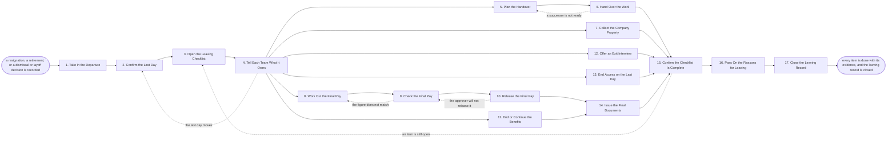

# Reference process: Offboard a Leaver

`ref/hr/offboard-a-leaver v1`

**value stream:** [Leaving the company](../../streams/human-resources/leaving-the-company.md)
An employee is leaving, through a resignation, a retirement, a dismissal
or a layoff, and everything around the departure has to be finished on
time. Once a named person has confirmed the last day, the
separation-coordinator agent opens one leaving checklist across pay,
benefits, access, property and work, and tells each team only what its own
step needs, so payroll, benefits and IT never see why the person is
leaving. The handover-coordinator agent passes the leaver's work, contacts
and open commitments to named successors. The payroll-administrator agent
works out the final pay under `<your jurisdiction's rule on final pay>`, a
finance controller checks it, and a named approver releases it. The
benefits-administrator agent ends or continues each benefit and sends the
continuation notices, and the tool-administrator agent closes every
account at the end of the last day. The leaver is offered an exit
interview and may decline it. The run closes when every item on the
checklist is done with its evidence, the final documents are signed and
issued, and the leaving record is closed.

**delivers:** status board, a leaving checklist

## The goals

- Close every account within [1 hour] of the end of the last day
- Hand over [95%] of open work before access ends
- Release final pay on the day it is due for [100%] of leavers
- Hear the reasons of [60%] of leavers who resign

## The activities

| # | Activity | What happens | Agents |
|---|---|---|---|
| 1 | Take in the Departure | who leaves, by resignation, retirement or recorded decision | [separation-coordinator](../../agents/separation-coordinator.md) |
| 2 | Confirm the Last Day | the last day and the notice, set by the contract and policy | HR business partner (person) · manager (person) |
| 3 | Open the Leaving Checklist | every item across pay, benefits, access, property and work | separation-coordinator |
| 4 | Tell Each Team What It Owns | the last day and each team's items, with the reason withheld | separation-coordinator |
| 5 | Plan the Handover | work, contacts and open commitments, each with a successor | [handover-coordinator](../../agents/handover-coordinator.md) · manager (person) |
| 6 | Hand Over the Work | each item walked through and acknowledged by its successor | handover-coordinator · leaver (person) |
| 7 | Collect the Company Property | each device, card, key and file returned or recorded missing | separation-coordinator · leaver (person) |
| 8 | Work Out the Final Pay | pay to the last day, unused leave and each deduction | [payroll-administrator](../../agents/payroll-administrator.md) |
| 9 | Check the Final Pay | the figure checked against the record and the last period | finance controller (person) · payroll-administrator |
| 10 | Release the Final Pay | a named approver releases it on the day it is due | payroll approver (person) |
| 11 | End or Continue the Benefits | end dates to the carriers and the continuation notices sent | [benefits-administrator](../../agents/benefits-administrator.md) |
| 12 | Offer an Exit Interview | a conversation the leaver may accept or decline | separation-coordinator · HR business partner (person) |
| 13 | End Access on the Last Day | every account and badge closed at the end of the last day | [tool-administrator](../../agents/tool-administrator.md) |
| 14 | Issue the Final Documents | the final payslip, an employment letter and required notices | separation-coordinator · HR business partner (person) |
| 15 | Confirm the Checklist Is Complete | every item done with its evidence | separation-coordinator · HR business partner (person) |
| 16 | Pass On the Reasons for Leaving | the reasons, with names taken out, to the workforce report | separation-coordinator |
| 17 | Close the Leaving Record | the file closed and kept for the retention period | separation-coordinator |

A dismissal arrives here from `ref/hr/dismiss-an-employee` and a layoff
from `ref/hr/run-a-layoff`, each with its decision already recorded, and
any separation terms are agreed at `ref/hr/negotiate-a-separation-agreement`
and handed to this run. Final pay that falls due on the regular payday is
carried in `ref/hr/run-payroll`, and final pay that falls due sooner under
`<your jurisdiction's rule on final pay>` goes in a pay run of its own,
checked and released by the same people. An outside payroll provider may
hold the payroll-administrator role for the company, and the roster says
which.

## The graph



## The document, with the blanks marked

```
PROCESS: offboard a leaver            id: <team>/offboard-a-leaver   v1
from: ref/hr/offboard-a-leaver v1
owner: <who>                          effective: <date>
trigger: <your HR business partner role> records a resignation, a
         retirement, or a dismissal or layoff decision with a proposed
         last day in <your HR system>
         watch: record=<employee departure> system=<your HR system>
                change=<a departure is recorded with a proposed last day>
concurrency: runs may overlap - one leaver is one run, any number of
             leavers may be in flight at once, a layoff opens one run for
             each person affected, and one person has one leaving run at
             a time
goal: every account closed at the end of the last day, final pay released
      on the day <your jurisdiction's rule on final pay> sets, every item
      on the leaving checklist done with its evidence, and the leaving
      record closed within <days> of the last day
phases:
  take-in-departure    - system: the departure lands with its kind, the
                         person, the manager, the proposed last day, and
                         the resignation letter or the recorded decision
                         it rests on
                         owner: separation-coordinator   after: trigger
                         automation: <level>
  confirm-last-day     - convenes approval: the last day and the notice
                         confirmed under the employment contract, <your
                         leaving policy> and <your jurisdiction's rules on
                         notice>, with whether the notice is worked or
                         paid decided by a named person, and the last day
                         entered on the employee's record through
                         ref/hr/change-an-employee-record
                         owner: <your HR business partner role>
                         after: take-in-departure   by: <days>
                         automation: never
  open-checklist       - runs collect-and-report: every item the departure
                         needs across pay, benefits, access, property and
                         work, listed once with one owner and one date,
                         counted from the last day
                         owner: separation-coordinator
                         after: confirm-last-day    automation: <level>
  tell-teams           - human: payroll, benefits, IT and facilities each
                         told the last day and the items they own, with
                         only the personal data their step needs, and the
                         reason for leaving withheld from all of them
                         owner: separation-coordinator
                         after: open-checklist      automation: <level>
  plan-handover        - human: the leaver's work, contacts, open
                         commitments and shared files listed, each with a
                         named successor the manager chooses
                         owner: handover-coordinator
                         after: tell-teams          automation: <level>
  hand-over-work       - convenes briefing: each item walked through with
                         its successor before the last day, the shared
                         files moved to the successor, and the
                         successor's acknowledgment recorded against it
                         owner: handover-coordinator
                         after: plan-handover       by: <the last day>
                         automation: <level>
  collect-property     - runs roll-call: every device, card, key and
                         company document the asset register shows for
                         the leaver, returned and checked in, or recorded
                         as missing
                         owner: separation-coordinator
                         after: tell-teams          by: <the last day>
                         every: <cadence>           automation: <level>
  work-out-final-pay   - runs allocate-and-reconcile: pay to the last day,
                         any notice paid in place of being worked, unused
                         leave, and each deduction, worked out under <your
                         jurisdiction's rule on final pay> and <your
                         jurisdiction's tax and deduction rules>
                         owner: payroll-administrator
                         after: tell-teams          automation: <level>
  check-final-pay      - runs assessment: the final pay checked against the
                         employee's record, the last period's pay and the
                         rule, by someone other than whoever worked it out
                         owner: <your finance controller role>
                         after: work-out-final-pay  automation: <level>
  release-final-pay    - convenes approval: <your payroll approver role>
                         releases the final pay as a named person on the
                         day <your jurisdiction's rule on final pay> sets,
                         in the regular pay run or in one of its own
                         owner: <your payroll approver role>
                         after: check-final-pay
                         by: <the day the rule sets>
                         automation: never
  settle-benefits      - system: each benefit's end date sent to its
                         carrier and to payroll, and the continuation
                         notices <your jurisdiction's rule on benefit
                         continuation> requires sent to the leaver by
                         their deadline
                         owner: benefits-administrator
                         after: tell-teams          automation: <level>
  offer-exit-interview - human: an exit interview offered to the leaver as
                         a choice they may decline, held by <your HR
                         business partner role> before the last day, and
                         the reasons given recorded with the leaver's
                         agreement
                         owner: separation-coordinator
                         after: tell-teams          automation: <level>
  end-access           - system: every account, badge and remote access
                         the leaver holds closed at the end of the last
                         day, or at the time a named person sets for a
                         dismissal or a layoff
                         owner: tool-administrator
                         after: tell-teams
                         by: <the end of the last day>
                         automation: <level>
  issue-documents      - convenes approval: the final pay statement, a
                         letter confirming the dates of employment and the
                         job held, and the notices <your jurisdiction's
                         rules on leaving documents> require, drafted by
                         separation-coordinator and signed by <your HR
                         business partner role>
                         owner: <your HR business partner role>
                         after: release-final-pay + settle-benefits
                         by: <days>                 automation: never
  confirm-complete     - runs assessment: every item on the checklist done
                         with its evidence, the handover acknowledged, the
                         property returned or recorded missing, the
                         documents issued and no account left open
                         owner: separation-coordinator
                         after: hand-over-work + collect-property +
                         offer-exit-interview + end-access +
                         issue-documents            automation: <level>
  pass-on-reasons      - human: the reasons the leaver gave, with the name
                         and anything else that could identify the leaver
                         taken out, passed to ref/hr/report-on-the-workforce
                         owner: separation-coordinator
                         after: confirm-complete    automation: <level>
  close-record         - convenes debrief: the leaving file closed and kept
                         for <your jurisdiction's record retention
                         period>, and what slowed the run or went wrong
                         written down for the next one
                         owner: separation-coordinator
                         after: pass-on-reasons     automation: <level>
run-scoped:
  checklist - runs roll-call                  owner: separation-coordinator
              every: <cadence>
              from: open-checklist  until: confirm-complete
  access    - runs assessment                 owner: tool-administrator
              every: <cadence>
              from: end-access      until: run close
handoffs:
  take-in-departure -> confirm-last-day [departure]: the kind of
    departure, the person, the manager, the proposed last day, and the
    letter or decision it rests on
  confirm-last-day -> open-checklist [confirmed-last-day]: the last day,
    the notice, whether it is worked or paid, and who confirmed it
  open-checklist -> tell-teams [leaving-checklist]: every item with its
    owner and its date, counted from the last day
  tell-teams -> plan-handover / collect-property / work-out-final-pay /
    settle-benefits / offer-exit-interview / end-access [team-items]: each
    team's items and the last day, with the reason for leaving withheld
  plan-handover -> hand-over-work [handover-plan]: each item of work,
    each contact and each open commitment, with its named successor
  hand-over-work -> confirm-complete [handover-acknowledged]: each item
    acknowledged by its successor, or passed to the manager when it is
    still open on the last day
  collect-property -> confirm-complete [property-record]: each item
    returned and checked in, or recorded as missing with what was done
  work-out-final-pay -> check-final-pay [final-pay]: each line of the
    final pay with the rule and the record it comes from
  check-final-pay -> release-final-pay [checked-final-pay]: the final pay
    as the finance controller checked it, with the name of the checker
  release-final-pay -> issue-documents [final-pay-released]: the payment,
    its reference, its date and the person who released it
  settle-benefits -> issue-documents [benefits-settled]: each benefit's
    end date or continuation, and each notice sent with its date
  offer-exit-interview -> confirm-complete [exit-interview]: held or
    declined, and the reasons given, recorded with the leaver's agreement
  end-access -> confirm-complete [access-ended]: each account and badge
    closed, with the time it closed
  issue-documents -> confirm-complete [final-documents]: each signed
    document, the date it was sent and how it was sent
  confirm-complete -> pass-on-reasons [completed-checklist]: every item
    done with its evidence
  pass-on-reasons -> close-record [reasons-passed-on]: the reasons as
    they went to the workforce report, with nothing that names the leaver
deviations:
  tell-teams -> confirm-last-day [last-day-moves]: the last day moves, so
    it is confirmed again and every item counted from it moves with it
  hand-over-work -> plan-handover [successor-not-ready]: a successor is
    not named or will not acknowledge an item, so the manager names
    another
  check-final-pay -> work-out-final-pay [final-pay-does-not-match]: the
    figure does not match the record or the rule, so it is worked out
    again with the lines that differ named
  release-final-pay -> check-final-pay [approver-will-not-release]: the
    approver will not release the payment, so it is checked again on the
    lines the approver named
  confirm-complete -> open-checklist [item-still-open]: an item is open or
    has no evidence, so it goes back on the checklist with its owner and a
    new date
bindings:
  roster:  <who holds each role - agents claiming the abstract agents
           above, or the outside payroll provider where it holds
           payroll-administrator for the company, and named people for
           the HR business partner, the manager, the finance controller
           and the payroll approver>
  systems: the HR system (write), the payroll system (write), the
           benefits administration system (write), the identity and
           access system (write), the asset register (write), the
           document store (write), the notification channel (write)
  data:    the employment contract, <your leaving policy> <version>,
           <your jurisdiction's rule on final pay>, <your jurisdiction's
           rule on benefit continuation>, <your record retention
           schedule> <version>, <your exit interview questions>
           <version>
policy:
  each team sees only the last day and the items it owns, and the reason
    for leaving is seen only by the people <your leaving policy> names
  every account ends at the end of the last day, or at the time a named
    person sets for a dismissal or a layoff, whether or not the handover
    is finished
  final pay is released only by <your payroll approver role> after the
    finance check, and an agent never releases money
  nothing is held back from final pay for property that was not returned
    unless <your jurisdiction's rule on deductions> allows it and the
    leaver has agreed in writing
  the exit interview is a choice the leaver may decline, and what the
    leaver says reaches the workforce report only without names and for
    groups of at least <the minimum group size>
  health, investigation and background check records stay where they are
    held, and this process reads only the outcome it needs, such as the
    end date of a leave
  every letter to the leaver is signed by a named person
measures:
  cycle time: <days> from the confirmed last day to the closed record
  on time: <target> share of final pay released on the day it is due
  volume: <leavers per period>
  quality gate: every account closed by the end of the last day, and
                every item on the checklist done with its evidence
```

## The failure edges

- **The last day moves.** The leaver and the manager agree a new date, or
  a named person moves it. The separation-coordinator agent confirms the
  new date and moves every item counted from it, and payroll, benefits
  and IT hear the new date on the same day.
- **A successor is not ready.** No successor has been named, or a
  successor will not acknowledge an item. The manager names another, and
  any item still open on the last day passes to the manager, so no work
  is left without an owner when access ends.
- **Property is not returned.** The separation-coordinator agent records
  each missing item, and the leaver is asked in writing to return it by a
  date. A named person decides what follows. Nothing is held back from
  final pay unless the local rule allows it and the leaver has agreed in
  writing.
- **The final pay does not match.** The finance controller names each
  line that differs, and the payroll-administrator agent works it out
  again. When the delay would make the payment late under the local rule,
  the payroll approver and the head of HR decide whether to pay the part
  nobody questions on time and the rest once it is checked.
- **An account is still open after the last day.** The access check
  finds it, and the tool-administrator agent closes it at once. The HR
  business partner reports it to `<your security lead role>` with the
  dates it was open and what it was used for.
- **The leaver withdraws a resignation.** A named person decides whether
  to accept the withdrawal. When they accept it, the run is abandoned.
  When they decline it, the run goes on to the last day already
  confirmed.
- **The trigger fires while a run is in flight.** One person has one
  leaving run at a time. A second departure record for the same person,
  such as a resignation that arrives while a dismissal is under way,
  joins the open run, and the HR business partner decides with counsel
  which record the departure rests on.
- **A run is abandoned.** The employee stays. Every team hears the same
  day, any account already closed is opened again at a named person's
  request, property is given back, any final pay already released is
  recovered only as `<your jurisdiction's rules on recovering
  overpayments>` allow, and the departure is taken off the employee's
  record.
