# Reference process: Open a Position

`ref/hr/open-a-position v1`

**value stream:** [Workforce planning](../../streams/human-resources/workforce-planning.md)
A manager asks for a new position, or for a replacement when a position
will be empty. The workforce-planner agent checks the request against the
approved workforce plan and the team's budget, and the hiring manager
describes the job from the work it does. The compensation-analyst agent
places the job at a level in the company's job framework and sets the pay
range the company keeps for that level and location. A position the plan
does not hold needs a trade or a named extra cost before anyone signs. The
named approvers, such as the department head, the finance lead and the
human resources (HR) business partner, then sign the position or decline
it with a reason. Nobody is approached about the job before every
approver has signed. The run closes when a signed position is on the plan
and with the recruiter, or when the hiring manager has heard why it was
declined.

**delivers:** document, an approved position

## The goals

- Decide each request within [5 working days]
- Open [95%] of positions inside the approved plan
- Change the level of [fewer than 5%] of positions after signing
- Hold each position's cost within [its budget line]

## The activities

| # | Activity | What happens | Agents |
|---|---|---|---|
| 1 | Take in the Request | the role, the team, the reason and the start date wanted | [workforce-planner](../../agents/workforce-planner.md) · hiring manager (person) |
| 2 | Check the Request Is Complete | the work, the reason, and whether it is new or a replacement | workforce-planner |
| 3 | Check the Request against the Plan | whether the plan holds this position, or one it replaces | workforce-planner |
| 4 | Describe the Job | the purpose, the main duties and the must-haves | hiring manager (person) · HR business partner (person) |
| 5 | Place the Job at a Level | the level in the job framework, matched on the work | [compensation-analyst](../../agents/compensation-analyst.md) |
| 6 | Set the Pay Range | the range for the level and the location, from market data | compensation-analyst |
| 7 | Cost the Position | the full cost for the rest of the year and a full year | workforce-planner |
| 8 | Check the Budget | the cost against the team's budget line | workforce-planner · finance lead (person) |
| 9 | Propose a Trade for an Unplanned Position | the planned position it replaces, or the extra cost | department head (person) · workforce-planner |
| 10 | Approve the Position | each named approver signs, or declines with a reason | department head (person) · finance lead (person) · HR business partner (person) |
| 11 | Record the Position on the Plan | the position with its level, range and budget line | workforce-planner |
| 12 | Tell the Hiring Manager | the answer, the level, the range and the next step | HR business partner (person) · workforce-planner |
| 13 | Hand the Position to Hiring | the signed position to the recruiter | workforce-planner · recruiter (person) |
| 14 | Close the Request | how long it took, and what changed on the way | workforce-planner |

The position is filled elsewhere. The recruiter takes it into
`ref/hr/plan-the-hire`, an employee who wants it applies through
`ref/hr/move-an-employee-to-a-new-role`, and the range set here bounds the
offer at `ref/hr/make-an-offer`. The compensation-analyst agent proposes
the level and the range, and the approvers decide both when they sign the
position.

## The graph

```mermaid
flowchart LR
  T([a manager asks for a new or replacement position, or hiring sends a signed position back]) --> A1[1. Take in the Request]
  A1 --> A2[2. Check the Request Is Complete]
  A2 -. the request is missing what the approvers need .-> A1
  A2 --> A3[3. Check the Request against the Plan]
  A3 --> A4[4. Describe the Job]
  A4 --> A5[5. Place the Job at a Level]
  A5 -. the job fits no level .-> A4
  A5 --> A6[6. Set the Pay Range]
  A6 --> A7[7. Cost the Position]
  A7 --> A8[8. Check the Budget]
  A8 -. the position is outside the plan or the budget .-> A9[9. Propose a Trade for an Unplanned Position]
  A8 --> A10[10. Approve the Position]
  A9 --> A10
  A10 -. an approver asks for a change .-> A4
  A10 -. an approver declines .-> A12[12. Tell the Hiring Manager]
  A10 --> A11[11. Record the Position on the Plan]
  A11 --> A12
  A12 --> A13[13. Hand the Position to Hiring]
  A12 -. the position was declined .-> A14[14. Close the Request]
  A13 --> A14
  A14 --> DONE([the position is signed and with the recruiter, or declined with its reason])
```



## The document, with the blanks marked

```
PROCESS: open a position              id: <team>/open-a-position   v1
from: ref/hr/open-a-position v1
owner: <who>                          effective: <date>
trigger: a manager submits a request for a new position, or for a
         replacement when a position will be empty, in <your HR system>,
         or ref/hr/plan-the-hire or ref/hr/make-an-offer sends a signed
         position back to be approved at a different level or range
         watch: record=<position request> system=<your HR system>
                change=<a position request is submitted or sent back>
concurrency: runs may overlap freely - one position is one run, and a
             second request for the same planned position joins the run
             already open
goal: every request signed or declined by its named approvers within
      <days>, and every signed position handed to the recruiter with its
      level, its pay range and its budget line
phases:
  take-in-request  - system: the request lands from the manager, or a
                     signed position comes back from hiring with the
                     reason, with the team, the role, whether it is new
                     or replaces a position that will be empty, and the
                     start date wanted
                     owner: workforce-planner   after: trigger
                     automation: <level>
  check-complete   - runs assessment: the request read for what the
                     approvers need, such as the work the role will do,
                     the target in the business plan it serves, and for
                     a replacement the position it replaces
                     owner: workforce-planner   after: take-in-request
                     automation: <level>
  check-plan       - runs assessment: whether the approved workforce plan
                     holds this position for the team, at what level and
                     from what date, or holds the position it replaces
                     owner: workforce-planner   after: check-complete
                     automation: <level>
  describe-job     - human: the purpose of the job, its main duties, and
                     the must-haves a person needs on the first day,
                     written from the work on
                     <your job description template>
                     owner: <your hiring manager role>
                     after: check-plan          automation: <level>
  place-level      - runs assessment: the job placed at a level in
                     <your job framework> by matching its duties and
                     must-haves to the level descriptions, with the
                     nearest jobs already at that level named
                     owner: compensation-analyst   after: describe-job
                     automation: <level>
  set-range        - runs assessment: the pay range kept for the level in
                     the job's location, read from
                     <your pay range record> with the date of the market
                     data behind it
                     owner: compensation-analyst   after: place-level
                     automation: <level>
  cost-position    - runs assessment: the full cost of the position at
                     the middle of its range, with benefits and the
                     employer's taxes on pay, for the months left in the
                     year and for a full year
                     owner: workforce-planner   after: set-range
                     automation: <level>
  check-budget     - runs assessment: the cost set beside the team's
                     budget line for labor cost, and the position marked
                     inside or outside the plan and the budget
                     owner: workforce-planner   after: cost-position
                     automation: <level>
  propose-trade    - human: for a position outside the plan or the
                     budget, the planned position it replaces or the
                     extra cost the team asks for, and the target in the
                     business plan that needs it
                     owner: <your department head role>
                     after: check-budget, when the position is outside
                     the plan or the budget     automation: <level>
  approve-position - convenes approval: each named approver under
                     <your approval rules for positions>, such as the
                     department head, the finance lead and the HR
                     business partner, signs the position with its
                     level, range and budget line, or declines it with a
                     reason
                     owner: <your department head role>
                     after: check-budget, and propose-trade when one ran
                     by: <days>                 automation: never
  record-position  - system: the signed position written to the workforce
                     plan and <your HR system> with its level, its
                     range, its budget line and the names of those who
                     signed
                     owner: workforce-planner   after: approve-position
                     automation: <level>
  tell-manager     - human: the hiring manager told the answer, with the
                     level, the range and the next step for a signed
                     position, or the reason for a declined one
                     owner: <your HR business partner role>
                     after: record-position, or approve-position when
                     the position was declined  automation: <level>
  hand-to-hiring   - convenes briefing: the signed position, the job, the
                     level and the range handed to the recruiter in
                     <your applicant tracking system> to start
                     ref/hr/plan-the-hire
                     owner: workforce-planner
                     after: tell-manager, when the position was signed
                     automation: <level>
  close-request    - convenes debrief: how long the request took, what
                     changed between the request and the signatures, and
                     any exception the plan should carry next time
                     owner: workforce-planner
                     after: hand-to-hiring, or tell-manager when the
                     position was declined      automation: <level>
run-scoped:
  clock - runs roll-call                     owner: workforce-planner
          every: <cadence>
          from: take-in-request  until: approve-position
handoffs:
  take-in-request -> check-complete [position-request]: the team, the
    role, new or replacement, the reason and the start date wanted
  check-complete -> check-plan [complete-request]: the request with
    everything the approvers need, and the target it serves
  check-plan -> describe-job [plan-reading]: whether the plan holds the
    position, at what level and from what date
  describe-job -> place-level [job-description]: the purpose, the main
    duties and the must-haves, at a version
  place-level -> set-range [job-level]: the level, the level description
    it matched and the nearest jobs at that level
  set-range -> cost-position [pay-range]: the range for the level and the
    location, and the date of its market data
  cost-position -> check-budget [position-cost]: the cost for the rest of
    the year and for a full year, and what it includes
  check-budget -> approve-position [budget-check]: the cost against the
    budget line, and the position marked inside or outside the plan and
    the budget
  propose-trade -> approve-position [proposed-trade]: the planned
    position traded or the extra cost asked for, with the target it serves
  approve-position -> record-position [signed-position]: the position as
    signed, with each approver's name and date. A change to the level,
    the range or the budget line voids the signatures
  record-position -> tell-manager [recorded-position]: the position on
    the plan and in the HR system, at a version
  tell-manager -> hand-to-hiring [manager-told]: the answer as the hiring
    manager heard it, and the date
  hand-to-hiring -> close-request [position-with-recruiter]: the
    position, the job, the level and the range in the applicant tracking
    system, and the recruiter who holds it
deviations:
  check-complete -> take-in-request [request-incomplete]: the request is
    missing what the approvers need, so it goes back to the manager with
    each gap named
  place-level -> describe-job [job-fits-no-level]: the job matches no
    level, or spans two, so it is described again with the hiring
    manager, or the compensation lead decides whether the framework needs
    a new job
  check-budget -> propose-trade [outside-plan-or-budget]: the position is
    outside the plan or over the budget line, so the department head
    proposes a trade or names the extra cost before any approver sees it
  approve-position -> describe-job [approver-asks-for-change]: an
    approver asks for a change to the job, the level or the range, so it
    is described again and every signature already given is voided
  approve-position -> tell-manager [position-declined]: an approver
    declines, so the hiring manager hears the reason and the request
    closes
bindings:
  roster:  <who holds each role - agents claiming the abstract agents
           above, and named people for the hiring manager, the
           department head, the finance lead, the HR business partner,
           the compensation lead and the recruiter>
  systems: <your HR system> (write), the workforce plan (write),
           <your job framework> (read), <your pay range record> (read),
           <your financial planning system> (read),
           <your applicant tracking system> (write), the notification
           channel (write)
  data:    the approved workforce plan <version>, <your job framework>
           <version>, the pay ranges <version>,
           <your approval rules for positions> <version>,
           <your job description template> <version>, the labor cost
           budget <version>
policy:
  nobody inside or outside the company is approached about a position
    before every named approver has signed it
  every position carries a level and a pay range before it is signed,
    and the range is the one kept for that level and location
  a position outside the approved plan is signed only with the trade or
    the extra cost named, and by <who> as well as the usual approvers
  the request and the job describe the work, and they never name or
    describe a person the company hopes to hire
  a replacement request names the position, and the reason its last
    holder left stays in that person's record
  no step reads a protected characteristic of anyone, and every
    must-have is something a person can show
  the approvers decide, and an agent never signs or declines a position
  a change to the level, the range or the budget line after signing
    voids the signatures
measures:
  cycle time: <days> from the request to the decision
  inside the plan: <target> share of positions opened inside the
                   approved plan
  volume: <position requests per period>
  quality gate: every signed position carries a level, a range, a budget
                line and the signature of every named approver
```

## The failure edges

- **The request is incomplete.** The request goes back to the manager with
  each gap named. The clock for a decision starts again when the complete
  request comes back, and the manager sees the date it started.
- **The job fits no level.** The compensation-analyst agent names the
  nearest levels and the duties that do not match them. The hiring manager
  describes the job again, or the compensation lead decides whether the
  framework needs a new job. A level is never chosen to make a range fit a
  person someone already has in mind.
- **The position is outside the plan or the budget.** The department head
  proposes a planned position to trade, or names the extra cost and the
  target it serves. The approvers see the trade beside the plan, and the
  extra approver that `<your approval rules for positions>` name for an
  unplanned position signs as well.
- **The range is out of step with the market.** The compensation-analyst
  agent shows the date of the market data behind the range and the size of
  the gap. The approvers sign at the range as it stands or ask the
  compensation lead to review it, and a range changes only through
  `ref/hr/run-the-pay-review` or by the compensation lead with a recorded
  reason.
- **An approver asks for a change.** The job is described again, every
  signature already given is voided, and the position goes round the
  approvers again so that each one signs the same version.
- **An approver declines.** The hiring manager hears the reason from the
  HR business partner. The request closes with the reason recorded, and a
  new request for the same work is a new run that answers that reason.
- **The hiring manager already has a person in mind.** The request still
  describes the work and names nobody. That person applies through
  `ref/hr/plan-the-hire` or `ref/hr/move-an-employee-to-a-new-role` and is
  assessed on the same must-haves as everyone else.
- **A signed position comes back from hiring.** The must-haves agreed at
  `ref/hr/plan-the-hire`, or the terms asked at `ref/hr/make-an-offer`,
  need a different level or range from the one signed. The position comes
  back as a new request with that reason, its signatures are voided, and
  recruiting waits until the approvers sign the new version.
- **The trigger fires while a run is in flight.** A second request for the
  same planned position joins the run already open, and the two managers
  agree one request. A request for a different position in the same team
  is its own run, and each run reads the budget the other has used.
- **A run is abandoned.** The manager withdraws the request, or the plan
  changes under it. The request closes with its reason, any signature
  already given is voided, and the position stays on the plan as it was.
  Nobody has been approached, because nobody is approached before the
  signatures.
