# Reference process: Plan Succession for Key Roles

`ref/hr/plan-succession-for-key-roles v1`

**value stream:** [Performance and development](../../streams/human-resources/performance-and-development.md)
Once a year, or when the holder of a key role gives notice, the leaders
review the roles whose loss would hurt the company most. The
workforce-planner agent lists the key roles from the workforce plan for
the executive team to confirm, and the leader over each role writes down
what a successor must bring to it. The career-planner agent asks each
manager to record who could step into each role and how ready each one
is, with the evidence of the work behind each view, reads the career
interest each named person wrote in their own development plan, and
prepares the review pack. The decision-coordinator agent sends the pack
ahead and runs the succession review, where the leaders agree the
possible successors and their readiness for each role, and it records
what was agreed and who disagreed. Each gap then becomes a development
action in a successor's plan, agreed with that person, or a hiring need
in the workforce plan. The run closes when every key role has its
possible successors named with their readiness, or its gap named with an
action, an owner and a date, and the next review is set.

**delivers:** shortlist, successors for each key role

**starts:** on a schedule, the yearly review falls due, or the holder of a key role gives notice

## The goals

- Name a ready-now successor for [60%] of key roles
- Fill [70%] of key roles that open from the named successors
- See [85%] of successors who step in meet expectations at their first review
- Give every gap an action with an owner and a date within [30 days] of the review

## The activities

| # | Activity | What happens | Agents |
|---|---|---|---|
| 1 | Open the Succession Review | the date, the leaders taking part and the readiness scale | head of HR (person) · [decision-coordinator](../../agents/decision-coordinator.md) |
| 2 | List the Key Roles | roles whose loss would hurt most, from the workforce plan | [workforce-planner](../../agents/workforce-planner.md) · executive team (person) |
| 3 | Write What Each Key Role Needs | the experience and skills a successor must bring | leader over the role (person) |
| 4 | Ask Managers for Possible Successors | each manager asked who could step into each role | [career-planner](../../agents/career-planner.md) · manager (person) |
| 5 | Record Readiness with Its Evidence | each person named, how ready, and the work behind the view | manager (person) · career-planner |
| 6 | Read Each Person's Career Interest | what each named person wrote in their development plan | career-planner |
| 7 | Prepare the Review Pack | each role, its possible successors, their readiness and gaps | career-planner |
| 8 | Send the Pack Ahead | the leaders read the pack before the review | decision-coordinator |
| 9 | Hold the Succession Review | the leaders agree each role's successors and their readiness | executive team (person) · head of HR (person) · decision-coordinator |
| 10 | Record the Succession Plan | each role, its successors, their readiness and any dissent | decision-coordinator |
| 11 | Name the Roles with No Ready Successor | each gap, and each development need behind a readiness view | career-planner |
| 12 | Add Development Actions | each successor's actions, agreed with them, in their plan | career-planner · manager (person) · employee (person) |
| 13 | Add Hiring Needs to the Workforce Plan | roles with no internal successor become hiring needs | workforce-planner · head of HR (person) |
| 14 | Set the Next Review | the date the plan comes back up, and what brings it forward | decision-coordinator |
| 15 | Record What the Review Taught | which roles lacked successors, and why | decision-coordinator |

A hiring need added here is approved through `ref/hr/plan-the-workforce`
or `ref/hr/open-a-position`. When a key role opens, it is
filled through `ref/hr/move-an-employee-to-a-new-role` or the Hiring
processes, on the same criteria as any other candidate, and a name on
this plan promises nobody the role.

## The graph

```mermaid
flowchart LR
  T([the yearly review falls due, or the holder of a key role gives notice]) --> A1[1. Open the Succession Review]
  A1 --> A2[2. List the Key Roles]
  A2 --> A3[3. Write What Each Key Role Needs]
  A3 --> A4[4. Ask Managers for Possible Successors]
  A4 --> A5[5. Record Readiness with Its Evidence]
  A5 --> A6[6. Read Each Person's Career Interest]
  A6 --> A7[7. Prepare the Review Pack]
  A7 -. a readiness view has no evidence behind it .-> A5
  A7 --> A8[8. Send the Pack Ahead]
  A8 --> A9[9. Hold the Succession Review]
  A9 -. the leaders cannot agree a readiness on the evidence .-> A5
  A9 --> A10[10. Record the Succession Plan]
  A10 --> A11[11. Name the Roles with No Ready Successor]
  A11 --> A12[12. Add Development Actions]
  A11 --> A13[13. Add Hiring Needs to the Workforce Plan]
  A12 --> A14[14. Set the Next Review]
  A13 --> A14
  A14 --> A15[15. Record What the Review Taught]
  A15 --> DONE([every key role has its successors and their readiness agreed, or its gap named with an action])
```



## The document, with the blanks marked

```
PROCESS: plan succession   id: <team>/plan-succession-for-key-roles   v1
from: ref/hr/plan-succession-for-key-roles v1
owner: <who>                          effective: <date>
trigger: the yearly review falls due on <your succession calendar>, or
         the holder of a key role gives notice, or <who> asks for one
         role to be reviewed, in <your HR system>
         watch: record=<succession review> system=<your HR system>
                change=<the review falls due, or the holder of a key
                role gives notice>
concurrency: one company-wide review a year - a review of a single role
             whose holder has given notice runs alongside it and starts
             from the last version of the plan
goal: every key role has its possible successors and their readiness
      agreed by the leaders, with the evidence of the work behind each
      view, or its gap named with a development action or a hiring
      need that has an owner and a date, and the next review is set
      for <date>
phases:
  open-review             - convenes briefing: the review's date, the
                            leaders taking part, the roles in scope and
                            the readiness scale at a version, sent to
                            every leader and manager who will record a
                            view
                            owner: decision-coordinator
                            after: trigger            automation: <level>
  list-key-roles          - runs collect-and-report: the roles whose loss
                            would hurt the company most, read from the
                            workforce plan with each role's holder and
                            team, for the executive team to confirm
                            owner: workforce-planner
                            after: open-review        automation: <level>
  write-role-needs        - human: the experience, skills and knowledge a
                            successor must bring to each key role,
                            written by the leader over the role at a
                            version
                            owner: <your executive role>
                            after: list-key-roles     by: <days>
                            automation: <level>
  ask-for-successors      - runs collect-and-report: each manager asked
                            to name the people who could step into each
                            key role, with the role's needs and the
                            readiness scale
                            owner: career-planner
                            after: write-role-needs   by: <days>
                            automation: <level>
  record-readiness        - human: each possible successor named with a
                            readiness on <your readiness scale>, such as
                            ready now, ready within <time> or ready
                            later, and the evidence of the work behind
                            each view
                            owner: <your manager role>
                            after: ask-for-successors
                            automation: never
  read-interest           - runs collect-and-report: the career interest
                            each named person wrote in their own
                            development plan, read for the roles they are
                            named for
                            owner: career-planner
                            after: record-readiness   automation: <level>
  prepare-pack            - runs collect-and-report: each key role, its
                            needs, its possible successors with their
                            readiness, evidence and stated interest, and
                            the roles with no successor, with no pay,
                            health, leave, case record or protected
                            characteristic in it
                            owner: career-planner
                            after: read-interest      automation: <level>
  send-pack               - convenes briefing: the pack sent to every
                            leader <days> before the review, held where
                            only <the named leaders> can open it
                            owner: decision-coordinator
                            after: prepare-pack       automation: <level>
  hold-review             - convenes decide-and-announce: the leaders go
                            through each key role, question the readiness
                            views, and agree the possible successors and
                            their readiness for each
                            owner: <your succession review chair role>
                            after: send-pack          by: <days>
                            automation: never
  record-plan             - runs collect-and-report: the succession plan
                            at a version, each role with its agreed
                            successors, their readiness and any dissent,
                            confirmed by the chair
                            owner: decision-coordinator
                            after: hold-review        automation: <level>
  name-gaps               - runs assessment: each key role with no
                            successor ready within <time>, and each
                            successor whose readiness waits on a named
                            development need
                            owner: career-planner
                            after: record-plan        automation: <level>
  add-development-actions - human: each successor's development actions,
                            agreed with the person and the manager and
                            added to the person's development plan with
                            an owner and a date
                            owner: career-planner
                            after: name-gaps          automation: <level>
  add-hiring-needs        - human: each role with no internal successor
                            added to the workforce plan as a hiring need
                            with its date, for approval through
                            ref/hr/plan-the-workforce or
                            ref/hr/open-a-position
                            owner: workforce-planner
                            after: name-gaps          automation: <level>
  set-next-review         - system: the date the plan comes back up, and
                            the events that bring it forward, such as the
                            holder of a key role giving notice
                            owner: decision-coordinator
                            after: add-development-actions +
                            add-hiring-needs          automation: <level>
  record-learning         - convenes debrief: which roles had no
                            successor and why, which readiness views the
                            leaders changed, how past successors did when
                            they stepped in, and what the next review
                            does differently
                            owner: decision-coordinator
                            after: set-next-review    automation: <level>
run-scoped:
  clock - runs roll-call                     owner: decision-coordinator
          every: <cadence>
          from: open-review     until: hold-review
handoffs:
  open-review -> list-key-roles [review-plan]: the date, the leaders,
    the roles in scope and the readiness scale
  list-key-roles -> write-role-needs [key-roles]: each key role, its
    holder and its team, as the executive team confirmed them
  write-role-needs -> ask-for-successors [role-needs]: what a successor
    must bring to each role, at a version
  ask-for-successors -> record-readiness [successor-request]: the roles
    each manager is asked about, with their needs and the scale
  record-readiness -> read-interest [readiness-views]: each person named,
    the readiness and the evidence behind it
  read-interest -> prepare-pack [stated-interest]: the career interest
    each named person recorded, as they wrote it
  prepare-pack -> send-pack [review-pack]: every key role with its
    successors, their readiness and evidence, and the gaps
  send-pack -> hold-review [pack-sent]: the pack, and the date each
    leader received it
  hold-review -> record-plan [agreed-successors]: each role's successors
    and their readiness as the leaders agreed them, and any dissent
  record-plan -> name-gaps [succession-plan]: the plan at a version,
    confirmed by the chair
  name-gaps -> add-development-actions / add-hiring-needs
    [succession-gaps]: each role with no ready successor, and each
    development need behind a readiness view
  add-development-actions -> set-next-review [development-actions]: each
    action with its owner and date, and the person's agreement
  add-hiring-needs -> set-next-review [hiring-needs]: each need in the
    workforce plan with its date
  set-next-review -> record-learning [next-review]: the date, and the
    events that bring it forward
deviations:
  prepare-pack -> record-readiness [view-without-evidence]: a readiness
    view has no evidence of the work behind it, so it goes back to the
    manager before the pack goes out
  hold-review -> record-readiness [leaders-need-evidence]: the leaders
    cannot agree a readiness on the evidence, so the manager adds
    evidence and the role comes back to the leaders by <date>
bindings:
  roster:  <who holds each role - agents claiming the abstract agents
           above, and named people for the head of HR, the executive
           team, the leaders over each key role, the managers and the
           chair of the review>
  systems: the HR system (read), the workforce plan (write), the
           development plan record (write), the performance review
           system (read), the decision record (write), the calendar
           (write)
  data:    <your succession policy> <version>, <your readiness scale>
           <version>, the workforce plan <version>, <your data
           protection policy> <version>
policy:
  successors and their readiness are agreed by the leaders at the
    review, and no agent names, ranks or scores a successor
  every readiness view rests on evidence of the work the manager wrote
    down
  no step weighs a protected characteristic, and the pack carries no
    pay, health, leave, accommodation or case record
  how soon a key role may open is read only from notice the holder gave
    or plans the holder shared, and never from the holder's age
  the plan is open only to <the named leaders>, and a named successor is
    told <as your succession policy sets>
  a development action enters a person's plan only with that person's
    agreement
  being named on the plan promises no one a role, and a key role that
    opens is filled on the same criteria as any other
  a change to the recorded plan is a new version, and the version it
    replaces is kept
  the plan is kept under <your jurisdiction's rule on keeping employee
    records>
measures:
  cycle time: <weeks> from the review opening to every gap having an
              action
  coverage: <target> share of key roles with a ready-now successor
  volume: <key roles per review>
  quality gate: every successor named has a readiness view with evidence
                behind it, and every gap has an action, an owner and a
                date
```

## The failure edges

- **A readiness view has no evidence behind it.** It goes back to the
  manager before the pack goes out. The career-planner agent names the
  view that has no evidence and leaves the judgment to the manager, so a
  name never reaches the leaders on a manager's impression alone.
- **The leaders cannot agree a readiness.** The manager adds evidence and
  the role comes back to the leaders by a set date. The disagreement is
  recorded, and the role is shown as open until it is settled.
- **A key role has no possible successor.** It becomes a hiring need in
  the workforce plan, with the date by which a search would have to start.
  The leaders never name a successor they do not believe in to make the
  plan look complete.
- **A named person does not want the role.** The career interest each
  person recorded is read before the review. A person whose stated
  interest does not include the role stays off the plan for it unless the
  person agrees after the manager asks, and a person is never pressed to
  want a role.
- **The holder of a key role leaves before the review.** The trigger fires
  for that role, a review of the one role runs at once from the last
  version of the plan, and the role is filled through
  `ref/hr/move-an-employee-to-a-new-role` or the Hiring processes.
- **The plan reaches someone outside the named leaders.** The head of HR
  is told the same day, the access is removed through
  `ref/hr/review-access-to-employee-data`, and the people named on the
  plan are told where the succession policy requires it.
- **The trigger fires while a run is in flight.** One company-wide review
  runs a year. A review of a single role runs alongside it, and the
  company-wide review reads its result when the two meet.
- **A run is abandoned.** The company stops the review, for example during
  a reorganization. The last recorded plan stays in force with a note
  saying it was not reviewed, the leaders are told, and the reason is
  recorded.
