# Reference process: Plan the Hire

`ref/hr/plan-the-hire v1`

**value stream:** [Hiring](../../streams/human-resources/hiring.md)
A position has been approved and its hiring manager wants it filled. The
meeting-scheduler agent books the intake meeting between the hiring
manager and the recruiter and briefs both of them on the approved
position. Before the meeting, the recruiting-coordinator agent drafts the
must-haves from the approved job and checks each one for a requirement
the work does not need. At the meeting the hiring manager and the
recruiter agree the must-haves, and the recruiting-coordinator agent turns
them into a structured interview plan in which every question is tied to
one must-have and scored on a written scale. The hiring manager chooses
the panel, the recruiter chooses the sources, and the dates are counted
back from the day the hire is needed. The run closes when both of them
have signed the plan at a version and the panel's dates are held, so the
posting and the search can start and every candidate is read against the
same must-haves.

**delivers:** document, a hiring plan

**starts:** by hand, a position is approved and its hiring manager asks for it to be filled

## The goals

- Sign the plan within [5 working days] of the approved position
- Tie [100%] of interview questions to a written must-have
- Keep the panel to [4] interviewers or fewer
- Change the must-haves after the first approach on under [10%] of hires

## The activities

| # | Activity | What happens | Agents |
|---|---|---|---|
| 1 | Take in the Approved Position | the job, level, pay range, team and date it is needed | [recruiting-coordinator](../../agents/recruiting-coordinator.md) |
| 2 | Book the Intake Meeting | the hiring manager and the recruiter meet within days | [meeting-scheduler](../../agents/meeting-scheduler.md) |
| 3 | Draft the Must-Haves | the few things every hire must bring, from the approved job | recruiting-coordinator |
| 4 | Check the Draft Must-Haves | job-related, none a stand-in for a protected characteristic | recruiting-coordinator |
| 5 | Brief the Attendees | the approved position, the draft and what the check flagged | meeting-scheduler |
| 6 | Agree the Must-Haves | each must-have testable and tied to the work that needs it | hiring manager (person) · recruiter (person) |
| 7 | Write the Interview Plan | structured questions, each tied to one must-have | recruiting-coordinator |
| 8 | Set the Scoring Scale | what a weak, good and strong answer show for each question | recruiting-coordinator · hiring manager (person) |
| 9 | Choose the Panel | the interviewers, each covering named must-haves | hiring manager (person) |
| 10 | Check the Panel Is Ready | each interviewer trained and free on the planned dates | recruiting-coordinator |
| 11 | Choose the Sources | referrals, past applicants, the posting and allowed sources | recruiter (person) · recruiting-coordinator |
| 12 | Set the Dates | each stage counted back from the date the hire is needed | recruiting-coordinator |
| 13 | Hold the Panel's Dates | interview slots held in each interviewer's calendar | meeting-scheduler |
| 14 | Sign Off the Hiring Plan | the hiring manager and the recruiter sign it at a version | hiring manager (person) · recruiter (person) |
| 15 | Hand the Plan to the Search | the signed plan to the posting and the search | recruiting-coordinator |
| 16 | Record What the Planning Taught | what changed from the last plan for this job, and why | recruiting-coordinator |

The plan is what the rest of the hire is measured against. The posting at
`ref/hr/post-a-job` states only the must-haves, the search at
`ref/hr/find-candidates` and the screen at `ref/hr/screen-applications`
read every person against them, and the panel at
`ref/hr/run-the-interviews` asks the plan's questions and scores on its
scale. An outside recruitment firm may hold the recruiter's role for the
company, and the roster says which.

## The graph

```mermaid
flowchart LR
  T([a position is approved and its hiring manager asks for it to be filled]) --> A1[1. Take in the Approved Position]
  A1 --> A2[2. Book the Intake Meeting]
  A1 --> A3[3. Draft the Must-Haves]
  A3 --> A4[4. Check the Draft Must-Haves]
  A4 -. a must-have is not needed for the work .-> A3
  A2 --> A5[5. Brief the Attendees]
  A4 --> A5
  A5 --> A6[6. Agree the Must-Haves]
  A6 -. the job needs a different level or pay range .-> A1
  A6 --> A7[7. Write the Interview Plan]
  A6 --> A11[11. Choose the Sources]
  A7 --> A8[8. Set the Scoring Scale]
  A8 --> A9[9. Choose the Panel]
  A9 --> A10[10. Check the Panel Is Ready]
  A10 -. an interviewer is not trained or not free .-> A9
  A10 --> A12[12. Set the Dates]
  A11 --> A12
  A12 --> A13[13. Hold the Panel's Dates]
  A13 --> A14[14. Sign Off the Hiring Plan]
  A14 -. a signer will not sign .-> A6
  A14 --> A15[15. Hand the Plan to the Search]
  A15 --> A16[16. Record What the Planning Taught]
  A16 --> DONE([the hiring plan is signed at a version and the search can start])
```



## The document, with the blanks marked

```
PROCESS: plan the hire                id: <team>/plan-the-hire   v1
from: ref/hr/plan-the-hire v1
owner: <who>                          effective: <date>
trigger: a position is approved at ref/hr/open-a-position and its hiring
         manager asks for it to be filled, in <your applicant tracking
         system>
         watch: record=<requisition>
                system=<your applicant tracking system>
                change=<an approved position is opened for hiring>
concurrency: runs may overlap freely - one position is one run, a
             recruiter holds <how many> hires in planning at once, and
             several openings for the same job may share one plan when
             <who> agrees
goal: the hiring plan signed at a version within <days> of the approved
      position, with every must-have testable, every interview question
      tied to a must-have and scored on a written scale, and the panel's
      dates held
phases:
  take-in-position     - system: the approved position lands with its
                         job, level, pay range, team, location, budget
                         and the date the hire is needed by
                         owner: recruiting-coordinator   after: trigger
                         automation: <level>
  book-intake          - system: the intake meeting between the hiring
                         manager and the recruiter, booked within <days>
                         of the approved position
                         owner: meeting-scheduler
                         after: take-in-position    automation: <level>
  draft-must-haves     - human: the few things every hire must bring to
                         do the work, drafted from the approved job and
                         the last plan for the same job, each one written
                         so that an interview can test it
                         owner: recruiting-coordinator
                         after: take-in-position    automation: <level>
  check-must-haves     - runs assessment: each draft must-have read for
                         a requirement the work does not need, such as a
                         degree or a number of years the job does not
                         call for, and for wording that stands in for a
                         protected characteristic
                         owner: recruiting-coordinator
                         after: draft-must-haves    automation: <level>
  brief-intake         - convenes briefing: the approved position, the
                         draft must-haves and what the check flagged,
                         sent to both attendees before the meeting
                         owner: meeting-scheduler
                         after: book-intake + check-must-haves
                         automation: <level>
  agree-must-haves     - convenes decide-and-announce: the hiring manager
                         and the recruiter agree the must-haves at the
                         intake meeting, each one naming the work it is
                         needed for
                         owner: <your hiring manager role>
                         after: brief-intake        automation: never
  write-interview-plan - human: a structured set of questions, each tied
                         to one must-have, with the stage that asks it,
                         so that every candidate is asked the same
                         questions
                         owner: recruiting-coordinator
                         after: agree-must-haves    automation: <level>
  set-scoring-scale    - human: for each question, what a weak, a good
                         and a strong answer shows on <your scoring
                         scale>, agreed with the hiring manager
                         owner: recruiting-coordinator
                         after: write-interview-plan
                         automation: <level>
  choose-panel         - human: the interviewers, each covering named
                         must-haves, with no must-have left uncovered and
                         no more interviewers than <your panel size
                         limit>
                         owner: <your hiring manager role>
                         after: set-scoring-scale   automation: <level>
  check-panel-ready    - runs assessment: each interviewer has the
                         interview training <your interviewing policy>
                         requires and is free on the planned dates
                         owner: recruiting-coordinator
                         after: choose-panel        automation: <level>
  choose-sources       - human: where the search will look, from employee
                         referrals, past applicants who agreed to be kept
                         on file, the posting and the outside sources
                         <your sourcing policy> allows, and whether the
                         opening is posted inside the company first
                         owner: <your recruiter role>
                         after: agree-must-haves    automation: <level>
  set-dates            - human: the dates for the posting, the screen,
                         the interviews, the decision and the offer,
                         counted back from the date the hire is needed
                         owner: recruiting-coordinator
                         after: check-panel-ready + choose-sources
                         automation: <level>
  hold-panel-dates     - system: interview slots held in each
                         interviewer's calendar on the planned dates
                         owner: meeting-scheduler   after: set-dates
                         automation: <level>
  sign-off-plan        - convenes approval: the hiring manager and the
                         recruiter sign the hiring plan at a version
                         before anyone is approached
                         owner: <your hiring manager role>
                         after: hold-panel-dates    by: <days>
                         automation: never
  hand-on-plan         - system: the signed plan handed to
                         ref/hr/post-a-job and ref/hr/find-candidates, so
                         that the screen and the interviews read the same
                         version
                         owner: recruiting-coordinator
                         after: sign-off-plan       automation: <level>
  record-learning      - convenes debrief: what changed from the last
                         plan for this job, which must-haves the check
                         flagged, and what the next plan does differently
                         owner: recruiting-coordinator
                         after: hand-on-plan        automation: <level>
run-scoped:
  status - runs roll-call                     owner: recruiting-coordinator
           every: <cadence>
           from: take-in-position   until: sign-off-plan
handoffs:
  take-in-position -> book-intake / draft-must-haves [approved-position]:
    the job, the level, the pay range, the team, the location, the budget
    and the date the hire is needed by
  book-intake -> brief-intake [intake-meeting]: the booked meeting and
    its attendees
  draft-must-haves -> check-must-haves [draft-must-haves]: each draft
    must-have and the source it was drawn from
  check-must-haves -> brief-intake [checked-must-haves]: the draft with
    each flag and its reason
  brief-intake -> agree-must-haves [intake-brief]: the brief each
    attendee read before the meeting
  agree-must-haves -> write-interview-plan / choose-sources
    [agreed-must-haves]: the must-haves at a version, each with the work
    it is needed for
  write-interview-plan -> set-scoring-scale [interview-questions]: each
    question, its must-have and its stage
  set-scoring-scale -> choose-panel [scored-questions]: the questions
    with the scale for each
  choose-panel -> check-panel-ready [proposed-panel]: each interviewer and
    the must-haves each one covers
  check-panel-ready -> set-dates [ready-panel]: the panel, the date each
    interviewer was trained, and when each one is free
  choose-sources -> set-dates [chosen-sources]: the sources the search
    will use, and whether the opening is posted inside first
  set-dates -> hold-panel-dates [hiring-dates]: the date for each stage,
    counted back from the date the hire is needed
  hold-panel-dates -> sign-off-plan [held-dates]: the slots held in each
    interviewer's calendar
  sign-off-plan -> hand-on-plan [signed-plan]: the hiring plan at its
    version, with its two signers. A change to a must-have after signing
    needs both signers again
  hand-on-plan -> record-learning [plan-in-use]: the plan as handed to
    the posting and the search, and the date it was handed on
deviations:
  check-must-haves -> draft-must-haves [must-have-not-needed]: a draft
    must-have is not needed for the work or stands in for a protected
    characteristic, so it is redrafted or removed before the meeting
  agree-must-haves -> take-in-position [position-does-not-fit]: the
    must-haves call for a different level or pay range than the one
    approved, so the position goes back to ref/hr/open-a-position to be
    approved again
  check-panel-ready -> choose-panel [interviewer-not-ready]: an
    interviewer is not trained or not free on the dates, so the hiring
    manager chooses another
  sign-off-plan -> agree-must-haves [signer-refuses]: the hiring manager
    or the recruiter will not sign, so the must-haves are agreed again on
    the lines the signer named
bindings:
  roster:  <who holds each role - agents claiming the abstract agents
           above, or an outside recruitment firm where it holds the
           recruiter's role for the company, and named people for the
           hiring manager, the recruiter and each interviewer>
  systems: <your applicant tracking system> (write), <your HR system>
           (read), the calendar (write), the training record (read),
           the notification channel (write)
  data:    the approved position <version>, the job description
           <version>, <your scoring scale> <version>, <your interviewing
           policy> <version>, <your sourcing policy> <version>
policy:
  nobody is approached and nothing is posted before the hiring plan is
    signed at a version
  every must-have is needed for the work and can be tested in an
    interview, and a must-have that stands in for a protected
    characteristic is removed
  every candidate for the position is read against the same must-haves
    and asked the same questions, and a change after the first approach
    is a new version, signed by both signers and applied to every
    candidate still in play
  every interviewer on the panel has the training <your interviewing
    policy> requires
  the plan stays within the approved position's level and pay range, and
    a hire that needs more goes back to be approved again
  the agents never weigh a protected characteristic, and the plan asks
    for nothing about a person that the work does not need
measures:
  cycle time: <days> from the approved position to the signed plan
  coverage: <target> share of must-haves tested by at least one question
  volume: <hiring plans per period>
  quality gate: every interview question traces to a must-have, and every
                must-have traces to the work it is needed for
```

## The failure edges

- **A must-have is not needed for the work.** The recruiting-coordinator
  agent flags a must-have the work does not need, such as a degree or a
  number of years the job does not call for, or one whose wording stands
  in for a protected characteristic, such as a call for recent graduates.
  It is redrafted or removed before the intake meeting, so the hiring
  manager agrees only must-haves an interview can test.
- **The must-haves do not fit the approved position.** The job the
  hiring manager describes needs a higher level or a wider pay range than
  the one approved. The position goes back to `ref/hr/open-a-position`,
  and the plan waits. Nobody is recruited to a level that nobody
  approved.
- **An interviewer is not ready.** An interviewer has not had the
  training the policy requires, or is not free on the dates. The hiring
  manager chooses another, and no must-have is left without an
  interviewer to test it.
- **A signer will not sign.** The must-haves are agreed again on the
  lines the signer named, and the interview plan and the dates follow
  them. Nothing is posted and nobody is approached on a plan that only
  one of the two has signed.
- **The must-haves change after the search starts.** A new version is
  signed by both signers, and every candidate still in play is read
  against it. A candidate already turned down on the old version is read
  again where the change would have let them through.
- **The trigger fires while a run is in flight.** One position is one
  run. Several openings for the same job may share one plan when the
  recruiter and the hiring manager agree, and each opening keeps its own
  record.
- **A run is abandoned.** The position is withdrawn or put on hold. The
  held interview slots are released, the posting and the search are told
  before they start, and the reason goes onto the position's record.
