# Reference process: Plan the Learning Program

`ref/hr/plan-the-learning-program v1`

**value stream:** [Performance and development](../../streams/human-resources/performance-and-development.md)
Once a year the company plans what its people will learn. The
career-planner agent gathers the development actions people and their
managers wrote into the development plans, including those recorded at
the last review, and counts them by skill and by team. The
training-coordinator agent counts the required training that falls due
in the year by role and location, and the curriculum-manager agent reads
the skills the approved workforce plan calls for. The curriculum-manager
agent then combines every need into one list with its source, checks
what the library already covers, and drafts a program of courses to
build, buy or reuse, each with its cost and with required training
first. The learning lead and the head of HR choose the program within
its budget, finance signs the cost, and each course is built or bought
against a written requirement, signed by its owner and published at a
version. The training-coordinator agent puts the sessions on the
calendar, and the career-planner agent tells the people who asked for
each course that it is there. The run closes when the approved program
is published with its budget, every course is ready or has a date, and
every need left out is on the record with the reason.

**delivers:** document, a learning program for the year

**starts:** on a schedule, the planning round for the coming year opens

## The goals

- Spend no more than [the approved learning budget]
- Meet [80%] of the needs recorded in development plans
- Have [90%] of courses ready by their first session
- Have [75%] of learners say a course helped their work

## The activities

| # | Activity | What happens | Agents |
|---|---|---|---|
| 1 | Open the Planning Round | the year, the budget envelope and the dates | learning lead (person) |
| 2 | Gather Needs from the Development Plans | the actions people asked for, counted by skill and team | [career-planner](../../agents/career-planner.md) |
| 3 | Count the Required Training | each required course due in the year, by role and location | [training-coordinator](../../agents/training-coordinator.md) |
| 4 | Read the Skills the Workforce Plan Calls For | the skills the approved plan says the company will need | [curriculum-manager](../../agents/curriculum-manager.md) · learning lead (person) |
| 5 | Combine the Needs into One List | each need once, with its source, its size and its date | curriculum-manager |
| 6 | Check What the Library Already Covers | each need against the courses already held at a version | curriculum-manager |
| 7 | Draft the Candidate Program | each course to build, buy or reuse, with its cost | curriculum-manager · learning lead (person) |
| 8 | Choose the Program | what goes in and what is left out, with the reason | learning lead (person) · head of HR (person) |
| 9 | Approve the Budget | the program's cost signed within the year's budget | finance lead (person) |
| 10 | Write the Requirement for Each Course | what a learner can do afterwards, in testable lines | curriculum-manager · learning lead (person) |
| 11 | Build the Courses Inside | each course built against its requirement | curriculum-manager · subject expert (person) |
| 12 | Buy the Courses from Outside | each bought course read against its requirement | learning lead (person) · curriculum-manager |
| 13 | Sign Off Each Course | the named owner signs the material before anyone is taught | learning lead (person) |
| 14 | Publish the Courses at a Version | each course in the library at one address | curriculum-manager |
| 15 | Schedule the Sessions | the year's sessions on the calendar | training-coordinator |
| 16 | Tell the People Who Asked | each person told the course for their need is there | career-planner |
| 17 | Record What the Plan Rests On | the needs, the choices and the needs left out | curriculum-manager |

The development plans this run reads are recorded in
`ref/hr/run-the-performance-review` and in
`ref/hr/plan-succession-for-key-roles`, and the skills come from the plan
approved in `ref/hr/plan-the-workforce`. Required training is assigned
and chased in `ref/hr/run-required-training`, and the courses built here
are the ones it assigns.

## The graph

```mermaid
flowchart LR
  T([the planning round for the coming year opens]) --> A1[1. Open the Planning Round]
  A1 --> A2[2. Gather Needs from the Development Plans]
  A1 --> A3[3. Count the Required Training]
  A1 --> A4[4. Read the Skills the Workforce Plan Calls For]
  A2 --> A5[5. Combine the Needs into One List]
  A3 --> A5
  A4 --> A5
  A5 --> A6[6. Check What the Library Already Covers]
  A6 --> A7[7. Draft the Candidate Program]
  A7 --> A8[8. Choose the Program]
  A8 -. the program costs more than the budget .-> A7
  A8 --> A9[9. Approve the Budget]
  A9 -. finance will not sign the cost .-> A8
  A9 --> A10[10. Write the Requirement for Each Course]
  A10 --> A11[11. Build the Courses Inside]
  A10 --> A12[12. Buy the Courses from Outside]
  A11 --> A13[13. Sign Off Each Course]
  A12 --> A13
  A13 -. a built course falls short of its requirement .-> A11
  A13 -. a bought course falls short of its requirement .-> A12
  A13 --> A14[14. Publish the Courses at a Version]
  A14 --> A15[15. Schedule the Sessions]
  A14 --> A16[16. Tell the People Who Asked]
  A15 --> A17[17. Record What the Plan Rests On]
  A16 --> A17
  A17 --> DONE([the program is approved within its budget, each course is ready or dated, and the needs left out are recorded])
```



## The document, with the blanks marked

```
PROCESS: plan the learning program    id: <team>/plan-the-learning-program   v1
from: ref/hr/plan-the-learning-program v1
owner: <who>                          effective: <date>
trigger: the planning round opens on the date <your budget calendar>
         sets for the coming year, in <your learning system>
         watch: record=<learning program year>
                system=<your learning system>
                change=<the planning round for the year opens>
concurrency: one run a year - a need that arrives between rounds, such
             as a new rule that brings required training, goes to
             ref/hr/run-required-training or waits for the next round,
             as <who> decides
goal: the year's program chosen within its approved budget from needs
      that each trace to a development plan, required training or the
      workforce plan, every course built or bought against a written
      requirement and ready by its first session or dated, and every
      need left out recorded with the reason by <date>
phases:
  open-round               - human: the year the program covers, the
                             budget envelope, the dates for each step
                             and the people who decide
                             owner: <your learning lead role>
                             after: trigger           automation: <level>
  gather-development-needs - runs collect-and-report: the development
                             actions people and their managers wrote
                             into the development plans, including those
                             recorded at the last review, counted by
                             skill and by team with no person named
                             owner: career-planner
                             after: open-round        by: <days>
                             automation: <level>
  count-required-training  - runs collect-and-report: each course the law
                             or the company requires that falls due in
                             the year, with how many people it covers by
                             role and location, under <your
                             jurisdiction's required training rules>
                             owner: training-coordinator
                             after: open-round        by: <days>
                             automation: <level>
  read-workforce-skills    - runs collect-and-report: the skills the
                             approved workforce plan says the company
                             will need in the year and does not yet
                             have, as <your learning lead role> confirms
                             them
                             owner: curriculum-manager
                             after: open-round        by: <days>
                             automation: <level>
  combine-needs            - runs collect-and-report: every need once,
                             with its source, how many people it covers
                             and by when, and required training marked
                             as required
                             owner: curriculum-manager
                             after: gather-development-needs +
                             count-required-training +
                             read-workforce-skills    automation: <level>
  check-library            - runs assessment: each need read against the
                             courses already in the library at their
                             versions, and marked covered, covered in
                             part or open
                             owner: curriculum-manager
                             after: combine-needs     automation: <level>
  draft-program            - runs build-by-talent: the candidate program,
                             each open need with a course to build, buy
                             or reuse, its cost, the people it serves and
                             its priority, with required training first
                             owner: curriculum-manager
                             after: check-library     automation: <level>
  choose-program           - convenes decide-and-announce: what goes into
                             the program and what is left out, each with
                             its reason, chosen by <your learning lead
                             role> and <your head of HR role> within the
                             budget envelope
                             owner: <your head of HR role>
                             after: draft-program     automation: never
  approve-budget           - convenes approval: <your finance role> signs
                             the program's cost within the year's budget
                             before any course is bought
                             owner: <your finance role>
                             after: choose-program    by: <days>
                             automation: never
  write-requirements       - human: for each course, what a learner can
                             do afterwards, in testable lines at a
                             version, with the need it serves
                             owner: curriculum-manager
                             after: approve-budget    automation: <level>
  build-courses            - runs build-by-talent: each course made
                             inside built against its requirement, with
                             the subject experts <your learning lead
                             role> names
                             owner: curriculum-manager
                             after: write-requirements
                             automation: <level>
  buy-courses              - convenes approval: each course from outside
                             chosen against its written requirement and
                             bought under <your purchasing policy>, with
                             the curriculum-manager agent's reading of
                             how it meets each line
                             owner: <your learning lead role>
                             after: write-requirements
                             automation: never
  sign-off-courses         - convenes approval: the named owner of each
                             course signs the material at its version
                             before anyone is taught from it
                             owner: <your learning lead role>
                             after: build-courses + buy-courses
                             automation: never
  publish-courses          - system: each signed course published in the
                             library at its version, at one address
                             people can reach, with the version stamped
                             on it
                             owner: curriculum-manager
                             after: sign-off-courses  automation: <level>
  schedule-sessions        - system: the year's sessions on the calendar,
                             with trainers and rooms or links, and the
                             date each course opens
                             owner: training-coordinator
                             after: publish-courses   automation: <level>
  tell-requesters          - human: each person whose development plan
                             asked for a need told the course for it is
                             there, and each person whose need was left
                             out told why
                             owner: career-planner
                             after: publish-courses   automation: <level>
  record-basis             - convenes debrief: the needs, their sources,
                             the choices made, the needs left out with
                             their reasons, and the spend against the
                             budget, kept for the next round
                             owner: curriculum-manager
                             after: schedule-sessions + tell-requesters
                             automation: <level>
run-scoped:
  clock - runs roll-call                     owner: <your learning lead role>
          every: <cadence>
          from: open-round       until: publish-courses
handoffs:
  open-round -> gather-development-needs / count-required-training /
    read-workforce-skills [round-plan]: the year, the budget envelope,
    the dates and the people who decide
  gather-development-needs -> combine-needs [development-needs]: the
    needs from the development plans, counted by skill and team
  count-required-training -> combine-needs [required-training]: each
    required course due in the year, with the people it covers by role
    and location
  read-workforce-skills -> combine-needs [workforce-skills]: the skills
    the workforce plan calls for, as confirmed
  combine-needs -> check-library [need-list]: every need once, with its
    source, its size and its date
  check-library -> draft-program [library-check]: each need marked
    covered, covered in part or open, with the course that covers it
  draft-program -> choose-program [candidate-program]: each course to
    build, buy or reuse, with its cost and its priority
  choose-program -> approve-budget [chosen-program]: the program, the
    needs left out and the reasons, at a version
  approve-budget -> write-requirements [approved-program]: the program
    with its cost signed
  write-requirements -> build-courses / buy-courses
    [course-requirements]: each course's requirement at a version
  build-courses -> sign-off-courses [built-courses]: each course built,
    traced to its requirement
  buy-courses -> sign-off-courses [bought-courses]: each course bought,
    read against its requirement, with its contract
  sign-off-courses -> publish-courses [signed-courses]: each course
    signed at its version
  publish-courses -> schedule-sessions / tell-requesters
    [published-courses]: each course, its version and its address
  schedule-sessions -> record-basis [session-calendar]: the year's
    sessions with their dates
  tell-requesters -> record-basis [requesters-told]: who was told what,
    and when
deviations:
  choose-program -> draft-program [program-over-budget]: the chosen
    courses cost more than the envelope, so the program is drafted again
    on the priorities the deciders named
  approve-budget -> choose-program [cost-not-approved]: finance will not
    sign the cost, so the program is chosen again within the figure
    finance names
  sign-off-courses -> build-courses [built-course-falls-short]: a course
    built inside does not meet its requirement, so it is built again on
    the lines the owner named
  sign-off-courses -> buy-courses [bought-course-falls-short]: a bought
    course does not meet its requirement, so another is chosen or the
    course is built inside
bindings:
  roster:  <who holds each role - agents claiming the abstract agents
           above, and named people for the learning lead, the head of
           HR, the finance lead and the subject experts>
  systems: the learning system (write), the course library (write), the
           development plan record (read), the workforce plan (read),
           the HR system (read), the calendar (write), the notification
           channel (write)
  data:    the workforce plan <version>, the learning budget <version>,
           <your purchasing policy> <version>, <your learning policy>
           <version>
policy:
  every course traces to a recorded need and is built or bought against
    a written requirement
  required training is funded before any other course
  the program is chosen by <your learning lead role> and <your head of
    HR role>, and its cost is signed by <your finance role> before any
    course is bought
  a course from outside is chosen on its written requirement and bought
    under <your purchasing policy>
  every course is signed by its named owner at a version before anyone
    is taught from it
  needs reach the program as counts by skill and team, and the
    curriculum-manager agent reads no one's development plan
  every course is offered in a format the people it serves can use, and
    anyone who needs an adjustment is pointed to
    ref/hr/handle-an-accommodation-request
  a place on a course is offered on the need the person recorded, and no
    step weighs a protected characteristic
  every need left out is recorded with its reason, and the person who
    asked is told
measures:
  cycle time: <weeks> from the round opening to the program published
  on time: <target> share of courses ready by their first session
  volume: <courses in the program>
  quality gate: every course traces to a recorded need and a written
                requirement, and the program's cost was signed within
                its budget
```

## The failure edges

- **The program costs more than the budget.** The program is drafted
  again on the priorities the learning lead and the head of HR named.
  Required training stays in, and the courses that serve the fewest
  recorded needs come out first, each with the reason recorded.
- **Finance will not sign the cost.** The program is chosen again within
  the figure finance names, and the needs that drop out are recorded and
  told to the people who asked. No course is bought on a cost nobody
  signed.
- **A need has no course that meets it.** The need stays on the record as
  open, with the reason, and goes to the next round or to a course built
  for it during the year. The people who asked are told.
- **A course falls short of its requirement.** A course built inside is
  built again on the lines its owner named. A bought course is replaced
  or built inside, and nobody is taught from material its owner has not
  signed.
- **A required course is missing from the count.** A new rule or a new
  location brings training the count did not show. It goes at once to
  `ref/hr/run-required-training`, finance signs its cost as a change to
  the program, and the program records the change at a new version.
- **The people who asked are never released for the course.** The
  career-planner agent tells the manager, the need stays open in the
  development plan, and the debrief counts it, so the next round can see
  needs that were planned and never met.
- **The trigger fires while a run is in flight.** One program runs a year.
  A need that arrives between rounds waits for the next round, or joins
  this year's program where a named person decides it cannot wait.
- **A run is abandoned.** The budget is withdrawn or the company changes
  course. Required training goes ahead through
  `ref/hr/run-required-training`, the courses already signed stay in the
  library, no new purchase is made, and the people who asked are told.
