# Reference process: Plan the Workforce

`ref/hr/plan-the-workforce v1`

**value stream:** [Workforce planning](../../streams/human-resources/workforce-planning.md)
Each year, once the business plan is set, the leaders decide how many
people each team needs, in which roles and at what labor cost. The
workforce-planner agent takes in the business plan and asks each
department head what the year's work will need, and the analytics agent
reads the hiring, leaving and labor cost the company actually had, with
the source of each figure. The workforce-planner agent then drafts each
team's positions, levels and start dates, costs the plan, and builds two
or three options that each say what they give up. The finance lead checks
the cost against the budget, the decision-coordinator agent puts the
options to the executive team, the executive team chooses one in a
recorded decision, and the finance lead approves its labor cost. The plan
counts positions and their cost, and it names no person. The run closes
when the approved plan is published at a version, each department head
knows what the team has for the year, and the dates when the plan is read
again are set.

**delivers:** document, a workforce plan for the year

## The goals

- Approve the plan by [the first day of the financial year]
- Hold labor cost within [2%] of the budget
- Staff [95%] of the roles the business plan calls for
- Revise the plan no more than [twice] in the year

## The activities

| # | Activity | What happens | Agents |
|---|---|---|---|
| 1 | Open the Year's Plan | the year it covers, the date it is due and who approves it | [workforce-planner](../../agents/workforce-planner.md) · head of HR (person) |
| 2 | Take in the Business Plan | the targets, the budget and the changes the year will bring | workforce-planner |
| 3 | Read the Year's Hiring and Leaving | hires, leavers, internal moves and time to fill, by team | [analytics](../../agents/analytics.md) |
| 4 | Read the Labor Cost | pay, benefits and the employer's taxes on pay, by team | analytics |
| 5 | Ask Each Department What It Needs | the roles, skills and timing each department head proposes | workforce-planner · department heads (person) |
| 6 | Name the Skills the Year Calls For | the skills the work will need, and where the gaps are | workforce-planner · HR business partners (person) |
| 7 | Draft the Headcount by Team | each team's positions, levels and start dates | workforce-planner |
| 8 | Cost the Plan | each team's labor cost, with the leaving the year expects | workforce-planner |
| 9 | Check the Plan against the Budget | the plan's cost beside the budget finance set | finance lead (person) · workforce-planner |
| 10 | Build the Options | two or three plans, each with its cost and what it gives up | workforce-planner |
| 11 | Put the Options to the Executive Team | the options, their evidence and their trade-offs | [decision-coordinator](../../agents/decision-coordinator.md) |
| 12 | Decide the Plan | the executive team chooses, with any dissent recorded | executive team (person) · decision-coordinator |
| 13 | Approve the Labor Cost | the finance lead approves the cost of the chosen plan | finance lead (person) |
| 14 | Publish the Plan | each team's approved positions and cost, at a version | workforce-planner |
| 15 | Brief the Department Heads | what each team has, and how a position is opened | workforce-planner · HR business partners (person) |
| 16 | Set When the Plan Is Read Again | the review dates, and who may propose a change | decision-coordinator |
| 17 | Record What the Plan Rests On | the assumptions, and what the next plan should check | workforce-planner |

The plan counts positions and their cost, and it never decides about a
person. A position the plan holds is still opened through
`ref/hr/open-a-position` before anyone is recruited into it. A team that
needs fewer people than it has changes through
`ref/hr/change-the-organization-structure`, or through
`ref/hr/run-a-layoff` when roles end, and named leaders decide there about
each person. The skills the plan names feed
`ref/hr/plan-the-learning-program` and
`ref/hr/plan-succession-for-key-roles`.

## The graph

```mermaid
flowchart LR
  T([the business plan for the year is approved, and the head of HR opens the workforce plan]) --> A1[1. Open the Year's Plan]
  A1 --> A2[2. Take in the Business Plan]
  A2 --> A3[3. Read the Year's Hiring and Leaving]
  A2 --> A4[4. Read the Labor Cost]
  A2 --> A5[5. Ask Each Department What It Needs]
  A5 --> A6[6. Name the Skills the Year Calls For]
  A3 --> A7[7. Draft the Headcount by Team]
  A6 --> A7
  A7 --> A8[8. Cost the Plan]
  A4 --> A8
  A8 --> A9[9. Check the Plan against the Budget]
  A9 -. the plan costs more than the budget .-> A7
  A9 --> A10[10. Build the Options]
  A10 --> A11[11. Put the Options to the Executive Team]
  A11 --> A12[12. Decide the Plan]
  A12 -. the executive team rejects every option .-> A10
  A12 --> A13[13. Approve the Labor Cost]
  A13 -. the finance lead will not approve the cost .-> A8
  A13 --> A14[14. Publish the Plan]
  A14 --> A15[15. Brief the Department Heads]
  A15 --> A16[16. Set When the Plan Is Read Again]
  A16 --> A17[17. Record What the Plan Rests On]
  A17 --> DONE([one approved workforce plan at one version, with each team's positions and labor cost])
```



## The document, with the blanks marked

```
PROCESS: plan the workforce           id: <team>/plan-the-workforce   v1
from: ref/hr/plan-the-workforce v1
owner: <who>                          effective: <date>
trigger: the business plan for the next financial year is approved, and
         <your head of HR role> opens the workforce plan, or <who> opens a
         revision of the plan during the year
         watch: record=<business plan>
                system=<your financial planning system>
                change=<the business plan for the year is approved>
concurrency: one run per financial year - a revision during the year is
             its own run that starts from the published plan and replaces
             it at a new version, and only one revision is open at a time
goal: one workforce plan at one version, chosen by the executive team and
      its labor cost approved by <your finance lead role> by <date>, with
      every team's positions and cost inside <the labor cost budget> and
      every figure traced to its source
phases:
  open-plan             - human: the financial year the plan covers, the
                          date it is due, the people who approve it, and
                          the business plan it is built from
                          owner: workforce-planner   after: trigger
                          automation: <level>
  take-in-business-plan - runs collect-and-report: the business plan's
                          targets, the budget finance set for labor cost,
                          and the changes the year brings, such as a new
                          product, a new location or work that ends
                          owner: workforce-planner   after: open-plan
                          automation: <level>
  read-movement         - runs collect-and-report: the year's hires,
                          leavers, internal moves and time to fill,
                          counted by team and level from <your HR system>
                          and <your applicant tracking system>, with the
                          source of each count
                          owner: analytics
                          after: take-in-business-plan
                          automation: <level>
  read-labor-cost       - runs collect-and-report: the cost of pay,
                          benefits and the employer's taxes on pay,
                          totaled by team from <your payroll system> and
                          set beside the budget for the year
                          owner: analytics
                          after: take-in-business-plan
                          automation: <level>
  collect-requests      - runs collect-and-report: each department head's
                          proposal for the roles, the skills and the
                          timing the year's work needs, each tied to a
                          target in the business plan
                          owner: workforce-planner
                          after: take-in-business-plan   by: <weeks>
                          automation: <level>
  name-skills           - runs assessment: the skills the year's work
                          will need, set beside the skills each team holds
                          today as its managers record them, with the
                          gaps named by team
                          owner: workforce-planner
                          after: collect-requests    automation: <level>
  draft-headcount       - human: each team's positions at a level in
                          <your job framework>, with a start date for each
                          new one, and the positions that end or are left
                          empty
                          owner: workforce-planner
                          after: read-movement + name-skills
                          automation: <level>
  cost-plan             - runs assessment: each team's labor cost for the
                          year, from the pay range for each level, the
                          start dates and the leaving the year's figures
                          predict
                          owner: workforce-planner
                          after: draft-headcount + read-labor-cost
                          automation: <level>
  check-budget          - runs assessment: the plan's cost set beside the
                          budget for labor cost, team by team, read by
                          <your finance lead role>
                          owner: <your finance lead role>
                          after: cost-plan           by: <days>
                          automation: <level>
  build-options         - human: two or three plans, each with its
                          headcount and cost by team, and what each one
                          gives up against the business plan
                          owner: workforce-planner   after: check-budget
                          automation: <level>
  put-options           - convenes briefing: the options put to the
                          executive team, with the evidence behind each
                          figure and what each one gives up
                          owner: decision-coordinator
                          after: build-options       automation: <level>
  decide-plan           - convenes decide-and-announce: the executive
                          team chooses one plan, and the decision is
                          recorded with who disagreed and why
                          owner: <your chief executive role>
                          after: put-options         by: <date>
                          automation: never
  approve-cost          - convenes approval: <your finance lead role>
                          approves the labor cost of the chosen plan as a
                          named approver
                          owner: <your finance lead role>
                          after: decide-plan         automation: never
  publish-plan          - system: the approved plan written to
                          <your HR system> at a version, with each team's
                          positions, levels and labor cost
                          owner: workforce-planner   after: approve-cost
                          automation: <level>
  brief-heads           - convenes briefing: each department head told
                          the positions and the cost the team has for the
                          year, and how a position is opened under
                          ref/hr/open-a-position
                          owner: workforce-planner   after: publish-plan
                          automation: <level>
  set-review-dates      - human: the dates when the plan is read against
                          the year's actual figures, and the people who
                          may propose a change between them
                          owner: decision-coordinator
                          after: brief-heads         automation: <level>
  record-assumptions    - convenes debrief: what the plan rests on, such
                          as the leaving it expects and the dates hires
                          will start, and what the next plan checks first
                          owner: workforce-planner
                          after: set-review-dates    automation: <level>
run-scoped:
  timeline - runs roll-call                  owner: workforce-planner
             every: <cadence>
             from: open-plan        until: approve-cost
  plan-log - runs collect-and-report         owner: workforce-planner
             from: draft-headcount  until: run close
handoffs:
  open-plan -> take-in-business-plan [plan-scope]: the year, the due
    date, the approvers and the business plan at its version
  take-in-business-plan -> read-movement / read-labor-cost /
    collect-requests [business-plan-reading]: the targets, the labor cost
    budget and the changes the year brings
  read-movement -> draft-headcount [year-movement]: hires, leavers,
    internal moves and time to fill by team and level, each with its
    source
  read-labor-cost -> cost-plan [labor-cost-actuals]: the year's labor
    cost by team beside its budget, each total with its source
  collect-requests -> name-skills [department-requests]: each department
    head's roles, skills and timing, tied to the business plan
  name-skills -> draft-headcount [skill-gaps]: the skills the year needs,
    and the gaps by team
  draft-headcount -> cost-plan [draft-headcount]: each team's positions,
    levels and start dates
  cost-plan -> check-budget [plan-cost]: the labor cost by team and the
    assumptions behind it
  check-budget -> build-options [checked-cost]: the cost against the
    budget, team by team, with the name of who checked it
  build-options -> put-options [plan-options]: two or three plans, each
    with its cost and what it gives up
  put-options -> decide-plan [options-briefed]: the options as the
    executive team saw them, with their evidence
  decide-plan -> approve-cost [plan-decision]: the plan chosen, any
    conditions on it, and who disagreed and why
  approve-cost -> publish-plan [approved-plan]: the chosen plan with its
    approved cost. A change to any position or cost voids the approval
  publish-plan -> brief-heads [published-plan]: the plan at its version,
    and the date it was published
  brief-heads -> set-review-dates [teams-briefed]: each department head
    briefed, and the questions they raised
  set-review-dates -> record-assumptions [review-dates]: the review dates,
    and the people who may propose a change
deviations:
  check-budget -> draft-headcount [plan-over-budget]: the plan costs more
    than the budget, so the headcount is drafted again, starting with the
    requests that go furthest past the business plan
  decide-plan -> build-options [every-option-rejected]: the executive team
    rejects every option, so new options are built and the rejected ones
    are kept with the reason
  approve-cost -> cost-plan [cost-not-approved]: the finance lead will not
    approve the cost, so the plan is costed again on the lines the finance
    lead named and goes back to the executive team
bindings:
  roster:  <who holds each role - agents claiming the abstract agents
           above, and named people for the chief executive, the executive
           team, the head of HR, the finance lead, the department heads
           and the HR business partners>
  systems: <your HR system> (write), <your applicant tracking system>
           (read), <your payroll system> (read), <your decision record>
           (write), <your financial planning system> (read), the
           document store (write), the notification channel (write)
  data:    the business plan <version>, the labor cost budget <version>,
           the last workforce plan <version>, <your job framework>
           <version>, the pay ranges <version>, the workforce plan at its
           version
policy:
  the plan counts positions, levels and cost, and it never names a person
    or says what happens to one
  no step reads a protected characteristic of any employee, and every
    figure is read as a count or a total by team and level
  a team total that would show one person's pay is seen only by
    <your finance lead role> and <your head of HR role>
  every figure traces to the business plan, the budget or the year's
    actual figures, and a figure with no source is marked as a leader's
    estimate
  the plan is chosen by the executive team and its cost approved by
    <your finance lead role> in a recorded decision, and an agent never
    approves it
  a position in the approved plan is still opened through
    ref/hr/open-a-position before anyone is recruited into it
  a team that needs fewer people than it has changes only through
    ref/hr/change-the-organization-structure or ref/hr/run-a-layoff,
    where named people decide about each person
  a change to the approved plan makes a new version, chosen and approved
    the same way
measures:
  cycle time: <weeks> from the business plan to the approved workforce
              plan
  accuracy: headcount and labor cost at the year end, against the plan
  volume: <plans and revisions per year>
  quality gate: every position and every cost traces to the business
                plan, the budget or the year's actual figures, and the
                plan and its cost carry one version
```

## The failure edges

- **The plan costs more than the budget.** The headcount is drafted again,
  starting with the requests that go furthest past the business plan. The
  workforce-planner agent names those requests, and the department heads
  say which positions wait for a later date. Only finance changes the
  budget, and the plan never assumes a budget nobody approved.
- **The executive team rejects every option.** New options are built. The
  options already shown are kept with the reason each one was rejected, so
  the next round does not offer them again unchanged.
- **The finance lead will not approve the cost.** The plan is costed again
  on the lines the finance lead named and goes back to the executive team,
  because a plan chosen at one cost and run at another is two plans.
- **The figures for hiring, leaving or cost do not agree.** The HR system,
  the applicant tracking system and the payroll system can count the same
  thing differently. The analytics agent names each difference and its
  source, the head of HR and the finance lead say which count the plan
  uses, and the plan records the choice.
- **A department asks for positions the business plan does not support.**
  The request stays in the record with the target it would serve. The
  department head ties it to a target or withdraws it, and a request kept
  without a target appears in the options as a cost with nothing set
  against it.
- **The plan needs fewer people in a team than it has today.** The plan
  shows the positions that end and their cost, and it says nothing about
  who holds them. What happens to each person is decided by named leaders
  under `ref/hr/change-the-organization-structure` or
  `ref/hr/run-a-layoff`, with the notice and consultation
  `<your jurisdiction's rules on consultation>` require.
- **The trigger fires while a run is in flight.** A changed business plan
  joins the run already open, which takes in the new version and drafts
  again from the first figure the change touches. A revision during the
  year starts from the published plan and replaces it at a new version,
  and only one revision is open at a time.
- **A run is abandoned.** The year starts without an approved plan. The
  last approved plan stays in force at its version until a new one is
  approved, positions are opened only where that plan holds them, and the
  reason the run stopped is recorded.
