# Reference process: Post a Job

`ref/hr/post-a-job v1`

**value stream:** [Hiring](../../streams/human-resources/hiring.md)
The hiring plan is signed and names the places the opening will be
posted. The disclosure-check agent reads what each location the posting
will run in requires it to say under
`<your jurisdiction's rules on job postings>`, such as a pay range. The
copywriter agent writes the posting from the approved job and the agreed
must-haves, inside the company's voice, with a version for each place it
will run. The
recruiting-coordinator agent checks that every requirement the posting
states is one of the written must-haves and reads the wording for words
that would put off qualified people, and the disclosure-check agent checks
that every statement each location requires is there. The recruiter and
the hiring manager approve the text, and the recruiting-coordinator agent
publishes it inside the company and in each place the plan names, at a
version, and confirms that applications arrive. The run closes when the
position is filled or the plan is closed, the posting has come down
everywhere, and what each place drew is recorded.

**delivers:** page, a job posting

## The goals

- Publish within [3 working days] of the signed hiring plan
- Carry every required statement on [100%] of published versions
- Keep each posting under [600 words]
- See [30%] of applicants meet every must-have

## The activities

| # | Activity | What happens | Agents |
|---|---|---|---|
| 1 | Take in the Hiring Plan | the approved job, must-haves, pay range and places to post | [recruiting-coordinator](../../agents/recruiting-coordinator.md) |
| 2 | List Where the Posting Will Run | each location the job is open in, and each channel planned | recruiting-coordinator |
| 3 | Read What Each Location Requires | the statements each place requires a posting to carry | [disclosure-check](../../agents/disclosure-check.md) |
| 4 | Write the Posting | the work, the must-haves, the pay range and how to apply | [copywriter](../../agents/copywriter.md) |
| 5 | Write the Version for Each Place | each channel's length and fields, with the same must-haves | copywriter |
| 6 | Check the Requirements Against the Must-Haves | every stated requirement is a written must-have | recruiting-coordinator |
| 7 | Check the Wording | words that put off qualified people, read against the guide | recruiting-coordinator |
| 8 | Check the Required Statements | the pay range and every statement each location requires | disclosure-check |
| 9 | Revise the Posting | exactly what the checks named, fixed at a new version | copywriter |
| 10 | Approve the Posting | the recruiter and the hiring manager approve each version | recruiter (person) · hiring manager (person) |
| 11 | Post It Inside the Company | the opening shown to employees first or at the same time | recruiting-coordinator |
| 12 | Publish the Posting | live on the careers page and each channel the plan names | recruiting-coordinator |
| 13 | Confirm Applications Arrive | a test application from each channel reaches the system | recruiting-coordinator |
| 14 | Keep the Posting Current | a change to the job or the range published at a new version | recruiting-coordinator · copywriter |
| 15 | Take the Posting Down | removed everywhere when the job fills or the plan closes | recruiting-coordinator |
| 16 | Record What the Posting Drew | applicants from each place, and how many met the must-haves | recruiting-coordinator |

The posting is one of the sources the hiring plan names. People the
company already knows reach the same pipeline through
`ref/hr/find-candidates`, and every application from either route is read
at `ref/hr/screen-applications` against the same must-haves. Where an
outside recruitment firm posts for the company, it publishes the version
approved here and no other.

## The graph

```mermaid
flowchart LR
  T([the hiring plan is signed and names where the opening will be posted]) --> A1[1. Take in the Hiring Plan]
  A1 --> A2[2. List Where the Posting Will Run]
  A2 --> A3[3. Read What Each Location Requires]
  A3 --> A4[4. Write the Posting]
  A4 --> A5[5. Write the Version for Each Place]
  A5 --> A6[6. Check the Requirements Against the Must-Haves]
  A6 --> A7[7. Check the Wording]
  A7 --> A8[8. Check the Required Statements]
  A8 --> A9[9. Revise the Posting]
  A9 -. a fix changed a requirement or a required statement .-> A6
  A9 --> A10[10. Approve the Posting]
  A10 -. an approver asks for a change .-> A9
  A10 --> A11[11. Post It Inside the Company]
  A11 --> A12[12. Publish the Posting]
  A12 --> A13[13. Confirm Applications Arrive]
  A13 -. an application does not arrive .-> A12
  A13 --> A14[14. Keep the Posting Current]
  A14 -. the job or the pay range changes .-> A4
  A14 --> A15[15. Take the Posting Down]
  A15 --> A16[16. Record What the Posting Drew]
  A16 --> DONE([the posting ran in every place the plan named and is down everywhere])
```



## The document, with the blanks marked

```
PROCESS: post a job                   id: <team>/post-a-job   v1
from: ref/hr/post-a-job v1
owner: <who>                          effective: <date>
trigger: the hiring plan is signed at ref/hr/plan-the-hire and handed to
         the posting, in <your applicant tracking system>
         watch: record=<hiring plan>
                system=<your applicant tracking system>
                change=<a signed hiring plan is handed to the posting>
concurrency: runs may overlap freely - one position is one run, and
             openings that share a hiring plan may share one posting with
             a version for each location
goal: the posting live in every place the plan names within <days> of
      the signed plan, carrying every statement each location requires
      and stating no requirement beyond the must-haves, and down
      everywhere within <days> of the position filling
phases:
  take-in-plan         - system: the signed hiring plan lands with the
                         approved job, the must-haves, the pay range, the
                         locations and the places to post
                         owner: recruiting-coordinator   after: trigger
                         automation: <level>
  list-places          - runs collect-and-report: each location the job
                         is open in, and each channel the plan names,
                         such as the careers page, the internal job board
                         and the job boards the company uses
                         owner: recruiting-coordinator
                         after: take-in-plan        automation: <level>
  read-requirements    - runs collect-and-report: the statements each
                         location requires a job posting to carry under
                         <your jurisdiction's rules on job postings>,
                         such as a pay range or a statement about equal
                         treatment, each with the rule it comes from
                         owner: disclosure-check
                         after: list-places         automation: <level>
  write-posting        - human: the posting written from the approved job
                         and the must-haves, inside <your brand voice>,
                         with the work, the pay range, the location, how
                         to apply and how to ask for an adjustment to the
                         process
                         owner: copywriter
                         after: read-requirements   automation: <level>
  write-versions       - human: a version for each place, inside its
                         length and fields, each carrying the same
                         must-haves and the statements its location
                         requires
                         owner: copywriter
                         after: write-posting       automation: <level>
  check-requirements   - runs assessment: every requirement each version
                         states read against the written must-haves, and
                         any that is not one of them named
                         owner: recruiting-coordinator
                         after: write-versions, and revise-posting when a
                         fix changed the text       automation: <level>
  check-wording        - runs assessment: the wording read against <your
                         inclusive wording guide> for words that would
                         put off qualified people, each flag with the
                         word and the reason
                         owner: recruiting-coordinator
                         after: check-requirements  automation: <level>
  check-statements     - runs assessment: every version scored for the
                         pay range and each statement its location
                         requires, every verdict citing the rule and the
                         location
                         owner: disclosure-check
                         after: check-wording       automation: <level>
  revise-posting       - human: each fix the checks or the approvers
                         named, made to exactly what they asked, and the
                         posting set at a new version
                         owner: copywriter
                         after: check-statements, and approve-posting when
                         an approver asked for a change
                         automation: <level>
  approve-posting      - convenes approval: <your recruiter role> and the
                         hiring manager approve each version before it is
                         published
                         owner: <your recruiter role>
                         after: revise-posting      by: <days>
                         automation: never
  post-internally      - system: the opening shown on <your internal job
                         board> <before or with> the outside posting, as
                         <your internal posting policy> sets
                         owner: recruiting-coordinator
                         after: approve-posting     automation: <level>
  publish-posting      - system: each approved version published to its
                         place, with the date it went live
                         owner: recruiting-coordinator
                         after: post-internally     automation: <level>
  confirm-applications - runs assessment: a test application from each
                         channel reaches <your applicant tracking system>
                         with its source recorded
                         owner: recruiting-coordinator
                         after: publish-posting     by: <hours>
                         automation: <level>
  keep-current         - runs roll-call: each place checked for the
                         version that is live, and a change to the job or
                         the pay range republished at a new version
                         owner: recruiting-coordinator
                         after: confirm-applications
                         every: <cadence>           automation: <level>
  take-down            - system: every version removed from every place
                         when the position fills or the plan closes, with
                         the date each came down
                         owner: recruiting-coordinator
                         after: keep-current        by: <days>
                         automation: <level>
  record-reach         - convenes debrief: how many applied from each
                         place, how many met every must-have, and what
                         the next posting for this job does differently
                         owner: recruiting-coordinator
                         after: take-down           automation: <level>
run-scoped:
  status - runs roll-call                     owner: recruiting-coordinator
           every: <cadence>
           from: take-in-plan       until: publish-posting
handoffs:
  take-in-plan -> list-places [hiring-plan]: the signed plan at its
    version
  list-places -> read-requirements [posting-places]: each location and
    each channel, with the date each opens
  read-requirements -> write-posting [location-requirements]: each
    statement each location requires, with its rule
  write-posting -> write-versions [draft-posting]: the posting at a
    version
  write-versions -> check-requirements [posting-versions]: one version for
    each place, at a version
  check-requirements -> check-wording [checked-requirements]: each stated
    requirement matched to its must-have, or named as unmatched
  check-wording -> check-statements [wording-flags]: each flagged word
    with its reason
  check-statements -> revise-posting [statement-verdicts]: each version's
    verdict, citing the rule and the location
  revise-posting -> approve-posting [revised-posting]: every version at
    its new version, with each fix and the check that asked for it
  approve-posting -> post-internally [approved-posting]: the approved
    versions and their approvers. A change after approval voids it
  post-internally -> publish-posting [internal-posting]: the date the
    opening went up inside the company
  publish-posting -> confirm-applications [live-posting]: each version,
    its place and the date it went live
  confirm-applications -> keep-current [confirmed-channels]: each channel
    confirmed to deliver applications with their source
  keep-current -> take-down [close-signal]: the position filled or the
    plan closed, with the date
  take-down -> record-reach [removed-posting]: each version, its place and
    the date it came down
deviations:
  revise-posting -> check-requirements [fix-changed-text]: a fix changed a
    stated requirement or a required statement, so every check runs again
    on the new version
  approve-posting -> revise-posting [changes-requested]: an approver asks
    for a change, so it is made and the version approved again
  confirm-applications -> publish-posting [application-lost]: a test
    application does not arrive or arrives without its source, so that
    channel is published again and tested before it counts
  keep-current -> write-posting [job-changed]: the job, the must-haves or
    the pay range change, so the posting is written again from the new
    plan and checked before it replaces the live version
bindings:
  roster:  <who holds each role - agents claiming the abstract agents
           above, or an outside recruitment firm where it posts for the
           company, and named people for the recruiter and the hiring
           manager>
  systems: <your applicant tracking system> (write), <your careers page>
           (write), <your internal job board> (write), the job boards the
           plan names (write), the notification channel (write)
  data:    the signed hiring plan <version>, <your brand voice>
           <version>, <your inclusive wording guide> <version>, <your
           jurisdiction's rules on job postings> <version>, <your
           internal posting policy> <version>
policy:
  nothing is published before <your recruiter role> and the hiring
    manager have approved the version that goes out, and a change after
    approval needs approval again
  every requirement a posting states is a written must-have, and the
    posting asks for nothing about a person that the work does not need
  every version carries the statements <your jurisdiction's rules on job
    postings> require in each location it runs in, and the posting does
    not run in a location whose rules have not been read
  the pay range stated is the approved range for the position, and a
    different figure needs <who> to approve it
  every posting says how an applicant may ask for an adjustment to the
    process
  a posting comes down within <days> of the position filling, and no
    posting stays up for a position that is not open
  each published version is kept with its dates for <your jurisdiction's
    retention period for hiring records>
measures:
  cycle time: <days> from the signed plan to the posting live
  reach: <target> share of applicants who meet every must-have
  volume: <postings per period>
  quality gate: every published version carried every required statement,
                and every stated requirement traces to a must-have
```

## The failure edges

- **A stated requirement is not a must-have.** The recruiting-coordinator
  agent names it, and the copywriter agent takes it out or rewrites it as
  the must-have it was meant to be. A posting that asks for more than the
  plan does turns away people the hiring manager would have hired.
- **The wording would put off qualified people.** The
  recruiting-coordinator agent names each word and the reason from the
  company's guide, and the copywriter agent rewrites the line. Where the
  recruiter and the copywriter disagree about a word, the recruiter
  decides and the reason is kept with the version.
- **A required statement is missing.** The disclosure-check agent names
  the statement, the rule and the location, and the posting does not run
  in that location until the statement is there. When the rules for a
  location have not been read, the posting does not run there at all.
- **An approver asks for a change.** The change is made to exactly what
  was asked, and a change to a requirement or a required statement goes
  through the checks again before the version is approved.
- **An application does not arrive.** A channel that loses the test
  application, or drops its source, is published again and tested before
  any application from it counts. Applications that came in while it was
  broken are traced and added with their source.
- **The job or the pay range changes while the posting is live.** The
  posting is written again from the new plan, checked, approved and
  republished at a new version, and the old version comes down in every
  place on the same day. Applicants still in play are read against the
  new version of the must-haves, and the recruiter tells them of the
  change.
- **The trigger fires while a run is in flight.** One position is one
  run. Openings that share a hiring plan may share one posting, and each
  opening keeps its own count of applicants.
- **A run is abandoned.** The position is withdrawn or put on hold. Every
  version comes down on the same day, applicants already in the pipeline
  are told by the recruiter what happens to their application, and the
  reason is recorded.
