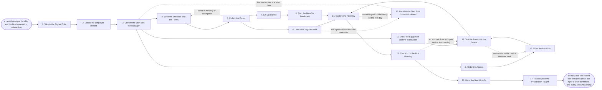

# Reference process: Prepare for a New Hire

`ref/hr/prepare-for-a-new-hire v1`

**value stream:** [Onboarding](../../streams/human-resources/onboarding.md)
A candidate has signed an offer, and the company has until the first day
to be ready for them. The employee-record-keeper agent creates the new
hire's record from the signed offer, and the onboarding-manager agent
confirms the start with the hiring manager, sends the welcome and the
forms the local rules require, and chases each form until it is complete.
A person examines the documents the new hire shows for the right to work,
and the employee-record-keeper agent keeps them where only the named
people can see them. The pay and tax details pass to payroll, the
benefits enrollment starts, the tool-administrator agent opens the
accounts on the job's access list, and the equipment and the workspace
are ordered, with every account tried on the configured device before the
first day. When the start cannot go ahead as planned, a named person
decides what happens. The run closes when the new hire has signed in to
every system on the first morning and has been handed on to orientation
and to the plan for the first months.

**delivers:** status board, a first day readiness board

## The goals

- Finish the forms and the right to work check [3 days] before the start
- Have every account and device working on [98%] of first mornings
- Spend no more than [2 hours] of HR time on each new hire
- Grant no access beyond the job's list to [95%] of new hires

## The activities

| # | Activity | What happens | Agents |
|---|---|---|---|
| 1 | Take in the Signed Offer | the job, manager, location, pay and start date | [onboarding-manager](../../agents/onboarding-manager.md) |
| 2 | Create the Employee Record | one record with the job, manager, location and start date | [employee-record-keeper](../../agents/employee-record-keeper.md) |
| 3 | Confirm the Start with the Manager | the date, first week's work, buddy and place of work | hiring manager (person) · onboarding-manager |
| 4 | Send the Welcome and the Forms | what to expect, what to bring, and the location's forms | onboarding-manager |
| 5 | Collect the Forms | tax, bank, emergency contact and signed contract, complete | onboarding-manager · employee-record-keeper |
| 6 | Check the Right to Work | documents the new hire chooses to show, checked by a person | HR operations specialist (person) · employee-record-keeper |
| 7 | Set Up Payroll | pay, tax details and the bank account in the payroll system | employee-record-keeper · payroll specialist (person) |
| 8 | Start the Benefits Enrollment | the eligibility date and the window passed to benefits | employee-record-keeper |
| 9 | Order the Access | the job's access list, and any extra with its approver | onboarding-manager · hiring manager (person) |
| 10 | Open the Accounts | each account at the job's role, locked until the first day | [tool-administrator](../../agents/tool-administrator.md) |
| 11 | Order the Equipment and the Workspace | the laptop, phone, badge and desk, or the delivery | onboarding-manager · IT support (person) · facilities coordinator (person) |
| 12 | Test the Access on the Device | each account reached from the set-up device before it ships | onboarding-manager · IT support (person) |
| 13 | Decide on a Start That Cannot Go Ahead | a later date or a withdrawn offer, decided by a person | HR operations lead (person) · hiring manager (person) |
| 14 | Confirm the First Day | every item ready, and the new hire told where to go and when | onboarding-manager |
| 15 | Check In on the First Morning | the new hire signs in to each system and collects equipment | onboarding-manager · new hire (person) |
| 16 | Hand the New Hire On | to orientation and to the plan for the first months | onboarding-manager |
| 17 | Record What the Preparation Taught | what was late or missing, and what the next one changes | onboarding-manager |

Where the local rule lets the right to work be checked on the first day,
activity 6 happens on the first morning before any work starts, and the
run waits for it. Payroll and benefits carry on in their own stream: the
first pay runs at `ref/hr/run-payroll` and the elections at
`ref/hr/enroll-an-employee-in-benefits`. An outside payroll provider may
hold the payroll specialist's part for the company, and the roster says
which.

## The graph



## The document, with the blanks marked

```
PROCESS: prepare for a new hire       id: <team>/prepare-for-a-new-hire   v1
from: ref/hr/prepare-for-a-new-hire v1
owner: <who>                          effective: <date>
trigger: the signed acceptance is passed from ref/hr/make-an-offer to
         onboarding, in <your applicant tracking system>
         watch: record=<signed offer>
                system=<your applicant tracking system>
                change=<the offer is marked signed and accepted>
concurrency: runs may overlap freely - one new hire is one run, a rehire
             is a run of its own against the old record, and a start date
             that moves keeps the same run
goal: the new hire starts on the agreed day with every form complete,
      the right to work confirmed by the date <your jurisdiction's
      rules> set, payroll and benefits set up, and every account and
      device working on the first morning
phases:
  take-in-offer        - system: the signed acceptance lands with the
                         job, the level, the manager, the location, the
                         pay, the start date and any condition of the
                         offer still open
                         owner: onboarding-manager  after: trigger
                         automation: <level>
  create-record        - system: one employee record in <your HR
                         system> with the job, the manager, the
                         location, the start date and the pay, checked
                         first for an old record of the same person
                         owner: employee-record-keeper
                         after: take-in-offer       automation: <level>
  confirm-start        - convenes briefing: the hiring manager confirms
                         the start date, the work of the first week, the
                         buddy, where the new hire will work from, and
                         anything the job needs beyond its standard list
                         owner: onboarding-manager
                         after: create-record       by: <days>
                         automation: <level>
  send-forms           - human: the welcome, what the first day holds,
                         what to bring, and the forms <your
                         jurisdiction's rules> require for tax, pay and
                         the right to work, sent to the new hire's own
                         sign-in to <your HR system>
                         owner: onboarding-manager
                         after: confirm-start       automation: <level>
  collect-forms        - runs roll-call: each form chased until it is
                         complete and signed, read for missing fields,
                         and filed to the employee record
                         owner: onboarding-manager
                         after: send-forms          every: <cadence>
                         automation: <level>
  check-right-to-work  - convenes approval: <your HR operations role>
                         examines the documents the new hire chooses to
                         show from those <your jurisdiction's rules>
                         accept, in the way those rules set, and records
                         the outcome and the end date of any permission
                         that expires
                         owner: <your HR operations role>
                         after: collect-forms
                         by: <your jurisdiction's deadline for the
                         right to work check>       automation: never
  set-up-payroll       - system: the pay, the tax details and the bank
                         account from the new hire's forms passed to
                         <your payroll system>, and <your payroll role>
                         confirms the first pay date
                         owner: employee-record-keeper
                         after: collect-forms       automation: <level>
  start-benefits       - system: the eligibility date and the enrollment
                         window passed to
                         ref/hr/enroll-an-employee-in-benefits, which
                         runs on its own from there
                         owner: employee-record-keeper
                         after: set-up-payroll      automation: <level>
  order-access         - human: the accounts on the job's access list,
                         and any account beyond it with the name of the
                         person who approved it, requested in <your IT
                         service desk>
                         owner: onboarding-manager
                         after: confirm-start       automation: <level>
  open-accounts        - system: each account opened at the job's role
                         in <your identity system>, locked until the
                         first day
                         owner: tool-administrator
                         after: order-access
                         by: <days before the start>
                         automation: <level>
  order-equipment      - human: the laptop, the phone, the badge, the
                         desk and anything else the job needs, or a
                         delivery to the new hire's home for someone who
                         works from there, each with the date it must
                         arrive
                         owner: onboarding-manager
                         after: confirm-start       automation: <level>
  test-access          - runs assessment: every account on the list
                         opened at its role and reached from the
                         configured device by <your IT support role>
                         before the device ships or is set at the desk,
                         with each failure named with its ticket
                         owner: onboarding-manager
                         after: open-accounts + order-equipment
                         by: <days before the start>
                         automation: <level>
  decide-start         - convenes decide-and-announce: whether the start
                         moves to a later date or the offer is withdrawn,
                         when the right to work cannot be confirmed, a
                         condition of the offer has not cleared, or
                         something the job cannot start without will not
                         be ready, with a withdrawal read first against
                         <your jurisdiction's rules> with <your counsel>
                         owner: <your HR operations lead role>
                         after: check-right-to-work or confirm-first-day,
                         when either finds the start cannot go ahead
                         automation: never
  confirm-first-day    - runs collect-and-report: <days> before the
                         start, every item read as ready or named with
                         its owner, and the new hire told where to go,
                         when, and who will meet them
                         owner: onboarding-manager
                         after: check-right-to-work + start-benefits +
                         test-access                automation: <level>
  first-morning        - runs assessment: the new hire signs in to each
                         system on the list and collects the equipment,
                         and anything that fails is fixed that morning
                         or named with its ticket
                         owner: onboarding-manager
                         after: confirm-first-day   automation: <level>
  hand-on              - human: the new hire passed to
                         ref/hr/run-new-hire-orientation for the next
                         session, and to
                         ref/hr/run-a-new-hires-first-months with the
                         manager's briefing and any probation period in
                         the contract
                         owner: onboarding-manager
                         after: first-morning       automation: <level>
  record-learning      - convenes debrief: what arrived late, which
                         forms came back incomplete, which accounts
                         failed the test, and what the next preparation
                         does differently
                         owner: onboarding-manager
                         after: hand-on             automation: <level>
run-scoped:
  status     - runs roll-call                   owner: onboarding-manager
               every: <cadence>
               from: confirm-start  until: first-morning
  restricted - runs collect-and-report          owner: employee-record-keeper
               from: collect-forms  until: run close
handoffs:
  take-in-offer -> create-record [signed-offer]: the job, the level, the
    manager, the location, the pay, the start date and any open condition
  create-record -> confirm-start [employee-record]: the new record, or
    the old one reopened for a rehire
  confirm-start -> send-forms / order-access / order-equipment
    [confirmed-start]: the start date, the first week's work, the buddy,
    the place of work and any access beyond the job's list
  send-forms -> collect-forms [forms-sent]: each form sent, with the date
    it went out and the date it is due back
  collect-forms -> check-right-to-work / set-up-payroll
    [completed-forms]: each form complete and signed, filed to the
    employee record
  check-right-to-work -> confirm-first-day [right-to-work-confirmed]: the
    outcome, the date, who examined the documents, and the end date of
    any permission that expires
  set-up-payroll -> start-benefits [payroll-set-up]: the new hire in the
    payroll system, with the first pay date
  start-benefits -> confirm-first-day [benefits-started]: the eligibility
    date and the window passed on, with the run it started
  order-access -> open-accounts [access-request]: each account with its
    role, and the approver of anything beyond the job's list
  open-accounts -> test-access [accounts-opened]: each account opened,
    locked until the first day
  order-equipment -> test-access [equipment-ordered]: each item with its
    order and the date it must arrive
  test-access -> confirm-first-day [access-tested]: each account reached
    from the configured device, with who tested it and when
  confirm-first-day -> first-morning [first-day-ready]: every item ready,
    and the arrival note the new hire was sent
  first-morning -> hand-on [first-morning-checked]: each system signed in
    to by the new hire, and anything still open with its ticket
  hand-on -> record-learning [new-hire-handed-on]: the orientation
    session booked and the first months run started
deviations:
  collect-forms -> send-forms [form-incomplete]: a form is missing,
    unsigned or incomplete, so it is sent again with the field named
  check-right-to-work -> decide-start [right-to-work-unconfirmed]: the
    right to work cannot be confirmed by the date the rules set, so a
    named person decides what happens to the start
  test-access -> open-accounts [access-fails]: an account or the device
    does not work, so the account is opened again or the device set up
    again, and both are tested once more
  confirm-first-day -> decide-start [not-ready]: something the job cannot
    start without will not be ready, so a named person decides whether
    the start moves
  decide-start -> confirm-start [start-moves]: the start moves to a later
    date, so the manager confirms it again and every date behind it
    moves too
  first-morning -> test-access [fails-on-the-day]: an account does not
    open on the first morning, so it is fixed and tested again that day
bindings:
  roster:  <who holds each role - agents claiming the abstract agents
           above, an outside payroll provider where it holds the payroll
           role for the company, and named people for the hiring
           manager, the HR operations specialist, the HR operations
           lead, the payroll specialist, IT support and facilities>
  systems: the HR system (write), the applicant tracking system (read),
           the payroll system (write), the benefits system (write), the
           identity system (write), the IT service desk (write), the
           signature system (trigger), the calendar (write), the
           notification channel (write)
  data:    the signed offer <version>, the employment contract
           <version>, <your new hire forms for each location> <version>,
           <your jurisdiction's right to work rules> <version>, the job's
           access list <version>, <your equipment standard> <version>,
           <your record retention schedule> <version>
policy:
  nobody starts work before the right to work is confirmed, by the date
    and in the way <your jurisdiction's rules> set
  the new hire may show any of the documents <your jurisdiction's rules>
    accept, nobody asks for more documents or for a particular one, and
    every new hire in a location is checked the same way
  right to work documents and the outcome of any background check are
    held apart in the HR system and open only to <the named people>, and
    the rest of the run sees only that the check is complete
  each step sees only the personal data it needs: IT and facilities see
    the name, the job, the start date and the delivery address, and
    nothing from the forms
  agents never weigh a protected characteristic in anything they do
    about a new hire
  the bank account for pay comes only from the new hire's own forms, and
    a change asked for by email or telephone before the first pay is
    handled at ref/hr/change-an-employee-record
  accounts open at the job's access list, and anything beyond it needs
    <who> to approve it in writing
  a moved start and a withdrawn offer are decided by a named person and
    never by an agent, and a withdrawal is read with <your counsel> first
  the forms and the documents are kept for the period <your
    jurisdiction's rule on record retention> sets, and then deleted
measures:
  cycle time: <days> from the signed offer to the first day ready
  on time: <target> share of new hires with every account working on the
           first morning
  volume: <new hires per period>
  quality gate: every right to work check was made by a person by its
                date, and every form is complete on the employee record
```

## The failure edges

- **A form is missing or incomplete.** The onboarding-manager agent sends
  it again with the missing field named and reminds the new hire on the
  cadence the run sets. A form still missing close to the first day goes
  to the HR operations specialist, who calls the new hire. No agent fills
  in a field on the new hire's behalf.
- **The right to work cannot be confirmed.** The new hire is told in
  writing what the check still needs and is given the time the local rule
  allows. Nobody asks for documents beyond those the rule accepts. The HR
  operations lead decides whether the start moves or the offer is
  withdrawn, a withdrawal is read with counsel first, and nobody starts
  work while the check is open.
- **An account or the device does not work.** The tool-administrator
  agent opens the account again or IT support sets the device up again,
  and both are tested once more before the first day. An access ticket
  marked done counts as working only once the account has been reached
  from the device.
- **Something will not be ready on the first day.** A laptop is late, or
  a badge cannot be printed in time. The HR operations lead decides with
  the hiring manager whether the start moves or the new hire starts with
  a loan device and a plan for the gap, and the new hire hears the same
  day.
- **The new hire asks to move the start.** The hiring manager confirms
  the new date, and every date behind it moves, including the accounts,
  the deliveries and the orientation session.
- **A change to the bank account arrives before the first pay.** It is
  treated as suspect, whatever channel it came by, and handled at
  `ref/hr/change-an-employee-record`, where it is confirmed through a
  contact already on file before payroll sees it.
- **The new hire worked here before.** The employee-record-keeper agent
  reopens the old record, checks what may be reused under the retention
  schedule, and asks again for every form the local rules require of a
  new start.
- **The trigger fires while a run is in flight.** A revised offer for the
  same person replaces the first, and the run carries on with the new
  terms. Two signed offers for different jobs for the same person go to
  the HR operations lead before anything more is opened.
- **A run is abandoned.** The new hire withdraws, or a named person
  withdraws the offer. The tool-administrator agent closes every account
  the same day, the equipment is recalled, the payroll and benefits setup
  is reversed, the record is marked as a hire who did not start and kept
  only as the retention schedule allows, and the recruiter is told so the
  position can be filled again.
