# Reference process: Publish an HR Policy

`ref/hr/publish-an-hr-policy v1`

**value stream:** [HR operations](../../streams/human-resources/hr-operations.md)
A human resources (HR) policy is needed or has to change. Leaders have
decided something new, counsel reports that a rule has changed in one of
the company's locations, an audit has found a gap, or the policy has
reached its review date. The policy-keeper agent drafts the change on the
current version from the approved decision, writes the variant each
location needs, and leaves every point a local rule decides as a blank for
counsel. Counsel reviews each variant against the rules of its location
and fills its blanks, employee representatives are consulted wherever a
local rule requires it, and the named approvers sign before anything is
published. The policy is published at a version with its effective date,
each person it covers is sent what changed and acknowledges the version
they were sent, and the training-coordinator agent assigns any training
the change calls for. The run closes when the policy is in force at its
version, the old version is kept with the dates it applied, and every
acknowledgment is in or being chased.

**delivers:** document, a published HR policy

## The goals

- Publish each change within [30 days] of the decision behind it
- Collect acknowledgments from [95%] of the people each policy covers
- Keep each policy to at most [3] location variants
- Review every policy at least every [12 months]

## The activities

| # | Activity | What happens | Agents |
|---|---|---|---|
| 1 | Take in the Policy Request | the decision, the rule change or the finding behind it | [policy-keeper](../../agents/policy-keeper.md) |
| 2 | Read the Current Version | the policy in force, its variants and who each covers | policy-keeper |
| 3 | Name the Owner and the Approvers | the policy owner, counsel and the people who sign | head of HR (person) |
| 4 | Draft the Change | the new text, written from the approved decision | policy-keeper · policy owner (person) |
| 5 | Write the Location Variants | the text each location needs, with local rules left blank | policy-keeper |
| 6 | Review Each Variant With Counsel | counsel reads each variant and fills each blank | counsel (person) |
| 7 | Consult the Employee Representatives | where a local rule requires it, before approval | policy owner (person) · employee representative (person) |
| 8 | Approve the Policy | the named approvers sign each variant | policy approver (person) |
| 9 | Publish the Policy at a Version | each variant at its version, with its effective date | policy-keeper |
| 10 | Send It to the People It Covers | what changed, and the date to acknowledge it by | policy-keeper |
| 11 | Assign the Training It Needs | the training the change calls for, by role and location | [training-coordinator](../../agents/training-coordinator.md) |
| 12 | Collect the Acknowledgments | each person's acknowledgment of the version they were sent | policy-keeper |
| 13 | Mark What Rests on the Old Version | answers, forms and pages that cite the old text | policy-keeper |
| 14 | Keep the Old Version With Its Dates | the old text kept, with when and to whom it applied | policy-keeper |
| 15 | Record the Publication | what changed, who signed, and who acknowledged | policy-keeper |

The training this run assigns is tracked to completion at
`ref/hr/run-required-training`, and new hires acknowledge the policies in
force at `ref/hr/run-new-hire-orientation`. A company with employees in
several locations keeps one policy, with a variant for a location only
where a local rule needs a different text, and counsel for each location
fills that location's blanks.

## The graph

```mermaid
flowchart LR
  T([a decision, a rule change, an audit finding or a review date calls for a policy change]) --> A1[1. Take in the Policy Request]
  A1 --> A2[2. Read the Current Version]
  A2 --> A3[3. Name the Owner and the Approvers]
  A3 --> A4[4. Draft the Change]
  A4 --> A5[5. Write the Location Variants]
  A5 --> A6[6. Review Each Variant With Counsel]
  A6 -. a variant conflicts with a local rule .-> A4
  A6 -. a local rule requires consultation .-> A7[7. Consult the Employee Representatives]
  A7 -. the consultation changes the text .-> A4
  A6 --> A8[8. Approve the Policy]
  A7 --> A8
  A8 -. an approver will not sign .-> A4
  A8 --> A9[9. Publish the Policy at a Version]
  A9 --> A10[10. Send It to the People It Covers]
  A9 --> A11[11. Assign the Training It Needs]
  A9 --> A13[13. Mark What Rests on the Old Version]
  A9 --> A14[14. Keep the Old Version With Its Dates]
  A10 --> A12[12. Collect the Acknowledgments]
  A12 -. a person has not acknowledged by the date .-> A10
  A11 --> A15[15. Record the Publication]
  A12 --> A15
  A13 --> A15
  A14 --> A15
  A15 --> DONE([the policy is in force at its version, and every acknowledgment is in or being chased])
```



## The document, with the blanks marked

```
PROCESS: publish an HR policy         id: <team>/publish-an-hr-policy   v1
from: ref/hr/publish-an-hr-policy v1
owner: <who>                          effective: <date>
trigger: <your head of HR role> or a policy owner opens a policy request
         in <your policy library>, or a policy reaches its review date
         watch: record=<policy request> system=<your policy library>
                change=<a request is opened or a review date arrives>
concurrency: runs may overlap across policies, and one change to one
             policy is one run. A second change to the same policy joins
             the open run before approval, or waits until the first is
             published
goal: every change published at a version within <days> of the decision
      behind it, each variant reviewed by counsel and signed by the named
      approvers, and acknowledged by <target> share of the people it
      covers within <days>
phases:
  take-in-request      - system: the request lands with the decision, the
                         rule change counsel reported, the audit finding
                         or the review date behind it, and the policy it
                         touches
                         owner: policy-keeper       after: trigger
                         automation: <level>
  read-current         - runs collect-and-report: the policy in force, its
                         variants, the locations and the people each
                         variant covers, and the answers, forms and pages
                         that cite it
                         owner: policy-keeper       after: take-in-request
                         automation: <level>
  name-owners          - human: the policy owner, counsel for each
                         location the change touches, and the approvers
                         named under <your policy approval rules>
                         owner: <your head of HR role>
                         after: read-current        by: <days>
                         automation: <level>
  draft-change         - human: the new text written on the current
                         version from the approved decision, on <your
                         policy template>, with every change marked
                         owner: policy-keeper       after: name-owners
                         automation: <level>
  write-variants       - human: the text each location needs, written only
                         where a local rule needs a different text, with
                         each point a local rule decides left as a blank
                         such as <your jurisdiction's rule on notice
                         periods>
                         owner: policy-keeper       after: draft-change
                         automation: <level>
  counsel-review       - runs assessment: counsel reads each variant
                         against <your jurisdiction's rules> for its
                         location, fills each blank, and says whether
                         employee representatives must be consulted
                         owner: <your counsel role>
                         after: write-variants      by: <days>
                         automation: never
  consult-employees    - convenes briefing: the change put to the employee
                         representatives in each location where <your
                         jurisdiction's rules> require it, and their views
                         recorded with the answer to each
                         owner: <your policy owner role>
                         after: counsel-review      by: <days>
                         automation: never
  approve-policy       - convenes approval: the named approvers sign each
                         variant at its version
                         owner: <your policy approver role>
                         after: counsel-review, and consult-employees when
                         it ran                     by: <days>
                         automation: never
  publish-policy       - system: each variant published in <your policy
                         library> at its version, with its effective date
                         and the locations it covers
                         owner: policy-keeper       after: approve-policy
                         automation: <level>
  send-to-people       - system: each person the policy covers sent the
                         variant for their location, what changed, and the
                         date to acknowledge it by
                         owner: policy-keeper       after: publish-policy
                         automation: <level>
  assign-training      - system: the training the change calls for
                         assigned in <your learning system> by role and
                         location, with its due date
                         owner: training-coordinator
                         after: publish-policy      automation: <level>
  chase-acknowledgment - runs roll-call: each person's acknowledgment of
                         the version they were sent, a reminder to each
                         person who has not acknowledged, and their manager
                         told after <days>
                         owner: policy-keeper       after: send-to-people
                         every: <cadence>           automation: <level>
  mark-dependents      - runs collect-and-report: every library answer,
                         form and page that cites the old version, marked
                         for review and sent to its owner
                         owner: policy-keeper       after: publish-policy
                         automation: <level>
  keep-old-version     - system: the old version closed on the new one's
                         effective date and kept with the dates it applied
                         and the people it covered
                         owner: policy-keeper       after: publish-policy
                         automation: <level>
  record-publication   - convenes debrief: what changed, who reviewed and
                         signed, the share of people who acknowledged, the
                         training assigned, and what the next change to
                         this policy should do differently
                         owner: policy-keeper
                         after: chase-acknowledgment + assign-training +
                         mark-dependents + keep-old-version
                         automation: <level>
run-scoped:
  timeline - runs roll-call                 owner: policy-keeper
             every: <cadence>
             from: name-owners      until: publish-policy
  versions - runs collect-and-report        owner: policy-keeper
             from: draft-change     until: run close
handoffs:
  take-in-request -> read-current [policy-request]: the decision, rule
    change, finding or review date behind it, and the policy it touches
  read-current -> name-owners [current-policy]: the policy in force, its
    variants, who each covers and what cites it
  name-owners -> draft-change [policy-team]: the policy owner, counsel for
    each location and the approvers
  draft-change -> write-variants [draft-policy]: the new text on the
    current version, with every change marked
  write-variants -> counsel-review [draft-variants]: each variant, with the
    blanks a local rule decides
  counsel-review -> consult-employees / approve-policy [reviewed-variants]:
    each variant with its blanks filled, the name of the counsel who
    reviewed it and whether consultation is required
  consult-employees -> approve-policy [consultation-record]: the views the
    representatives gave and the answer to each
  approve-policy -> publish-policy [signed-policy]: each variant as signed.
    A change to the text after signing voids the signatures
  publish-policy -> send-to-people / assign-training / mark-dependents /
    keep-old-version [published-policy]: each variant at its version, with
    its effective date and the people it covers
  send-to-people -> chase-acknowledgment [sent-policy]: who was sent which
    variant, and the date to acknowledge it by
  chase-acknowledgment -> record-publication [acknowledgments]: who has
    acknowledged which version, and who has not
  assign-training -> record-publication [training-assigned]: who was
    assigned what, and by when
  mark-dependents -> record-publication [marked-items]: each answer, form
    and page marked for review, with its owner
  keep-old-version -> record-publication [closed-version]: the old version
    and the dates it applied
deviations:
  counsel-review -> draft-change [counsel-finds-conflict]: a variant
    conflicts with a local rule, so it is drafted again on counsel's points
    and reviewed again
  consult-employees -> draft-change [consultation-changes-text]: the
    consultation leads the policy owner to change the text, so it is
    drafted again and goes back through counsel
  approve-policy -> draft-change [approver-refuses]: an approver will not
    sign, so the text is drafted again on the approver's points
  chase-acknowledgment -> send-to-people [not-acknowledged]: a person has
    not acknowledged by the date, so the policy is sent again and their
    manager is told
bindings:
  roster:  <who holds each role - agents claiming the abstract agents
           above, and named people for the head of HR, each policy owner,
           counsel for each location, the policy approvers and the
           employee representatives>
  systems: <your policy library> (write), <your HR system> (read), <your
           learning system> (write), <your answer library> (write), the
           signature system (trigger), the notification channel (write)
  data:    the current policy <version> and its variants, the decision,
           rule change or finding behind the request, <your policy
           template> <version>, <your policy approval rules> <version>,
           the list of locations and the people in each
policy:
  no policy is published before the named approvers have signed each
    variant, and a change to the text after signing voids the signatures
  counsel reviews every variant against the rules of its location, and
    the agent never fills a blank that a local rule decides
  employee representatives are consulted before approval wherever <your
    jurisdiction's rules> require it
  the agent drafts only from an approved decision, a rule change counsel
    has confirmed or an audit finding, and it never invents a rule
  a policy has a variant for a location only where a local rule needs a
    different text
  every version is kept with the dates it applied and the people it
    covered, so the record can say which version applied to whom on any
    date
  each person acknowledges the version they were sent, and an
    acknowledgment of an older version does not count for a newer one
  a policy takes effect no sooner than <days> after it is published,
    unless a local rule sets the date or <who> approves a shorter time in
    writing
measures:
  cycle time: <days> from the request to the policy in force
  on time: <target> share of changes published within <days> of the
           decision behind them
  acknowledgment: <target> share of the people covered who acknowledged
                  by the date
  volume: <policy changes per year>
  quality gate: every variant traces to a counsel review and the
                signatures of its approvers, and every acknowledgment to
                the version it covers
```

## The failure edges

- **The request has no approved decision behind it.** A proposal that
  nobody with authority has decided goes to the head of HR, who decides
  whether it becomes a request. The policy-keeper agent drafts nothing
  until a decision, a rule change counsel has confirmed or an audit
  finding is on the record.
- **Counsel finds a conflict with a local rule.** The variant is drafted
  again on counsel's points and reviewed again. The other variants go on,
  and the policy is published for each location only once that location's
  own variant is signed.
- **The consultation changes the text.** The text goes back through
  drafting and counsel. Where the representatives and the company do not
  agree, the policy owner records both views, and the approvers decide
  with both in front of them.
- **An approver will not sign.** The text is drafted again on the
  approver's points. Nothing is published with a signature missing, and
  nobody signs in the place of the approver who refused.
- **A local rule changes during the run.** Counsel reports it, and the
  variant for that location goes back to drafting. A rule that takes
  effect before the policy can be published is met first by a notice from
  the policy owner, and the policy follows.
- **People do not acknowledge.** Each one is sent the policy again and
  their manager is told. The record shows who has not acknowledged, and
  whether the policy applies to them from its effective date all the same
  follows `<your jurisdiction's rules>`.
- **The published policy has an error.** A corrected version is drafted,
  reviewed and signed, and it is published as a new version. The people it
  covers receive the correction and acknowledge the new version, and the
  record keeps the version with the error and the dates it was in force.
- **The trigger fires while a run is in flight.** A second change to the
  same policy joins the open run before approval, or waits until the first
  is published. Changes to different policies run side by side.
- **A run is abandoned.** The decision behind the change is withdrawn.
  Nothing is published, the draft is kept with the reason it stopped, and
  the policy in force stays as it is.
