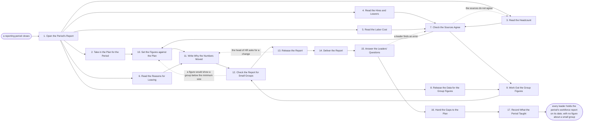

# Reference process: Report on the Workforce

`ref/hr/report-on-the-workforce v1`

**value stream:** [Workforce planning](../../streams/human-resources/workforce-planning.md)
Each reporting period, such as a month or a quarter, the leaders receive
one report on the workforce. The reporting-manager agent owns the report
and its date. The analytics agent reads the headcount, the hires and
leavers, the time to fill and the labor cost from the human resources
(HR) system, the applicant tracking system and the payroll system, checks
that the sources agree, and counts the reasons leavers gave. The
workforce-planner agent sets each figure beside the workforce plan.
Figures by a protected characteristic are worked out by the statistician
agent alone, on data the head of HR releases for that report, and the
statistician agent checks that no figure shows a group smaller than the
minimum size. The head of HR releases the report. The run closes when
every leader holds the report on its date, each question they ask is
answered, and any gap the plan cannot absorb is with the plan's owner.

**delivers:** report, a workforce report

**starts:** on a schedule, a reporting period closes

## The goals

- Deliver the report within [5 working days] of the period end
- Restate [zero] figures after release
- Explain every gap of more than [5%] against the plan
- Spend no more than [2 days] of HR time on each report

## The activities

| # | Activity | What happens | Agents |
|---|---|---|---|
| 1 | Open the Period's Report | what it covers, when it is due and who it goes to | [reporting-manager](../../agents/reporting-manager.md) |
| 2 | Take in the Plan for the Period | the planned headcount, positions and labor cost | [workforce-planner](../../agents/workforce-planner.md) |
| 3 | Read the Headcount | people by team, level and location at the period end | [analytics](../../agents/analytics.md) |
| 4 | Read the Hires and Leavers | joiners, leavers and time to fill, by team | analytics |
| 5 | Read the Labor Cost | pay, benefits and the employer's taxes on pay, by team | analytics |
| 6 | Read the Reasons for Leaving | the reasons leavers gave, counted by reason | analytics |
| 7 | Check the Sources Agree | the HR system, the payroll system and the ledger compared | analytics · finance lead (person) |
| 8 | Release the Data for the Group Figures | a named person releases it for this report alone | head of HR (person) |
| 9 | Work Out the Group Figures | representation, hires and leavers by group, on released data | [statistician](../../agents/statistician.md) |
| 10 | Set the Figures against the Plan | each figure beside the plan, with the gap | workforce-planner |
| 11 | Write Why the Numbers Moved | the reasons behind each large gap, from the teams | reporting-manager · HR business partners (person) |
| 12 | Check the Report for Small Groups | no figure shown for a group below the minimum size | statistician |
| 13 | Release the Report | the head of HR reads it and releases it | head of HR (person) |
| 14 | Deliver the Report | each leader receives it on its date | reporting-manager |
| 15 | Answer the Leaders' Questions | each question answered and logged for the next report | reporting-manager · HR business partners (person) |
| 16 | Hand the Gaps to the Plan | the gaps the plan cannot absorb, to its owner | workforce-planner |
| 17 | Record What the Period Taught | late sources, corrections, and what the next report changes | reporting-manager |

The figures come from records other processes keep. Hires and time to
fill come from the hiring processes, leavers and their reasons from
`ref/hr/offboard-a-leaver`, and the plan from `ref/hr/plan-the-workforce`.
The report reads counts and totals, and no step shows or sends a figure
about one person. The group figures in a required filing are made at
`ref/hr/file-a-required-report`, under the same rule on released data.

## The graph



## The document, with the blanks marked

```
PROCESS: report on the workforce      id: <team>/report-on-the-workforce   v1
from: ref/hr/report-on-the-workforce v1
owner: <who>                          effective: <date>
trigger: a reporting period closes on <your reporting calendar>, and the
         period's payroll has been run
         watch: record=<reporting period> system=<your HR system>
                change=<a reporting period closes>
concurrency: one run per period - the next period's run opens when this
             one has delivered, and a corrected report is a new version
             within the run that delivered it
goal: the leaders hold the period's workforce report within <days> of the
      period end, with every figure traced to its source and set beside
      the plan, every gap larger than <your threshold for a gap>
      explained, and no figure shown for a group smaller than
      <your minimum group size>
phases:
  open-report          - human: the period the report covers, the date it
                         is due, the leaders it goes to, and the
                         definitions of headcount, hires, leavers and time
                         to fill it is built on
                         owner: reporting-manager   after: trigger
                         automation: <level>
  take-in-plan         - runs collect-and-report: the approved workforce
                         plan for the period, with each team's planned
                         positions, headcount and labor cost at the plan's
                         version
                         owner: workforce-planner   after: open-report
                         automation: <level>
  read-headcount       - runs collect-and-report: the people employed at
                         the period end, counted by team, level and
                         location from <your HR system>, with the open
                         positions counted beside them
                         owner: analytics           after: open-report
                         automation: <level>
  read-movement        - runs collect-and-report: the period's hires,
                         leavers and internal moves by team, whether each
                         departure was a resignation or the company's
                         decision, and the time to fill each position
                         closed, from <your HR system> and
                         <your applicant tracking system>
                         owner: analytics           after: open-report
                         automation: <level>
  read-labor-cost      - runs collect-and-report: the period's cost of
                         pay, benefits and the employer's taxes on pay,
                         totaled by team from <your payroll system>
                         owner: analytics           after: open-report
                         automation: <level>
  read-leaving-reasons - runs collect-and-report: the reasons leavers gave
                         in their exit interviews, counted by the reason
                         categories ref/hr/offboard-a-leaver records, with
                         no leaver's own words
                         owner: analytics           after: open-report
                         automation: <level>
  check-sources        - runs allocate-and-reconcile: the headcount, the
                         movement and the cost compared across
                         <your HR system>, <your payroll system> and the
                         ledger, and each difference named with its source
                         owner: analytics
                         after: read-headcount + read-movement +
                         read-labor-cost            automation: <level>
  release-group-data   - convenes approval: <your head of HR role>
                         releases the data the group figures need, such as
                         the protected characteristics employees chose to
                         record, for this report alone and to the
                         statistician agent alone
                         owner: <your head of HR role>
                         after: open-report         automation: never
  group-figures        - runs assessment: representation, hiring and
                         leaving by group, worked out on the released data,
                         with the group size behind each figure and the
                         method used
                         owner: statistician
                         after: release-group-data + check-sources
                         automation: <level>
  set-against-plan     - runs assessment: each figure set beside the plan
                         for the period, with the gap and whether it is
                         larger than <your threshold for a gap>
                         owner: workforce-planner
                         after: take-in-plan + check-sources
                         automation: <level>
  write-reasons        - human: why each large gap opened, from the HR
                         business partners and the teams, and what the
                         reasons for leaving show, in plain words
                         owner: reporting-manager
                         after: set-against-plan + read-leaving-reasons
                         automation: <level>
  check-small-groups   - runs assessment: every figure, table and chart in
                         the draft checked against
                         <your minimum group size>, and any figure that
                         could be worked out from two others checked too
                         owner: statistician
                         after: write-reasons + group-figures
                         automation: <level>
  release-report       - convenes approval: <your head of HR role> reads
                         the report and releases it as a named approver
                         owner: <your head of HR role>
                         after: check-small-groups  by: <days>
                         automation: never
  deliver-report       - system: the report delivered to each leader in
                         <your reporting tool> at a version, on its date
                         owner: reporting-manager   after: release-report
                         automation: <level>
  answer-questions     - human: each question a leader asks answered from
                         the report and its sources, and logged for the
                         next period
                         owner: reporting-manager   after: deliver-report
                         automation: <level>
  hand-on-gaps         - convenes briefing: each gap the plan cannot
                         absorb handed to the owner of the workforce plan,
                         who may open a revision under
                         ref/hr/plan-the-workforce
                         owner: workforce-planner
                         after: answer-questions    automation: <level>
  record-learning      - convenes debrief: which sources were late, which
                         figures were corrected, which questions the
                         report could not answer, and what the next report
                         changes
                         owner: reporting-manager   after: hand-on-gaps
                         automation: <level>
run-scoped:
  due-date   - runs roll-call                owner: reporting-manager
               every: <cadence>
               from: open-report         until: deliver-report
  group-data - runs collect-and-report       owner: statistician
               from: release-group-data  until: check-small-groups
handoffs:
  open-report -> take-in-plan / read-headcount / read-movement /
    read-labor-cost / read-leaving-reasons / release-group-data
    [report-scope]: the period, the due date, the leaders it goes to and
    the definitions at their version
  take-in-plan -> set-against-plan [period-plan]: the planned positions,
    headcount and cost for the period, at the plan's version
  read-headcount / read-movement / read-labor-cost -> check-sources
    [period-figures]: each count and total, with its source and the date
    it was read
  read-leaving-reasons -> write-reasons [leaving-reasons]: the reasons
    leavers gave, counted by category
  check-sources -> group-figures / set-against-plan [agreed-figures]: the
    figures as the sources agree them, with each difference named and the
    count the report uses
  release-group-data -> group-figures [released-group-data]: the data
    released, what it covers, who released it and the date it is deleted
  group-figures -> check-small-groups [group-figures]: each figure by
    group, with its group size and its method
  set-against-plan -> write-reasons [plan-gaps]: each figure beside the
    plan, with the gaps larger than the threshold marked
  write-reasons -> check-small-groups [draft-report]: the draft report at
    a version
  check-small-groups -> release-report [checked-report]: the report with
    every figure above the minimum group size, and what was merged or
    hidden
  release-report -> deliver-report [released-report]: the report as
    released, with the name of who released it. A change to any figure
    voids the release
  deliver-report -> answer-questions [delivered-report]: the report at
    its version, and the date each leader received it
  answer-questions -> hand-on-gaps [leader-questions]: each question and
    its answer
  hand-on-gaps -> record-learning [gaps-handed-on]: each gap handed to
    the plan's owner, and what the owner decided to do with it
deviations:
  check-sources -> read-headcount [sources-disagree]: the sources do not
    agree, so the figures are read again and each difference is traced
    before any figure is set against the plan
  check-small-groups -> set-against-plan [group-below-minimum]: a figure
    would show a group smaller than the minimum size, so it is merged
    with a neighbor or removed, and the gaps are worked out again
  release-report -> write-reasons [change-requested]: the head of HR asks
    for a change, so the reasons are written again, and a figure changes
    only when its source does
  answer-questions -> check-sources [error-found]: a leader finds an
    error, so the figure is traced to its source, and a corrected report
    goes out as a new version that names the change
bindings:
  roster:  <who holds each role - agents claiming the abstract agents
           above, and named people for the head of HR, the finance lead,
           the HR business partners and the leaders who receive the
           report>
  systems: <your HR system> (read), <your applicant tracking system>
           (read), <your payroll system> (read), the ledger (read), the
           workforce plan (read), <your reporting tool> (write), the
           notification channel (write)
  data:    the workforce plan <version>, <your workforce definitions>
           <version>, <your minimum group size>,
           <your threshold for a gap>, <your report template> <version>,
           the exit interview reasons as ref/hr/offboard-a-leaver records
           them
policy:
  the report shows counts and totals, and no figure, comment or chart
    names or points to one person
  no figure is shown for a group smaller than <your minimum group size>,
    and a figure that could be worked out from two others is hidden as
    well
  figures by a protected characteristic are worked out only by the
    statistician agent, on data <your head of HR role> releases for this
    report alone, and that data is deleted when check-small-groups ends
  no other step reads a protected characteristic
  reasons for leaving are counted by category, and no leaver's own words
    appear in the report
  every figure carries its source and the date it was read
  the report goes out only after <your head of HR role> releases it, and
    a figure changed after release makes a new version that names the
    change
  the report is delivered on its date, and a source that has not
    answered is marked as missing in it
measures:
  cycle time: <days> from the period end to the report delivered
  on time: <target> share of reports delivered on their date
  volume: <reports per year>
  quality gate: every figure traces to a source and a date, and no figure
                shows a group below the minimum size
```

## The failure edges

- **The sources do not agree.** The HR system, the payroll system and the
  ledger can count the same people and the same cost differently. The
  analytics agent names each difference and its source, the head of HR and
  the finance lead say which count the report uses, and the report says
  which one it is.
- **A source is late.** The report goes out on its date with the missing
  figures marked and the date they will arrive. A figure that arrives
  later goes into the next report, or into a new version of this one when
  a leader needs it sooner.
- **A figure would show a small group.** The statistician agent merges
  the group with a neighbor or removes the figure. It also hides a figure
  that could be worked out from two others, such as a team's total beside
  the same total less one location.
- **The group data is not released.** The report goes out without the
  group figures and says so. The figures are never worked out from data
  that was not released for this report, and no other agent fills the
  gap.
- **The head of HR asks for a change.** The reasons are written again. A
  figure changes only when its source does, and a figure the head of HR
  would rather not show stays in the report.
- **A leader asks about one person or a small group.** The report does not
  answer it. A question about one person goes to that person's HR business
  partner under the rules that protect the person's record, and a group
  below the minimum size is never shown, whoever asks.
- **A leader finds an error after release.** The figure is traced to its
  source. A corrected report goes out as a new version that names the
  change, and every leader who received the first version is told.
- **The trigger fires while a run is in flight.** The next period closes
  before this report is out. This run delivers first and the next opens
  after it, so two reports never carry different figures for the same
  period.
- **A run is abandoned.** No report is delivered for the period. The
  leaders are told why and when the figures will come, the released group
  data is deleted, and the next report covers both periods with each one
  shown on its own.
