# Reference process: Resolve an Employee Concern

`ref/hr/resolve-an-employee-concern v1`

**value stream:** [Employee relations](../../streams/human-resources/employee-relations.md)
An employee raises a concern about the work, a manager, a colleague or
the way a policy was applied, in person, in writing, through a manager or
on an anonymous line. The employee-case-keeper agent logs it once,
acknowledges it with the date an answer is due, and opens a restricted
file that only the named people on the case can open. The policy-keeper
agent sets out the policy at the version that applied to the employee's
location on the date of what the concern describes. The employee
relations lead reads it for any risk that cannot wait, an HR business
partner hears what the employee wants, and the employee relations lead
chooses whether the concern is answered with guidance, heard as a
grievance or sent for investigation. A named person decides the answer,
and the employee receives it in writing with its reasons and the route
to appeal. The run closes when the answer has been sent inside the
promised time, any appeal is decided, every action the answer commits to
has an owner and a date, and the case is closed on the record.

**delivers:** document, a written answer to a concern

**starts:** by hand, an employee raises a concern in any channel

## The goals

- Send a written answer within [20 working days]
- Answer [60%] of concerns without a formal hearing
- Have fewer than [10%] of answers overturned on appeal
- Hear from [85%] of employees who raised a concern that they would raise another

## The activities

| # | Activity | What happens | Agents |
|---|---|---|---|
| 1 | Take in the Concern | the concern logged once from any channel, named or anonymous | [employee-case-keeper](../../agents/employee-case-keeper.md) |
| 2 | Acknowledge the Concern | a reply with the case reference and when an answer is due | employee-case-keeper |
| 3 | Check for Urgent Risk | a safety risk or a report the law requires, acted on at once | employee relations lead (person) |
| 4 | Open the Restricted File | the case file, open only to the named people on the case | employee-case-keeper |
| 5 | Read the Policy That Applied | the version in force for the employee's location on the date | [policy-keeper](../../agents/policy-keeper.md) |
| 6 | Hear What the Employee Wants | what happened, and what would put it right | HR business partner (person) |
| 7 | Choose the Route | guidance, a grievance hearing or an investigation | employee relations lead (person) · employee-case-keeper |
| 8 | Give Guidance | the policy explained and the next step agreed | HR business partner (person) · policy-keeper |
| 9 | Hear the Grievance | a meeting with the employee, with a companion where allowed | deciding manager (person) · employee-case-keeper |
| 10 | Send for Investigation | the case and its file handed to the investigation | employee-case-keeper |
| 11 | Decide the Answer | the decision on each point raised, with its reasons | deciding manager (person) |
| 12 | Send the Written Answer | the answer and the route to appeal, inside the promised time | deciding manager (person) · employee-case-keeper |
| 13 | Hear an Appeal | a named person with no part in the answer decides it | appeal manager (person) · employee-case-keeper |
| 14 | Act on the Outcome | each action, owner and date, and any policy change drafted | employee relations lead (person) · policy-keeper |
| 15 | Check In with the Employee | whether the actions happened, and any sign of retaliation | HR business partner (person) · employee-case-keeper |
| 16 | Close the Case | the outcome, the dates and the file closed on the record | employee-case-keeper |
| 17 | Record What the Case Taught | what the concern showed about a team, a policy or a manager | employee relations lead (person) · employee-case-keeper |

An anonymous concern runs the same way, and the employee-case-keeper
agent answers it through the case reference on the line it came in on.
An investigation runs at `ref/hr/investigate-a-workplace-complaint` and
returns its signed findings to activity 11, a conduct matter the answer
leads to runs at `ref/hr/issue-a-disciplinary-action`, and a policy
change runs at `ref/hr/publish-an-hr-policy`. A concern that
`<your jurisdiction's whistleblowing rules>` protect follows the route
those rules set, and this run keeps the case record beside it.

## The graph

```mermaid
flowchart LR
  T([an employee raises a concern in any channel]) --> A1[1. Take in the Concern]
  A1 --> A2[2. Acknowledge the Concern]
  A1 --> A3[3. Check for Urgent Risk]
  A1 --> A4[4. Open the Restricted File]
  A4 --> A5[5. Read the Policy That Applied]
  A2 --> A6[6. Hear What the Employee Wants]
  A3 --> A6
  A5 --> A6
  A6 --> A7[7. Choose the Route]
  A7 --> A8[8. Give Guidance]
  A7 --> A9[9. Hear the Grievance]
  A7 --> A10[10. Send for Investigation]
  A9 -. the facts can only be settled by an investigation .-> A7
  A9 --> A11[11. Decide the Answer]
  A10 --> A11
  A8 --> A12[12. Send the Written Answer]
  A11 --> A12
  A12 -. the employee appeals .-> A13[13. Hear an Appeal]
  A13 -. the appeal finds a point the answer did not decide .-> A11
  A12 --> A14[14. Act on the Outcome]
  A13 --> A14
  A14 --> A15[15. Check In with the Employee]
  A15 -. the employee reports retaliation .-> A1
  A15 --> A16[16. Close the Case]
  A16 --> A17[17. Record What the Case Taught]
  A17 --> DONE([the employee has a written answer, any appeal is decided, and the case is closed])
```



## The document, with the blanks marked

```
PROCESS: resolve an employee concern  id: <team>/resolve-an-employee-concern   v1
from: ref/hr/resolve-an-employee-concern v1
owner: <who>                          effective: <date>
trigger: an employee raises a concern in person, in writing, through a
         manager or on <your anonymous reporting line>, and it is logged
         in <your employee relations case system>
         watch: record=<employee relations case>
                system=<your employee relations case system>
                change=<a new concern is logged>
concurrency: runs may overlap freely - one concern is one run, and a
             second concern about the same matter joins the open case
             unless <your employee relations lead role> keeps them apart
goal: every concern acknowledged within <days>, routed by a named person
      and answered in writing by a named person within <days>, with any
      appeal decided and every action the answer commits to owned and
      dated
phases:
  take-in-concern       - system: the concern logged once with the
                          channel it came in on, the date, what it
                          describes and who it names, and an anonymous
                          concern logged under a case reference alone
                          owner: employee-case-keeper   after: trigger
                          automation: <level>
  acknowledge           - human: a reply through the channel the concern
                          came in on, with the case reference, what
                          happens next and the date an answer is due
                          owner: employee-case-keeper
                          after: take-in-concern     by: <days>
                          automation: <level>
  check-urgent-risk     - runs assessment: whether the concern describes
                          a risk to someone's safety, a matter <your
                          jurisdiction's rules> require to be reported
                          outside the company, or a disclosure <your
                          jurisdiction's whistleblowing rules> protect
                          owner: <your employee relations lead role>
                          after: take-in-concern     by: <hours>
                          automation: never
  open-file             - system: the restricted case file, open only to
                          the named people on the case, with every
                          opening logged
                          owner: employee-case-keeper
                          after: take-in-concern     automation: <level>
  read-policy           - runs collect-and-report: the policy the concern
                          touches, at the version in force for the
                          employee's location on the date of what it
                          describes, with the clause that applies
                          owner: policy-keeper       after: open-file
                          automation: <level>
  hear-employee         - human: what happened, in the employee's words,
                          and what would put it right, heard through the
                          anonymous line's replies when the employee has
                          given no name
                          owner: <your HR business partner role>
                          after: acknowledge + check-urgent-risk +
                          read-policy                automation: <level>
  choose-route          - convenes decide-and-announce: whether the
                          concern is answered with guidance, heard as a
                          grievance or sent for investigation, and who
                          decides the answer
                          owner: <your employee relations lead role>
                          after: hear-employee       automation: never
  give-guidance         - human: the policy explained to the employee,
                          what the employee or the manager can do next,
                          and the step agreed
                          owner: <your HR business partner role>
                          after: choose-route, when the route is guidance
                          automation: <level>
  hear-grievance        - human: a meeting at which the employee sets out
                          the grievance, with a companion where <your
                          jurisdiction's rules on the right to be
                          accompanied> or <your grievance policy> allow,
                          and notes the employee may check
                          owner: <your deciding manager role>
                          after: choose-route, when the route is a
                          grievance                  by: <days>
                          automation: never
  send-to-investigation - human: the case and its file handed to
                          ref/hr/investigate-a-workplace-complaint, and
                          the signed findings it returns read into this
                          case
                          owner: employee-case-keeper
                          after: choose-route, when the route is an
                          investigation              automation: <level>
  decide-answer         - convenes decide-and-announce: the decision on
                          each point the employee raised, with its
                          reasons, made from the hearing notes or the
                          signed findings
                          owner: <your deciding manager role>
                          after: hear-grievance or send-to-investigation
                          automation: never
  send-answer           - human: the written answer, with its reasons,
                          what will happen next, and the route and the
                          time limit to appeal
                          owner: <your deciding manager role>, or <your
                          HR business partner role> on the guidance route
                          after: decide-answer or give-guidance
                          by: <days>                 automation: never
  hear-appeal           - convenes decide-and-announce: a named person
                          who took no part in the answer hears the appeal
                          and decides whether the answer stands, changes
                          or goes back to be decided again
                          owner: <your appeal manager role>
                          after: send-answer, when the employee appeals
                          within <days>              automation: never
  act-on-outcome        - convenes decide-and-announce: each action the
                          answer or the appeal commits to, with one owner
                          and one date, and any change to a policy
                          drafted from the approved decision for
                          ref/hr/publish-an-hr-policy
                          owner: <your employee relations lead role>
                          after: send-answer, and hear-appeal when one ran
                          automation: <level>
  check-in              - human: a check with the employee <days> after
                          the answer, on whether the actions happened and
                          on any sign of retaliation
                          owner: <your HR business partner role>
                          after: act-on-outcome      automation: <level>
  close-case            - system: the outcome, the dates and the file
                          closed on the record, with the date the file is
                          to be destroyed under <your records retention
                          schedule>
                          owner: employee-case-keeper after: check-in
                          automation: <level>
  record-learning       - convenes debrief: what the concern showed about
                          a team, a policy or a manager, what slowed the
                          answer, and what the next case does differently
                          owner: <your employee relations lead role>
                          after: close-case          automation: <level>
run-scoped:
  clock  - runs roll-call                     owner: employee-case-keeper
           every: <cadence>
           from: acknowledge        until: send-answer
  access - runs assessment                    owner: employee-case-keeper
           from: open-file          until: run close
handoffs:
  take-in-concern -> acknowledge / check-urgent-risk / open-file
    [logged-concern]: the concern, its channel, its date and the case
    reference
  open-file -> read-policy [case-file]: the restricted file and the named
    people who may open it
  acknowledge -> hear-employee [acknowledgment]: the reply sent, and the
    date the answer is due
  check-urgent-risk -> hear-employee [risk-check]: whether a risk or a
    required report was found, and what was done the same day
  read-policy -> hear-employee [applicable-policy]: the policy and the
    clause, at the version for the employee's location and date
  hear-employee -> choose-route [employee-account]: what the employee
    said happened and what would put it right, as the employee checked it
  choose-route -> give-guidance / hear-grievance / send-to-investigation
    [chosen-route]: the route, the reason for it, and who decides the
    answer
  give-guidance -> send-answer [guidance-given]: the guidance, the step
    agreed, and the policy version it rests on
  hear-grievance -> decide-answer [hearing-notes]: the notes as the
    employee checked them, and anything new the meeting raised
  send-to-investigation -> decide-answer [signed-findings]: the findings
    the investigator signed, and the decision on what follows them
  decide-answer -> send-answer [decided-answer]: the decision on each
    point, with its reasons
  send-answer -> hear-appeal / act-on-outcome [written-answer]: the
    answer as sent, the date it was sent, and the appeal deadline
  hear-appeal -> act-on-outcome [appeal-decision]: the decision on the
    appeal, its reasons, and who decided
  act-on-outcome -> check-in [agreed-actions]: each action with its owner
    and its date, and any policy change sent for drafting
  check-in -> close-case [check-in-notes]: what the employee said, and
    whether each action happened
  close-case -> record-learning [closed-case]: the outcome, the dates and
    the file's retention date
deviations:
  hear-grievance -> choose-route [facts-in-dispute]: the hearing shows
    facts that only an investigation can settle, so the route is chosen
    again with the hearing notes on the file
  hear-appeal -> decide-answer [appeal-sends-back]: the appeal finds a
    point the answer did not decide, so that point is decided by a named
    person who took no part in the first answer
  check-in -> take-in-concern [retaliation-reported]: the employee
    reports being treated worse for raising the concern, so it is logged
    as a new concern of its own and read for risk the same day
bindings:
  roster:  <who holds each role - agents claiming the abstract agents
           above, and named people for the employee relations lead, the
           HR business partner, the deciding manager and the appeal
           manager>
  systems: the employee relations case system (write), the restricted
           case file (write), the policy library (read), the HR system
           (read), <your anonymous reporting line> (write), the calendar
           (write), the notification channel (write)
  data:    <your grievance policy> <version>, the HR policies at the
           version for each location, <your anonymous reporting
           procedure> <version>, <your jurisdiction's whistleblowing
           rules>, <your records retention schedule> <version>
policy:
  every concern is logged once and acknowledged within <days>, whatever
    channel it came in on
  nobody tries to find out who raised an anonymous concern, and its
    answer goes back through the case reference
  the route, the answer and the appeal are each decided by a named
    person and are never delegated to an agent
  nobody named in the concern decides it, and the appeal is heard by a
    named person who took no part in the answer
  the case file opens only to the named people on the case, every
    opening is logged, and an opening by anyone else is reported to <who>
  the employee who raised a concern is protected from retaliation, and
    any sign of it is a new concern read the same day
  a concern that <your jurisdiction's whistleblowing rules> protect, or
    that <your jurisdiction's rules> require to be reported outside the
    company, follows the route those rules set
  the policy applied is the version in force for the employee's location
    on the date of what the concern describes
  the file is kept as long as <your jurisdiction's rule on how long
    records are kept> requires and is then destroyed
measures:
  cycle time: <days> from the concern to the written answer
  on time: <target> share of answers sent inside the promised time
  volume: <concerns per period, by route and by channel>
  quality gate: every concern has an acknowledgment, a route chosen by a
                named person and a written answer, and every opening of
                its file is logged
```

## The failure edges

- **The concern describes a risk to someone's safety.** The employee
  relations lead acts the same day, before any route is chosen, and the
  step taken goes on the file. A matter that the law requires to be
  reported outside the company goes to counsel the same day, and the
  report is made the way `<your jurisdiction's rules>` set.
- **The facts are in dispute.** The hearing shows facts that only an
  investigation can settle, so the employee relations lead chooses the
  route again and the case goes to
  `ref/hr/investigate-a-workplace-complaint` with the hearing notes on the
  file. The answer's due date moves, and the employee hears the new date
  the same day.
- **The concern names the person who would decide it.** Another named
  person decides the answer, and the person named in the concern sees
  only what they are asked to answer.
- **The answer will miss its date.** The employee-case-keeper agent
  raises it with the employee relations lead before the date passes, and
  the employee hears the new date and the reason before the old one
  arrives. A concern is never left to go quiet past its date.
- **An anonymous employee cannot be reached.** The answer is decided on
  what the concern says and what can be checked without the employee,
  and it is posted through the case reference. Nobody tries to work out
  who raised it, and the file says what could not be checked.
- **The employee reports retaliation.** It is logged as a new concern of
  its own and read for risk the same day. The person accused of it takes
  no part in deciding it, and the first case stays open until the new one
  has a route.
- **The employee withdraws the concern.** The employee relations lead
  decides whether the case continues, because a concern about safety,
  harassment or a breach of the law may need an answer whatever the
  employee now wants. The decision and its reason are recorded, and the
  employee is told.
- **The trigger fires while a run is in flight.** A second concern about
  the same matter joins the open case, and the employee who raised it is
  told it has joined. A concern about the same people and a different
  matter is its own run, and the employee relations lead decides whether
  one person decides both.
- **A run is abandoned.** The employee leaves the company or the matter
  is settled another way. The employee is told in writing that the case
  has closed and why, any action already agreed keeps its owner and its
  date, and the file is closed with its retention date.
