# Reference process: Respond to an Employment Audit

`ref/hr/respond-to-an-employment-audit v1`

**value stream:** [HR operations](../../streams/human-resources/hr-operations.md)
An auditor or an inspector writes to the company, or arrives, to examine
its pay, hours, employee records, benefit plans or proof of the right to
work. The filing-coordinator agent logs the audit with the authority
behind it, its scope, the period it covers and every date. Counsel
confirms who is asking, on what authority, and what the company must give
under the rules of the location, and puts a hold on the records in scope
so nothing in them is deleted or changed. Each request is logged on its
own. The questionnaire-responder agent reads what each one asks for and
drafts the answer from approved answers and the records behind them, and
the employee-record-keeper agent pulls only the records and the fields
the request covers, holding back the details of people outside its scope.
Counsel reviews the response, a named person signs it, and the
coordinator sends it and logs what went, when and to whom. The head of
human resources (HR) and counsel decide the company's position on each
finding, and an owner fixes each one by a date. The run closes when the
auditor or inspector closes the audit, every finding is fixed or answered,
and counsel lifts the hold.

**delivers:** document, an employment audit response

**starts:** on an event, an auditor or an inspector gives notice of an audit, or arrives

## The goals

- Answer [100%] of requests by their due date
- Send [zero] records beyond what each request covers
- Close each finding within [90 days]
- Keep findings repeated from the last audit at [zero]

## The activities

| # | Activity | What happens | Agents |
|---|---|---|---|
| 1 | Log the Audit | the authority, the scope, the period and every date | [filing-coordinator](../../agents/filing-coordinator.md) |
| 2 | Confirm Who Is Asking and on What Authority | the auditor's identity and mandate, and what must be given | counsel (person) · filing-coordinator |
| 3 | Name the Response Team | the lead, the record owners, the privacy lead and the signer | HR operations lead (person) |
| 4 | Put a Hold on the Records | nothing in scope deleted or changed until counsel lifts it | counsel (person) · [employee-record-keeper](../../agents/employee-record-keeper.md) |
| 5 | Log Each Request | each request numbered, with its due date and its owner | filing-coordinator |
| 6 | Read What Each Request Asks For | the records, the period, the people and the format | [questionnaire-responder](../../agents/questionnaire-responder.md) |
| 7 | Pull the Records Asked For | only the records and the fields the request covers | employee-record-keeper |
| 8 | Hold Back What the Request Does Not Cover | others' details, and restricted records unless covered | employee-record-keeper · privacy lead (person) |
| 9 | Route What the Records Cannot Answer | each gap sent to the person who owns the fact | questionnaire-responder |
| 10 | Draft the Answers | from approved answers and the records behind them | questionnaire-responder |
| 11 | Review the Response | counsel reads every answer and every record sent | counsel (person) |
| 12 | Sign the Response | the named signer signs it | response signer (person) |
| 13 | Send the Response and Log It | what went, when, to whom, and at which version | filing-coordinator |
| 14 | Answer the Follow-Ups | each further request logged and answered the same way | filing-coordinator · counsel (person) |
| 15 | Log Each Finding | each finding with what it rests on, an owner and a date | filing-coordinator |
| 16 | Decide the Company's Position | accept, explain or contest each finding | head of HR (person) · counsel (person) |
| 17 | Fix Each Finding | the fix made by its owner, with its evidence | finding owner (person) |
| 18 | Close the Audit on the Record | the closing letter, the fixes, and the hold lifted | filing-coordinator · counsel (person) |

An outside auditor of the company's benefit plans, an inspector from an
authority and the company's own internal auditors all run through this
process, and the scope each may examine is the one counsel confirms. A
finding that needs pay corrected is paid at `ref/hr/run-payroll`, and one
that needs records corrected runs through
`ref/hr/change-an-employee-record` once counsel has agreed how the
correction is shown to the auditor.

## The graph

```mermaid
flowchart LR
  T([an auditor or an inspector gives notice of an audit, or arrives]) --> A1[1. Log the Audit]
  A1 --> A2[2. Confirm Who Is Asking and on What Authority]
  A2 -. who is asking cannot be confirmed .-> A1
  A2 --> A3[3. Name the Response Team]
  A2 --> A4[4. Put a Hold on the Records]
  A3 --> A5[5. Log Each Request]
  A5 --> A6[6. Read What Each Request Asks For]
  A6 --> A7[7. Pull the Records Asked For]
  A4 --> A7
  A7 --> A8[8. Hold Back What the Request Does Not Cover]
  A6 --> A9[9. Route What the Records Cannot Answer]
  A8 --> A10[10. Draft the Answers]
  A9 --> A10
  A10 --> A11[11. Review the Response]
  A11 -. counsel sends answers back .-> A10
  A11 --> A12[12. Sign the Response]
  A12 -. the signer will not sign .-> A10
  A12 --> A13[13. Send the Response and Log It]
  A13 --> A14[14. Answer the Follow-Ups]
  A14 -. a follow-up asks for more records .-> A5
  A13 --> A15[15. Log Each Finding]
  A15 --> A16[16. Decide the Company's Position]
  A16 --> A17[17. Fix Each Finding]
  A17 -. the auditor does not accept a fix .-> A16
  A14 --> A18[18. Close the Audit on the Record]
  A17 --> A18
  A18 --> DONE([the audit is closed, every finding is fixed or answered, and the hold is lifted])
```



## The document, with the blanks marked

```
PROCESS: respond to an employment audit  id: <team>/respond-to-an-employment-audit   v1
from: ref/hr/respond-to-an-employment-audit v1
owner: <who>                          effective: <date>
trigger: an auditor or an inspector gives notice of an audit or an
         inspection, or arrives, and <who> logs it in <your audit log>
         watch: record=<employment audit> system=<your audit log>
                change=<an audit or an inspection is logged>
concurrency: runs may overlap, and one audit by one auditor or authority
             is one run. Two audits that cover the same records run side
             by side, each with its own log, under one hold
goal: every request answered by its due date with only the records it
      covers, every response reviewed by counsel and signed by a named
      person, and every finding fixed or answered within <days> of the
      auditor's report
phases:
  log-audit            - system: the audit logged with the auditor or the
                         authority, the scope, the period it covers, the
                         people and places it names, and every date
                         owner: filing-coordinator  after: trigger
                         automation: <level>
  confirm-authority    - runs assessment: who is asking, the authority
                         they act under, and what the company must give
                         and by when under <your jurisdiction's rules on
                         inspections>
                         owner: <your counsel role>
                         after: log-audit           by: <hours>
                         automation: never
  name-team            - human: the response lead, the owner of each kind
                         of record in scope, the privacy lead and the
                         person who signs the response
                         owner: <your HR operations role>
                         after: confirm-authority   automation: <level>
  hold-records         - convenes approval: <your counsel role> sets a
                         hold on the records in scope, and the
                         employee-record-keeper agent stops the retention
                         schedule from deleting any of them
                         owner: <your counsel role>
                         after: confirm-authority   automation: never
  log-requests         - runs collect-and-report: each request numbered,
                         with what it asks for, its due date and the owner
                         of the records it reaches
                         owner: filing-coordinator  after: name-team
                         automation: <level>
  read-requests        - runs assessment: each request read for the
                         records, the period, the people it covers and the
                         format it asks for, with repeats joined
                         owner: questionnaire-responder
                         after: log-requests        automation: <level>
  pull-records         - runs collect-and-report: only the records and the
                         fields each request covers, from <your HR
                         system>, <your payroll system>, <your timekeeping
                         system> and <your benefits system>
                         owner: employee-record-keeper
                         after: read-requests + hold-records
                         automation: <level>
  hold-back            - runs assessment: the details of people outside
                         the request's scope removed, and any health,
                         investigation or background check record left
                         with the named person who holds it unless counsel
                         confirms the request covers it
                         owner: employee-record-keeper
                         after: pull-records        automation: <level>
  route-gaps           - runs collect-and-report: each request the
                         approved answers and the records cannot answer
                         sent to the person who owns the fact, with the
                         date it is needed by
                         owner: questionnaire-responder
                         after: read-requests       by: <days>
                         automation: <level>
  draft-answers        - human: each answer drafted from an approved
                         answer or the records behind it, in the format
                         the request asks for, with each record it sends
                         listed
                         owner: questionnaire-responder
                         after: hold-back + route-gaps
                         automation: <level>
  review-response      - convenes approval: counsel reads every answer and
                         every record against the request it answers and
                         the authority confirmed for it
                         owner: <your counsel role>
                         after: draft-answers       by: <days>
                         automation: <level>
  sign-response        - convenes approval: <your response signer role>
                         signs the response as a named signer
                         owner: <your response signer role>
                         after: review-response     automation: never
  send-response        - system: the signed response sent by the route the
                         auditor asks for, by its due date, with each item
                         logged at its version
                         owner: filing-coordinator  after: sign-response
                         by: <due date>             automation: <level>
  answer-follow-ups    - human: each further request logged and answered
                         through the same reading, holding back, review
                         and signature
                         owner: filing-coordinator  after: send-response
                         by: <days>                 automation: <level>
  log-findings         - runs collect-and-report: each finding in the
                         auditor's report logged with what it says, the
                         records it rests on, an owner and a date
                         owner: filing-coordinator  after: send-response
                         automation: <level>
  decide-position      - convenes decide-and-announce: for each finding,
                         whether the company accepts it, explains it or
                         contests it, and what it will do
                         owner: <your head of HR role>
                         after: log-findings        by: <days>
                         automation: never
  fix-findings         - human: each fix made by its owner, with the
                         evidence that it is done, and any pay owed paid
                         through ref/hr/run-payroll
                         owner: <your finding owner role>
                         after: decide-position     by: <days>
                         automation: <level>
  close-audit          - convenes debrief: the auditor's closing letter,
                         the evidence of each fix, what the next audit
                         should find ready, and the hold lifted by counsel
                         owner: filing-coordinator
                         after: fix-findings + answer-follow-ups
                         automation: <level>
run-scoped:
  due-dates   - runs roll-call              owner: filing-coordinator
                every: <cadence>
                from: log-requests     until: close-audit
  request-log - runs collect-and-report     owner: filing-coordinator
                from: log-audit        until: run close
handoffs:
  log-audit -> confirm-authority [audit-notice]: the auditor or the
    authority, the scope, the period, the people and places named, and
    every date
  confirm-authority -> name-team / hold-records [confirmed-authority]:
    who is asking, under what authority, and what the company must give
  name-team -> log-requests [response-team]: the lead, each record owner,
    the privacy lead and the signer
  hold-records -> pull-records [records-hold]: the records in scope and
    the date the hold began
  log-requests -> read-requests [request-log]: each request numbered, with
    its due date and its owner
  read-requests -> pull-records / route-gaps [read-requests]: what each
    request covers, its period, its people and its format
  pull-records -> hold-back [pulled-records]: the records and the fields
    each request covers
  hold-back -> draft-answers [records-to-send]: the records with other
    people's details removed, and the restricted records counsel
    confirmed, released by their holders
  route-gaps -> draft-answers [routed-gaps]: each gap, its owner and the
    owner's answer
  draft-answers -> review-response [draft-response]: each answer and the
    list of records it sends
  review-response -> sign-response [reviewed-response]: the response as
    counsel approved it, at a version
  sign-response -> send-response [signed-response]: the signed response. A
    change after signing voids the signature
  send-response -> answer-follow-ups / log-findings [sent-response]: what
    was sent, when, to whom and at which version
  log-findings -> decide-position [findings]: each finding, what it rests
    on, its owner and its date
  decide-position -> fix-findings [position]: the company's position on
    each finding, the fix and the person who decided
  fix-findings -> close-audit [fixes]: each fix with its evidence
  answer-follow-ups -> close-audit [follow-up-log]: each further request
    and its answer
deviations:
  confirm-authority -> log-audit [authority-unconfirmed]: who is asking or
    the authority they act under cannot be confirmed, so nothing is given
    and counsel contacts the authority through its published contact
    details
  review-response -> draft-answers [counsel-sends-back]: counsel sends
    answers back, so each one named is drafted again and reviewed again
  sign-response -> draft-answers [signer-refuses]: the signer will not
    sign, so the answers the signer names are drafted again
  answer-follow-ups -> log-requests [new-request]: a follow-up asks for
    more records, so it is logged as a new request and goes through the
    same checks
  fix-findings -> decide-position [fix-not-accepted]: the auditor does not
    accept a fix, so the company's position is decided again
bindings:
  roster:  <who holds each role - agents claiming the abstract agents
           above, and named people for counsel, the HR operations lead,
           the privacy lead, the head of HR, the response signer, each
           record owner and each finding owner>
  systems: <your audit log> (write), <your HR system> (read), <your
           payroll system> (read), <your timekeeping system> (read),
           <your benefits system> (read), <your restricted records store>
           (read by its named holders), <your answer library> (read), the
           document store (write), the notification channel (write)
  data:    the audit notice and its scope, <your jurisdiction's rules on
           inspections>, <your retention schedule> <version>, <your
           policies> at their versions, the last audit's findings and
           their fixes
policy:
  nothing is given to an auditor or an inspector before counsel has
    confirmed who is asking and on what authority, except where <your
    jurisdiction's rules on inspections> require access at once, and then
    counsel is called at once
  each request is answered with only the records and the fields it
    covers, and the details of people outside its scope are removed
  health, investigation and background check records are released only by
    the named person who holds them, and only where counsel confirms the
    request covers them
  nothing in scope is deleted or changed while the hold is in place, and
    only counsel lifts it
  every answer comes from an approved answer or a record, and an answer
    the records cannot support goes to the person who owns the fact
  no response leaves before <your response signer role> has signed it,
    and a change after signing voids the signature
  the company's position on each finding is decided by named people, and
    the agents never accept or contest a finding
  no employee is asked what they told an auditor or an inspector, and
    nobody is treated worse for speaking to one
  every item sent is logged with its version, its date and who received
    it
measures:
  cycle time: <days> from the audit notice to the audit closed
  on time: <target> share of requests answered by their due date
  findings: <findings per audit>, and <how many> repeated from the last
  volume: <audits and inspections per year>
  quality gate: every item sent traces to the request it answers, a
                version and a signature
```

## The failure edges

- **Who is asking cannot be confirmed.** Nothing is given. Counsel
  contacts the authority through its published contact details, and the
  run waits until the authority confirms the person and the mandate.
- **The inspector arrives without notice.** Counsel is called at once, and
  the inspector is given the access
  `<your jurisdiction's rules on inspections>` require without waiting for
  the written review. The HR operations lead stays with the inspector, and
  the filing-coordinator agent logs every record shown and every question
  asked, so the response that follows matches what was seen.
- **A request reaches beyond the scope.** Counsel raises it with the
  auditor in writing. The company answers what is in scope by the due
  date, and the rest waits for the auditor's answer.
- **A record holds details of other people.** The employee-record-keeper
  agent removes the details of people outside the scope, and the privacy
  lead decides any case in doubt. A restricted record stays with its named
  holder unless counsel confirms the request covers it.
- **The records cannot answer a request.** The questionnaire-responder
  agent routes it to the person who owns the fact, and the answer is
  drafted from what that person confirms. Nothing is written to fill a gap
  the records do not support.
- **Counsel sends answers back, or the signer will not sign.** Each answer
  named is drafted again and goes back through review. Nothing is sent
  with a signature missing.
- **A due date will be missed.** The due-date roll-call raises it at the
  warning point the company sets, and counsel asks the auditor for more
  time in writing before the date passes.
- **A record turns out to be wrong.** The record is kept as it was under
  the hold, and counsel decides how the auditor is told. The correction
  runs through `ref/hr/change-an-employee-record` once counsel agrees, and
  the record keeps both values.
- **The auditor does not accept a fix.** The head of HR and counsel decide
  the company's position again, and the finding stays open until the
  auditor accepts a fix or the company's appeal is decided.
- **The trigger fires while a run is in flight.** A second audit by a
  different auditor or authority is its own run with its own log. Where
  the two cover the same records, one hold covers both, and counsel lifts
  it only when both have closed.
- **A run is abandoned.** The auditor or the authority withdraws the
  audit. Counsel confirms it in writing and decides when the hold is
  lifted, and the log is kept with everything already sent.
