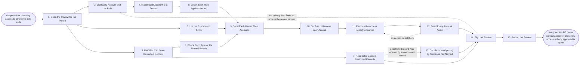

# Reference process: Review Access to Employee Data

`ref/hr/review-access-to-employee-data v1`

**value stream:** [HR operations](../../streams/human-resources/hr-operations.md)
Each period the company checks who can open the personal data it holds
about its employees. The tool-administrator agent lists every account in
each human resources (HR) system with its role, its permissions and its
last use, and every report, export and integration that carries employee
data out of those systems, and it matches each account to a current
employee or to a service with an approved owner. The
employee-record-keeper agent lists everyone who can open the health,
investigation and background check records, checks each one against the
named people allowed for that record, and reads the log of who opened
them without reading what the records say. Each access owner confirms or
removes the access of the people they answer for, and the
tool-administrator agent removes every access nobody confirmed and reads
the accounts again. The privacy lead decides what follows whenever a
restricted record was opened by someone not named, with counsel where it
may be a breach of personal data. The run closes when every access left
in the HR systems has a named approver, every access nobody approved is
gone, and the privacy lead has signed the review.

**delivers:** status board, an employee data access review

## The goals

- Finish each review within [15 days] of the period's end
- Remove [100%] of access nobody approved by the review's close
- Keep access removed in error below [2%] of removals
- Keep openings of restricted records by anyone not named at [zero]

## The activities

| # | Activity | What happens | Agents |
|---|---|---|---|
| 1 | Open the Review for the Period | the systems in scope, the access owners and the dates | [tool-administrator](../../agents/tool-administrator.md) |
| 2 | List Every Account and Its Role | each account, its role, its permissions and its last use | tool-administrator |
| 3 | List the Exports and Links | reports, exports and integrations carrying employee data out | tool-administrator |
| 4 | Match Each Account to a Person | a current employee, an approved service, or nobody | tool-administrator |
| 5 | List Who Can Open Restricted Records | health, investigation and background check records | [employee-record-keeper](../../agents/employee-record-keeper.md) |
| 6 | Check Each Against the Named People | each person against the people allowed for that record | employee-record-keeper |
| 7 | Read Who Opened Restricted Records | the period's log of openings, against the named people | employee-record-keeper |
| 8 | Check Each Role Against the Job | access wider than the job needs, and roles that clash | tool-administrator |
| 9 | Send Each Owner Their Accounts | each access owner gets the accesses they answer for | tool-administrator |
| 10 | Confirm or Remove Each Access | the owner confirms each access or marks it to go | access owner (person) |
| 11 | Remove the Access Nobody Approved | removed on the review's close date | tool-administrator |
| 12 | Read Every Account Again | the list read again to confirm each removal took | tool-administrator |
| 13 | Decide on an Opening by Someone Not Named | whether it is a breach, and what follows | privacy lead (person) · counsel (person) |
| 14 | Sign the Review | the privacy lead signs the review | privacy lead (person) |
| 15 | Record the Review | what was found, removed and decided, kept for auditors | tool-administrator |

Accounts are opened and closed day to day at
`ref/hr/prepare-for-a-new-hire` and `ref/hr/offboard-a-leaver`, and this
review catches what those missed. A company that reviews the access to
all its tools at `ref/rev/administer-a-tool` may run this review with it,
and this one adds the check of the restricted records and the log of who
opened them.

## The graph



## The document, with the blanks marked

```
PROCESS: review access to employee data  id: <team>/review-access-to-employee-data   v1
from: ref/hr/review-access-to-employee-data v1
owner: <who>                          effective: <date>
trigger: a review period ends on <your access review calendar>, or <your
         privacy lead role> calls a review out of cycle
         watch: record=<access review> system=<your access review calendar>
                change=<a review period ends>
concurrency: one review per period is open at a time, and an out-of-cycle
             review of one system runs beside it and joins its record
goal: every access to an HR system confirmed by a named approver or
      removed within <days> of the period's end, and every opening of a
      restricted record matched to a named person allowed to open it
phases:
  open-review          - system: the review opened with the systems in
                         scope, the access owner for each group of
                         accounts, the period and the close date
                         owner: tool-administrator  after: trigger
                         automation: <level>
  list-accounts        - runs collect-and-report: every account in each HR
                         system, with its role, its permissions, who
                         approved it and when it was last used
                         owner: tool-administrator  after: open-review
                         automation: <level>
  list-exports         - runs collect-and-report: every scheduled report,
                         export and integration that carries employee data
                         out of an HR system, with its owner and where it
                         goes
                         owner: tool-administrator  after: open-review
                         automation: <level>
  match-accounts       - runs assessment: each account matched to a current
                         employee, to a service with an approved owner, or
                         to nobody, read against <your HR system> and the
                         leaving records for the period
                         owner: tool-administrator  after: list-accounts
                         automation: <level>
  list-restricted      - runs collect-and-report: everyone who can open the
                         health, investigation and background check
                         records, in each place those records are held
                         owner: employee-record-keeper
                         after: open-review         automation: <level>
  check-restricted     - runs assessment: each person who can open a
                         restricted record read against the named people
                         allowed for that record, and anyone else marked to
                         go at once
                         owner: employee-record-keeper
                         after: list-restricted     automation: <level>
  read-access-log      - runs assessment: the period's log of who opened
                         each restricted record, read against the named
                         people allowed, without reading what the records
                         say
                         owner: employee-record-keeper
                         after: list-restricted     automation: <level>
  check-roles          - runs assessment: each role read against the job of
                         the person who holds it under <your role
                         definitions>, and any pair of roles on <your list
                         of roles that must not be combined> marked
                         owner: tool-administrator  after: match-accounts
                         automation: <level>
  send-to-owners       - system: each access owner sent the accesses they
                         answer for, with what each check found and the
                         close date
                         owner: tool-administrator
                         after: list-exports + check-roles +
                         check-restricted           automation: <level>
  confirm-access       - convenes approval: each access owner confirms each
                         access, export and link that should stay, or marks
                         it to go, and never confirms their own
                         owner: <your access owner role>
                         after: send-to-owners      by: <close date>
                         automation: never
  remove-unapproved    - system: every access, export and link nobody
                         confirmed, and every one marked to go, removed on
                         the close date in <your access system>
                         owner: tool-administrator  after: confirm-access
                         automation: <level>
  read-again           - runs assessment: every account read again after
                         the removals, to confirm each one took
                         owner: tool-administrator
                         after: remove-unapproved   automation: <level>
  decide-opening       - convenes decide-and-announce: for each opening of
                         a restricted record by someone not named, whether
                         it is a breach of personal data, whether <your
                         jurisdiction's breach notification rule> requires
                         a report, and what follows
                         owner: <your privacy lead role>
                         after: read-access-log     by: <hours>
                         automation: never
  sign-review          - convenes approval: <your privacy lead role> signs
                         the review once every remaining access has a named
                         approver
                         owner: <your privacy lead role>
                         after: read-again + read-access-log, and
                         decide-opening when it ran
                         automation: never
  record-review        - runs collect-and-report: what each check found,
                         what was removed, what was decided, and the signed
                         review, kept for <your retention period>
                         owner: tool-administrator  after: sign-review
                         automation: <level>
run-scoped:
  close-date - runs roll-call               owner: tool-administrator
               every: <cadence>
               from: send-to-owners  until: remove-unapproved
  findings   - runs collect-and-report      owner: tool-administrator
               from: open-review     until: run close
handoffs:
  open-review -> list-accounts / list-exports / list-restricted
    [review-scope]: the systems, the access owners, the period and the
    close date
  list-accounts -> match-accounts [account-list]: every account with its
    role, its permissions, its approver and its last use
  match-accounts -> check-roles [matched-accounts]: each account with the
    person or service it belongs to, or marked as belonging to nobody
  list-exports -> send-to-owners [export-list]: every report, export and
    link that carries employee data out, with its owner
  list-restricted -> check-restricted / read-access-log
    [restricted-access-list]: everyone who can open each restricted
    record
  check-restricted -> send-to-owners [restricted-findings]: each person
    who can open a restricted record without being named
  check-roles -> send-to-owners [role-findings]: access wider than the job
    and each pair of roles that clash
  send-to-owners -> confirm-access [owner-lists]: each owner's accesses
    with what the checks found
  confirm-access -> remove-unapproved [owner-answers]: each access
    confirmed, marked to go or left unanswered
  remove-unapproved -> read-again [removals]: each access removed, and
    when
  read-access-log -> decide-opening [unnamed-openings]: each opening by
    someone not named, with the date, the record and the account
  read-again -> sign-review [confirmed-removals]: the accounts as they now
    stand, each with a named approver
  read-access-log -> sign-review [access-log-reading]: the period's
    openings, each matched to a named person or passed on
  decide-opening -> sign-review [opening-decisions]: the decision on each
    opening and the person who made it
  sign-review -> record-review [signed-review]: the review as signed
deviations:
  read-access-log -> decide-opening [opened-by-someone-not-named]: a
    restricted record was opened by someone not named, so the privacy
    lead decides what follows within <hours>
  read-again -> remove-unapproved [access-still-there]: an access is still
    there after its removal, so it is removed again and the reason traced
  sign-review -> list-accounts [review-incomplete]: the privacy lead finds
    an access the review missed, so the lists are read again
bindings:
  roster:  <who holds each role - agents claiming the abstract agents
           above, and named people for the privacy lead, counsel, the HR
           system administrator and each access owner>
  systems: <your HR system> (read), <your payroll system> (read), <your
           benefits system> (read), <your applicant tracking system>
           (read), <your learning system> (read), <your restricted
           records store> (read, its access list and log only), <your
           access system> (write), the access review record (write), the
           notification channel (write)
  data:    <your access review calendar>, the named people allowed for
           each restricted record, <your role definitions> <version>,
           <your list of roles that must not be combined> <version>, the
           leaving records for the period
policy:
  every access to an HR system has a named approver, and an access nobody
    confirms by the close date is removed on that date
  only the named people allowed for each health, investigation or
    background check record can open it, and any other access to it is
    removed on the day it is found
  the agents list, check and remove access, and a person confirms every
    access that stays
  an access owner never confirms their own access
  the review reads who can open what and who opened it, and it never
    reads what the restricted records say
  an account that belongs to someone who has left is closed on the day it
    is found, and the leaving record is checked to see how it was missed
  whether an opening by someone not named is a breach, and whether it
    must be reported under <your jurisdiction's breach notification rule>,
    is decided by <your privacy lead role> with counsel, and an agent
    never decides it
  one person never holds both the access to change an employee's bank
    details and the access to approve a payroll, unless <who> approves it
    in writing with another check in its place
measures:
  cycle time: <days> from the period's end to the review signed
  on time: <target> share of reviews signed within <days>
  removals: <accesses removed per review>, and <how many> restored as
            removed in error
  volume: <accounts reviewed per period>
  quality gate: every remaining access traces to a named approver in this
                review, and every opening of a restricted record to a
                named person allowed to open it
```

## The failure edges

- **An account belongs to nobody, or to someone who has left.** The
  tool-administrator agent closes the account of someone who has left on
  the day it is found, and the leaving record at
  `ref/hr/offboard-a-leaver` is checked to see why it was missed. An
  account that belongs to nobody is removed on the close date unless an
  owner claims it and confirms it.
- **An access owner does not answer.** The close-date roll-call reminds
  the owner and then the owner's manager. An access still unconfirmed on
  the close date is removed, and the person who loses it asks again
  through the normal access request.
- **Someone can open a restricted record without being named.** That
  access is removed on the day it is found, and the employee-record-keeper
  agent tells the privacy lead how it came about, such as a shared folder
  or a role that was too wide.
- **A restricted record was opened by someone not named.** The privacy
  lead decides within the hours the company sets, with counsel, whether
  it is a breach and whether
  `<your jurisdiction's breach notification rule>` requires a report.
  Anything that follows for the person who
  opened it is decided by a named person through
  `ref/hr/resolve-an-employee-concern` or
  `ref/hr/issue-a-disciplinary-action`, and this review decides nothing
  about that person.
- **Two roles clash.** The access owner chooses which role the person
  keeps. Where the work needs both, a named person approves it in writing
  with another check in its place, and the next review reads it again.
- **An access was removed in error.** The access owner asks for it again,
  and it is restored through the normal access request on the same day.
  The count of removals made in error is kept, so the next review can see
  whether owners are answering too late.
- **An access is still there after its removal.** It is removed again and
  the reason is traced, such as a second account or a group the person
  belongs to.
- **The trigger fires while a run is in flight.** One review per period is
  open at a time. An out-of-cycle review of one system runs beside it and
  joins its record.
- **A run is abandoned.** A system leaves the company's use during the
  review, so its part of the review stops and its accounts close with it
  at `ref/rev/retire-a-tool`, and the record says so. The rest of the
  review goes on.
