# Reference process: Run a Layoff

`ref/hr/run-a-layoff v1`

**value stream:** [Leaving the company](../../streams/human-resources/leaving-the-company.md)
The company has to reduce its roles. The executive sponsor writes down
the business reason and the saving it needs, and the workforce-planner
agent models the ways to reach it, from fewer hires and moves to fewer
roles, each with its cost. Once the executive team decides to proceed,
the roles affected are listed and the selection criteria are fixed and
written down before any name is applied. The separation-coordinator agent
keeps the calendar of every notice and consultation `<your jurisdiction's
rules on collective dismissal>` require, and the record behind each
decision. Department heads score each person in the pool on the written
criteria with evidence. The statistician agent checks the selection for unfair
outcomes across groups, on data a named person releases for that check
alone, and reports only groups above a minimum size. Counsel reviews the
selection, and named leaders decide who is selected. The comms-manager
agent plans the order in which people hear, so each person affected is
told in person and in private before anyone else is told. The run closes
when every person selected has been told, each one's leaving has started,
and what the layoff taught is written down.

**delivers:** verdict, a layoff decision

**starts:** by hand, the executive sponsor opens a proposed reduction in roles

## The goals

- Reach [100%] of the saving the business reason set
- Move [20%] of selected people into open roles
- Tell every affected person within [60 days] of the decision to proceed
- Keep successful challenges below [1%] of people selected

## The activities

| # | Activity | What happens | Agents |
|---|---|---|---|
| 1 | Write Down the Business Reason | why roles must be cut, with the labor cost against the plan | executive sponsor (person) · [workforce-planner](../../agents/workforce-planner.md) |
| 2 | Model the Options | fewer hires, moves, fewer hours or roles, each with its cost | workforce-planner |
| 3 | Decide to Proceed | the executive team decides if roles are cut, and how many | executive sponsor (person) · head of HR (person) |
| 4 | List the Roles Affected | the roles, teams and locations in each selection pool | workforce-planner · department heads (person) |
| 5 | Fix the Selection Criteria | the criteria and weights, written before any name is applied | head of HR (person) · counsel (person) |
| 6 | Set the Notice and Consultation Calendar | every notice, consultation and waiting period with its date | [separation-coordinator](../../agents/separation-coordinator.md) · counsel (person) |
| 7 | Give the Required Notices | signed notices to representatives and authorities, on time | separation-coordinator · head of HR (person) |
| 8 | Consult the Employee Representatives | each proposal heard and answered, where local rules require | head of HR (person) · employee representatives (person) · separation-coordinator |
| 9 | Apply the Criteria | everyone in the pool scored on the criteria with evidence | department heads (person) · separation-coordinator |
| 10 | Check the Selection Across Groups | outcomes by group above the minimum size, on released data | [statistician](../../agents/statistician.md) · head of HR (person) |
| 11 | Review the Selection with Counsel | the scores, the evidence and the group check | counsel (person) · head of HR (person) |
| 12 | Decide Who Is Selected | named leaders confirm each person selected | executive sponsor (person) · head of HR (person) |
| 13 | Look for Other Roles | the open positions each selected person could take | workforce-planner · HR business partner (person) |
| 14 | Draft Each Person's Letter | the notice, the last day, the terms on offer and the support | separation-coordinator |
| 15 | Sign the Letters | a named person signs each letter before anyone is told | head of HR (person) |
| 16 | Plan the Announcement | who hears first, from whom, and what everyone else is told | [comms-manager](../../agents/comms-manager.md) |
| 17 | Tell Each Person in Person | each person told by their manager with HR, in private | manager (person) · HR business partner (person) |
| 18 | Announce to the Staff | the staff message once everyone affected has been told | comms-manager · executive sponsor (person) |
| 19 | Start Each Person's Leaving | one offboarding run per person, and terms where offered | separation-coordinator |
| 20 | Record What the Layoff Taught | what failed, what the group check showed, and what to change | separation-coordinator · head of HR (person) |

Each person selected leaves through their own run of
`ref/hr/offboard-a-leaver`, and separation terms, where the company offers
them, are agreed person by person at
`ref/hr/negotiate-a-separation-agreement`. A selected person who takes an
open role moves through `ref/hr/move-an-employee-to-a-new-role`, where the
hiring manager chooses on the usual criteria. The workforce plan is
changed afterwards at `ref/hr/plan-the-workforce`, and a reduction that
also changes reporting lines runs `ref/hr/change-the-organization-structure`
beside this one.

## The graph

```mermaid
flowchart LR
  T([the executive sponsor opens a proposed reduction in roles]) --> A1[1. Write Down the Business Reason]
  A1 --> A2[2. Model the Options]
  A2 --> A3[3. Decide to Proceed]
  A3 -. the executive team asks for other options .-> A2
  A3 --> A4[4. List the Roles Affected]
  A4 --> A5[5. Fix the Selection Criteria]
  A5 --> A6[6. Set the Notice and Consultation Calendar]
  A6 --> A7[7. Give the Required Notices]
  A7 --> A8[8. Consult the Employee Representatives]
  A8 -. consultation changes the pool or the criteria .-> A5
  A6 --> A9[9. Apply the Criteria]
  A9 --> A10[10. Check the Selection Across Groups]
  A10 -. a group outcome the criteria do not explain .-> A9
  A10 --> A11[11. Review the Selection with Counsel]
  A11 -. a score has no evidence .-> A9
  A8 --> A12[12. Decide Who Is Selected]
  A11 --> A12
  A12 --> A13[13. Look for Other Roles]
  A13 --> A14[14. Draft Each Person's Letter]
  A14 --> A15[15. Sign the Letters]
  A15 -. a letter needs changes .-> A14
  A12 --> A16[16. Plan the Announcement]
  A15 --> A17[17. Tell Each Person in Person]
  A16 --> A17
  A17 --> A18[18. Announce to the Staff]
  A17 --> A19[19. Start Each Person's Leaving]
  A18 --> A20[20. Record What the Layoff Taught]
  A19 --> A20
  A20 --> DONE([every person selected has been told, and each one's leaving has started])
```



## The document, with the blanks marked

```
PROCESS: run a layoff                 id: <team>/run-a-layoff   v1
from: ref/hr/run-a-layoff v1
owner: <who>                          effective: <date>
trigger: <your executive sponsor role> opens a proposed reduction in
         roles with its business reason in <your workforce planning
         system>
         watch: record=<proposed reduction>
                system=<your workforce planning system>
                change=<a reduction is opened with its business reason>
concurrency: one layoff is one run, and a second reduction opened while
             one is in flight joins it or waits for it, because <your
             jurisdiction's rules on collective dismissal> may count
             reductions close in time together
goal: the reduction decided by named leaders on written criteria fixed
      before any name was applied and checked across groups, every
      notice and consultation <your jurisdiction's rules on collective
      dismissal> require done on its date, each person selected told in
      person before the staff announcement, and each one's leaving
      started
phases:
  write-reason         - human: <your executive sponsor role> writes down
                         why roles must be reduced and the saving needed,
                         with the labor cost against the plan from
                         workforce-planner
                         owner: <your executive sponsor role>
                         after: trigger             automation: <level>
  model-options        - runs assessment: the ways to reach the saving,
                         such as fewer hires, moves into open roles,
                         reduced hours and fewer roles, each with its cost,
                         its timing and the number of people it affects
                         owner: workforce-planner
                         after: write-reason        automation: <level>
  decide-to-proceed    - convenes decide-and-announce: the executive team
                         decides whether to reduce roles, by how many and
                         by when, under <your delegation of authority>
                         owner: <your executive sponsor role>
                         after: model-options       automation: never
  list-roles           - runs collect-and-report: the roles, teams and
                         locations in each selection pool, with the
                         department heads' reasons for each pool and no
                         names attached
                         owner: workforce-planner
                         after: decide-to-proceed   automation: <level>
  fix-criteria         - convenes approval: the selection criteria and
                         their weights, written from the work, the skills
                         and the evidence <your selection policy> names,
                         read by <your counsel role> for any unfair effect,
                         and signed before any name is applied
                         owner: <your head of HR role>
                         after: list-roles          automation: never
  set-calendar         - runs assessment: every notice, consultation and
                         waiting period <your jurisdiction's rules on
                         collective dismissal> require for the number of
                         people and the places affected, each with its
                         date, confirmed by <your counsel role>
                         owner: separation-coordinator
                         after: fix-criteria        automation: <level>
  give-notices         - convenes approval: each notice to the employee
                         representatives and to <the authorities your
                         jurisdiction names>, drafted by
                         separation-coordinator, signed by <your head of
                         HR role> and sent on its date
                         owner: <your head of HR role>
                         after: set-calendar        by: <the calendar date>
                         automation: never
  consult              - convenes briefing: each consultation meeting held
                         with the employee representatives where the local
                         rules require it, and every proposal they make
                         recorded with its written answer
                         owner: <your head of HR role>
                         after: give-notices
                         every: <cadence>           automation: never
  apply-criteria       - human: <your department head role> scores each
                         person in the pool on the written criteria, with
                         the evidence behind each score, and
                         separation-coordinator records each score and
                         marks any without evidence
                         owner: <your department head role>
                         after: set-calendar        automation: never
  check-groups         - runs assessment: selection rates compared across
                         groups on the data <your head of HR role> releases
                         for this check alone, reported only for groups of
                         at least <the minimum group size>, and never as a
                         result about one person
                         owner: statistician
                         after: apply-criteria      automation: <level>
  review-with-counsel  - human: <your counsel role> reads the scores, the
                         evidence and the group check, and writes down the
                         risks and any score to be looked at again
                         owner: <your counsel role>
                         after: check-groups        by: <days>
                         automation: never
  decide-selection     - convenes decide-and-announce: named leaders
                         confirm each person selected, and record what they
                         decided about each result of the group check
                         owner: <your executive sponsor role>
                         after: consult + review-with-counsel
                         automation: never
  look-for-roles       - runs collect-and-report: the open positions in
                         the workforce plan that each selected person could
                         apply for or be offered, under <your jurisdiction's
                         rules on alternative work>
                         owner: workforce-planner
                         after: decide-selection    automation: <level>
  draft-letters        - human: one letter for each person selected, with
                         the reason, the notice, the last day, the open
                         roles they could take, any terms on offer within
                         <your separation policy>, and the support, on
                         <your layoff letter template>
                         owner: separation-coordinator
                         after: look-for-roles      automation: <level>
  sign-letters         - convenes approval: <your head of HR role> signs
                         each letter as a named signer before anyone is
                         told
                         owner: <your head of HR role>
                         after: draft-letters       automation: never
  plan-announcement    - human: the order in which people hear, who tells
                         each person, the time access ends for each, the
                         staff message and the answers to likely
                         questions, signed off by <your executive sponsor
                         role>
                         owner: comms-manager
                         after: decide-selection    automation: <level>
  tell-each-person     - convenes briefing: each person told in person and
                         in private by their manager with the HR business
                         partner present, and handed the signed letter
                         owner: <your manager role>
                         after: sign-letters + plan-announcement
                         by: <the announcement date>   automation: never
  announce-to-staff    - human: the staff message sent once every person
                         affected has been told, with the questions it
                         raises answered on the channel the plan names
                         owner: comms-manager
                         after: tell-each-person    automation: <level>
  start-leaving        - human: one run of ref/hr/offboard-a-leaver for
                         each person selected, and one run of
                         ref/hr/negotiate-a-separation-agreement for each
                         person offered terms
                         owner: separation-coordinator
                         after: tell-each-person    automation: <level>
  record-learning      - convenes debrief: what went wrong, what the group
                         check showed and what was done about it, the
                         challenges received, and what the next reduction
                         does differently
                         owner: separation-coordinator
                         after: announce-to-staff + start-leaving
                         automation: <level>
run-scoped:
  calendar - runs roll-call                  owner: separation-coordinator
             every: <cadence>
             from: set-calendar      until: start-leaving
  record   - runs collect-and-report         owner: separation-coordinator
             from: write-reason      until: run close
handoffs:
  write-reason -> model-options [business-reason]: why roles must be
    reduced, the saving needed, and the labor cost against the plan
  model-options -> decide-to-proceed [reduction-options]: each option
    with its cost, its timing and the number of people it affects
  decide-to-proceed -> list-roles [decision-to-proceed]: how many roles,
    by when, and who decided
  list-roles -> fix-criteria [selection-pools]: each pool's roles, teams
    and locations, with no names attached
  fix-criteria -> set-calendar [signed-criteria]: the criteria and their
    weights, signed and dated. A change after signing needs <who> and
    counsel to agree in writing, and every score is then done again
  set-calendar -> give-notices / apply-criteria [notice-calendar]: every
    notice, consultation and waiting period with its date
  give-notices -> consult [notices-given]: each notice, who received it,
    and the date it was sent
  consult -> decide-selection [consultation-record]: every proposal from
    the representatives and its written answer
  apply-criteria -> check-groups [scores]: each person's score on each
    criterion with its evidence
  check-groups -> review-with-counsel [group-check]: the selection rates
    by group above the minimum size, with the method and the data used
  review-with-counsel -> decide-selection [counsel-review]: counsel's
    written view of the scores, the evidence and the group check
  decide-selection -> look-for-roles / plan-announcement
    [selection-decision]: each person selected, the decision on each
    group check result, and the names of the leaders who decided
  look-for-roles -> draft-letters [open-roles]: the open positions each
    selected person could take
  draft-letters -> sign-letters [draft-letters]: one letter for each
    person, at a version
  sign-letters -> tell-each-person [signed-letters]: the signed letters.
    A change to a letter voids its signature
  plan-announcement -> tell-each-person [announcement-plan]: who tells
    each person, the order, the time access ends, and the staff message
  tell-each-person -> announce-to-staff / start-leaving [people-told]:
    each person told, the time, and who told them
  announce-to-staff -> record-learning [staff-announced]: the message as
    sent, and the questions it raised with their answers
  start-leaving -> record-learning [leaving-runs]: each offboarding run
    and each separation agreement run opened
deviations:
  decide-to-proceed -> model-options [other-options-asked]: the executive
    team asks for other ways to reach the saving, so they are modeled
    before anyone is selected
  consult -> fix-criteria [consultation-changes-plan]: consultation
    changes the pool or the criteria, so they are fixed again, signed
    again, and every score is done again
  check-groups -> apply-criteria [unexplained-group-outcome]: a group is
    selected at a rate the criteria do not explain, so each score's
    evidence is reviewed before counsel reads the selection
  review-with-counsel -> apply-criteria [score-without-evidence]: a score
    has no evidence, so the department head scores that person again with
    the evidence written down
  sign-letters -> draft-letters [letter-changes]: the signer changes a
    letter, so it is drafted again at a new version
bindings:
  roster:  <who holds each role - agents claiming the abstract agents
           above, and named people for the executive sponsor, the head of
           HR, the department heads, counsel, the managers, the HR
           business partners and the employee representatives>
  systems: the workforce planning system (write), the HR system (read),
           the restricted analysis area (read), the document store
           (write), the signature system (trigger), the staff channel
           (write), the notification channel (write)
  data:    <your selection policy> <version>, <your separation policy>
           <version>, <your jurisdiction's rules on collective
           dismissal>, <your delegation of authority> <version>, <your
           layoff letter template> <version>, the workforce plan
           <version>
policy:
  the business reason and the selection criteria are written and signed
    before any name is applied, and a criterion changes after that only
    when <who> and counsel agree in writing, with every score then done
    again
  agents never weigh a protected characteristic, and the criteria and the
    scores rest on the work, the skills and the evidence <your selection
    policy> names
  the group check runs only on data <your head of HR role> releases for
    that check alone, reports only groups of at least <the minimum group
    size>, never reports a result about one person, and its data is
    deleted when the check closes
  who is selected is decided only by named people, and an agent never
    scores, ranks or selects a person
  every notice and consultation <your jurisdiction's rules on collective
    dismissal> require is done on its date before any selection is final
  each person affected hears in person and in private before the staff
    announcement, and nobody learns of their own selection from a
    message, a system or a closed account
  the list of people selected is open only to <your access list for the
    layoff> until each of them has been told
  each person selected is told of the open positions they could take
measures:
  cycle time: <days> from the business reason to the last person told
  on time: <target> share of notices and consultations done on their
           dates
  volume: <reductions per year> and <people affected per reduction>
  quality gate: every selection traces to a score on the written
                criteria with its evidence, and every group check result
                carries the named leaders' written decision on it
```

## The failure edges

- **The executive team asks for other options.** The workforce-planner
  agent models them, and nobody is selected until the executive team has
  decided how many roles go. A saving that fewer hires or moves can reach
  is taken that way first where the leaders agree.
- **Consultation changes the plan.** The representatives' proposals
  change the pool or the criteria. The criteria are fixed and signed
  again, every score is done again, and the calendar is checked for any
  notice that has to be given again.
- **The group check shows an outcome the criteria do not explain.** The
  statistician agent reports the groups and the rates, and never a
  person. Each score's evidence is reviewed. When a criterion itself
  causes the outcome, named people decide whether to change it, and a
  changed criterion means every score is done again. The decision and its
  reason go into the record.
- **A score has no evidence.** The department head scores that person
  again with the evidence written down. A score that still has no
  evidence is left out, and the person is scored on the criteria that do.
- **A selected person is on leave.** The person is selected on the same
  criteria as everyone else, and the leave plays no part in the score.
  The HR business partner agrees with counsel how and when to tell them,
  and they are told before the staff announcement like everyone else.
- **Word gets out before people are told.** The comms-manager agent
  brings the plan forward with the executive sponsor, and every person
  selected is told in person as soon as it can be arranged. Nobody learns
  of their own selection from a rumor left unanswered.
- **A selected person takes an open role.** The move runs at its own
  process, and the person leaves the selection. The saving is read again,
  and nobody else is selected in that person's place without a new
  decision by named leaders.
- **The trigger fires while a run is in flight.** A second reduction
  opened while one is in flight joins it or waits for it, because the
  local rules may count the two together. Counsel decides which, and the
  calendar is worked out again for the combined number.
- **A run is abandoned.** The executive team decides not to reduce roles.
  The representatives and any authority already notified are told in
  writing, the scores and the group data are deleted under `<your record
  retention schedule>`, and nobody is told they were selected. When
  anyone already knew, they are told in writing that their role stays.
