# Reference process: Run a New Hire's First Months

`ref/hr/run-a-new-hires-first-months v1`

**value stream:** [Onboarding](../../streams/human-resources/onboarding.md)
A new hire has started, and the manager and the new hire now agree what
the first months should achieve. The onboarding-manager agent drafts a
plan from the job and the manager's briefing, the two of them agree it,
and the commitment-keeper agent loads each objective with one owner, one
date and a state into a record that only they and the HR business partner
can open, then puts each check-in on both calendars. At each check-in the
manager and the new hire read the plan together, and the agent records
what is met, running or late and the support asked for. Where the
contract sets a probation period, the employee-record-keeper agent
confirms its closing date and terms, and the manager decides with the HR
business partner, on the evidence of the work, to confirm, extend or end
it before that date. The run closes when the outcome is on the employee
record, the new hire has it in writing, and the objectives still open
have passed to the performance review.

**delivers:** document, a plan for the first months

## The goals

- Agree the plan within [10 working days] of the start
- Hold [95%] of check-ins on their dates
- Extend no more than [10%] of probations
- Keep [90%] of new hires past their first year

## The activities

| # | Activity | What happens | Agents |
|---|---|---|---|
| 1 | Take in the New Hire | the job, manager, start date and any probation period | [onboarding-manager](../../agents/onboarding-manager.md) |
| 2 | Draft the Plan for the First Months | objectives for the first weeks and months, from the job | onboarding-manager |
| 3 | Agree the Plan | the objectives, support and check-in dates, agreed by both | manager (person) · new hire (person) |
| 4 | Load the Plan into the Tracker | each objective with one owner, one date and a state | [commitment-keeper](../../agents/commitment-keeper.md) |
| 5 | Set the Check-In Dates | each check-in on both calendars, showing the probation date | commitment-keeper |
| 6 | Hold Each Check-In | the manager and the new hire read the plan together | manager (person) · new hire (person) |
| 7 | Record the Check-In | each objective's state, and the support asked for | commitment-keeper |
| 8 | Rebook a Missed Check-In | a new date within days, and the manager told | onboarding-manager |
| 9 | Ask the New Hire How the Start Went | a few private questions, read by the HR business partner | onboarding-manager · HR business partner (person) |
| 10 | Confirm the Probation Terms | the closing date, the notice and the steps the contract sets | [employee-record-keeper](../../agents/employee-record-keeper.md) · HR business partner (person) |
| 11 | Prepare the Probation Review | the plan, check-ins and support given, for the manager | onboarding-manager · commitment-keeper |
| 12 | Decide the Probation | the manager confirms, extends or ends it before it closes | manager (person) · HR business partner (person) |
| 13 | Tell the New Hire the Outcome | in a conversation with the manager, then in a letter | manager (person) · onboarding-manager |
| 14 | Record the Outcome | the outcome, who decided and when, on the employee record | employee-record-keeper |
| 15 | Hand an Ended Employment to Offboarding | the last day and the outcome passed to the leaving process | employee-record-keeper · HR business partner (person) |
| 16 | Close the Plan | each objective met, carried into the review, or closed | commitment-keeper · manager (person) |
| 17 | Record What the First Months Taught | what helped, what was missing and what the next plan changes | onboarding-manager |

Where the contract sets no probation period, activities 10 to 15 do not
run, and the plan closes at activity 16 after its last check-in, with the
objectives still open carried into `ref/hr/run-the-performance-review`. A
concern the new hire raises goes to `ref/hr/resolve-an-employee-concern`,
a conduct matter to `ref/hr/issue-a-disciplinary-action`, and a request
for a change to the job or the workplace to
`ref/hr/handle-an-accommodation-request`, and none of them is written
into the plan.

## The graph

```mermaid
flowchart LR
  T([the new hire's first day is confirmed and the hire is handed on]) --> A1[1. Take in the New Hire]
  A1 --> A2[2. Draft the Plan for the First Months]
  A1 --> A10[10. Confirm the Probation Terms]
  A2 --> A3[3. Agree the Plan]
  A3 --> A4[4. Load the Plan into the Tracker]
  A4 --> A5[5. Set the Check-In Dates]
  A5 --> A6[6. Hold Each Check-In]
  A5 --> A9[9. Ask the New Hire How the Start Went]
  A6 -. the check-in does not happen .-> A8[8. Rebook a Missed Check-In]
  A8 -. the check-in has a new date .-> A6
  A6 --> A7[7. Record the Check-In]
  A7 -. another check-in is due .-> A6
  A7 --> A11[11. Prepare the Probation Review]
  A10 --> A11
  A11 --> A12[12. Decide the Probation]
  A12 -. the probation is extended .-> A3
  A12 --> A13[13. Tell the New Hire the Outcome]
  A13 --> A14[14. Record the Outcome]
  A14 -. the probation ended the employment .-> A15[15. Hand an Ended Employment to Offboarding]
  A14 --> A16[16. Close the Plan]
  A15 --> A16
  A7 -. the last check-in is held and no probation applies .-> A16
  A16 --> A17[17. Record What the First Months Taught]
  A9 --> A17
  A17 --> DONE([the plan is closed, and its outcome is on the employee record and in the new hire's hands])
```



## The document, with the blanks marked

```
PROCESS: new hire first months        id: <team>/run-a-new-hires-first-months   v1
from: ref/hr/run-a-new-hires-first-months v1
owner: <who>                          effective: <date>
trigger: the new hire is handed on from ref/hr/prepare-for-a-new-hire on
         the first day, in <your HR system>
         watch: record=<employee record> system=<your HR system>
                change=<the first day is confirmed>
concurrency: runs may overlap freely - one new hire is one run, and an
             extended probation keeps the same run with a new plan
goal: the plan for the first months agreed within <days> of the start,
      every check-in held on its date or moved with a reason, and the
      plan closed with a recorded outcome, which, where the contract
      sets a probation period, is the manager's decision to confirm,
      extend or end it, made before the date it closes
phases:
  take-in-hire         - system: the job, the manager, the start date,
                         the manager's briefing from the preparation,
                         and any probation period the contract sets
                         owner: onboarding-manager  after: trigger
                         automation: <level>
  draft-plan           - human: objectives for the first weeks and
                         months drawn from the job and the briefing, the
                         people to meet, the support the company gives,
                         and check-in dates on <your check-in cadence>
                         owner: onboarding-manager
                         after: take-in-hire        automation: <level>
  agree-plan           - convenes decide-and-announce: the manager and
                         the new hire agree the objectives, the support
                         and the check-in dates, and both can read the
                         plan at its version
                         owner: <your manager role>
                         after: draft-plan          by: <days>
                         automation: never
  load-plan            - system: each objective as an item with one
                         owner, one date and a state, in a record open
                         only to the new hire, the manager and <your HR
                         business partner role>
                         owner: commitment-keeper
                         after: agree-plan          automation: <level>
  set-check-ins        - system: each check-in on both calendars, with
                         the date the probation closes shown where one
                         applies
                         owner: commitment-keeper
                         after: load-plan           automation: <level>
  hold-check-in        - convenes briefing: the manager and the new hire
                         read the plan together, say what is going well
                         and what is not, and agree any change of
                         support
                         owner: <your manager role>
                         after: set-check-ins, and record-check-in while
                         check-ins remain           automation: never
  record-check-in      - runs roll-call: each objective read as met,
                         running, late or untouched, with the support
                         asked for and any change the two agreed
                         owner: commitment-keeper
                         after: hold-check-in       automation: <level>
  rebook-check-in      - system: a check-in that did not happen booked
                         again within <days>, and the manager told
                         owner: onboarding-manager
                         after: a check-in date that passes with no
                         check-in                   automation: <level>
  ask-new-hire         - runs collect-and-report: a few questions about
                         how the start went, asked in private at <days>
                         and at <days>, and read by <your HR business
                         partner role>, and by the manager only where
                         the new hire agrees
                         owner: onboarding-manager
                         after: set-check-ins       automation: <level>
  confirm-terms        - runs assessment: the date the probation closes,
                         the notice and the steps the contract and <your
                         jurisdiction's rules on probation> set, and any
                         change to the date from a leave, read from the
                         employee record
                         owner: employee-record-keeper
                         after: take-in-hire, when the contract sets a
                         probation period           automation: <level>
  prepare-review       - runs collect-and-report: the plan, the record
                         of each check-in, the support given and the
                         probation terms, for the manager <days> before
                         the probation closes, with no recommendation on
                         the outcome
                         owner: onboarding-manager
                         after: record-check-in + confirm-terms
                         automation: <level>
  decide-probation     - convenes decide-and-announce: the manager
                         confirms, extends or ends the probation with
                         <your HR business partner role> on the evidence
                         of the work, before the date it closes, with an
                         end read first against the contract and <your
                         jurisdiction's rules on ending employment in a
                         probation period>
                         owner: <your manager role>
                         after: prepare-review
                         by: <the date the probation closes>
                         automation: never
  deliver-outcome      - convenes briefing: the manager tells the new
                         hire the outcome in a conversation, with <your
                         HR business partner role> present for an
                         extension or an end, and the letter drafted
                         from <your letter template> follows it
                         owner: <your manager role>
                         after: decide-probation    automation: never
  record-outcome       - system: the outcome, the person who decided,
                         the date and the letter, on the employee record
                         owner: employee-record-keeper
                         after: deliver-outcome     automation: <level>
  hand-to-offboarding  - human: the last day and the outcome passed to
                         ref/hr/offboard-a-leaver, with the notice the
                         contract and <your jurisdiction's rules> set
                         owner: employee-record-keeper
                         after: record-outcome, when the probation ended
                         the employment             automation: <level>
  close-plan           - runs roll-call: every objective closed as met,
                         carried into ref/hr/run-the-performance-review
                         with its owner, or closed with the employment,
                         and the plan closed at its final version
                         owner: commitment-keeper
                         after: record-outcome, and hand-to-offboarding
                         when it ran, or record-check-in after the last
                         check-in where no probation applies
                         automation: <level>
  record-learning      - convenes debrief: what helped the new hire,
                         what was missing, which check-ins slipped, and
                         what the next plan for the first months does
                         differently
                         owner: onboarding-manager
                         after: close-plan          automation: <level>
run-scoped:
  check-ins      - runs roll-call               owner: commitment-keeper
                   every: <cadence>
                   from: set-check-ins  until: close-plan
  probation-date - runs roll-call               owner: employee-record-keeper
                   every: <cadence>
                   from: confirm-terms  until: record-outcome
handoffs:
  take-in-hire -> draft-plan / confirm-terms [new-hire]: the job, the
    manager, the start date, the briefing and any probation period
  draft-plan -> agree-plan [draft-plan]: the objectives, the support and
    the check-in dates, at a version
  agree-plan -> load-plan [agreed-plan]: the plan as both agreed it, at
    its version
  load-plan -> set-check-ins [tracked-plan]: each objective with one
    owner, one date and a state
  set-check-ins -> hold-check-in / ask-new-hire [check-in-dates]: each
    check-in date, on both calendars
  hold-check-in -> record-check-in [check-in-held]: what the two read
    and what they agreed
  record-check-in -> prepare-review / close-plan [check-in-record]: each
    objective's state after the check-in, and the support asked for
  confirm-terms -> prepare-review [probation-terms]: the closing date,
    the notice and the steps, with the clause behind each
  prepare-review -> decide-probation [review-pack]: the plan, the
    check-ins, the support given and the terms
  decide-probation -> deliver-outcome [probation-decision]: the outcome,
    the reasons drawn from the evidence of the work, and the person who
    decided
  deliver-outcome -> record-outcome [outcome-delivered]: the date of the
    conversation and the letter as sent
  record-outcome -> hand-to-offboarding / close-plan [recorded-outcome]:
    the outcome on the employee record, with its date
  hand-to-offboarding -> close-plan [leaving-started]: the leaving run
    started, with the last day
  ask-new-hire -> record-learning [start-feedback]: what the HR business
    partner takes from the answers, with nothing that names the new hire
  close-plan -> record-learning [closed-plan]: every objective closed or
    carried on, with its owner
deviations:
  hold-check-in -> rebook-check-in [check-in-missed]: a check-in does not
    happen on its date, so it is booked again and the manager is told
  rebook-check-in -> hold-check-in [check-in-rebooked]: the check-in has
    a new date, so it is held like any other
  record-check-in -> hold-check-in [more-check-ins]: check-ins remain in
    the plan, so the next one is held on its date
  decide-probation -> agree-plan [probation-extended]: the probation is
    extended, so the manager and the new hire agree a plan for the
    extension with its own objectives, check-ins and closing date
  record-outcome -> hand-to-offboarding [employment-ends]: the probation
    ended the employment, so the leaving starts at
    ref/hr/offboard-a-leaver
bindings:
  roster:  <who holds each role - agents claiming the abstract agents
           above, and named people for the manager, the new hire, the HR
           business partner, the head of HR and counsel>
  systems: the HR system (write), the commitment tracker (write), the
           calendar (write), the survey tool (write), the notification
           channel (write)
  data:    the plan for the first months <version>, the employment
           contract <version>, <your probation policy> <version>, <your
           jurisdiction's rules on probation> <version>, <your letter
           template> <version>, <your record retention schedule>
           <version>
policy:
  the probation decision, an extension and an end are made by <your
    manager role> with <your HR business partner role>, and never by an
    agent
  the review pack sets out the plan, the check-ins and the support
    given, and carries no recommendation on the outcome
  the plan and the check-ins record the work and the support, and
    nothing about health, family or the reason for a leave
  agents never weigh a protected characteristic in anything they do
    about a new hire
  a probation decision never rests on a concern the new hire raised, a
    leave they took or a request for an adjustment
  the plan is open only to the new hire, the manager and <your HR
    business partner role>
  the private answers about the start are read by <your HR business
    partner role>, and by the manager only where the new hire agrees
  a probation is extended only where the contract and <your
    jurisdiction's rules on probation> allow, once, for at most <weeks>
  where the closing date passes with no decision, the probation is
    treated as <your contract's rule on a probation that closes without
    a decision>, and the miss is reported to <who>
  an end is told to the new hire by the manager in a conversation with
    <your HR business partner role> present, and the letter follows the
    same day
measures:
  cycle time: <days> from the start to the agreed plan
  on time: <target> share of probations decided before the date they
           close
  volume: <new hires in their first months per period>
  quality gate: every outcome names who decided it and rests on the plan
                and the check-ins on the employee record
```

## The failure edges

- **A check-in does not happen.** The onboarding-manager agent books it
  again within the days the run sets and tells the manager. A second
  missed check-in goes to the HR business partner, and the run never
  counts a check-in as held because its date has passed.
- **An objective falls behind.** The manager and the new hire agree the
  support at the next check-in, and the commitment-keeper agent records
  the new date with the check-in that moved it. An objective moved twice
  goes to the HR business partner before it is moved again, and only the
  manager and the new hire change an objective.
- **The probation is extended.** The manager and the new hire agree a
  plan for the extension with its own objectives, check-ins and closing
  date. An extension is made only where the contract and the local rule
  allow it, only once, and the new hire hears the reason and the new date
  in writing.
- **The probation ends the employment.** The decision rests on the
  evidence of the work in the plan and the check-ins, read with the HR
  business partner and against the contract and the local rule, with
  counsel where the company requires it. The new hire hears it from the
  manager in person with the HR business partner present, the letter
  follows the same day, and the leaving runs at
  `ref/hr/offboard-a-leaver`.
- **The closing date passes with no decision.** The probation is treated
  as the contract sets for that case, the miss goes to the head of HR,
  and the closing dates of the manager's other open probations are read
  again the same day.
- **The new hire takes leave during the first months.** The leave runs at
  `ref/hr/manage-a-leave-of-absence`, and the plan pauses. The
  employee-record-keeper agent receives only the dates of the leave and
  moves the probation date only as the contract and the local rule allow.
  Nothing about the reason for the leave enters the plan.
- **The new hire raises a concern or asks for an adjustment.** It goes to
  its own process and its own restricted record, the plan holds no note
  of it, and the probation decision never rests on it.
- **The manager changes.** The new manager receives the plan and the
  check-in record, the HR business partner reads the plan with them
  before the next check-in, and the probation date stays where it was.
- **The trigger fires while a run is in flight.** A new hire has one
  first months run at a time. A move to another job during the first
  months keeps this run, and the manager of the new job agrees a new
  plan with the new hire.
- **A run is abandoned.** The new hire resigns during the first months.
  The leaving runs at `ref/hr/offboard-a-leaver`, the plan is closed with
  the reason, the employee record holds the outcome, and the private
  answers about the start are kept only as the retention schedule allows.
