# Reference process: Run a Performance Improvement Plan

`ref/hr/run-a-performance-improvement-plan v1`

**value stream:** [Performance and development](../../streams/human-resources/performance-and-development.md)
A manager sees a gap between what a job expects and the work an employee
is doing, and the gap has lasted past the ordinary feedback a manager
gives. The employee-case-keeper agent opens a restricted case with its
clock, and the performance-review-coordinator agent gathers the
objectives and the reviews already on the record and checks the
manager's written account of the gap for an example behind every point.
A named person decides whether a plan is the right route. The manager
and the employee meet, the employee is heard, and a plan is agreed with
objectives, dates and the support the company will give. The
commitment-keeper agent keeps score on every item in the plan, the
company's as well as the employee's, and opens each check-in on its
date, and the employee-case-keeper agent files each check-in note with
the employee's comments. A named person decides the outcome from that
record, and the employee hears it in a meeting and in writing. The run
closes when the case is closed with the outcome, the reasons, the person
who decided and every check-in on the record.

**delivers:** document, a performance improvement plan

## The goals

- Bring [60%] of employees on a plan back to meeting expectations
- Decide each plan's outcome within [90 days] of its start
- Hold [95%] of check-ins on their date
- Back [100%] of plans with an example for every point of the gap

## The activities

| # | Activity | What happens | Agents |
|---|---|---|---|
| 1 | Take In the Manager's Concern | the gap, how long it has lasted, and feedback already given | manager (person) · HR business partner (person) |
| 2 | Open the Restricted Case | a case with its clock, open only to the named people | [employee-case-keeper](../../agents/employee-case-keeper.md) |
| 3 | Gather the Record of the Work | the objectives, reviews and ratings already recorded | [performance-review-coordinator](../../agents/performance-review-coordinator.md) |
| 4 | Write the Gap Down | what the job expects and what the work has shown | manager (person) |
| 5 | Check the Written Gap for Evidence | an example for each point, and personality remarks flagged | performance-review-coordinator |
| 6 | Decide Whether a Plan Is the Right Route | a plan, coaching first, or another process | HR business partner (person) · manager's manager (person) |
| 7 | Draft the Plan | objectives, measures, dates and the company's support | manager (person) · HR business partner (person) |
| 8 | Meet the Employee | the gap, evidence and draft plan, and the employee heard | manager (person) · employee (person) · HR business partner (person) |
| 9 | Agree the Plan | the plan at a version, with the employee's comments attached | manager (person) · employee (person) · employee-case-keeper |
| 10 | Load the Plan into the Tracker | each item with one owner, one date and a state | [commitment-keeper](../../agents/commitment-keeper.md) |
| 11 | Give the Agreed Support | the coaching, training and time the company promised | manager (person) · commitment-keeper |
| 12 | Hold Each Check-In | each item read as met, running, late or untouched | commitment-keeper · manager (person) · employee (person) |
| 13 | Record Each Check-In | the written note, shared with the employee | employee-case-keeper · manager (person) |
| 14 | Decide the Outcome | met, extended once, or referred for a decision on dismissal | manager's manager (person) · HR business partner (person) |
| 15 | Tell the Employee in Writing | the outcome, the reasons and what follows | manager (person) · employee-case-keeper |
| 16 | Close the Case | the outcome recorded, and the file kept restricted | employee-case-keeper |

A gap that comes from conduct belongs to
`ref/hr/issue-a-disciplinary-action`, and a concern the employee raises
about the manager belongs to `ref/hr/resolve-an-employee-concern`. An
outcome that would end the employment starts
`ref/hr/dismiss-an-employee`, where it is decided again with counsel,
and this run ends no one's employment. The review record learns only
that a plan ran and how it ended.

## The graph

```mermaid
flowchart LR
  T([a manager raises a lasting gap in an employee's work with HR]) --> A1[1. Take In the Manager's Concern]
  A1 --> A2[2. Open the Restricted Case]
  A2 --> A3[3. Gather the Record of the Work]
  A3 --> A4[4. Write the Gap Down]
  A4 --> A5[5. Check the Written Gap for Evidence]
  A5 -. a point has no example behind it .-> A4
  A5 --> A6[6. Decide Whether a Plan Is the Right Route]
  A6 --> A7[7. Draft the Plan]
  A6 --> A16[16. Close the Case]
  A7 --> A8[8. Meet the Employee]
  A8 -. the employee shows the account left out facts .-> A4
  A8 --> A9[9. Agree the Plan]
  A9 --> A10[10. Load the Plan into the Tracker]
  A10 --> A11[11. Give the Agreed Support]
  A11 --> A12[12. Hold Each Check-In]
  A12 --> A13[13. Record Each Check-In]
  A13 -. the plan's end date has not come .-> A12
  A13 --> A14[14. Decide the Outcome]
  A14 -. the plan is extended once .-> A10
  A14 --> A15[15. Tell the Employee in Writing]
  A15 --> A16
  A16 --> DONE([the outcome is decided by a named person, given in writing, and the case is closed])
```



## The document, with the blanks marked

```
PROCESS: improvement plan  id: <team>/run-a-performance-improvement-plan   v1
from: ref/hr/run-a-performance-improvement-plan v1
owner: <who>                          effective: <date>
trigger: <your manager role> raises with <your HR business partner
         role> a gap in an employee's work that has lasted past the
         feedback already given, in <your HR case system>
         watch: record=<performance concern>
                system=<your HR case system>
                change=<a manager raises a lasting gap in an employee's
                work>
concurrency: one plan at a time for any one employee - a second concern
             about the same employee joins the open case, and runs for
             different employees overlap freely
goal: the gap written down with an example behind every point, a plan
      agreed with the employee with its dates and the company's
      support, every check-in held and recorded, and the outcome
      decided by a named person and given to the employee in writing
      within <weeks> of the plan's start
phases:
  take-in-concern  - human: the manager's account of the gap, how long
                     it has lasted, and the feedback already given and
                     when, with nothing about the employee's health or
                     private life
                     owner: <your HR business partner role>
                     after: trigger            automation: <level>
  open-case        - system: a restricted case opened with its clock,
                     open only to the manager, <your HR business partner
                     role> and <who>, with every access to it logged
                     owner: employee-case-keeper
                     after: take-in-concern    automation: <level>
  gather-record    - runs collect-and-report: the employee's objectives,
                     the reviews and final ratings already recorded, and
                     the dates of any approved leave without its reason,
                     for the manager and <your HR business partner role>
                     alone
                     owner: performance-review-coordinator
                     after: open-case          automation: <level>
  write-gap        - human: what the job expects, what the work has
                     shown, and an example with its date for each point,
                     written about the work
                     owner: <your manager role>
                     after: gather-record      by: <days>
                     automation: <level>
  check-gap        - runs assessment: each point read for an example of
                     the work behind it, and every remark about
                     personality flagged with its line named
                     owner: performance-review-coordinator
                     after: write-gap          automation: <level>
  decide-route     - convenes decide-and-announce: whether a plan is the
                     right route, or coaching first, or another process
                     where the matter is conduct or the employee has
                     asked for support, decided by <your HR business
                     partner role> with the manager's manager
                     owner: <your HR business partner role>
                     after: check-gap          automation: never
  draft-plan       - human: the objectives the employee must meet, a
                     measure and a date for each, the check-in dates,
                     the plan's length of <weeks>, and the support the
                     company will give, such as coaching, training or
                     time
                     owner: <your manager role>
                     after: decide-route       automation: <level>
  meet-employee    - convenes briefing: the manager and <your HR
                     business partner role> take the employee through
                     the gap, the evidence and the draft plan, the
                     employee is heard and may bring a companion where
                     <your jurisdiction's rules> allow, and the
                     employee's answer is noted
                     owner: <your manager role>
                     after: draft-plan         by: <days>
                     automation: never
  agree-plan       - convenes approval: the plan at a version, with the
                     employee's comments attached, signed by the manager
                     and given to the employee
                     owner: <your manager role>
                     after: meet-employee      automation: never
  load-plan        - system: each item in the plan, the employee's and
                     the company's, as an item with one owner, one date
                     and a state, in a restricted record the case links
                     to
                     owner: commitment-keeper
                     after: agree-plan         automation: <level>
  give-support     - human: the coaching, training and time the company
                     promised, given on the dates the plan sets, each
                     one marked done or late
                     owner: <your manager role>
                     after: load-plan          automation: <level>
  hold-check-in    - runs roll-call: each item read out as met, running,
                     late or untouched, the company's support among
                     them, at a meeting of the manager and the employee
                     on each check-in date
                     owner: commitment-keeper
                     after: give-support       every: <cadence>
                     automation: <level>
  record-check-in  - runs collect-and-report: the note of each check-in,
                     written by the manager, shared with the employee,
                     and filed in the case with the employee's comments
                     owner: employee-case-keeper
                     after: hold-check-in      automation: <level>
  decide-outcome   - convenes decide-and-announce: at the plan's end
                     date, the plan met and closed, extended once to
                     <weeks>, or the case referred to
                     ref/hr/dismiss-an-employee, decided from the
                     check-in record by
                     <your outcome decision role> and never by the
                     manager alone
                     owner: <your outcome decision role>
                     after: record-check-in    automation: never
  tell-outcome     - human: the outcome and the reasons given to the
                     employee in a meeting and in writing, with what
                     follows and the route to appeal that <your appeal
                     policy> sets
                     owner: <your manager role>
                     after: decide-outcome     by: <days>
                     automation: never
  close-case       - system: the outcome, the reasons and the person who
                     decided recorded, the review record told only that
                     a plan ran and its outcome, and the file kept
                     restricted under <your jurisdiction's rule on
                     keeping employee records>
                     owner: employee-case-keeper
                     after: tell-outcome, or decide-route when no plan
                     was chosen                automation: <level>
run-scoped:
  clock - runs roll-call                     owner: employee-case-keeper
          every: <cadence>
          from: open-case       until: tell-outcome
  file  - runs collect-and-report            owner: employee-case-keeper
          from: open-case       until: run close
handoffs:
  take-in-concern -> open-case [performance-concern]: the gap as the
    manager described it, how long it has lasted and the feedback
    already given
  open-case -> gather-record [restricted-case]: the case number, its
    clock and the named people who may open it
  gather-record -> write-gap [work-record]: the objectives, reviews and
    ratings already recorded, and leave dates without their reasons
  write-gap -> check-gap [written-gap]: the gap at a version, with an
    example and a date for each point
  check-gap -> decide-route [checked-gap]: the gap with an example behind
    every point and no flagged remark left open
  decide-route -> draft-plan [plan-chosen]: the decision that a plan is
    the right route, and who made it
  decide-route -> close-case [other-route-chosen]: the decision that
    another route is right, which route, and who made it
  draft-plan -> meet-employee [draft-plan]: the plan at a version, with
    its objectives, dates and support
  meet-employee -> agree-plan [employee-heard]: what the employee said,
    and any change to the plan it led to
  agree-plan -> load-plan [agreed-plan]: the plan as agreed, with the
    employee's comments
  load-plan -> give-support [tracked-plan]: each item with its owner,
    its date and its state
  give-support -> hold-check-in [support-given]: each piece of support
    with the date it was given, or marked late
  hold-check-in -> record-check-in [check-in-roll-call]: each item's
    state at the check-in
  record-check-in -> decide-outcome [check-in-record]: every check-in
    note with the employee's comments, at the plan's end date
  decide-outcome -> tell-outcome [outcome-decision]: the outcome, the
    reasons and the person who decided
  tell-outcome -> close-case [outcome-delivered]: the letter, the date
    the employee received it, and any appeal raised
deviations:
  check-gap -> write-gap [gap-lacks-evidence]: a point has no example of
    the work behind it, or a remark is about the person's personality,
    so the gap goes back to the manager with the line named
  meet-employee -> write-gap [employee-answers-gap]: the employee shows
    the account left out facts that change it, so the gap is written
    again, or dropped when the facts remove it
  record-check-in -> hold-check-in [next-check-in]: the plan's end date
    has not come, so the next check-in opens on its date
  decide-outcome -> load-plan [plan-extended]: the plan is extended once,
    so the new dates are loaded and the check-ins go on
bindings:
  roster:  <who holds each role - agents claiming the abstract agents
           above, and named people for the manager, the HR business
           partner, the manager's manager and the person who decides
           the outcome>
  systems: the HR case system (write), the commitment tracker (write),
           the performance review system (read), the calendar (write),
           the notification channel (write)
  data:    <your performance improvement policy> <version>, the
           employee's objectives and reviews, <your appeal policy>
           <version>, <your data protection policy> <version>
policy:
  the decision to start a plan, any extension and the outcome are made by
    named people, and no agent recommends or predicts an outcome
  the gap is written about the work, with an example and a date behind
    every point, and a remark about the person's personality is taken
    out before the employee sees the plan
  no step weighs a protected characteristic, and the case file holds no
    health information
  an employee who raises a health matter, a disability, caring duties or
    a need for leave is shown how to ask through
    ref/hr/handle-an-accommodation-request or
    ref/hr/manage-a-leave-of-absence, the plan pauses until that is
    settled, and the case records only the dates it paused
  the company's support in the plan is tracked like the employee's
    objectives, and the outcome waits while any of it is late
  the employee receives a copy of the plan and of every check-in note,
    and may bring a companion where <your jurisdiction's rules> allow it
  the case file is open only to <the named people>, and the review record
    shows only that a plan ran and its outcome
  a plan is extended at most once, to no more than <weeks>
  an outcome that would end the employment starts
    ref/hr/dismiss-an-employee, where it is decided again with counsel
    under <your jurisdiction's rules on dismissal>
  the records are kept under <your jurisdiction's rule on keeping
    employee records>
measures:
  cycle time: <weeks> from the concern to the outcome
  on time: <target> share of check-ins held on their date
  volume: <plans per period>
  quality gate: every plan has an example behind each point of the gap,
                the company's support was given, and the outcome was
                decided by a named person
```

## The failure edges

- **A point in the written gap has no example.** It goes back to the
  manager with the line named. The performance-review-coordinator agent
  flags the line and leaves the words to the manager, and no plan is
  drafted from a gap that still has an open flag.
- **The employee answers the gap with facts the account left out.** The
  gap is written again with those facts, or dropped when they remove it,
  and the employee sees the new version before any plan is agreed.
- **The employee raises a health matter, a disability, caring duties or a
  need for leave.** The employee is shown how to ask through
  `ref/hr/handle-an-accommodation-request` or
  `ref/hr/manage-a-leave-of-absence`, and the plan pauses until that is
  settled. Nobody in this run reads the health information.
  The case records only the dates the plan paused, and the plan resumes,
  or is drafted again around the agreed change, once the request is
  settled.
- **The employee raises a concern about the manager.** The concern goes
  to `ref/hr/resolve-an-employee-concern` and is answered there. The
  plan's outcome waits until a named person has chosen the concern's
  route, and the outcome is then decided by someone outside the
  manager's own line.
- **The company's support is late.** The commitment-keeper agent reads it
  out at the next check-in like any late item. The plan's dates move by
  the time the support was late, and no outcome is decided while the
  company still owes its part.
- **A check-in is missed.** It is held again within a set number of days,
  and the miss is recorded with the reason. A plan whose check-ins did
  not happen is extended by the time missed, and its outcome is never
  decided on a record with gaps the employee had no part in.
- **The trigger fires while a run is in flight.** One plan runs for one
  employee at a time. A second concern about the same employee joins the
  open case, and a new gap is added to the plan only by agreeing a new
  version with the employee.
- **A run is abandoned.** The employee resigns, moves to another role, or
  goes on a long leave. The case closes with the reason, and the employee
  is told in writing. An employee who returns from a long leave starts
  from a new conversation, and no part of the old plan is held against
  them.
