# Reference process: Run Benefits Open Enrollment

`ref/hr/run-benefits-open-enrollment v1`

**value stream:** [Pay and benefits](../../streams/human-resources/pay-and-benefits.md)
The benefit plans are coming to the end of their plan year, and they have
to be renewed and offered to employees again. The benefits lead writes
down the criteria for the renewal before any proposal arrives, with the
supplier-check agent, and the benefits-administrator agent sends the
broker the enrollment figures the carriers need, with no one's health
identified. The broker brings back the carriers' renewal terms and the
alternatives, the supplier-check agent scores each one against the
criteria, and the decision-coordinator agent lays two or three choices in
front of the named people who decide which plans to offer and what
employees pay. Once the contracts are signed, the benefits-administrator
agent sets up the plans, tells each eligible employee what changed and
what they may elect by when, collects the elections and the evidence the
plans require, applies the plan's default for anyone who does not elect,
and sends the elections to the carriers and the deductions to payroll.
The run closes when every eligible employee holds an election or the
default, each carrier confirms the enrollments, payroll holds the new
deductions before the plan year starts, and the first bills match.

**delivers:** sheet, the plan year's benefit elections

## The goals

- Hold the rise in the company's benefit cost under [5%]
- Keep the employees' share of the cost under [20%]
- Have [90%] of eligible employees make an active election
- Send every election to the carriers within [5 working days] of the window closing

## The activities

| # | Activity | What happens | Agents |
|---|---|---|---|
| 1 | Open the Renewal | the timetable, the plans up for renewal and the deadlines | [benefits-administrator](../../agents/benefits-administrator.md) · benefits lead (person) |
| 2 | Write the Renewal Criteria | cost, coverage, service and the employees' share, set first | [supplier-check](../../agents/supplier-check.md) · benefits lead (person) |
| 3 | Send the Enrollment Figures | the counts carriers need, with no one's health identified | benefits-administrator |
| 4 | Receive the Renewal Proposals | the carriers' terms and alternatives, through the broker | benefits broker (person) |
| 5 | Score the Proposals | each one against the criteria written beforehand | supplier-check |
| 6 | Lay Out the Choices | two or three sets of plans with their cost and coverage | [decision-coordinator](../../agents/decision-coordinator.md) |
| 7 | Decide the Plans and the Contributions | named people choose the plans and what employees pay | head of HR (person) · chief financial officer (person) |
| 8 | Sign the Renewals | each carrier contract signed by the named signer | contract signer (person) |
| 9 | Set Up the Plans for the New Year | the plans, the rates and the eligibility rules in the system | benefits-administrator |
| 10 | Tell Employees What Changed | each eligible employee's options, costs and deadline | benefits-administrator |
| 11 | Collect the Elections | each employee's choices and dependents, confirmed by them | benefits-administrator |
| 12 | Remind Those Who Have Not Elected | reminders until each employee elects or the window closes | benefits-administrator |
| 13 | Check Eligibility and Evidence | each dependent and any evidence a plan requires | benefits-administrator |
| 14 | Apply the Defaults | the plan's default for anyone who did not elect | benefits-administrator |
| 15 | Send the Elections to the Carriers | each carrier's enrollment file by its deadline | benefits-administrator |
| 16 | Send the Deductions to Payroll | each employee's new deduction from the year's first payday | benefits-administrator |
| 17 | Confirm the Carriers Hold the Elections | each carrier's confirmation matched to the elections | benefits-administrator |
| 18 | Match the First Bills | each carrier's first bill matched to the enrollments | benefits-administrator |
| 19 | Record What the Enrollment Taught | questions, late elections and errors, for next year | benefits-administrator |

A new hire or an employee with a life event during the window enrolls at
`ref/hr/enroll-an-employee-in-benefits`, on the plans in force on the date
of the event. Questions from employees during the window are answered at
`ref/hr/answer-an-employees-question`, and anything personal or
sensitive goes to the benefits lead. The deductions are taken at
`ref/hr/run-payroll`. The broker and the carriers are outside parties
named in the roster, and the broker may also run the comparison of the
proposals that the company checks.

## The graph

```mermaid
flowchart LR
  T([the benefit plans near the end of their plan year]) --> A1[1. Open the Renewal]
  A1 --> A2[2. Write the Renewal Criteria]
  A2 --> A3[3. Send the Enrollment Figures]
  A3 --> A4[4. Receive the Renewal Proposals]
  A4 --> A5[5. Score the Proposals]
  A5 -. a proposal lacks what the criteria need .-> A4
  A5 --> A6[6. Lay Out the Choices]
  A6 --> A7[7. Decide the Plans and the Contributions]
  A7 -. the decision makers ask for other terms .-> A4
  A7 --> A8[8. Sign the Renewals]
  A8 --> A9[9. Set Up the Plans for the New Year]
  A9 --> A10[10. Tell Employees What Changed]
  A10 --> A11[11. Collect the Elections]
  A10 --> A12[12. Remind Those Who Have Not Elected]
  A12 -. an employee elects after a reminder .-> A11
  A11 --> A13[13. Check Eligibility and Evidence]
  A13 -. a dependent or the evidence does not qualify .-> A11
  A12 --> A14[14. Apply the Defaults]
  A13 --> A14
  A14 --> A15[15. Send the Elections to the Carriers]
  A14 --> A16[16. Send the Deductions to Payroll]
  A15 --> A17[17. Confirm the Carriers Hold the Elections]
  A17 -. a carrier's record does not match .-> A15
  A16 --> A18[18. Match the First Bills]
  A17 --> A18
  A18 -. a bill does not match the enrollments .-> A17
  A18 --> A19[19. Record What the Enrollment Taught]
  A19 --> DONE([every eligible employee is enrolled, the carriers hold it, and payroll has the deductions])
```



## The document, with the blanks marked

```
PROCESS: run benefits open enrollment id: <team>/run-benefits-open-enrollment   v1
from: ref/hr/run-benefits-open-enrollment v1
owner: <who>                          effective: <date>
trigger: the benefit plans reach <days> before the end of their plan year
         in <your benefits system>
         watch: record=<plan year> system=<your benefits system>
                change=<the end of the plan year comes within the
                renewal lead time>
concurrency: runs do not overlap for one plan year - the company has one
             open enrollment for each plan year, a part of the company on
             another plan year runs its own, and an enrollment for a new
             hire or a life event during the window runs at
             ref/hr/enroll-an-employee-in-benefits
goal: the plans for the new plan year chosen by named people and signed,
      every eligible employee holding an election or the plan's default,
      every election held by the carriers and every deduction in payroll
      before <the first day of the plan year>
phases:
  open-renewal        - human: the timetable counted back from the first
                        day of the plan year, the plans up for renewal,
                        the carriers' and the broker's deadlines, and the
                        enrollment window
                        owner: benefits-administrator  after: trigger
                        automation: <level>
  write-criteria      - runs assessment: the criteria every proposal will
                        be scored against, such as cost, coverage, the
                        employees' share, the carrier's service and its
                        network, fixed by <your benefits lead role> at a
                        version before any proposal arrives
                        owner: supplier-check
                        after: open-renewal        automation: <level>
  send-figures        - system: the enrollment counts by plan and level of
                        cover, the other figures <your plan rules> let the
                        carriers price on, and the claims summary the
                        plans may share under <your jurisdiction's rules
                        on health data>, sent to the broker with no one's
                        health identified
                        owner: benefits-administrator
                        after: write-criteria      automation: <level>
  receive-proposals   - human: the carriers' renewal terms and the
                        alternatives the broker sought, with the broker's
                        statement of how each carrier pays it
                        owner: <your benefits broker role>
                        after: send-figures        by: <days>
                        automation: <level>
  score-proposals     - runs assessment: each proposal scored against the
                        criteria at their version, each score with its
                        evidence, and any criterion that could not be
                        scored reported with the reason
                        owner: supplier-check
                        after: receive-proposals   automation: <level>
  lay-out-choices     - human: two or three sets of plans built from the
                        scored proposals, each with its cost to the
                        company, its cost to employees and its coverage
                        set beside this year's
                        owner: decision-coordinator
                        after: score-proposals     automation: <level>
  decide-plans        - convenes decide-and-announce: <your head of HR
                        role> and <your chief financial officer role>
                        choose the plans, the carriers and what employees
                        pay, and the decision and its reasons are recorded
                        owner: <your head of HR role>
                        after: lay-out-choices     by: <days>
                        automation: never
  sign-renewals       - convenes approval: <your contract signer role>
                        signs each carrier contract and the broker's terms
                        as a named signer under <your delegation of
                        authority>
                        owner: <your contract signer role>
                        after: decide-plans        automation: never
  set-up-plans        - system: the plans, the rates, the employee costs
                        and the eligibility rules for the new plan year
                        entered in <your benefits system> and tested
                        before the window opens
                        owner: benefits-administrator
                        after: sign-renewals       automation: <level>
  tell-employees      - human: each eligible employee told what changed,
                        the options and their cost, what happens without
                        an election, and the dates of the window, at least
                        <days> before it opens and in any form <your
                        jurisdiction's rules on benefit notices> require
                        owner: benefits-administrator
                        after: set-up-plans        automation: <level>
  collect-elections   - system: each employee's choices and dependents
                        recorded in <your benefits system> as the employee
                        confirmed them
                        owner: benefits-administrator
                        after: tell-employees      automation: <level>
  remind-employees    - runs roll-call: a reminder to every employee who
                        has not elected, <how many> times before the
                        window closes
                        owner: benefits-administrator
                        after: tell-employees      every: <cadence>
                        automation: <level>
  check-eligibility   - runs assessment: each dependent checked against
                        the plan rules, and the evidence a plan requires
                        asked for, with any evidence of good health sent
                        from the employee to the carrier directly
                        owner: benefits-administrator
                        after: collect-elections   automation: <level>
  apply-defaults      - system: the default <your plan rules> set applied
                        for each eligible employee who did not elect, once
                        the window has closed
                        owner: benefits-administrator
                        after: remind-employees + check-eligibility
                        automation: <level>
  send-to-carriers    - system: each carrier's enrollment file for the new
                        plan year, sent by the carrier's deadline
                        owner: benefits-administrator
                        after: apply-defaults      by: <days>
                        automation: <level>
  send-to-payroll     - system: each employee's new deduction and the
                        payday it starts, sent to <your payroll system>
                        before the cutoff of the first pay period of the
                        plan year
                        owner: benefits-administrator
                        after: apply-defaults      automation: <level>
  confirm-carriers    - runs allocate-and-reconcile: each carrier's
                        confirmation matched to the elections, employee by
                        employee and dependent by dependent
                        owner: benefits-administrator
                        after: send-to-carriers    automation: <level>
  match-bills         - runs allocate-and-reconcile: each carrier's first
                        bill of the plan year matched to the enrollments
                        and to the deductions in payroll
                        owner: benefits-administrator
                        after: confirm-carriers + send-to-payroll
                        automation: <level>
  record-learning     - convenes debrief: the questions employees asked,
                        the late elections, the errors the carriers or
                        payroll found, and what next year's enrollment
                        does differently
                        owner: benefits-administrator
                        after: match-bills         automation: <level>
run-scoped:
  window - runs roll-call                       owner: benefits-administrator
           every: <cadence>
           from: tell-employees   until: apply-defaults
  bills  - runs allocate-and-reconcile          owner: benefits-administrator
           from: send-to-carriers until: run close
handoffs:
  open-renewal -> write-criteria [renewal-plan]: the timetable, the plans
    up for renewal and the deadlines
  write-criteria -> send-figures [renewal-criteria]: the criteria at a
    version, fixed before any proposal arrived
  send-figures -> receive-proposals [enrollment-figures]: the counts and
    the summary the carriers price on, with no one's health identified
  receive-proposals -> score-proposals [renewal-proposals]: each carrier's
    terms and alternatives, and how each carrier pays the broker
  score-proposals -> lay-out-choices [scored-proposals]: each proposal's
    score on every criterion, with its evidence
  lay-out-choices -> decide-plans [plan-choices]: two or three sets of
    plans, each with its cost and its coverage
  decide-plans -> sign-renewals [plan-decision]: the plans, the carriers
    and the employees' costs chosen, with the people who chose them
  sign-renewals -> set-up-plans [signed-renewals]: each signed contract
    and its rates
  set-up-plans -> tell-employees [plans-ready]: the plans set up and
    tested for the new plan year
  tell-employees -> collect-elections / remind-employees
    [enrollment-notice]: each notice sent, and the dates of the window
  collect-elections -> check-eligibility [elections]: each employee's
    choices and dependents, as the employee confirmed them
  remind-employees / check-eligibility -> apply-defaults
    [window-closed]: the checked elections, and the employees with none
  apply-defaults -> send-to-carriers / send-to-payroll [final-elections]:
    every eligible employee's election or default
  send-to-carriers -> confirm-carriers [carrier-files]: each file sent,
    with the date it was sent
  confirm-carriers / send-to-payroll -> match-bills [confirmed-enrollment]:
    the carriers' confirmations and the deductions in payroll
  match-bills -> record-learning [matched-bills]: each bill matched, with
    any difference named and owned
deviations:
  score-proposals -> receive-proposals [proposal-incomplete]: a proposal
    lacks what the criteria need to score it, so the broker asks the
    carrier for the missing terms
  decide-plans -> receive-proposals [ask-for-other-terms]: the people
    deciding ask for other terms or another carrier, so the broker goes
    back to the market and the new proposals are scored on the same
    criteria
  remind-employees -> collect-elections [late-election]: an employee
    elects after a reminder, so the election is recorded like any other
    while the window is open
  check-eligibility -> collect-elections [dependent-does-not-qualify]: a
    dependent or the evidence does not qualify, so the employee is told
    why and may elect again while the window is open
  confirm-carriers -> send-to-carriers [carrier-record-differs]: a
    carrier's record does not match the elections, so the file is sent
    again for those employees and confirmed again
  match-bills -> confirm-carriers [bill-does-not-match]: a bill does not
    match the enrollments, so the difference is traced with the carrier
    before the bill is paid
bindings:
  roster:  <who holds each role - agents claiming the abstract agents
           above, the broker and the carriers named as outside parties,
           and named people for the benefits lead, the head of HR, the
           chief financial officer and the contract signer>
  systems: the benefits system (write), the HR system (read), the payroll
           system (write), each carrier's enrollment channel (write), the
           employee portal (write), the notification channel (write)
  data:    the plan documents <version>, the renewal criteria <version>,
           <your plan rules> <version>, <your delegation of authority>
           <version>, <your enrollment notice template> <version>
policy:
  the renewal criteria are fixed before any proposal arrives, and every
    proposal is scored against the same criteria at the same version
  which plans are offered and what employees pay are decided by named
    people, and an agent never chooses a plan or a carrier
  every contract is signed by a named person under <your delegation of
    authority>
  the carriers and the broker receive only the data the plans require,
    and the figures sent for the renewal identify no one's health
  evidence of good health a plan asks for goes from the employee to the
    carrier directly, and the agents record only the carrier's answer
  an employee's election is recorded only as the employee confirmed it,
    and the plan's default applies only after the window has closed and
    the employee was reminded
  the agents never weigh a protected characteristic, and each step sees
    the least personal data it needs
  the broker states in writing how each carrier pays it before the
    proposals are scored
  employees are told what changed at least <days> before the window
    opens, under <your jurisdiction's rules on benefit notices>
measures:
  cycle time: <days> from the renewal opening to the carriers' last
              confirmation
  on time: <target> share of elections with the carriers and payroll
           before the plan year starts
  volume: <eligible employees per plan year>
  quality gate: every proposal carries a score on every criterion, and
                every enrollment matches the carrier's record and the
                deduction in payroll
```

## The failure edges

- **A proposal lacks what the criteria need.** The broker asks the
  carrier for the missing terms. A criterion that still cannot be scored
  is reported as not scored, with the reason, and the people deciding see
  it that way.
- **The people deciding ask for other terms.** The broker goes back to
  the market, and every new proposal is scored on the same criteria at the
  same version. The criteria never change to suit a proposal that has
  already arrived.
- **The renewal will not be signed in time to open the window.** The
  benefits lead tells the head of HR at once, and they decide whether to
  extend the current plans under the carriers' terms or shorten the
  window to the limit `<your jurisdiction's rules on benefit notices>`
  allow. The employees hear the new dates the same day.
- **An employee does not elect.** The employee is reminded until the
  window closes, and the plan's default then applies. The employee is told
  in writing what the default is and when the next chance to change it
  comes.
- **A dependent does not qualify.** The employee is told why and may elect
  again while the window is open. A disagreement goes to the benefits
  lead, who decides under the plan rules.
- **A carrier's record or a bill does not match.** The file is sent again
  for the employees concerned, and the difference is traced with the
  carrier before the bill is paid. An employee is never left without
  cover because a file failed.
- **The trigger fires while a run is in flight.** One plan year has one
  open enrollment. A part of the company on another plan year runs its
  own, and a new hire or a life event during the window enrolls at
  `ref/hr/enroll-an-employee-in-benefits`.
- **A run is abandoned.** The renewal cannot be completed, for example
  when a carrier withdraws. The current plans continue under the terms
  the carriers allow while a new run starts, the employees are told in
  writing, and no election is sent to a carrier for plans that were never
  signed.
