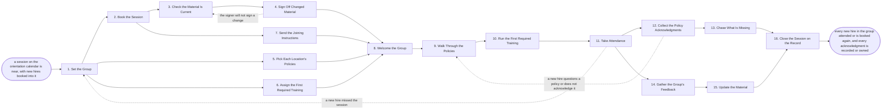

# Reference process: Run New Hire Orientation

`ref/hr/run-new-hire-orientation v1`

**value stream:** [Onboarding](../../streams/human-resources/onboarding.md)
New hires who start in the same weeks are taken through orientation
together. The onboarding-manager agent sets the group from the new hires
who start before the session and books it, the curriculum-manager agent
checks the orientation material against the policies now in force, and
the policy-keeper agent picks the version of each policy that applies in
each new hire's location. The training-coordinator agent assigns the
first required training by role and location. People present the
company, its policies and how to raise a concern, and each new hire
acknowledges each policy at its version under their own sign-in. Any
change to the material is signed by a named person before it is taught.
The run closes when every new hire in the group has attended or been
booked into the next session, every acknowledgment is recorded or open
with a named owner, and the material carries what this session taught.

**delivers:** event, a new hire orientation session

**starts:** on a schedule, a session on the orientation calendar is near, with new hires booked into it

## The goals

- Bring each new hire to orientation within [5 working days] of the start
- Keep each session to [half a day]
- Complete [95%] of the first required training by its due date
- Have [85%] of new hires rate the session useful

## The activities

| # | Activity | What happens | Agents |
|---|---|---|---|
| 1 | Set the Group | new hires starting before the session, with job and location | [onboarding-manager](../../agents/onboarding-manager.md) |
| 2 | Book the Session | the date, the room or call, the speakers and the trainers | onboarding-manager |
| 3 | Check the Material Is Current | the orientation material against the policies now in force | [curriculum-manager](../../agents/curriculum-manager.md) · [policy-keeper](../../agents/policy-keeper.md) |
| 4 | Sign Off Changed Material | any change since last session, signed before it is taught | HR operations lead (person) |
| 5 | Pick Each Location's Policies | the handbook and the variant each new hire's location needs | policy-keeper |
| 6 | Assign the First Required Training | the courses each role and location require, with due dates | [training-coordinator](../../agents/training-coordinator.md) |
| 7 | Send the Joining Instructions | when, where, what to bring, and how to ask for an adjustment | onboarding-manager |
| 8 | Welcome the Group | who the company serves, how it is run and how work gets done | executive speaker (person) · HR operations specialist (person) |
| 9 | Walk Through the Policies | conduct, pay, leave, data, and how to raise a concern | HR business partner (person) · policy-keeper |
| 10 | Run the First Required Training | courses due in the first days, taken in the session or after | trainer (person) · training-coordinator |
| 11 | Take Attendance | who attended each part, who did not, and who joined late | training-coordinator |
| 12 | Collect the Policy Acknowledgments | each new hire's own acknowledgment of each policy version | policy-keeper |
| 13 | Chase What Is Missing | an open acknowledgment or course, chased with the new hire | policy-keeper · training-coordinator |
| 14 | Gather the Group's Feedback | what was unclear, missing or too long, for the group only | onboarding-manager |
| 15 | Update the Material | the questions and the feedback turned into a new version | curriculum-manager |
| 16 | Close the Session on the Record | attendance, acknowledgments, training and what to change | onboarding-manager |

A session may be held in person, on a call, or as a course a new hire
takes alone where the group is too small to gather, and the material is
the same in each. The first required training is assigned here, and its
completion after the session is tracked at `ref/hr/run-required-training`.
A change to a policy itself is made at `ref/hr/publish-an-hr-policy`, and
orientation teaches only the published version.

## The graph



## The document, with the blanks marked

```
PROCESS: run new hire orientation     id: <team>/run-new-hire-orientation   v1
from: ref/hr/run-new-hire-orientation v1
owner: <who>                          effective: <date>
trigger: a session on the orientation calendar is <days> away with new
         hires booked into it, in <your learning system>
         watch: record=<orientation session>
                system=<your learning system>
                change=<a session comes within the set number of days>
concurrency: runs may overlap - one session is one run, sessions in
             different locations or languages may run at once, and a new
             hire belongs to one session's group at a time
goal: every new hire in the group attended within <days> of starting,
      acknowledged each policy that applies in their location at its
      version, and has the first required training assigned with its
      due dates
phases:
  set-group               - runs collect-and-report: the new hires who
                            start before the session, with the job, the
                            location and the language of each, and
                            nothing from their forms
                            owner: onboarding-manager  after: trigger
                            automation: <level>
  book-session            - system: the date, the room or the call, the
                            speakers and the trainers, in the calendars
                            of everyone who attends
                            owner: onboarding-manager  after: set-group
                            automation: <level>
  check-material          - runs assessment: the orientation material at
                            its version read against every policy now in
                            force, with each part that teaches an old
                            version named
                            owner: curriculum-manager
                            after: book-session        automation: <level>
  sign-material           - convenes approval: <your HR operations lead
                            role> signs any change to the material since
                            the last session before it is taught
                            owner: <your HR operations lead role>
                            after: check-material      automation: never
  pick-policies           - runs assessment: the handbook and each policy
                            at the version that applies in each new
                            hire's location, with the variant <your
                            jurisdiction's rules> call for where a
                            location needs one of its own
                            owner: policy-keeper       after: set-group
                            automation: <level>
  assign-training         - system: the courses each new hire's role and
                            location require in the first days, assigned
                            in <your learning system> with their due
                            dates
                            owner: training-coordinator
                            after: set-group           automation: <level>
  send-instructions       - human: when and where, how to join, what to
                            bring, and how to ask for an adjustment to
                            the session, sent to each new hire
                            owner: onboarding-manager
                            after: book-session        automation: <level>
  welcome                 - convenes briefing: the company, what it makes,
                            who it serves, how it is run and how work
                            gets done, presented by the people <your HR
                            operations lead role> names
                            owner: <your HR operations role>
                            after: sign-material + pick-policies +
                            assign-training + send-instructions
                            automation: <level>
  walk-policies           - convenes briefing: conduct, pay, leave, the
                            use of data, and how to raise a concern,
                            taught from the version that applies in each
                            new hire's location
                            owner: <your HR business partner role>
                            after: welcome             automation: <level>
  first-training          - convenes briefing: the courses due in the
                            first days, taken in the session or booked
                            for after it
                            owner: training-coordinator
                            after: walk-policies       automation: <level>
  take-attendance         - runs roll-call: who attended each part, who
                            did not, and who joined late
                            owner: training-coordinator
                            after: first-training      automation: <level>
  collect-acknowledgments - runs collect-and-report: each new hire's own
                            acknowledgment of each policy at its version,
                            made in <your HR system> under the new hire's
                            own sign-in
                            owner: policy-keeper
                            after: take-attendance     automation: <level>
  chase-missing           - runs roll-call: each missing acknowledgment
                            and each course past its due date, chased
                            with the new hire and then with the manager
                            owner: policy-keeper
                            after: collect-acknowledgments
                            every: <cadence>           automation: <level>
  gather-feedback         - runs collect-and-report: what the group found
                            unclear, missing or too long, and the
                            questions the material did not answer, read
                            only for the group as a whole
                            owner: onboarding-manager
                            after: take-attendance     automation: <level>
  update-material         - runs build-by-talent: the changes the
                            questions and the feedback call for, made at
                            a new version for the next session's
                            sign-off
                            owner: curriculum-manager
                            after: gather-feedback     automation: <level>
  close-session           - convenes debrief: who attended, what each new
                            hire acknowledged and completed, what is
                            still open with its owner, and what the next
                            session changes
                            owner: onboarding-manager
                            after: chase-missing + update-material
                            automation: <level>
run-scoped:
  status          - runs roll-call              owner: onboarding-manager
                    every: <cadence>
                    from: set-group                until: welcome
  acknowledgments - runs collect-and-report     owner: policy-keeper
                    from: collect-acknowledgments  until: run close
handoffs:
  set-group -> book-session / pick-policies / assign-training [group]:
    the new hires, with the job, the location and the language of each
  book-session -> check-material / send-instructions [booked-session]:
    the date, the place, the speakers and the trainers
  check-material -> sign-material [checked-material]: the material at
    its version, with each part that changed named
  sign-material -> welcome [signed-material]: the material as signed,
    with the signer and the date
  pick-policies -> welcome [location-policies]: each policy at the
    version that applies in each new hire's location
  assign-training -> welcome [assigned-training]: each course assigned,
    with its due date
  send-instructions -> welcome [instructions-sent]: what each new hire
    was sent and when, and whether an adjustment was asked for
  welcome -> walk-policies [welcome-held]: the parts presented and who
    presented them
  walk-policies -> first-training [policies-taught]: each policy taught,
    at its version
  first-training -> take-attendance [training-started]: the courses
    taken in the session and those booked for after it
  take-attendance -> collect-acknowledgments / gather-feedback
    [attendance]: who attended each part, and who joins the next session
  collect-acknowledgments -> chase-missing [acknowledgments]: each
    acknowledgment with its policy, its version and its date, and those
    still missing
  gather-feedback -> update-material [feedback]: the group's feedback
    and the questions the material did not answer
  chase-missing -> close-session [chased-items]: what was completed, and
    what is still open with its owner
  update-material -> close-session [updated-material]: the new version,
    waiting for sign-off before the next session
deviations:
  sign-material -> check-material [signer-refuses]: the signer will not
    sign a change, so the material is changed again on the lines named,
    and the last signed version is taught until it is signed
  take-attendance -> set-group [missed-session]: a new hire missed the
    session, so they join the group of the next one
  collect-acknowledgments -> walk-policies [policy-questioned]: a new
    hire questions a policy or does not acknowledge it, so the HR
    business partner talks it through with them
bindings:
  roster:  <who holds each role - agents claiming the abstract agents
           above, and named people for the HR operations lead, the HR
           operations specialist, the HR business partner, the speakers
           and the trainers>
  systems: the learning system (write), the HR system (write), the
           policy library (read), the calendar (write), the survey tool
           (write), the notification channel (write)
  data:    the orientation material <version>, the handbook <version>,
           each policy and its location variants <version>, <your
           required training list by role and location> <version>,
           <your minimum group size for feedback>
policy:
  the material is taught only at a version <your HR operations lead
    role> signed, and a change since the last session is signed before
    it is taught
  every policy is taught and acknowledged at the version that applies in
    the new hire's location
  an acknowledgment is the new hire's own act under their own sign-in,
    and nobody records one on their behalf
  a new hire who questions a policy or does not acknowledge it is heard
    by <your HR business partner role>, and an agent never treats it as
    a conduct matter
  the group list holds the name, the job, the location and the language
    of each new hire, and nothing else about them
  feedback is read only for the group as a whole, and a group smaller
    than <your minimum group size> has its feedback held and read with
    the next session's
  a request for an adjustment to the session goes to <who>, who handles
    it at ref/hr/handle-an-accommodation-request, and the session record
    shows only that the format was adjusted
  a change to a policy itself is made at ref/hr/publish-an-hr-policy,
    and orientation teaches only the published version
  agents never weigh a protected characteristic in anything they do
    about a new hire
measures:
  cycle time: <days> from the start to the orientation attended
  on time: <target> share of acknowledgments recorded within <days> of
           the session
  volume: <sessions and new hires per period>
  quality gate: every acknowledgment names its policy and its version,
                and every new hire attended or is booked into the next
                session
```

## The failure edges

- **The material teaches a policy that has changed.** The
  curriculum-manager agent names each part that teaches the old version,
  and the change is signed before the session. When no signature arrives
  in time, the session teaches that policy from its published text and
  the material is corrected afterward.
- **The signer will not sign a change.** The material goes back to be
  changed on the lines the signer named, and the last signed version is
  taught until the change is signed.
- **A new hire misses the session.** They join the next session's group.
  The policies apply to them from the first day all the same, so the
  policy-keeper agent sends them the version for their location to read
  and acknowledge before the next session.
- **A new hire questions a policy or does not acknowledge it.** The HR
  business partner talks it through with them. A refusal stays open with
  the reason the new hire gave and goes to the HR operations lead, and no
  agent treats it as a conduct matter.
- **A new hire asks for an adjustment to the session.** The request goes
  to the named person, who handles it at
  `ref/hr/handle-an-accommodation-request`. The session record shows only
  that the format was adjusted, and nothing about the reason reaches the
  agents.
- **A required course is past its due date.** The training-coordinator
  agent chases the new hire and then the manager, and a course still open
  at the close of the run passes to `ref/hr/run-required-training` with
  its due date.
- **The group is too small for its feedback to stay anonymous.** The
  feedback is held and read with the next session's, so no answer can be
  traced to a person.
- **The trigger fires while a run is in flight.** Sessions in different
  locations or languages may run at once. A new hire booked into two
  sessions stays in the earlier one and is taken out of the other.
- **A run is abandoned.** The session is cancelled. Each new hire is told
  and booked into the next session, the speakers and the trainers are
  told, the first required training stays assigned so its due dates
  hold, and the reason is recorded.
