# Reference process: Run Payroll

`ref/hr/run-payroll v1`

**value stream:** [Pay and benefits](../../streams/human-resources/pay-and-benefits.md)
A pay period has reached its cutoff for changes, and every employee in the
pay group has to be paid the right amount on payday. The
employee-record-keeper agent passes every change approved since the last
run, such as a hire, a leaver, a pay change, a new bank account or a
leave, and the payroll-administrator agent gathers the approved time and
variable pay, applies the benefit and other deductions, and works out each
employee's pay from gross to net under
`<your jurisdiction's tax and deduction rules>`. It compares the register
with the last period and
explains every difference. A named finance person checks the register
against the ledger and the last period, and a named payroll approver
approves it. The wire-check agent checks every payment in the payment file
against the approved register and the verified bank record, and the
approver releases the payments under dual control. The run closes when
every employee is paid and holds a payslip, the withholding is paid and
filed by its due date, and the period's journal is posted to the ledger.

**delivers:** statement, the payslips for a pay period

## The goals

- Pay [99.9%] of employees the right amount on payday
- Accept changes until [2 working days] before payday
- Keep off-cycle payments under [1%] of payslips
- Pay and file [100%] of withholding by its due date

## The activities

| # | Activity | What happens | Agents |
|---|---|---|---|
| 1 | Open the Pay Period | the dates, the cutoff for changes and the payday | [payroll-administrator](../../agents/payroll-administrator.md) |
| 2 | Gather the Approved Changes | hires, leavers, pay, bank and leave changes for this period | [employee-record-keeper](../../agents/employee-record-keeper.md) · payroll-administrator |
| 3 | Collect Time and Variable Pay | hours, overtime, commission and bonus, approved by managers | payroll-administrator · manager (person) |
| 4 | Apply the Deductions | benefits, savings, loans and court orders, as instructed | payroll-administrator |
| 5 | Work Out Gross to Net | each employee's pay, tax, contributions and deductions | payroll-administrator |
| 6 | Compare the Register with the Last Period | every change in pay traced to its cause | payroll-administrator |
| 7 | Check the Register for Finance | the register against the ledger and the last period | finance controller (person) |
| 8 | Approve the Register | the named approver approves before any payment file is built | payroll approver (person) |
| 9 | Build the Payment File | one payment per employee, from the approved register | payroll-administrator |
| 10 | Check the Payment File | each payment against the register and verified bank record | [wire-check](../../agents/wire-check.md) |
| 11 | Release the Payments | the approver releases them under dual control | payroll approver (person) · second signer (person) |
| 12 | Confirm the Payments Landed | every payment matched to the bank's report | wire-check |
| 13 | Issue the Payslips | each employee's payslip in the employee portal on payday | payroll-administrator |
| 14 | Pay and File the Withholding | tax and contributions paid and each return filed by its date | payroll-administrator · payroll manager (person) |
| 15 | Correct an Error Off Cycle | underpayments paid at once, overpayments recovered by rule | payroll-administrator · payroll manager (person) |
| 16 | Post the Payroll to the Ledger | the journal for pay, tax and deductions | payroll-administrator · finance controller (person) |
| 17 | Record What the Run Taught | errors, late changes, and what the next period changes | payroll-administrator |

The changes come from other processes. A new hire's record comes from
`ref/hr/prepare-for-a-new-hire`, a pay change from
`ref/hr/change-an-employees-pay` or `ref/hr/run-the-pay-review`, a new
bank account or address from `ref/hr/change-an-employee-record`, benefit
deductions from `ref/hr/enroll-an-employee-in-benefits` and
`ref/hr/run-benefits-open-enrollment`, pay during a leave from
`ref/hr/manage-a-leave-of-absence`, and final pay from
`ref/hr/offboard-a-leaver`. An outside payroll provider may hold the
payroll-administrator role for the company or run the calculation that
the company checks, and the roster says which it does. Finance reconciles
the payroll accounts to the ledger each month, outside the run.

## The graph

```mermaid
flowchart LR
  T([the pay period reaches its cutoff for changes]) --> A1[1. Open the Pay Period]
  A1 --> A2[2. Gather the Approved Changes]
  A1 --> A3[3. Collect Time and Variable Pay]
  A2 --> A4[4. Apply the Deductions]
  A3 --> A4
  A4 --> A5[5. Work Out Gross to Net]
  A5 --> A6[6. Compare the Register with the Last Period]
  A6 -. a difference has no approved cause .-> A2
  A6 --> A7[7. Check the Register for Finance]
  A7 -. the register does not agree .-> A5
  A7 --> A8[8. Approve the Register]
  A8 -. the approver will not approve .-> A5
  A8 --> A9[9. Build the Payment File]
  A9 --> A10[10. Check the Payment File]
  A10 -. a payment does not match the register or the record .-> A9
  A10 --> A11[11. Release the Payments]
  A11 --> A12[12. Confirm the Payments Landed]
  A12 --> A13[13. Issue the Payslips]
  A12 --> A14[14. Pay and File the Withholding]
  A12 -. a payment is returned or an employee was paid wrongly .-> A15[15. Correct an Error Off Cycle]
  A13 -. an employee reports an error .-> A15
  A13 --> A16[16. Post the Payroll to the Ledger]
  A14 --> A16
  A15 --> A16
  A16 --> A17[17. Record What the Run Taught]
  A17 --> DONE([every employee is paid, the withholding is filed, and the journal is posted])
```



## The document, with the blanks marked

```
PROCESS: run payroll                  id: <team>/run-payroll   v1
from: ref/hr/run-payroll v1
owner: <who>                          effective: <date>
trigger: the pay calendar in <your payroll system> reaches the cutoff for
         changes in a pay period of a pay group
         watch: record=<pay period> system=<your payroll system>
                change=<the cutoff for changes passes>
concurrency: runs may overlap across pay groups - one pay period of one
             pay group is one run, a pay group has one run open before
             its payday at a time, and an off-cycle correction belongs to
             the run it corrects
goal: every employee in the pay group paid the right net amount on <the
      payday>, every payslip issued, the withholding paid and filed by
      <the due date>, and the period's journal posted to the ledger
phases:
  open-period        - system: the pay period opened with its dates, the
                       cutoff for changes, the payday and the employees
                       in the pay group
                       owner: payroll-administrator   after: trigger
                       automation: <level>
  gather-changes     - system: every change approved in <your HR system>
                       since the last cutoff, such as a hire, a leaver, a
                       pay change, a new bank account, a new address or a
                       leave, passed with its effective date and the
                       approval behind it
                       owner: employee-record-keeper
                       after: open-period         automation: <level>
  collect-time       - runs collect-and-report: hours, overtime, shift
                       premiums, commission and bonuses for the period,
                       each approved by the manager named in <your HR
                       system>, and anything unapproved at the cutoff held
                       for the next run with its reason
                       owner: payroll-administrator
                       after: open-period         automation: <level>
  apply-deductions   - system: each employee's benefit deductions from
                       <your benefits system>, savings, loans and any
                       order from a court or an authority, applied as
                       instructed and in the order <your jurisdiction's
                       tax and deduction rules> set
                       owner: payroll-administrator
                       after: gather-changes + collect-time
                       automation: <level>
  work-out-pay       - system: each employee's gross pay, tax,
                       contributions and deductions worked out to net pay
                       in <your payroll system> under <your jurisdiction's
                       tax and deduction rules> for the place the employee
                       works
                       owner: payroll-administrator
                       after: apply-deductions    automation: <level>
  compare-register   - runs assessment: the register set beside the last
                       period, and every employee whose net pay moved by
                       more than <threshold> traced to an approved change,
                       a period of leave or a variable payment
                       owner: payroll-administrator
                       after: work-out-pay        automation: <level>
  finance-check      - runs assessment: the register's totals checked
                       against the ledger and the last period by <your
                       finance controller role>, with each difference
                       explained in writing
                       owner: <your finance controller role>
                       after: compare-register    by: <hours>
                       automation: never
  approve-register   - convenes approval: <your payroll approver role>
                       approves the register as a named approver before
                       any payment file is built
                       owner: <your payroll approver role>
                       after: finance-check       by: <hours>
                       automation: never
  build-payment-file - system: one payment for each employee from the
                       approved register, to the bank account on the
                       employee's verified record, dated for payday
                       owner: payroll-administrator
                       after: approve-register    automation: <level>
  check-payment-file - runs assessment: every payment in the file checked
                       against the approved register line it pays, and
                       every bank account against <your verified bank
                       record>, with any account changed since the last
                       run checked for its confirmation through a contact
                       already on file
                       owner: wire-check
                       after: build-payment-file  automation: <level>
  release-payments   - convenes approval: <your payroll approver role>
                       releases the payment file in <your bank portal>
                       under <your dual control rule>, in time for the
                       money to land on payday
                       owner: <your payroll approver role>
                       after: check-payment-file  by: <hours>
                       automation: never
  confirm-payments   - runs collect-and-report: every payment matched to
                       the bank's report, and any payment returned,
                       rejected or sent to an account that has since
                       changed held aside with the reason
                       owner: wire-check          after: release-payments
                       by: <hours>                automation: <level>
  issue-payslips     - system: each employee's payslip published to the
                       employee portal on payday, showing gross pay, each
                       deduction and net pay in the form <your
                       jurisdiction's rules on payslips> require
                       owner: payroll-administrator
                       after: confirm-payments    automation: <level>
  pay-withholding    - human: the tax and contributions withheld paid to
                       each authority, and each return filed by the date
                       <your jurisdiction's filing calendar> sets, with
                       <your payroll manager role> releasing each payment
                       and submitting each return as the named filer
                       owner: <your payroll manager role>
                       after: confirm-payments    by: <days>
                       automation: never
  correct-error      - human: an underpayment worked out and paid off
                       cycle once <your payroll approver role> releases it,
                       or an overpayment recovered only under <your
                       jurisdiction's rule on recovering overpaid wages>
                       after the employee is told in writing
                       owner: payroll-administrator
                       after: confirm-payments or issue-payslips, when an
                       error is found               automation: <level>
  post-to-ledger     - system: the period's journal for pay, tax,
                       contributions and deductions posted to <your
                       general ledger>, and the totals agreed to the
                       approved register
                       owner: payroll-administrator
                       after: issue-payslips + pay-withholding, and
                       correct-error when one ran   automation: <level>
  record-learning    - convenes debrief: which changes arrived late, which
                       errors reached an employee, what the checks caught,
                       and what the next period does differently
                       owner: payroll-administrator
                       after: post-to-ledger      automation: <level>
run-scoped:
  cutoff   - runs roll-call                     owner: payroll-administrator
             every: <cadence>
             from: open-period         until: approve-register
  payments - runs allocate-and-reconcile        owner: wire-check
             from: build-payment-file  until: confirm-payments
handoffs:
  open-period -> gather-changes / collect-time [pay-period]: the dates,
    the cutoff, the payday and the employees in the pay group
  gather-changes -> apply-deductions [approved-changes]: every change
    since the last cutoff, with its effective date and its approval
  collect-time -> apply-deductions [approved-time]: the hours and the
    variable pay for the period, each with the manager who approved it
  apply-deductions -> work-out-pay [deductions]: each employee's
    deductions, with the instruction behind each
  work-out-pay -> compare-register [draft-register]: each employee's
    gross pay, tax, contributions, deductions and net pay
  compare-register -> finance-check [explained-register]: the register
    with every movement from the last period traced to its cause
  finance-check -> approve-register [checked-register]: the register as
    finance checked it, with the name of whoever checked it
  approve-register -> build-payment-file [approved-register]: the
    approved register. A change to any line voids the approval
  build-payment-file -> check-payment-file [payment-file]: one payment for
    each employee, at a version
  check-payment-file -> release-payments [checked-payment-file]: the file
    with every payment matched to its register line and a verified
    account
  release-payments -> confirm-payments [released-payments]: the file
    released, with its bank reference and the people who released it
  confirm-payments -> issue-payslips / pay-withholding [confirmed-payments]:
    every payment matched to the bank's report
  confirm-payments -> correct-error [payment-exceptions]: each payment
    returned, rejected or wrong, with the reason
  issue-payslips -> post-to-ledger [issued-payslips]: every payslip
    published, and the date it was published
  pay-withholding -> post-to-ledger [filed-withholding]: each payment to
    an authority and each return filed, with its receipt
  correct-error -> post-to-ledger [corrections]: each off-cycle payment or
    recovery, with its approval and the employee's notice
  post-to-ledger -> record-learning [posted-journal]: the journal posted,
    with its totals agreed to the register
deviations:
  compare-register -> gather-changes [movement-unexplained]: a movement in
    pay has no approved change behind it, so the change is traced in the
    employee's record before the register goes on
  finance-check -> work-out-pay [register-does-not-agree]: the register
    does not agree with the ledger or the last period, so the pay is
    worked out again once the cause is found
  approve-register -> work-out-pay [approver-refuses]: the approver will
    not approve, so the lines the approver named are worked out again and
    checked again
  check-payment-file -> build-payment-file [payment-does-not-match]: a
    payment does not match its register line or the account is not on the
    verified record, so that payment is held and the file is built again
  confirm-payments -> correct-error [payment-returned]: a payment is
    returned or rejected, so the account is checked and the employee is
    paid off cycle once a verified account is in hand
  issue-payslips -> correct-error [employee-reports-error]: an employee
    reports a wrong payslip, so the line is traced and corrected off cycle
    or in the next run
bindings:
  roster:  <who holds each role - agents claiming the abstract agents
           above, or the outside payroll provider where it holds
           payroll-administrator for the company, and named people for
           the payroll manager, the finance controller, the payroll
           approver, the second signer and the managers who approve time>
  systems: the payroll system (write), the HR system (read), the time
           and attendance system (read), the benefits system (read), the
           bank portal (read), <your verified bank record> (read), the
           general ledger (write), the employee portal (write), each
           tax authority's filing channel (write), the notification
           channel (write)
  data:    <your pay calendar> <version>, <your jurisdiction's tax and
           deduction rules> at the version for each place, <your payroll
           policy> <version>, <your dual control rule> <version>, <your
           payslip template> <version>
policy:
  no payment file is built before <your payroll approver role> has
    approved the register, and a change to any line after approval voids
    the approval
  the person who checks the register for finance is someone other than
    the person who approves it or releases the payments
  money is released by a named person in <your bank portal> under <your
    dual control rule>, and the release is never delegated to an agent
  a payment goes only to a bank account on the employee's verified
    record, and an account changed since the last run is paid only once
    the change was confirmed through a contact already on file
  a request to change an employee's bank account that arrives by email
    alone is treated as an attempt at fraud and reported to <who> the same
    day
  an overpayment is recovered only under <your jurisdiction's rule on
    recovering overpaid wages>, and only after the employee is told in
    writing
  pay is worked out under <your jurisdiction's tax and deduction rules>
    for each place the company employs people, and a change to a rate or
    a rule takes effect only once <your payroll manager role> confirms it
  each step sees the least personal data it needs, and the register is
    open only to <the named payroll and finance people>
measures:
  cycle time: <hours> from the cutoff to the payments released
  on time: <target> share of employees paid the right amount on payday
  volume: <payslips per period>
  quality gate: every payslip traces to the approved register, and every
                payment traces to a register line and a verified account
```

## The failure edges

- **A change arrives after the cutoff.** The payroll-administrator agent
  holds it for the next run and tells the person who sent it. Where
  waiting would leave an employee unpaid or underpaid, such as a new
  hire's first pay, the payroll manager decides whether it goes in this
  run, and a late change still passes every check the register passes.
- **A movement in pay has no approved change behind it.** The change is
  traced in the employee's record before the register goes on. A figure
  that nobody approved never reaches a payslip because it happened to be
  in the system.
- **The register does not agree with the ledger or the last period.** The
  pay is worked out again once the cause is found, and the finance
  controller checks the new register in full. The run does not go to the
  approver with a difference that nobody has explained in writing.
- **The approver will not approve.** The lines the approver named are
  worked out again and go back through the finance check. When payday is
  close, the payroll manager tells the employees affected in writing, and
  everyone else is paid on time.
- **A payment does not match the register or the record.** The wire-check
  agent holds that payment and names it, and the file is built again. A
  bank account changed by email alone, or changed close to payday, is
  treated as an attempt at fraud until it is confirmed through a contact
  already on file.
- **A payment is returned or an employee was paid the wrong amount.** The
  employee is paid off cycle once a verified account is in hand, released
  by the approver like any other payment. An overpayment is recovered only
  under the local rule and after the employee is told in writing.
- **The withholding misses its due date.** The payroll manager pays and
  files at once, records the reason, and tells the finance controller and
  the head of HR the same day. Any penalty is recorded against the run.
- **The trigger fires while a run is in flight.** A pay group has one run
  open before its payday at a time. A second pay period that reaches its
  cutoff waits for the first to be approved, and an off-cycle correction
  belongs to the run it corrects.
- **A run is abandoned.** The run cannot reach payday, for example when
  the payroll system fails. No payment file is released from an unchecked
  register. The run starts again from the last approved changes, the
  employees are told in writing if pay will be late, and any emergency
  payment is approved and released by named people under
  `<your payroll policy>`.
