# Reference process: Run Required Training

`ref/hr/run-required-training v1`

**value stream:** [Performance and development](../../streams/human-resources/performance-and-development.md)
Training that the law or the company requires, such as <your
jurisdiction's required training> or the company's own training on its
code of conduct, falls due on a date for the people it covers. The
training-coordinator agent reads who it applies to by role and location,
and the curriculum-manager agent checks that the course content matches
the rule in force in each location before a named owner signs the
version people will take. The training-coordinator agent assigns the
course to each person with a due date, books people onto live sessions
where the course needs one, records any exemption a named person grants,
reminds people before the date, and chases anyone overdue, first the
person and then the manager. A department head decides what follows for
anyone who stays overdue. The record shows who completed which version
of the course, when, and with what result where the course has an
assessment. The run closes when every person the training covers has
completed it or holds a recorded exemption, the record is kept ready for
an auditor, and anyone still overdue is with a named person.

**delivers:** report, a training completion record

## The goals

- Complete [98%] of required training by its due date
- Keep required training under [4 hours] per person a year
- Teach the version that matches the rule in force in [100%] of completions
- Raise fewer than [2%] of people to a department head

## The activities

| # | Activity | What happens | Agents |
|---|---|---|---|
| 1 | Take In the Requirement | the training, the rule behind it, who it covers and when | [training-coordinator](../../agents/training-coordinator.md) · learning lead (person) |
| 2 | Read Who It Applies To | each person covered, by role and location | training-coordinator |
| 3 | Check the Course Matches the Rule | the content at its version against the rule in force | [curriculum-manager](../../agents/curriculum-manager.md) · counsel (person) |
| 4 | Update the Course | the changes the rule requires, at a new version | curriculum-manager |
| 5 | Sign Off the Course | the named owner signs the version people will take | learning lead (person) · counsel (person) |
| 6 | Assign the Training | each person, the course version and the due date | training-coordinator |
| 7 | Book the Live Sessions | people placed on sessions where the course needs one | training-coordinator |
| 8 | Record Exemptions | a current completion, or an exemption a named person granted | training-coordinator · learning lead (person) |
| 9 | Remind Before the Due Date | each person not yet complete reminded on its cadence | training-coordinator |
| 10 | Record Each Completion | the person, the version, the date and any result | training-coordinator |
| 11 | Chase Overdue Training | the person first, and then the manager | training-coordinator · manager (person) |
| 12 | Raise What Stays Overdue | the department head decides what follows | department head (person) · training-coordinator |
| 13 | Report Completion | by team and location, for managers and the course owner | training-coordinator |
| 14 | Keep the Record for Audit | each person, course and version, kept for its period | training-coordinator |
| 15 | Record What the Round Taught | the questions the course left open, and where people stalled | curriculum-manager · training-coordinator |

The courses this run assigns are planned and built in
`ref/hr/plan-the-learning-program`. A new hire's first required course
is assigned at orientation in `ref/hr/run-new-hire-orientation`, and its
completion is tracked here in the open run for that course. Anything
that follows for a person who stays overdue, such as a disciplinary
step, goes through `ref/hr/issue-a-disciplinary-action`, and an
auditor's request for the record is answered through
`ref/hr/respond-to-an-employment-audit`.

## The graph

```mermaid
flowchart LR
  T([a required course falls due for the people it covers]) --> A1[1. Take In the Requirement]
  A1 --> A2[2. Read Who It Applies To]
  A1 --> A3[3. Check the Course Matches the Rule]
  A3 -. the course no longer matches the rule .-> A4[4. Update the Course]
  A3 --> A5[5. Sign Off the Course]
  A4 --> A5
  A5 -. the owner will not sign the version .-> A4
  A2 --> A6[6. Assign the Training]
  A5 --> A6
  A6 --> A7[7. Book the Live Sessions]
  A6 --> A8[8. Record Exemptions]
  A7 --> A9[9. Remind Before the Due Date]
  A8 --> A9
  A9 --> A10[10. Record Each Completion]
  A10 -. a person misses the due date .-> A11[11. Chase Overdue Training]
  A11 -. the person completes the course .-> A10
  A11 --> A12[12. Raise What Stays Overdue]
  A10 --> A13[13. Report Completion]
  A12 --> A13
  A13 --> A14[14. Keep the Record for Audit]
  A14 --> A15[15. Record What the Round Taught]
  A15 --> DONE([everyone covered has completed the course or holds an exemption, and the record is kept])
```



## The document, with the blanks marked

```
PROCESS: run required training        id: <team>/run-required-training   v1
from: ref/hr/run-required-training v1
owner: <who>                          effective: <date>
trigger: a required course falls due on the date <your compliance
         calendar> sets, a new or changed rule brings one due, or a new
         hire or a move puts a person in a role it covers, in <your
         learning system>
         watch: record=<required course> system=<your learning system>
                change=<a required course falls due for a group of
                people>
concurrency: runs overlap freely across courses - one course for one
             group and one due date is one run, and a person who joins a
             covered role while it is open joins the open run with a due
             date of their own
goal: every person the course covers has completed the version that
      matches the rule in force in their location, or holds an
      exemption a named person granted, by <date>, and the record shows
      who completed which version, when, and with what result
phases:
  take-in-requirement - runs collect-and-report: the training required,
                        the rule or policy behind it, the roles and
                        locations it covers, how often it falls due and
                        the date, as <your learning lead role> confirms
                        them
                        owner: training-coordinator
                        after: trigger            automation: <level>
  read-population     - runs collect-and-report: each person the course
                        covers, read from the HR system by role and
                        location alone, with their manager
                        owner: training-coordinator
                        after: take-in-requirement
                        automation: <level>
  check-course        - runs assessment: the course content at its
                        version read against the rule in force in each
                        location, with <your counsel role> confirming the
                        reading where the rule is the law's
                        owner: curriculum-manager
                        after: take-in-requirement
                        automation: <level>
  update-course       - runs build-by-talent: the changes the rule
                        requires, made at a new version with the date
                        the rule took effect
                        owner: curriculum-manager
                        after: check-course       automation: <level>
  sign-off-course     - convenes approval: <your learning lead role>
                        signs the version people will take, with <your
                        counsel role> where the rule is the law's
                        owner: <your learning lead role>
                        after: check-course, or update-course when one
                        ran                       automation: never
  assign-training     - system: each person assigned the course at its
                        signed version with a due date, and told what it
                        covers and how long it takes
                        owner: training-coordinator
                        after: read-population + sign-off-course
                        automation: <level>
  book-sessions       - system: each person placed on a live session
                        where the course needs one, in working time, with
                        the session in the person's calendar
                        owner: training-coordinator
                        after: assign-training    automation: <level>
  record-exemptions   - runs assessment: each person who already holds a
                        current completion of the same version marked
                        complete, and any other exemption recorded only
                        when <your learning lead role> grants it in
                        writing
                        owner: training-coordinator
                        after: assign-training    automation: <level>
  send-reminders      - runs roll-call: each person not yet complete
                        reminded <days> before the due date
                        owner: training-coordinator
                        after: book-sessions + record-exemptions
                        every: <cadence>          automation: <level>
  record-completions  - system: each completion recorded with the person,
                        the course version, the date and any result the
                        course's assessment gives
                        owner: training-coordinator
                        after: send-reminders     automation: <level>
  chase-overdue       - runs roll-call: each person past the due date
                        chased, first the person and then the manager,
                        with how far overdue each one is
                        owner: training-coordinator
                        after: record-completions every: <cadence>
                        automation: <level>
  raise-overdue       - convenes decide-and-announce: the people still
                        overdue <days> after the due date raised to
                        <your department head role>, who decides what
                        follows for each
                        owner: <your department head role>
                        after: chase-overdue      automation: never
  report-completion   - runs collect-and-report: completion by team and
                        location for each manager and the course owner,
                        each manager seeing their own team alone
                        owner: training-coordinator
                        after: record-completions, and raise-overdue
                        when one ran              automation: <level>
  keep-record         - system: the record for each person, course and
                        version, kept ready for an auditor under <your
                        jurisdiction's rule on keeping training records>
                        owner: training-coordinator
                        after: report-completion  automation: <level>
  record-learning     - convenes debrief: the questions the course left
                        open, where people stalled, how long it really
                        took, and what the next version changes
                        owner: curriculum-manager
                        after: keep-record        automation: <level>
run-scoped:
  due-date - runs roll-call                  owner: training-coordinator
             every: <cadence>
             from: assign-training  until: report-completion
handoffs:
  take-in-requirement -> read-population / check-course [requirement]:
    the training, the rule behind it, the roles and locations, and the
    due date
  read-population -> assign-training [covered-people]: each person
    covered and their manager
  check-course -> sign-off-course [course-check]: the course version and
    how it matches the rule in each location
  check-course -> update-course [course-gaps]: the lines of the course
    that no longer match the rule, location by location
  update-course -> sign-off-course [updated-course]: the new version,
    with what changed and why
  sign-off-course -> assign-training [signed-course]: the version people
    will take, signed
  assign-training -> book-sessions / record-exemptions [assignments]:
    each person, the course version and the due date
  book-sessions -> send-reminders [booked-sessions]: each person's
    session and its date
  record-exemptions -> send-reminders [exemptions]: each exemption, its
    reason and who granted it
  send-reminders -> record-completions [reminders-sent]: who was
    reminded, and when
  record-completions -> report-completion [completions]: each completion
    with its version and its date
  record-completions -> chase-overdue [overdue-people]: the people past
    the due date, with how far overdue each one is
  chase-overdue -> raise-overdue [still-overdue]: the people still
    overdue, with every reminder and chase sent to them
  raise-overdue -> report-completion [overdue-decisions]: what the
    department head decided for each person still overdue
  report-completion -> keep-record [completion-report]: completion by
    team and location
  keep-record -> record-learning [training-record]: the record as kept,
    with the date it may be removed
deviations:
  check-course -> update-course [course-out-of-date]: the course no
    longer matches the rule in a location, so it is changed at a new
    version before anyone is assigned it
  sign-off-course -> update-course [owner-will-not-sign]: the owner will
    not sign the version, so it is changed on the lines the owner named
  record-completions -> chase-overdue [past-due-date]: a person misses
    the due date, so the chase begins
  chase-overdue -> record-completions [person-completes]: the person
    completes the course, so the completion is recorded like any other
bindings:
  roster:  <who holds each role - agents claiming the abstract agents
           above, and named people for the learning lead, counsel, the
           managers and the department heads>
  systems: the learning system (write), the course library (write), the
           HR system (read), the calendar (write), the notification
           channel (write)
  data:    <your jurisdiction's required training rules> <version>,
           <your required training policy> <version>, the course
           <version>, <your audit policy> <version>
policy:
  a course is assigned only at a version that matches the rule in force
    in the person's location and that its owner signed
  training is assigned by role and location alone, and the step reads no
    other personal data
  required training is taken in working time, and paid where <your
    jurisdiction's rules> require it
  each person can take the course in a format they can use, and anyone
    who needs an adjustment is pointed to
    ref/hr/handle-an-accommodation-request, with only the adjustment
    recorded here
  an exemption is granted in writing by <your learning lead role>, and a
    current completion of the same version counts once
  what follows an overdue course is decided by <your department head
    role>, and the agents remind, chase and report and decide nothing
    about the person
  managers see their own team's completion, and auditors see the record
    as <your audit policy> sets
  the record is kept under <your jurisdiction's rule on keeping training
    records>
measures:
  cycle time: <days> from the course falling due to everyone complete or
              exempt
  on time: <target> share completed by the due date
  volume: <assignments per period>
  quality gate: every completion names the course version that matched
                the rule on the day it was taken
```

## The failure edges

- **The course no longer matches the rule.** The curriculum-manager agent
  names the lines that changed, and the course is changed at a new
  version before anyone is assigned it. Nobody is taught a version that
  no longer matches the rule in their location.
- **The owner will not sign the version.** The course is changed on the
  lines the owner named, and the run waits. Where the due date cannot
  then be met, the learning lead decides with counsel whether the date
  moves, and the reason is recorded.
- **A person cannot take the course as it is.** A person who needs an
  adjustment, such as another format or more time, is pointed to
  `ref/hr/handle-an-accommodation-request`, and only the adjustment is
  recorded here. A
  person who needs another language gets the version for that language
  where one exists, or the course owner is told that one is needed.
- **A person misses the due date.** The training-coordinator agent chases
  the person and then the manager on the cadence set, and records each
  chase. The person completes the course and the completion is recorded
  like any other.
- **A person stays overdue.** The department head decides what follows.
  The agents never limit a person's access, pay or work on their own
  because training is overdue, and any disciplinary step goes through
  `ref/hr/issue-a-disciplinary-action`.
- **A rule changes while the run is open.** The curriculum-manager agent
  names the change, the course is updated and signed again, and the
  learning lead decides whether the people already complete must take
  the new version, which then starts a run of its own.
- **The trigger fires while a run is in flight.** One course for one group
  and one due date is one run. A person who joins a covered role while it
  is open joins it with a due date of their own, and a person who leaves
  the role is taken out with the reason recorded.
- **A run is abandoned.** The rule is withdrawn or the course is replaced.
  The people assigned are told, the completions already made stay on the
  record, and the reason is recorded.
