# Reference process: Run the Employee Survey

`ref/hr/run-the-employee-survey v1`

**value stream:** [Employee relations](../../streams/human-resources/employee-relations.md)
The employee survey comes due on the company's cycle. The study-manager
agent opens the cycle, carries the questions forward from the last survey
at their versions so the two can be compared, and writes any new question
for the head of HR to approve. The statistician agent sets the minimum
group size below which no figure and no comment is shown, and the groups
the results are reported for. The survey runs in `<your survey system>`
so that no answer can be traced to a person, and nobody at the company
sees who has answered. When it closes, the employee relations lead holds
back any comment that could identify someone, the statistician agent
works out each figure with its range and says which changes since the
last survey are larger than the noise, and the study-manager agent writes
the findings. Leaders and managers choose the actions, each with one
owner and one date, and the commitment-keeper agent keeps score on them.
The run closes when every employee has seen the company's results and
what will change, and every action has been reviewed until it is met,
closed or carried into the next survey.

**delivers:** report, employee survey results

**starts:** on a schedule, the employee survey comes due on the company's cycle

## The goals

- Hear from [75%] of employees
- Show [90%] of managers the results for their own team
- Keep the survey to [15 minutes] to answer
- Close [80%] of agreed actions by the next survey

## The activities

| # | Activity | What happens | Agents |
|---|---|---|---|
| 1 | Open the Survey Cycle | the dates, what the survey is for, and its series | [study-manager](../../agents/study-manager.md) |
| 2 | Carry the Questions Forward | the last survey's exact questions, kept for comparison | study-manager |
| 3 | Write Any New Questions | each new or changed question, and how it affects comparison | study-manager |
| 4 | Set the Minimum Group Size | the size below which no figure or comment is shown | [statistician](../../agents/statistician.md) |
| 5 | Set the Groups to Report | teams, locations and levels, each at or above the minimum | statistician · study-manager |
| 6 | Approve the Survey | questions and groups approved, after any consultation needed | head of HR (person) |
| 7 | Open the Survey | the survey opens on its date, with no answer tied to a name | study-manager |
| 8 | Watch the Response Rate | how far each group has filled, with nobody named | study-manager · statistician |
| 9 | Close the Survey | the survey closes on its date, and the count is said | study-manager |
| 10 | Screen the Comments | identifying comments held back, and urgent matters passed on | employee relations lead (person) · study-manager |
| 11 | Work Out the Figures | each figure and range, for groups at or above the minimum | statistician |
| 12 | Compare with the Last Survey | which changes are larger than the noise | statistician · study-manager |
| 13 | Write the Findings | each finding with the answers behind it | study-manager |
| 14 | Share the Results | company results to all, and team results to each manager | head of HR (person) · study-manager |
| 15 | Agree the Actions | each action with one owner and one date | leader (person) · manager (person) |
| 16 | Load the Actions into the Tracker | every action as an item with an owner, a date and a state | [commitment-keeper](../../agents/commitment-keeper.md) |
| 17 | Tell Employees What Will Change | what the company heard and what it will do | head of HR (person) |
| 18 | Review the Actions | each action read out as met, running, late or untouched | commitment-keeper · head of HR (person) |
| 19 | Record What the Survey Taught | what to keep, change or drop next time | study-manager |

The survey reports nothing about a person and asks nothing about a
protected characteristic, so the groups it shows are teams, locations
and levels. A matter raised in a comment that needs an answer goes to
`ref/hr/resolve-an-employee-concern` as an anonymous concern. Where
`<your jurisdiction's rules on consulting employee representatives>`
require it, the representatives see the questions before the head of HR
approves them.

## The graph

```mermaid
flowchart LR
  T([the employee survey comes due on the company's cycle]) --> A1[1. Open the Survey Cycle]
  A1 --> A2[2. Carry the Questions Forward]
  A2 --> A3[3. Write Any New Questions]
  A3 --> A4[4. Set the Minimum Group Size]
  A4 --> A5[5. Set the Groups to Report]
  A5 --> A6[6. Approve the Survey]
  A6 -. the head of HR sends a question back .-> A3
  A6 --> A7[7. Open the Survey]
  A7 --> A8[8. Watch the Response Rate]
  A8 --> A9[9. Close the Survey]
  A9 --> A10[10. Screen the Comments]
  A9 --> A11[11. Work Out the Figures]
  A11 -. too few answers came in from a group to show it .-> A5
  A11 --> A12[12. Compare with the Last Survey]
  A10 --> A13[13. Write the Findings]
  A12 --> A13
  A13 --> A14[14. Share the Results]
  A14 --> A15[15. Agree the Actions]
  A15 --> A16[16. Load the Actions into the Tracker]
  A16 --> A17[17. Tell Employees What Will Change]
  A17 --> A18[18. Review the Actions]
  A18 -. an action has slipped twice .-> A15
  A18 --> A19[19. Record What the Survey Taught]
  A19 --> DONE([every employee has seen the results and what will change, and every action has been reviewed])
```



## The document, with the blanks marked

```
PROCESS: run the employee survey      id: <team>/run-the-employee-survey   v1
from: ref/hr/run-the-employee-survey v1
owner: <who>                          effective: <date>
trigger: the survey's opening date on <your survey calendar> arrives, or
         <your head of HR role> calls a survey between cycles
         watch: record=<survey cycle> system=<your survey system>
                change=<the cycle's opening date is reached>
concurrency: one survey cycle is one run, a shorter survey between
             cycles is its own run under the same minimum group size,
             and the actions still open when the next cycle opens are
             carried into it
goal: every employee invited, the results shown only for groups at or
      above the minimum group size with no answer traceable to a person,
      shared within <days> of the close, and every action owned, dated
      and reviewed until it is met, closed or carried into the next
      survey
phases:
  open-cycle            - system: the survey cycle opened with its dates,
                          what this survey is for, the series it belongs
                          to, and the people it covers, drawn from <your
                          HR system> with their team, location and level
                          alone
                          owner: study-manager       after: trigger
                          automation: <level>
  carry-questions       - human: the last survey's questions at the
                          versions they ran under, in the same order and
                          wording, so the readings compare
                          owner: study-manager       after: open-cycle
                          automation: <level>
  write-new-questions   - human: each new or changed question at a
                          version, with what the change does to the
                          comparison with the last survey, and no
                          question that asks about a protected
                          characteristic or could identify the person
                          answering
                          owner: study-manager
                          after: carry-questions     automation: <level>
  set-minimum-size      - runs assessment: the smallest group for which a
                          figure or a comment may be shown, set before
                          any answer arrives, under <your survey
                          anonymity rule>
                          owner: statistician
                          after: write-new-questions automation: <level>
  set-groups            - runs assessment: the teams, locations and
                          levels the results are reported for, each at
                          or above the minimum, with smaller groups
                          combined before the survey opens
                          owner: statistician
                          after: set-minimum-size    automation: <level>
  approve-survey        - convenes approval: the questions, the groups
                          and the anonymity design approved by <your
                          head of HR role>, after any consultation <your
                          jurisdiction's rules on consulting employee
                          representatives> require
                          owner: <your head of HR role>
                          after: set-groups          by: <days>
                          automation: never
  open-survey           - system: the survey opened on its date in <your
                          survey system>, which sends the invitations and
                          the reminders and holds any link between an
                          answer and the person who gave it where nobody
                          at the company can read it
                          owner: study-manager       after: approve-survey
                          automation: <level>
  watch-responses       - runs roll-call: how far each group has filled
                          against the count the statistician said the
                          reading needs, with nobody at the company
                          seeing who has answered
                          owner: study-manager       after: open-survey
                          every: <cadence>           automation: <level>
  close-survey          - system: the survey closed on its date, and the
                          count of answers said against the count it
                          needed
                          owner: study-manager
                          after: watch-responses     automation: <level>
  screen-comments       - human: each comment read for anything that
                          could identify the writer or anyone named,
                          which is held back, and for a safety or conduct
                          matter, which goes to
                          ref/hr/resolve-an-employee-concern as an
                          anonymous concern
                          owner: <your employee relations lead role>
                          after: close-survey        automation: <level>
  work-out-figures      - runs assessment: each figure with its range,
                          for the company and for every group at or above
                          the minimum, with every exclusion named
                          owner: statistician        after: close-survey
                          automation: <level>
  compare-with-last     - runs assessment: each figure set beside the
                          last survey's, with a verdict on whether each
                          change is larger than the noise, and every
                          question whose wording changed marked
                          owner: statistician
                          after: work-out-figures    automation: <level>
  write-findings        - runs collect-and-report: each finding with the
                          figures and the comments behind it, for the
                          company and for each group shown
                          owner: study-manager
                          after: compare-with-last + screen-comments
                          automation: <level>
  share-results         - human: the company's results to every employee,
                          and each group's results to its manager and its
                          leader, with no group below the minimum shown
                          to anyone
                          owner: <your head of HR role>
                          after: write-findings      by: <days>
                          automation: <level>
  agree-actions         - convenes decide-and-announce: the actions the
                          company and each team will take, each with one
                          owner and one date, chosen by leaders and
                          managers with their teams
                          owner: <your head of HR role>
                          after: share-results       by: <days>
                          automation: never
  load-actions          - system: every action as an item in the tracker
                          with one owner, one date and a state, traceable
                          to the finding it answers
                          owner: commitment-keeper   after: agree-actions
                          automation: <level>
  tell-employees        - human: what the company heard and what it will
                          do, with the owner and the date of each company
                          action
                          owner: <your head of HR role>
                          after: load-actions        automation: <level>
  review-actions        - runs roll-call: each action read out as met,
                          running, late or untouched, and a late one
                          raised to the leader above its owner, until it
                          is met or closed or the next survey opens
                          owner: commitment-keeper   after: tell-employees
                          every: <cadence>           automation: <level>
  record-learning       - convenes debrief: what the response rate, the
                          questions and the actions taught, and what the
                          next survey keeps, changes or drops
                          owner: study-manager       after: review-actions
                          automation: <level>
run-scoped:
  status    - runs roll-call                  owner: study-manager
              every: <cadence>
              from: open-cycle        until: share-results
  anonymity - runs assessment                 owner: statistician
              from: set-minimum-size  until: run close
handoffs:
  open-cycle -> carry-questions [survey-cycle]: the dates, the purpose,
    the series and the people covered
  carry-questions -> write-new-questions [carried-questions]: the last
    survey's questions at their versions, in their order
  write-new-questions -> set-minimum-size [question-set]: every question
    at a version, with what each change does to the comparison
  set-minimum-size -> set-groups [minimum-size]: the minimum group size
    and what it was set from
  set-groups -> approve-survey [reporting-groups]: each group the
    results are shown for, and the groups combined to reach the minimum
  approve-survey -> open-survey [approved-survey]: the questions, the
    groups and the anonymity design as approved, and who approved them
  open-survey -> watch-responses [open-survey]: the survey as opened,
    and the dates of its reminders
  watch-responses -> close-survey [response-count]: the count for each
    group against the count it needs
  close-survey -> screen-comments / work-out-figures [closed-survey]: the
    answers and the comments as they were given, and the final count
  screen-comments -> write-findings [screened-comments]: the comments
    that may be shown, and the count held back and why
  work-out-figures -> compare-with-last [survey-figures]: each figure
    with its range and the exclusions behind it
  compare-with-last -> write-findings [comparison]: each change, its
    size, its range and the verdict on the noise
  write-findings -> share-results [findings]: each finding with its
    evidence, for the company and each group shown
  share-results -> agree-actions [shared-results]: who received which
    results, and when
  agree-actions -> load-actions [agreed-actions]: each action with its
    owner, its date and the finding it answers
  load-actions -> tell-employees [action-tracker]: the actions as items,
    with their owners, dates and states
  tell-employees -> review-actions [announced-actions]: what employees
    were told, and when
  review-actions -> record-learning [action-states]: each action as met,
    running, late, untouched or closed, with the late ones counted
deviations:
  approve-survey -> write-new-questions [question-sent-back]: the head
    of HR sends a question back, so it is written again and its effect
    on the comparison is stated again
  work-out-figures -> set-groups [group-too-small]: too few answers came
    in from a group to show it, so it is combined with another, and the
    combined group is never shown beside the groups it came from
  review-actions -> agree-actions [action-slipped-twice]: an action has
    slipped twice, so the leader above its owner decides whether it gets
    what it needs, a new owner, or is closed with the reason
bindings:
  roster:  <who holds each role - agents claiming the abstract agents
           above, and named people for the head of HR, the employee
           relations lead, the leaders and the managers>
  systems: the survey system (trigger), the study record (write), the
           response record (read), the calculation record (write), the
           HR system (read), the commitment tracker (write), the
           notification channel (write)
  data:    the last survey's questions and results at their versions,
           <your survey anonymity rule> <version>, <your jurisdiction's
           rules on consulting employee representatives>, <your records
           retention schedule> <version>
policy:
  no answer can be traced to a person by anyone at the company, and the
    survey system's link between an invitation and an answer is never
    open to anyone at the company
  no figure and no comment is shown for a group below the minimum group
    size, and a group combined after the close is never shown beside the
    groups it came from
  the minimum group size is set before any answer arrives and is never
    lowered for any reader
  the survey asks no question about a protected characteristic, and its
    groups come only from team, location and level
  reminders go out from <your survey system> to everyone who has not
    answered, and nobody at the company learns who that is
  a comment that could identify someone is held back, and a safety or
    conduct matter in a comment goes on as an anonymous concern
  a question carried from the last survey keeps its wording, and a
    changed question is marked as starting a new series
  the survey is approved by <your head of HR role> before it opens
  the actions are chosen by people, each with one owner and one date,
    and no action closes by silence
  the answers are kept only as long as <your records retention schedule>
    sets, and are read only inside <your survey system>
measures:
  cycle time: <days> from the survey closing to the results shared
  response: <target> share of employees who answered
  volume: <surveys per year>
  quality gate: no figure or comment was shown for a group below the
                minimum, and every action has an owner, a date and a
                state
```

## The failure edges

- **A group has too few answers to show.** It is combined with another
  group, and the combined group is never shown beside the groups it came
  from, because subtracting one from the other would show what the small
  group said. The manager is told why the team has no results of its own.
- **Someone asks to see the answers of a small group or of one person.**
  The head of HR refuses, and the request is recorded with who asked.
  The minimum is never lowered for any reader, because a figure for three
  people tells their manager what each of them said.
- **Too few people are answering.** The study-manager agent tells the
  head of HR before the close date, with the count for each group. The
  head of HR may move the close once, and reminders go to everyone who
  has not answered without anyone at the company learning who they are.
- **A comment raises a safety or conduct matter.** It goes the same day
  to `ref/hr/resolve-an-employee-concern` as an anonymous concern, with
  nothing that identifies the writer. Nobody tries to find out who wrote
  it.
- **A question's wording has to change.** The study-manager agent marks
  the question as starting a new series, and the findings say that its
  reading cannot be compared with the last survey.
- **A change is inside the noise.** The statistician agent says so, and
  the findings report the figure as unchanged. A rise or a fall the data
  does not support is never reported as a result.
- **An action slips twice.** The commitment-keeper agent raises it to
  the leader above its owner, who decides whether it gets what it needs,
  a new owner, or is closed with the reason. Employees hear which company
  actions were closed and why.
- **The trigger fires while a run is in flight.** A shorter survey
  between cycles is its own run, under the same minimum group size and
  the same rules on anonymity. When the next cycle opens, the actions
  still open from this run carry into it with their owners and dates.
- **A run is abandoned.** The survey stops before it closes. Employees
  are told it has stopped and why, no figure is shown from the answers
  already given, and those answers are deleted under the retention
  schedule.
