# Reference process: Run the Interviews

`ref/hr/run-the-interviews v1`

**value stream:** [Hiring](../../streams/human-resources/hiring.md)
Candidates have come through the screen, and the hiring plan names the
panel, the questions and the scoring scale. The recruiting-coordinator
agent prepares a pack for each interviewer with the must-haves they cover,
the questions they ask and the scale they score on. The meeting-scheduler
agent books each interview in the candidate's time zone, briefs every
interviewer on the pack and tells the candidate who they will meet and
for how long. Each interviewer scores the candidate against the scale on
their own and submits the scorecard with the evidence for each score
before seeing anyone else's. The recruiting-coordinator agent collects
the scorecards, checks that every score cites what the candidate said or
did, strikes remarks about anything the must-haves do not cover, and
prepares the debrief pack. The hiring manager decides at the debrief from
the scores and the evidence, and the recruiting-coordinator agent records
the decision with its reasons and makes sure every candidate interviewed
hears back. The run closes when the hiring manager has chosen a candidate
and named any reserves, or has decided that nobody interviewed meets the
must-haves.

**delivers:** verdict, a hiring decision

**starts:** on an event, the screen hands on the candidates going forward

## The goals

- Reach a decision within [10 working days] of the first interview
- Get every scorecard in within [24 hours] of its interview
- Keep each candidate's interviews to [4 hours] in total
- Have [85%] of candidates rate the interviews as fair

## The activities

| # | Activity | What happens | Agents |
|---|---|---|---|
| 1 | Take in the Candidates | those going forward, their notes and the interview plan | [recruiting-coordinator](../../agents/recruiting-coordinator.md) |
| 2 | Ask for the Candidate's Times | times, time zone and any adjustment the candidate needs | [meeting-scheduler](../../agents/meeting-scheduler.md) |
| 3 | Arrange an Adjustment | a change the candidate asked for, decided by the recruiter | recruiter (person) |
| 4 | Prepare the Interview Packs | each interviewer's must-haves, questions and scale | recruiting-coordinator |
| 5 | Book Each Interview | each slot with joining details, in the candidate's time zone | meeting-scheduler |
| 6 | Brief the Panel | each interviewer reads the pack before the interview | meeting-scheduler |
| 7 | Brief the Candidate | who they meet, for how long, and what each interview covers | meeting-scheduler |
| 8 | Hold the Interviews | each interviewer asks the plan's questions | interviewer (person) |
| 9 | Score Each Interview Alone | each interviewer scores before seeing anyone else's scores | interviewer (person) |
| 10 | Collect the Scorecards | every scorecard in, and a late one chased | recruiting-coordinator |
| 11 | Check Each Scorecard | each score cites evidence, remarks off the must-haves struck | recruiting-coordinator |
| 12 | Prepare the Debrief Pack | the scores side by side by must-have, with the evidence | recruiting-coordinator |
| 13 | Book the Debrief | the hiring manager and the panel, once every scorecard is in | meeting-scheduler |
| 14 | Hold the Debrief | the panel speaks to the evidence, must-have by must-have | hiring manager (person) · interview panel (person) |
| 15 | Decide the Hire | the hiring manager chooses one and any reserves, or nobody | hiring manager (person) |
| 16 | Record the Decision | the choice, the reasons and the scores they rest on | recruiting-coordinator |
| 17 | Tell Each Candidate | the recruiter calls the chosen one, and all others hear back | recruiter (person) · recruiting-coordinator |
| 18 | Hand the Chosen Candidate On | to the background check and the offer | recruiting-coordinator |
| 19 | Record What the Loop Taught | time taken, where scores diverged and what candidates said | recruiting-coordinator |

The decision belongs to the hiring manager, and the interview plan from
`ref/hr/plan-the-hire` is what makes candidates comparable. The chosen
candidate goes on to `ref/hr/check-a-candidates-background` where the
role requires checks, and to `ref/hr/make-an-offer`, and the reserves
wait until the offer is signed. An employee who applies for the same
opening goes through the same loop and answers the same questions.

## The graph

```mermaid
flowchart LR
  T([the screen hands on the candidates going forward]) --> A1[1. Take in the Candidates]
  A1 --> A2[2. Ask for the Candidate's Times]
  A1 --> A4[4. Prepare the Interview Packs]
  A2 -. the candidate asks for an adjustment .-> A3[3. Arrange an Adjustment]
  A2 --> A5[5. Book Each Interview]
  A3 --> A5
  A4 --> A5
  A5 --> A6[6. Brief the Panel]
  A5 --> A7[7. Brief the Candidate]
  A6 --> A8[8. Hold the Interviews]
  A7 --> A8
  A8 -. the candidate or an interviewer does not attend .-> A5
  A8 --> A9[9. Score Each Interview Alone]
  A9 --> A10[10. Collect the Scorecards]
  A10 --> A11[11. Check Each Scorecard]
  A11 -. a score has no evidence or strays from the must-haves .-> A9
  A11 --> A12[12. Prepare the Debrief Pack]
  A12 --> A13[13. Book the Debrief]
  A13 --> A14[14. Hold the Debrief]
  A14 -. the evidence on a must-have is too thin to decide .-> A5
  A14 --> A15[15. Decide the Hire]
  A15 -. nobody interviewed meets the must-haves .-> A1
  A15 --> A16[16. Record the Decision]
  A16 --> A17[17. Tell Each Candidate]
  A17 --> A18[18. Hand the Chosen Candidate On]
  A18 --> A19[19. Record What the Loop Taught]
  A19 --> DONE([the hiring manager has decided, and every candidate interviewed has heard back])
```



## The document, with the blanks marked

```
PROCESS: run the interviews           id: <team>/run-the-interviews   v1
from: ref/hr/run-the-interviews v1
owner: <who>                          effective: <date>
trigger: the screen at ref/hr/screen-applications hands on its first
         candidate going forward, in <your applicant tracking system>
         watch: record=<candidate>
                system=<your applicant tracking system>
                change=<a candidate is moved forward to interview>
concurrency: runs may overlap freely - one position is one run, a
             candidate in two loops is interviewed for each against its
             own must-haves, and an interviewer sits on <how many> loops
             at once
goal: a decision by the hiring manager within <days> of the first
      interview, resting on scorecards that cite evidence for each
      must-have, with every candidate interviewed told the outcome within
      <days> of it
phases:
  take-in-candidates   - system: the candidates going forward land with
                         their screening notes, the hiring plan at its
                         version and the slots held for the panel
                         owner: recruiting-coordinator   after: trigger
                         automation: <level>
  ask-times            - human: each candidate asked for the times they
                         can attend, their time zone, and any adjustment
                         they need to the interviews
                         owner: meeting-scheduler
                         after: take-in-candidates  by: <hours>
                         automation: <level>
  arrange-adjustment   - convenes decide-and-announce: <your recruiter
                         role> decides how to meet an adjustment the
                         candidate asked for, with only the information
                         the adjustment needs, held restricted
                         owner: <your recruiter role>
                         after: ask-times           automation: never
  prepare-packs        - human: a pack for each interviewer with the
                         must-haves they cover, the questions they ask,
                         the scale and the candidate's screening note
                         owner: recruiting-coordinator
                         after: take-in-candidates  automation: <level>
  book-interviews      - system: each interview booked in the
                         candidate's time zone, inside the slots held for
                         the panel, with the joining details and any
                         adjustment in place
                         owner: meeting-scheduler
                         after: ask-times + prepare-packs, and
                         arrange-adjustment when one ran
                         automation: <level>
  brief-panel          - convenes briefing: each interviewer sent the
                         pack, and reminded which must-haves they cover
                         and that they score before the debrief
                         owner: meeting-scheduler
                         after: book-interviews     automation: <level>
  brief-candidate      - system: the candidate told who they will meet,
                         how long each interview takes, what it covers
                         and how to reach the recruiter, with a reminder
                         before each one
                         owner: meeting-scheduler
                         after: book-interviews     automation: <level>
  hold-interviews      - human: each interviewer asks the plan's
                         questions for the must-haves they cover, and
                         takes notes of what the candidate said and did
                         owner: <your interviewer role>
                         after: brief-panel + brief-candidate
                         automation: never
  score-alone          - human: each interviewer scores each question on
                         the plan's scale, with the evidence for each
                         score, and submits the scorecard before seeing
                         anyone else's
                         owner: <your interviewer role>
                         after: hold-interviews     by: <hours>
                         automation: never
  collect-scorecards   - runs roll-call: every scorecard in, each late
                         one chased with its interviewer, and no scores
                         shown to anyone until all are in
                         owner: recruiting-coordinator
                         after: score-alone         every: <cadence>
                         automation: <level>
  check-scorecards     - runs assessment: every score read for the
                         evidence behind it, and every remark about
                         anything the must-haves do not cover struck with
                         the reason
                         owner: recruiting-coordinator
                         after: collect-scorecards  automation: <level>
  prepare-debrief      - human: the scores set side by side by must-have
                         for each candidate, with the evidence behind
                         each and where the interviewers differ
                         owner: recruiting-coordinator
                         after: check-scorecards    automation: <level>
  book-debrief         - system: the debrief booked with the hiring
                         manager and the panel once every scorecard is in
                         owner: meeting-scheduler
                         after: prepare-debrief     automation: <level>
  hold-debrief         - convenes assessment: the panel speaks to the
                         evidence must-have by must-have, each
                         interviewer giving their evidence before any
                         discussion starts
                         owner: <your hiring manager role>
                         after: book-debrief        automation: never
  decide-hire          - convenes decide-and-announce: the hiring manager
                         chooses the candidate, names any reserves in
                         order, or decides that nobody meets the
                         must-haves, with the reasons in terms of the
                         must-haves
                         owner: <your hiring manager role>
                         after: hold-debrief        automation: never
  record-decision      - system: the decision, the reasons and the scores
                         it rests on recorded against each candidate
                         owner: recruiting-coordinator
                         after: decide-hire         automation: <level>
  tell-candidates      - human: <your recruiter role> calls the chosen
                         candidate, the reserves are told they are still
                         in play, and every other candidate interviewed
                         hears back, with feedback as far as <your
                         candidate feedback policy> allows
                         owner: <your recruiter role>
                         after: record-decision     by: <days>
                         automation: <level>
  hand-on-chosen       - system: the chosen candidate, the decision and
                         the reserves handed to
                         ref/hr/check-a-candidates-background where the
                         role requires checks, and to ref/hr/make-an-offer
                         owner: recruiting-coordinator
                         after: tell-candidates     automation: <level>
  record-learning      - convenes debrief: how long each stage took,
                         where the scores diverged, what candidates said
                         about the interviews, and what the next loop
                         does differently
                         owner: recruiting-coordinator
                         after: hand-on-chosen      automation: <level>
run-scoped:
  status     - runs roll-call                 owner: recruiting-coordinator
               every: <cadence>
               from: take-in-candidates  until: decide-hire
  scorecards - runs collect-and-report        owner: recruiting-coordinator
               from: score-alone         until: run close
handoffs:
  take-in-candidates -> ask-times / prepare-packs [interview-candidates]:
    the candidates, their notes and the hiring plan at its version
  ask-times -> arrange-adjustment / book-interviews [candidate-times]:
    each candidate's times and time zone, and any adjustment asked for
  arrange-adjustment -> book-interviews [adjustment]: what will change in
    the interviews, without the reason behind it
  prepare-packs -> book-interviews [interview-packs]: one pack for each
    interviewer, at a version
  book-interviews -> brief-panel / brief-candidate [booked-interviews]:
    each interview, its interviewer, its time and its joining details
  brief-panel -> hold-interviews [panel-brief]: the pack each interviewer
    read, and the date they read it
  brief-candidate -> hold-interviews [candidate-brief]: what the
    candidate was told, and when
  hold-interviews -> score-alone [interview-notes]: each interviewer's
    notes of what the candidate said and did
  score-alone -> collect-scorecards [scorecards]: each scorecard, its
    scores and its evidence, with the time it was submitted
  collect-scorecards -> check-scorecards [all-scorecards]: every
    scorecard for the candidate
  check-scorecards -> prepare-debrief [checked-scorecards]: the
    scorecards with any score sent back and any remark struck, each with
    the reason
  prepare-debrief -> book-debrief [debrief-pack]: the scores side by side
    by must-have, with the evidence
  book-debrief -> hold-debrief [booked-debrief]: the debrief and its
    attendees
  hold-debrief -> decide-hire [debrief-record]: what the panel said
    about each must-have
  decide-hire -> record-decision [hiring-decision]: the choice, the
    reserves in order and the reasons, with the hiring manager's name
  record-decision -> tell-candidates [recorded-decision]: the decision
    as recorded against each candidate
  tell-candidates -> hand-on-chosen [candidates-told]: each candidate,
    what they were told and when
  hand-on-chosen -> record-learning [chosen-candidate]: the chosen
    candidate and the reserves, as handed on
deviations:
  ask-times -> arrange-adjustment [adjustment-asked]: the candidate asks
    for an adjustment to the interviews, so the recruiter decides how to
    meet it before anything is booked
  hold-interviews -> book-interviews [no-show]: the candidate or an
    interviewer does not attend, so the interview is booked once more,
    and a candidate who misses it again is asked whether they wish to go
    on
  check-scorecards -> score-alone [score-without-evidence]: a score has
    no evidence behind it, or rests on something the must-haves do not
    cover, so the interviewer scores that question again from their notes
  hold-debrief -> book-interviews [evidence-too-thin]: the evidence on a
    must-have is too thin, or the scores are too far apart to decide, so
    one further interview on that must-have is booked
  decide-hire -> take-in-candidates [nobody-meets]: nobody interviewed
    meets the must-haves, so the next candidates from the screen are
    taken in, or the search widens at ref/hr/find-candidates
bindings:
  roster:  <who holds each role - agents claiming the abstract agents
           above, and named people for the hiring manager, the recruiter
           and each interviewer>
  systems: <your applicant tracking system> (write), the calendar
           (write), the video meeting system (write), the notification
           channel (write)
  data:    the signed hiring plan <version>, <your scoring scale>
           <version>, <your interviewing policy> <version>, <your
           candidate feedback policy> <version>, <your jurisdiction's
           rules on recording interviews> <version>
policy:
  every candidate for the position is asked the plan's questions and
    scored on the plan's scale
  each interviewer scores and submits the scorecard with its evidence
    before seeing anyone else's scores or attending the debrief
  the hiring manager decides at the debrief from the scores and the
    evidence, and the decision is never delegated to an agent
  the agents never weigh a protected characteristic, and a remark about
    anything the must-haves do not cover is struck before the debrief
    pack is made
  an adjustment a candidate asks for is decided by <your recruiter
    role>, and any health information is seen only by the named people
    who must see it
  an interview is recorded only with the candidate's written consent and
    as <your jurisdiction's rules on recording interviews> allow
  every candidate interviewed hears back within <days> of the decision,
    and every reason recorded cites a must-have
  scorecards and the decision record are kept for <your jurisdiction's
    retention period for hiring records>
measures:
  cycle time: <days> from the first interview to the decision
  completeness: <target> share of scorecards in within <hours> of their
                interview
  volume: <interviews per hire>
  quality gate: every decision rests on scorecards that cite evidence for
                each must-have, and every candidate interviewed heard back
```

## The failure edges

- **The candidate or an interviewer does not attend.** The
  meeting-scheduler agent books the interview once more. When an
  interviewer cannot attend, another interviewer who covers the same
  must-haves and has the same training takes the slot. A candidate who
  misses a second time is asked whether they wish to go on, and the
  answer is recorded.
- **A scorecard is late.** The recruiting-coordinator agent chases it,
  and the debrief waits. Nobody sees any scores until every scorecard is
  in, so an interviewer is never moved by what the others wrote.
- **A score has no evidence or strays from the must-haves.** The
  interviewer scores that question again from their own notes. A remark
  about the candidate's age, family, accent, appearance or anything else
  the must-haves do not cover is struck, and the recruiter speaks to the
  interviewer before their next interview.
- **The evidence is too thin to decide.** The scores on a must-have are
  too far apart, or nobody asked about it. One further interview on that
  must-have is booked, and the hiring manager decides once it is scored.
- **Nobody interviewed meets the must-haves.** The next candidates from
  the screen are taken in, or the search widens. When this keeps
  happening, the hiring plan goes back to its signers, because the
  must-haves or the pay range may be the cause.
- **The chosen candidate withdraws.** The hiring manager chooses from the
  reserves in the order recorded, or the loop reopens. The reason the
  candidate gave is recorded.
- **A candidate complains about how an interview was run.** The recruiter
  takes the complaint, the head of HR decides what follows, and the
  candidate hears back in writing. The complaint has no bearing on the
  decision about the candidate.
- **The trigger fires while a run is in flight.** One position is one
  run. A candidate in two loops is interviewed for each against its own
  must-haves, and the two hiring managers decide separately.
- **A run is abandoned.** The position is withdrawn or put on hold. Every
  candidate still in the loop hears from the recruiter, the booked
  interviews are cancelled, the scorecards are kept as the retention rule
  requires, and the reason is recorded.
