# Reference process: Run the Pay Review

`ref/hr/run-the-pay-review v1`

**value stream:** [Pay and benefits](../../streams/human-resources/pay-and-benefits.md)
The company's yearly pay review has opened, and every eligible employee's
pay is to be looked at once. The researcher agent gathers the market pay
data for each job from the surveys and the sources the company may use,
and the compensation-analyst agent refreshes the range for each level and
models what each budget would cost. Named leaders approve the ranges and
set the budget and the guidelines, and each manager proposes a change for
each person on the team within them. The compensation-analyst agent checks
every proposal against the range, the budget, the guidelines and the pay
of people doing like work. A named person releases the data for the group
fairness check for that check alone, and the statistician agent compares
pay across groups doing like work and reports only groups above a minimum
size. Named people decide what to do about each gap it finds, and the
decision-coordinator agent runs the approval, at which named people
approve the whole review. The run closes when every approved change is on
the record and in payroll from the effective date, and every employee has
heard the outcome from the manager and holds it in writing.

**delivers:** sheet, the approved pay review

**starts:** on a schedule, the pay review calendar opens the year's review

## The goals

- Keep the review within [100%] of its budget
- Explain or close every gap over [2%] between groups doing like work
- Keep [90%] of employees inside their pay range
- Pay every change from [the effective date] with no back pay

## The activities

| # | Activity | What happens | Agents |
|---|---|---|---|
| 1 | Open the Review | the timetable, the effective date and who is eligible | [decision-coordinator](../../agents/decision-coordinator.md) · compensation lead (person) |
| 2 | Gather the Market Pay Data | survey and market figures for each job, with their sources | [researcher](../../agents/researcher.md) |
| 3 | Refresh the Pay Ranges | each level's range worked out from the market data | [compensation-analyst](../../agents/compensation-analyst.md) |
| 4 | Approve the Ranges | the new ranges approved by named people | compensation lead (person) · head of HR (person) |
| 5 | Model the Cost | what each budget option costs this year and in a full year | compensation-analyst |
| 6 | Set the Budget and the Guidelines | the leaders decide the budget and the guide for each case | decision-coordinator · head of HR (person) · chief financial officer (person) |
| 7 | Brief the Managers | the budget, guidelines, their team's ranges and the due date | decision-coordinator · compensation lead (person) |
| 8 | Propose Each Employee's Change | managers propose each person's change within the guidelines | manager (person) |
| 9 | Check Each Proposal | against the range, the budget, the guidelines and like work | compensation-analyst |
| 10 | Release the Data for the Fairness Check | a named person releases it for this check alone | data release approver (person) |
| 11 | Compare Pay Across Groups | like work compared across groups above the minimum size | [statistician](../../agents/statistician.md) |
| 12 | Decide What to Do About Each Gap | named people decide, and the proposals change where they say | head of HR (person) · compensation lead (person) |
| 13 | Review the Proposals Across Teams | each department's proposals read beside the others | decision-coordinator · department head (person) |
| 14 | Approve the Review | the named approvers approve the review as a whole | chief executive (person) · decision-coordinator |
| 15 | Record the Approved Changes | each change, its approver and its effective date | decision-coordinator |
| 16 | Hand the Changes to the Record and Payroll | every change, for the first pay period after the date | decision-coordinator |
| 17 | Issue Each Employee's Letter | the new pay and its effective date, in writing | compensation lead (person) |
| 18 | Hold Each Conversation | the manager tells each employee the outcome | manager (person) |
| 19 | Record What the Review Taught | gaps found, ranges breached, and what next year changes | decision-coordinator · compensation-analyst |

The review covers everyone at once, and a change outside it runs at
`ref/hr/change-an-employees-pay`. The approved changes reach the
employee's record and payroll at `ref/hr/run-payroll`. A promotion decided
in the same cycle at `ref/hr/decide-promotions` carries its own pay
change, and the review reads it so nobody is counted twice. The data for
the group fairness check is the one place protected characteristics are
used in this stream, and the statistician agent returns figures for
groups only. An employee who disagrees with the outcome may raise it at
`ref/hr/resolve-an-employee-concern`.

## The graph

```mermaid
flowchart LR
  T([the pay review calendar opens the year's review]) --> A1[1. Open the Review]
  A1 --> A2[2. Gather the Market Pay Data]
  A2 --> A3[3. Refresh the Pay Ranges]
  A3 --> A4[4. Approve the Ranges]
  A4 -. the ranges are not approved .-> A3
  A4 --> A5[5. Model the Cost]
  A5 --> A6[6. Set the Budget and the Guidelines]
  A6 --> A7[7. Brief the Managers]
  A7 --> A8[8. Propose Each Employee's Change]
  A8 --> A9[9. Check Each Proposal]
  A9 -. a proposal falls outside the guidelines .-> A8
  A1 --> A10[10. Release the Data for the Fairness Check]
  A9 --> A11[11. Compare Pay Across Groups]
  A10 --> A11
  A11 --> A12[12. Decide What to Do About Each Gap]
  A12 -. a gap is to be closed in the proposals .-> A8
  A12 --> A13[13. Review the Proposals Across Teams]
  A13 --> A14[14. Approve the Review]
  A14 -. the approvers send proposals back .-> A8
  A14 --> A15[15. Record the Approved Changes]
  A15 --> A16[16. Hand the Changes to the Record and Payroll]
  A15 --> A17[17. Issue Each Employee's Letter]
  A17 --> A18[18. Hold Each Conversation]
  A16 --> A19[19. Record What the Review Taught]
  A18 --> A19
  A19 --> DONE([every change is approved, recorded, paid and told to the employee])
```



## The document, with the blanks marked

```
PROCESS: run the pay review           id: <team>/run-the-pay-review   v1
from: ref/hr/run-the-pay-review v1
owner: <who>                          effective: <date>
trigger: the pay review calendar in <your HR system> reaches the opening
         date of the year's review
         watch: record=<pay review cycle> system=<your HR system>
                change=<the review's opening date arrives>
concurrency: runs do not overlap - the company has one pay review open at
             a time, a part of the company on another cycle runs its own
             review, and a pay change asked for during the review waits
             under ref/hr/change-an-employees-pay unless <who> allows it
goal: every eligible employee's pay reviewed and decided by named people
      within <the budget>, every gap between groups doing like work
      explained or acted on, every approved change on the record and in
      payroll from <the effective date>, and every employee told the
      outcome in writing
phases:
  open-review          - human: the timetable, the effective date, who is
                         eligible under <your pay review policy>, and the
                         dates each step is due
                         owner: decision-coordinator   after: trigger
                         automation: <level>
  gather-market-data   - runs collect-and-report: pay figures for each
                         job from <your salary surveys> and the other
                         sources the company may use under their terms,
                         matched to the company's jobs, each figure with
                         its source and its date
                         owner: researcher
                         after: open-review         automation: <level>
  refresh-ranges       - runs assessment: each level's range in each
                         location worked out from the market data under
                         <your pay policy>, with the change from last year
                         and the people it would leave outside the range
                         counted
                         owner: compensation-analyst
                         after: gather-market-data  automation: <level>
  approve-ranges       - convenes approval: <your compensation lead role>
                         and <your head of HR role> approve the new ranges
                         as named approvers
                         owner: <your head of HR role>
                         after: refresh-ranges      by: <days>
                         automation: never
  model-cost           - runs assessment: what each budget option would
                         cost this year and in a full year, and how many
                         people each would leave outside their range
                         owner: compensation-analyst
                         after: approve-ranges      automation: <level>
  set-budget           - convenes decide-and-announce: <your head of HR
                         role> and <your chief financial officer role>
                         decide the budget and the guidelines for each
                         case, such as where a person sits in the range
                         and the last rating
                         owner: <your head of HR role>
                         after: model-cost          by: <days>
                         automation: never
  brief-managers       - convenes briefing: each manager receives the
                         budget, the guidelines, the ranges for the team's
                         jobs and the date proposals are due, and nothing
                         about other teams' pay
                         owner: decision-coordinator
                         after: set-budget          automation: <level>
  propose-changes      - human: each manager proposes a change for each
                         eligible person on the team in <your compensation
                         planning system>, within the guidelines, with a
                         reason for any proposal outside them
                         owner: <your manager role>
                         after: brief-managers      by: <days>
                         automation: never
  check-proposals      - runs assessment: every proposal checked against
                         the range, the budget, the guidelines and the pay
                         of people doing like work, using only the factors
                         <your pay policy> names, with each one outside
                         them named and its reason attached
                         owner: compensation-analyst
                         after: propose-changes     automation: <level>
  release-data         - convenes approval: <your data release role>
                         releases the data the group fairness check needs,
                         for that check alone, into a restricted space
                         that only the statistician agent and <the named
                         people> may open
                         owner: <your data release role>
                         after: open-review         automation: never
  compare-groups       - runs assessment: pay for like work compared
                         across groups, with the minimum group size set
                         before any figure is read, results reported only
                         for groups above it, each gap reported with its
                         range and whether it is larger than the noise, and
                         no result about one person
                         owner: statistician
                         after: check-proposals + release-data
                         automation: <level>
  decide-gaps          - convenes decide-and-announce: named people decide
                         for each gap whether it is explained by a factor
                         the policy names or is closed in the proposals,
                         and the managers whose proposals change are told
                         owner: <your head of HR role>
                         after: compare-groups      by: <days>
                         automation: never
  review-across-teams  - convenes briefing: each department's proposals
                         read beside the others' by <your department head
                         role>, with every proposal outside the guidelines
                         and every change the gap decisions made shown
                         owner: decision-coordinator
                         after: decide-gaps         automation: <level>
  approve-review       - convenes approval: <your final approver role>
                         approves the review as a whole, and any proposal
                         sent back returns to its manager with the reason
                         owner: <your final approver role>
                         after: review-across-teams by: <days>
                         automation: never
  record-changes       - runs collect-and-report: each approved change,
                         its approver, its reason where it falls outside
                         the guidelines, and its effective date
                         owner: decision-coordinator
                         after: approve-review      automation: <level>
  hand-on-changes      - human: every approved change handed to the
                         employee's record in <your HR system> and to
                         ref/hr/run-payroll for the first pay period after
                         the effective date
                         owner: decision-coordinator
                         after: record-changes      automation: <level>
  issue-letters        - human: each employee's letter, with the new pay
                         and its effective date, issued from <your pay
                         review letter template> through the employee
                         portal
                         owner: <your compensation lead role>
                         after: record-changes      automation: <level>
  hold-conversations   - convenes briefing: each manager tells each
                         person on the team the outcome and its reason
                         before or on the day the letter arrives
                         owner: <your manager role>
                         after: issue-letters       by: <days>
                         automation: never
  record-learning      - convenes debrief: the gaps found and what was
                         decided about each, the ranges breached, the
                         proposals sent back, and what next year's review
                         does differently
                         owner: decision-coordinator
                         after: hand-on-changes + hold-conversations
                         automation: <level>
run-scoped:
  clock  - runs roll-call                       owner: decision-coordinator
           every: <cadence>
           from: open-review      until: approve-review
  budget - runs allocate-and-reconcile          owner: compensation-analyst
           from: set-budget       until: approve-review
handoffs:
  open-review -> gather-market-data / release-data [review-plan]: the
    timetable, the effective date and who is eligible
  gather-market-data -> refresh-ranges [market-data]: the figures for
    each job, each with its source and its date
  refresh-ranges -> approve-ranges [proposed-ranges]: each level's range,
    the change from last year, and the people it would leave outside
  approve-ranges -> model-cost [approved-ranges]: the ranges as approved,
    with the names of the approvers
  model-cost -> set-budget [cost-model]: what each budget option costs,
    and how many people each leaves outside their range
  set-budget -> brief-managers [budget-and-guidelines]: the budget and the
    guidelines for each case, at a version
  brief-managers -> propose-changes [manager-brief]: each manager's
    budget, guidelines, ranges and due date
  propose-changes -> check-proposals [proposals]: each person's proposed
    change, with a reason for any outside the guidelines
  check-proposals -> compare-groups [checked-proposals]: every proposal
    with its checks, and each one outside them named
  release-data -> compare-groups [released-data]: the data for the check,
    the person who released it and the date it is deleted
  compare-groups -> decide-gaps [group-comparison]: each gap between
    groups above the minimum size, with its range and the method used
  decide-gaps -> review-across-teams [gap-decisions]: what was decided for
    each gap, by whom, and the proposals it changed
  review-across-teams -> approve-review [review-for-approval]: the review
    as a whole, with every exception shown
  approve-review -> record-changes [approved-review]: the review as
    approved. A change to any line after approval needs the approver again
  record-changes -> hand-on-changes / issue-letters [approved-changes]:
    each change, its approver and its effective date
  hand-on-changes -> record-learning [changes-handed-on]: every change on
    the record and with payroll, and the pay period it lands in
  issue-letters -> hold-conversations [letters]: each letter and the date
    it was issued
  hold-conversations -> record-learning [conversations-held]: each
    conversation held, or the reason it is still to come
deviations:
  approve-ranges -> refresh-ranges [ranges-not-approved]: the approvers
    do not approve the ranges, so they are worked out again on the lines
    the approvers named
  check-proposals -> propose-changes [proposal-outside-guidelines]: a
    proposal falls outside the guidelines with no reason given, so it goes
    back to its manager before anything else reads it
  decide-gaps -> propose-changes [gap-to-close]: named people decide that
    a gap is closed in the proposals, so the managers concerned propose
    again within the decision
  approve-review -> propose-changes [approver-sends-back]: the approver
    sends proposals back, so each one returns to its manager with the
    reason and is checked again
bindings:
  roster:  <who holds each role - agents claiming the abstract agents
           above, and named people for the compensation lead, the head of
           HR, the chief financial officer, the chief executive, the
           department heads, the managers and the person who releases the
           data for the fairness check>
  systems: the compensation planning system (write), the HR system
           (write), the salary surveys (read), the restricted analysis
           space (write), the payroll system (read), the employee portal
           (write), the notification channel (write)
  data:    <your pay review policy> <version>, <your pay policy>
           <version>, <your job framework> <version>, the pay ranges
           <version>, the budget and the guidelines <version>, <your pay
           review letter template> <version>
policy:
  every pay change in the review is approved by named people, and an agent
    proposes and checks figures and never approves one
  a proposal outside the guidelines needs <who> to approve the exception
    in writing, with its reason kept on the record
  the agents that check or propose pay never read or weigh a protected
    characteristic
  the group fairness check is the one use of protected characteristics in
    the review, on data <your data release role> releases for that check
    alone, held in a restricted space and deleted by <date>
  the minimum group size is set before any figure is read, results are
    reported only for groups above it, and no result is ever reported
    about one person
  named people decide what to do about each gap the check finds, and the
    decision and its reason are recorded
  each step sees the least personal data it needs, and a manager sees the
    proposals, ranges and budget for the team alone
  market data comes only from sources the company may use under their
    terms, and every figure carries its source
  each employee is told the outcome in writing under <your jurisdiction's
    rule on notice of a pay change>
measures:
  cycle time: <days> from the review opening to the last letter issued
  on time: <target> share of changes paid from the effective date
  volume: <employees reviewed per cycle>
  quality gate: every change traces to a proposal, its checks and its
                approval, and every gap the check found carries a recorded
                decision
```

## The failure edges

- **The market data is thin for a job.** The researcher agent reports the
  job with the figures it has and how many sources each rests on. The
  compensation lead decides whether to match the job to a nearby one or
  hold last year's range, and the choice is recorded with the range.
- **The ranges are not approved.** They are worked out again on the lines
  the approvers named. Nothing is modelled or proposed on ranges that
  nobody approved.
- **A proposal falls outside the guidelines with no reason.** It goes
  back to its manager before anything else reads it. A manager who misses
  the due date is chased, and a person with no proposal by the date gets
  the change `<your pay review policy>` sets as the default, which the
  approvers see as such.
- **The fairness check finds a gap.** Named people decide whether a
  factor the policy names explains it, or whether it is closed in the
  proposals. The statistician agent never names a person, and a group too
  small to report is shown as too small.
- **The budget is overspent.** The compensation-analyst agent shows where
  the proposals pass the budget, and the head of HR decides with the
  chief financial officer whether the budget moves or the proposals come
  back. The review is never approved over a budget nobody changed.
- **The approver sends proposals back.** Each one returns to its manager
  with the reason and is checked again, and the fairness check runs again
  on the changed proposals before the review goes back to the approver.
- **An employee disagrees with the outcome.** The employee may raise it
  at `ref/hr/resolve-an-employee-concern`, which reads this run's record
  of the proposal, its checks and its approval.
- **The trigger fires while a run is in flight.** The company has one pay
  review open at a time. A part of the company on another cycle runs its
  own review, and a pay change asked for during the review waits unless a
  named person allows it.
- **A run is abandoned.** The review is called off, for example when the
  company's results change. No change reaches the record or payroll, the
  managers are told in writing, the data released for the fairness check
  is deleted at once, and a review opened later starts as a new run.
