# Reference process: Run the Performance Review

`ref/hr/run-the-performance-review v1`

**value stream:** [Performance and development](../../streams/human-resources/performance-and-development.md)
Each review cycle, every employee in it writes down the evidence of the
period's work against the objectives set at the last review, the peers
chosen with the manager add what they saw, and each manager drafts a
rating with an example of the work behind it. The
performance-review-coordinator agent asks for each of these on its date,
checks every manager's draft for an example behind each rating and flags
remarks about personality, and prepares the packs a calibration panel of
leaders reads to compare the ratings across teams. The
decision-coordinator agent sends the packs ahead, runs the calibration
session where the panel agrees each final rating with its manager, and
records what was agreed and who disagreed. Each employee hears the result
from the manager in a private conversation, the two agree the next
period's objectives, and the career-planner agent records the development
plan they chose. The run closes when every employee in the cycle has a
final rating, objectives for the next period and a development plan on
the record, and the ratings have gone on to the pay review and the
promotion round.

**delivers:** document, performance reviews

**starts:** on a schedule, the head of HR opens the review cycle on its date

## The goals

- Hold [95%] of review conversations by the cycle's close date
- Back [100%] of final ratings with a written example of the work
- Keep each manager's time under [3 hours] per direct report
- Have [80%] of employees say their review was fair

## The activities

| # | Activity | What happens | Agents |
|---|---|---|---|
| 1 | Open the Review Cycle | who is in the cycle, the dates and the rating scale | [performance-review-coordinator](../../agents/performance-review-coordinator.md) · head of HR (person) |
| 2 | Ask for Self-Reviews | each employee writes the evidence of the period's work | performance-review-coordinator · employee (person) |
| 3 | Ask for Peer Feedback | the chosen peers write what they saw of the work | performance-review-coordinator · peer reviewer (person) |
| 4 | Send Each Manager the Evidence | objectives, self-review and peer feedback in one place | performance-review-coordinator |
| 5 | Draft the Review and the Rating | a rating on the scale with an example behind it | manager (person) |
| 6 | Check Each Draft for Evidence | an example for each rating, and personality remarks flagged | performance-review-coordinator |
| 7 | Prepare the Calibration Packs | each team's proposed ratings with their evidence | performance-review-coordinator |
| 8 | Send the Packs Ahead | every panel member reads every pack before the session | [decision-coordinator](../../agents/decision-coordinator.md) |
| 9 | Calibrate the Ratings | the panel compares ratings across teams and agrees each one | calibration panel (person) · manager (person) · decision-coordinator |
| 10 | Record the Final Ratings | each agreed rating, the reason for a change, and any dissent | decision-coordinator · performance-review-coordinator |
| 11 | Write the Final Review | the review the employee reads, matching the agreed rating | manager (person) |
| 12 | Hold the Review Conversation | the rating, the evidence and the reasons, in private | manager (person) · employee (person) |
| 13 | Record the Employee's Response | the employee's comments, kept with the review | performance-review-coordinator · employee (person) |
| 14 | Agree the Next Period's Objectives | each objective with a measure and a date | manager (person) · employee (person) · performance-review-coordinator |
| 15 | Record the Development Plan | the development actions the employee and the manager chose | [career-planner](../../agents/career-planner.md) · employee (person) |
| 16 | Hand On the Ratings | ratings to the pay review and promotions to the round | performance-review-coordinator |
| 17 | Close the Cycle on the Record | what was on time, what slipped, and what changes next cycle | performance-review-coordinator |

The final ratings feed the pay review at `ref/hr/run-the-pay-review`, and
the promotions the reviews name go to `ref/hr/decide-promotions`. A
gap the review shows to be lasting is raised after the conversation and
runs on its own in `ref/hr/run-a-performance-improvement-plan`, and the
development plans recorded here feed `ref/hr/plan-the-learning-program`.
A company that holds a lighter check-in between reviews, with no rating,
uses activities 2, 4, 12 and 14 alone.

## The graph

```mermaid
flowchart LR
  T([the head of HR opens the review cycle on its date]) --> A1[1. Open the Review Cycle]
  A1 --> A2[2. Ask for Self-Reviews]
  A1 --> A3[3. Ask for Peer Feedback]
  A2 --> A4[4. Send Each Manager the Evidence]
  A3 --> A4
  A4 --> A5[5. Draft the Review and the Rating]
  A5 --> A6[6. Check Each Draft for Evidence]
  A6 -. a rating has no example behind it .-> A5
  A6 --> A7[7. Prepare the Calibration Packs]
  A7 --> A8[8. Send the Packs Ahead]
  A8 --> A9[9. Calibrate the Ratings]
  A9 -. the evidence is too thin to agree a rating .-> A5
  A9 --> A10[10. Record the Final Ratings]
  A10 --> A11[11. Write the Final Review]
  A11 --> A12[12. Hold the Review Conversation]
  A12 --> A13[13. Record the Employee's Response]
  A13 -. the employee disputes the rating with new evidence .-> A9
  A13 --> A14[14. Agree the Next Period's Objectives]
  A13 --> A16[16. Hand On the Ratings]
  A14 --> A15[15. Record the Development Plan]
  A15 --> A17[17. Close the Cycle on the Record]
  A16 --> A17
  A17 --> DONE([every employee has a final rating, next objectives and a development plan on the record])
```



## The document, with the blanks marked

```
PROCESS: run the performance review   id: <team>/run-the-performance-review   v1
from: ref/hr/run-the-performance-review v1
owner: <who>                          effective: <date>
trigger: <your head of HR role> opens the review cycle on the date <your
         review calendar> sets, in <your performance review system>
         watch: record=<review cycle>
                system=<your performance review system>
                change=<a review cycle is opened with its dates>
concurrency: one cycle at a time for any one employee - the company may
             run cycles for <how many> groups at once, such as new hires
             on dates of their own, and an employee in two groups is
             reviewed in one of them
goal: every employee in the cycle has a final rating the panel agreed,
      with an example of the work behind it, has heard it from the
      manager in a conversation by <date>, and has the next period's
      objectives and a development plan on the record
phases:
  open-cycle              - runs collect-and-report: the people in the
                            cycle, the period it covers, the date for
                            each step, the rating scale and the form at
                            a version, and for each person the dates of
                            any approved leave in the period without its
                            reason, so the objectives are read for the
                            time the person worked
                            owner: performance-review-coordinator
                            after: trigger            automation: <level>
  ask-self-reviews        - runs collect-and-report: each employee's own
                            account of the period's work against the
                            objectives set at the last review, with an
                            example for each
                            owner: performance-review-coordinator
                            after: open-cycle         by: <days>
                            automation: <level>
  ask-peer-feedback       - runs collect-and-report: what each peer the
                            employee and the manager chose saw of the
                            work, written against the objectives with no
                            rating, from at most <how many> peers for
                            each person
                            owner: performance-review-coordinator
                            after: open-cycle         by: <days>
                            automation: <level>
  send-evidence           - runs collect-and-report: the objectives, the
                            self-review and the peer feedback for each
                            report, in one place for the manager, with
                            nothing from any health, leave or case
                            record
                            owner: performance-review-coordinator
                            after: ask-self-reviews + ask-peer-feedback
                            automation: <level>
  draft-review            - human: the manager's review of each report,
                            with a rating on <your rating scale> for each
                            objective and overall, and an example of the
                            work behind every rating
                            owner: <your manager role>
                            after: send-evidence      by: <days>
                            automation: never
  check-draft             - runs assessment: every rating read for an
                            example of the work behind it, and every
                            remark about personality flagged with its
                            line named, for the manager to rewrite before
                            the draft goes to calibration
                            owner: performance-review-coordinator
                            after: draft-review       automation: <level>
  prepare-packs           - runs collect-and-report: each team's proposed
                            ratings with the evidence behind each, and
                            the spread of ratings by team beside <your
                            rating guidance>, with no pay, health, leave
                            reason, case record or protected
                            characteristic in any pack
                            owner: performance-review-coordinator
                            after: check-draft        automation: <level>
  send-packs              - convenes briefing: the packs sent to every
                            panel member and every manager <days> before
                            the session, with the date and the teams each
                            session covers
                            owner: decision-coordinator
                            after: prepare-packs      automation: <level>
  calibrate               - convenes decide-and-announce: the panel
                            compares the ratings across teams against the
                            evidence, each manager answers for the
                            ratings proposed, and the panel agrees each
                            final rating under <your calibration rules>
                            owner: <your calibration panel chair role>
                            after: send-packs         by: <days>
                            automation: never
  record-ratings          - runs collect-and-report: each final rating,
                            the reason for any change from the manager's
                            draft, and any dissent, written down at a
                            version and confirmed by the panel chair
                            owner: decision-coordinator
                            after: calibrate          automation: <level>
  write-final-review      - human: the review the employee will read,
                            matching the agreed rating, with the examples
                            behind it and any change the panel made
                            explained
                            owner: <your manager role>
                            after: record-ratings     automation: <level>
  hold-conversation       - human: the manager talks the employee through
                            the rating, the evidence and the reasons in a
                            private conversation, and shares the written
                            review
                            owner: <your manager role>
                            after: write-final-review   by: <days>
                            automation: never
  record-response         - runs collect-and-report: the date the review
                            was shared, and any comments the employee
                            wants kept with it, recorded within <days> of
                            the conversation
                            owner: performance-review-coordinator
                            after: hold-conversation  automation: <level>
  agree-objectives        - human: the next period's objectives, each
                            with a measure and a date, agreed between the
                            manager and the employee and recorded at a
                            version
                            owner: <your manager role>
                            after: record-response    automation: <level>
  record-development-plan - runs collect-and-report: the development
                            actions the employee and the manager chose,
                            each with an owner, a date and the support
                            the company gives, written into the
                            employee's development plan
                            owner: career-planner
                            after: agree-objectives   automation: <level>
  hand-on-ratings         - system: the final ratings passed to
                            ref/hr/run-the-pay-review, and the promotions
                            the reviews name passed to
                            ref/hr/decide-promotions, each at its version
                            owner: performance-review-coordinator
                            after: record-response    automation: <level>
  close-cycle             - convenes debrief: which steps finished on
                            time, which drafts the check sent back and
                            why, what the panel changed, how many ratings
                            were disputed, and what the next cycle does
                            differently
                            owner: performance-review-coordinator
                            after: hand-on-ratings +
                            record-development-plan
                            automation: <level>
run-scoped:
  clock - runs roll-call                 owner: performance-review-coordinator
          every: <cadence>
          from: open-cycle      until: record-response
handoffs:
  open-cycle -> ask-self-reviews / ask-peer-feedback [cycle-plan]: the
    people in the cycle, the dates, the scale and the form, and the dates
    of any approved leave without its reason
  ask-self-reviews -> send-evidence [self-reviews]: each employee's own
    account of the period, with an example for each objective
  ask-peer-feedback -> send-evidence [peer-feedback]: what each peer saw,
    with the name of the peer who wrote it
  send-evidence -> draft-review [evidence-pack]: the objectives, the
    self-review and the peer feedback for each report
  draft-review -> check-draft [draft-reviews]: each draft review and its
    ratings, at a version
  check-draft -> prepare-packs [checked-drafts]: the drafts with an
    example behind every rating and no flagged remark left open
  prepare-packs -> send-packs [calibration-packs]: each team's proposed
    ratings, the evidence behind them and the spread by team
  send-packs -> calibrate [packs-sent]: the packs, and the date each
    panel member and manager received them
  calibrate -> record-ratings [agreed-ratings]: each rating the panel
    agreed, and the reason for each change
  record-ratings -> write-final-review [final-ratings]: each final rating
    at a version, confirmed by the panel chair
  write-final-review -> hold-conversation [final-review]: the review the
    employee will read, at a version
  hold-conversation -> record-response [review-shared]: the date the
    conversation was held and the review shared
  record-response -> agree-objectives / hand-on-ratings
    [acknowledged-review]: the review, its final rating and the
    employee's comments
  agree-objectives -> record-development-plan [next-objectives]: the next
    period's objectives with their measures and dates
  record-development-plan -> close-cycle [development-plan]: the
    development actions, each with an owner and a date
  hand-on-ratings -> close-cycle [ratings-handed-on]: what went to the
    pay review and the promotion round, at which version, and when
deviations:
  check-draft -> draft-review [draft-lacks-evidence]: a rating has no
    example of the work behind it, or a remark is about the person's
    personality, so the draft goes back to the manager with the line
    named
  calibrate -> draft-review [evidence-too-thin]: the panel cannot agree a
    rating on the evidence in the pack, so the manager adds evidence and
    the draft is checked again before the panel takes it up
  record-response -> calibrate [rating-disputed]: the employee disputes
    the rating and names evidence the panel did not see, so the panel
    chair reviews the rating with that evidence, and any change is
    recorded as a new version
bindings:
  roster:  <who holds each role - agents claiming the abstract agents
           above, and named people for the head of HR, the managers,
           the calibration panel and its chair, and the HR business
           partners>
  systems: the performance review system (write), the HR system (read),
           the development plan record (write), the decision record
           (write), the calendar (write), the notification channel
           (write)
  data:    <your review policy> <version>, <your rating scale>
           <version>, <your calibration rules> <version>, the review
           form <version>, <your data protection policy> <version>
policy:
  every rating rests on an example of the work, and a rating with none
    goes back to the manager before the panel sees it
  the manager proposes each rating and the calibration panel agrees the
    final one, and no agent proposes, changes or ranks a rating
  no review, pack or panel discussion weighs a protected characteristic,
    and <your HR business partner role> reads every flagged draft and
    takes out any remark that refers to one before the review is final
  time on an approved leave is never held against an employee, and the
    review reads only the dates of the leave and never its reason
  the packs carry the evidence of the work and the proposed ratings, and
    never pay, health, leave reasons or case records
  peer feedback reaches the employee <with or without the peer's name,
    as your review policy sets>
  every employee hears the final rating from the manager in a
    conversation before it reaches the pay review
  a change to a recorded rating is a new version, and the version it
    replaces is kept
  the reviews are kept under <your jurisdiction's rule on keeping
    employee records>, and the review form or the rating scale changes
    only after any consultation <your jurisdiction's rules on employee
    consultation> require
measures:
  cycle time: <weeks> from the cycle opening to the last conversation
  on time: <target> share of conversations held by the close date
  volume: <employees per cycle>
  quality gate: every final rating has an example of the work behind it,
                was agreed by the panel, and was heard by the employee
                in a conversation
```

## The failure edges

- **A self-review or peer feedback does not arrive.** The
  performance-review-coordinator agent reminds the person on the dates
  the cycle set and tells the manager when the date passes. The manager
  drafts from the evidence that did arrive, and the review records what
  was missing. One missing piece of peer feedback never holds a review
  past the cycle.
- **A draft has a rating with no example, or a remark about
  personality.** The draft goes back to the manager with the line named.
  The agent flags the line and leaves the words and the rating to the
  manager, so the review stays the manager's own.
- **The evidence is too thin to agree a rating.** The manager adds
  evidence, the draft is checked again, and the panel takes it up at its
  next session. The panel never moves a rating only to fit the spread
  that the rating guidance suggests, and every change it makes has a
  reason written down.
- **A manager will not accept the panel's rating.** The panel chair
  decides, the manager's dissent is recorded beside the rating, and the
  manager gives the employee the final rating with the reasons. A manager
  who still disagrees may take it to the head of HR, whose answer is
  recorded as a new version.
- **The employee disputes the rating.** The employee's comments are kept
  with the review in every case. Where the employee names evidence the
  panel did not see, the panel chair reviews the rating with it, and any
  change is a new version with the old one kept. A dispute that is really
  a complaint about how the manager treats the employee goes to
  `ref/hr/resolve-an-employee-concern` and is answered there.
- **An employee was on leave, or has an open case.** The review covers
  the time the person worked, and the objectives are read for that time.
  Nothing from a leave, a health record, an accommodation or an open
  investigation enters the pack or the review, and a draft that mentions
  one goes to the HR business partner before anyone else reads it.
- **The trigger fires while a run is in flight.** One employee is in one
  cycle at a time. A new hire who joins during a cycle is reviewed in the
  next one, or in the new-hire group where the review policy sets one.
- **A run is abandoned.** The company stops the cycle. Every employee and
  manager is told, the drafts are kept at their versions, no rating from
  the stopped cycle reaches the pay review, and the reason is recorded.
