# Reference process: Screen Applications

`ref/hr/screen-applications v1`

**value stream:** [Hiring](../../streams/human-resources/hiring.md)
Applications arrive in the applicant tracking system from the posting and
from the people the search brought in. The recruiting-coordinator agent
acknowledges each one and, before anyone reads it, withholds the name,
photo, age, address and every other detail the step does not need. The
application-screener agent reads each application against the written
must-haves only, and writes a short note in which every point cites the
must-have behind it, with what the application shows and what it leaves
unclear. The recruiting-coordinator agent checks each note before it goes
on, the recruiter reads every note and decides who goes forward to
interview, and a second reviewer reads a sample of the decisions against
the full applications before the answers go out. The
recruiting-coordinator agent makes sure every applicant hears back inside
the promised time. The run closes when every application received before
the closing date has a recorded decision and an answer, and the
applicants going forward are with the interviews.

**delivers:** verdict, a screening decision on each application

**starts:** on an event, an application arrives from the posting or the search

## The goals

- Answer every applicant within [10 working days]
- Send no more than [5] candidates per opening to interview
- See the panel score [50%] of interviewed candidates strong on every must-have
- Agree with the second reviewer on [95%] of sampled decisions

## The activities

| # | Activity | What happens | Agents |
|---|---|---|---|
| 1 | Take in Each Application | each application logged with its source and the date | [recruiting-coordinator](../../agents/recruiting-coordinator.md) |
| 2 | Acknowledge the Application | the applicant told it arrived and when to expect an answer | recruiting-coordinator |
| 3 | Withhold What the Step Does Not Need | name, photo, age, address and the like hidden before reading | recruiting-coordinator |
| 4 | Read Against the Must-Haves | each application read against the written must-haves only | [application-screener](../../agents/application-screener.md) |
| 5 | Write the Screening Note | each point cites its must-have, and what is shown or unclear | application-screener |
| 6 | Flag What Needs a Full Reading | applications it cannot read fairly, passed to the recruiter | application-screener |
| 7 | Check Each Note | each point cites a must-have, and nothing withheld shows | recruiting-coordinator |
| 8 | Decide Who Goes Forward | the recruiter reads each note and decides | recruiter (person) |
| 9 | Review a Sample of the Decisions | a sample read against the full applications | second reviewer (person) |
| 10 | Release the Details to Those Who Need Them | details of those going forward, to those who book interviews | recruiting-coordinator |
| 11 | Hand the Candidates to the Interviews | those going forward, with their notes, to the interview loop | recruiting-coordinator |
| 12 | Draft the Answers | a clear, courteous answer for everyone not going forward | recruiting-coordinator |
| 13 | Send Every Answer | each answer sent once the recruiter's decision is recorded | recruiting-coordinator |
| 14 | Keep Applicants on File by Consent | those who agreed kept on file, the rest removed on time | recruiting-coordinator |
| 15 | Record What the Screen Taught | the pass rate by source, and where the sample disagreed | recruiting-coordinator |

The screen reads the people the search at `ref/hr/find-candidates`
brought in the same way it reads everyone who answered the posting at
`ref/hr/post-a-job`. Those who go forward are interviewed at
`ref/hr/run-the-interviews`. The application-screener agent never sees
the details the step withheld, so it has nothing about a protected
characteristic to weigh, and the recruiter decides on every application.

## The graph

```mermaid
flowchart LR
  T([an application arrives from the posting or the search]) --> A1[1. Take in Each Application]
  A1 --> A2[2. Acknowledge the Application]
  A2 --> A3[3. Withhold What the Step Does Not Need]
  A3 --> A4[4. Read Against the Must-Haves]
  A4 --> A5[5. Write the Screening Note]
  A5 --> A6[6. Flag What Needs a Full Reading]
  A6 --> A7[7. Check Each Note]
  A7 -. a note cites something other than a must-have .-> A4
  A7 --> A8[8. Decide Who Goes Forward]
  A8 -. too few applicants go forward .-> A1
  A8 --> A9[9. Review a Sample of the Decisions]
  A9 -. the second reviewer disagrees .-> A8
  A9 --> A10[10. Release the Details to Those Who Need Them]
  A10 --> A11[11. Hand the Candidates to the Interviews]
  A9 --> A12[12. Draft the Answers]
  A12 --> A13[13. Send Every Answer]
  A11 --> A14[14. Keep Applicants on File by Consent]
  A13 --> A14
  A14 --> A15[15. Record What the Screen Taught]
  A15 --> DONE([every applicant has a recorded decision and an answer])
```



## The document, with the blanks marked

```
PROCESS: screen applications          id: <team>/screen-applications   v1
from: ref/hr/screen-applications v1
owner: <who>                          effective: <date>
trigger: a posting goes live at ref/hr/post-a-job, or the search at
         ref/hr/find-candidates brings in its first candidate, and
         applications start to arrive in <your applicant tracking system>
         watch: record=<application>
                system=<your applicant tracking system>
                change=<an application arrives for an open position>
concurrency: runs may overlap freely - one position is one run, and a
             person who applies to two openings is read once for each,
             against that opening's own must-haves
goal: every application received before the closing date read against
      the written must-haves with the withheld details hidden, a
      decision by <your recruiter role> recorded on each, and every
      applicant answered within <days>
phases:
  take-in-application  - system: each application logged with its source,
                         the posting version it answered and the date it
                         arrived
                         owner: recruiting-coordinator   after: trigger
                         automation: <level>
  acknowledge          - system: the applicant told the application
                         arrived, when to expect an answer, and how to ask
                         for an adjustment to the process
                         owner: recruiting-coordinator
                         after: take-in-application
                         by: <hours>                automation: <level>
  withhold-details     - system: the name, photo, age, date of birth,
                         address and every other detail <your screening
                         policy> lists hidden from the screen before
                         anyone reads the application
                         owner: recruiting-coordinator
                         after: acknowledge         automation: <level>
  read-applications    - runs assessment: each application read against
                         the written must-haves at the plan's version,
                         and against nothing else
                         owner: application-screener
                         after: withhold-details    automation: <level>
  write-notes          - human: a short note on each applicant in which
                         every point cites the must-have behind it, what
                         the application shows for it, and what it leaves
                         unclear
                         owner: application-screener
                         after: read-applications   automation: <level>
  flag-full-reading    - runs assessment: any application the screener
                         cannot read fairly, such as one in a format it
                         cannot read or one that shows a must-have in an
                         unusual way, flagged for the recruiter to read
                         in full with the details still withheld
                         owner: application-screener
                         after: write-notes         automation: <level>
  check-notes          - runs assessment: every note read for a point
                         that cites no must-have, a point about anything
                         the must-haves do not ask, and any withheld
                         detail that shows through
                         owner: recruiting-coordinator
                         after: flag-full-reading   automation: <level>
  decide-forward       - convenes decide-and-announce: <your recruiter
                         role> reads every note and every flagged
                         application and decides who goes forward to
                         interview, with the must-have behind each
                         decision
                         owner: <your recruiter role>
                         after: check-notes         by: <days>
                         automation: never
  review-sample        - runs assessment: <your second reviewer role>
                         reads <how many> decisions, both forward and
                         turned down, against the full applications with
                         the details still withheld, before the answers
                         go out
                         owner: <your second reviewer role>
                         after: decide-forward      by: <days>
                         automation: never
  release-details      - system: the withheld details of the candidates
                         going forward released to the people who book
                         and hold their interviews, and to nobody else
                         owner: recruiting-coordinator
                         after: review-sample       automation: <level>
  hand-to-interviews   - system: the candidates going forward, with their
                         notes, handed to ref/hr/run-the-interviews
                         owner: recruiting-coordinator
                         after: release-details     automation: <level>
  draft-answers        - human: a clear and courteous answer for each
                         applicant who does not go forward, saying no
                         more about the reasons than <your candidate
                         feedback policy> allows
                         owner: recruiting-coordinator
                         after: review-sample       automation: <level>
  send-answers         - system: each answer sent once the recruiter's
                         decision on that applicant is recorded and the
                         sample review has closed
                         owner: recruiting-coordinator
                         after: draft-answers       by: <days>
                         automation: <level>
  keep-on-file         - system: applicants who agreed to be kept on file
                         kept for later openings until <date>, and the
                         applications of the rest kept only for <your
                         jurisdiction's retention period for hiring
                         records>
                         owner: recruiting-coordinator
                         after: hand-to-interviews + send-answers
                         automation: <level>
  record-learning      - convenes debrief: how many met the must-haves
                         from each source, how many the screener flagged,
                         where the sample review disagreed, and what the
                         next screen does differently
                         owner: recruiting-coordinator
                         after: keep-on-file        automation: <level>
run-scoped:
  status   - runs roll-call                   owner: recruiting-coordinator
             every: <cadence>
             from: take-in-application  until: send-answers
  withheld - runs collect-and-report          owner: recruiting-coordinator
             from: withhold-details     until: run close
handoffs:
  take-in-application -> acknowledge [application]: the application, its
    source, the posting version and the date
  acknowledge -> withhold-details [acknowledged-application]: the
    application and the date the applicant was told
  withhold-details -> read-applications [screening-copy]: the application
    with the withheld details hidden, and the list of what was hidden
  read-applications -> write-notes [must-have-reading]: what the
    application shows for each must-have
  write-notes -> flag-full-reading [screening-notes]: one note for each
    applicant, at a version
  flag-full-reading -> check-notes [flagged-applications]: the notes, and
    each application flagged for a full reading with the reason
  check-notes -> decide-forward [checked-notes]: every note checked, and
    any point struck with the reason
  decide-forward -> review-sample [screening-decisions]: each decision,
    the must-have behind it and the recruiter who made it
  review-sample -> release-details / draft-answers [reviewed-decisions]:
    the decisions after the sample review, with any the recruiter changed
  release-details -> hand-to-interviews [released-details]: the details
    released, to whom and on what date
  hand-to-interviews -> keep-on-file [interview-candidates]: the
    candidates going forward, with their notes
  draft-answers -> send-answers [draft-answers]: one answer for each
    applicant not going forward
  send-answers -> keep-on-file [sent-answers]: each answer, the date it
    was sent and the applicant's choice about being kept on file
  keep-on-file -> record-learning [file-record]: who is kept on file to
    what date, and when the rest are to be removed
deviations:
  check-notes -> read-applications [note-off-must-haves]: a note cites
    something other than a must-have, or a withheld detail shows through,
    so the application is read again with that point struck
  decide-forward -> take-in-application [too-few-forward]: too few
    applicants go forward, so the search widens at ref/hr/find-candidates
    and new applications are read as they arrive
  review-sample -> decide-forward [reviewer-disagrees]: the second
    reviewer disagrees with a decision, so the recruiter decides again
    with the reviewer's reason in hand, and the rest of that batch is
    read again where the same reason applies
bindings:
  roster:  <who holds each role - agents claiming the abstract agents
           above, and named people for the recruiter and the second
           reviewer>
  systems: <your applicant tracking system> (write), the consent record
           (read), the notification channel (write)
  data:    the signed hiring plan <version>, <your screening policy>
           <version>, <your candidate feedback policy> <version>, <your
           jurisdiction's rules on candidate data> <version>
policy:
  the application-screener agent reads each application against the
    written must-haves only, with the details <your screening policy>
    lists withheld, and never weighs a protected characteristic or
    anything that points to one
  the withheld details are released only for candidates going forward,
    and only to the people who book and hold their interviews
  <your recruiter role> decides on every application, and no applicant
    is turned down by an agent
  a second reviewer reads <how many> decisions for each opening, both
    forward and turned down, before the answers go out
  every applicant hears back within <days>, and every reason recorded
    for a decision cites a must-have
  an applicant who asks for an adjustment to the process is answered by
    <your recruiter role>, and anything they say about their health is
    seen only by the named people who must see it
  applications are kept for <your jurisdiction's retention period for
    hiring records>, and longer only for applicants who agreed to be kept
    on file
measures:
  cycle time: <days> from an application arriving to its answer
  agreement: <target> share of sampled decisions the second reviewer
             agrees with
  volume: <applications per opening>
  quality gate: every decision rests on a note that cites must-haves only,
                and every applicant received an answer
```

## The failure edges

- **A note cites something other than a must-have.** The
  recruiting-coordinator agent strikes the point, and the application is
  read again. When a withheld detail shows through in a note, such as a
  date that gives away an age, the note is destroyed and the application
  is read again from a copy with that detail hidden too, and the detail
  is added to the list the screen withholds.
- **The screener cannot read an application fairly.** An application in
  a format the screener cannot read, or one that shows a must-have in an
  unusual way, such as experience gained outside paid work, is flagged.
  The recruiter reads it in full with the details still withheld, and it
  is never turned down for its format.
- **The second reviewer disagrees.** The recruiter decides again with the
  reviewer's reason in hand. When the reason applies to other decisions
  in the batch, those are read again too, and the answers wait until
  they are.
- **Too few applicants go forward.** The search widens at
  `ref/hr/find-candidates`, and new applications are read as they
  arrive. When the must-haves look like the cause, the hiring plan goes
  back to its signers, and every application still open is read against
  the new version.
- **An applicant asks for an adjustment.** The recruiter answers and
  arranges it. The applicant gives only the information the adjustment
  needs, and anything about their health is held where only the named
  people can see it.
- **An applicant asks why they were turned down.** The recruiter answers
  from the note, in terms of the must-haves and as far as the company's
  feedback policy allows. A request to see or delete the applicant's own
  data goes to the company's records request process.
- **The trigger fires while a run is in flight.** One position is one
  run. A person who applies to two openings is read once for each, against
  that opening's own must-haves, and each run records its own decision.
- **A run is abandoned.** The position is withdrawn or put on hold. Every
  applicant still waiting hears from the recruiter what has happened,
  applicants who agree are kept on file, and the rest are removed as the
  rules require.
