# Reference process: the account-based play

`ref/mkt/account-based-play v1`

A campaign manager takes a list of target accounts, reads where each
account stands, sorts the accounts into tiers, and agrees with the
people who own those accounts who approaches which account and in what
order. Marketing then produces the material, runs the touches across
ads, email, the website and the product, and holds the schedule so that
no account is approached twice in the same week. An account that engages
is scored and handed to its owner with the evidence attached. The run
stays open until engagement has been reported account by account.

## The activities

| # | Activity | What happens | Seats |
|---|---|---|---|
| 1 | take in the account list | what the play must achieve, and by when | [campaign-manager](../../agents/campaign-manager.md) |
| 2 | read the accounts | standing, history, and what each account cares about | [account-monitor](../../agents/account-monitor.md) · [researcher](../../agents/researcher.md) |
| 3 | set the tiers and the weight | how much treatment and money each tier of account gets | campaign-manager · [media-planner](../../agents/media-planner.md) · leadership (person) |
| 4 | agree the split with sales | who approaches which account, and in what order | campaign-manager · account owner (person) |
| 5 | build the contact set | the people at each account, pulled from the database | [audience-manager](../../agents/audience-manager.md) · [audience-operator](../../agents/audience-operator.md) |
| 6 | check who may be contacted | the consent record applied per account and channel | [consent-manager](../../agents/consent-manager.md) |
| 7 | brief the makers | every seat hears the same play at once | campaign-manager · [copywriter](../../agents/copywriter.md) · [designer](../../agents/designer.md) · [email-producer](../../agents/email-producer.md) · [sales-enablement-manager](../../agents/sales-enablement-manager.md) · media-planner |
| 8 | produce the material | the ads, the emails and the copy for the pages | copywriter · designer |
| 9 | make the sales material | what an account owner sends, says and answers | sales-enablement-manager · copywriter · account owner (person) |
| 10 | get sign-offs | brand and legal approve the material | [brand-check](../../agents/brand-check.md) · legal reviewer (person) |
| 11 | set up the paid buy | the lists go out and the campaigns are built | [media-buyer](../../agents/media-buyer.md) · [audience-handover](../../agents/audience-handover.md) |
| 12 | check the buy before it runs | the buy scored against the plan and the rules | [buy-check](../../agents/buy-check.md) |
| 13 | build the pages and the notice | account pages, the in-product notice, the tracking | [web-producer](../../agents/web-producer.md) · [in-product-producer](../../agents/in-product-producer.md) · [conversion-tracker](../../agents/conversion-tracker.md) |
| 14 | start the touches | the ads, the emails and the sales outreach begin | campaign-manager · email-producer · media-buyer |
| 15 | keep the touches in step | no account gets two approaches in the same week | campaign-manager · account owner (person) |
| 16 | watch engagement by account | who at which account did what | [analytics](../../agents/analytics.md) · account-monitor |
| 17 | hand over the accounts that moved | an engaged account scored and routed to its owner | [lead-scorer](../../agents/lead-scorer.md) |
| 18 | report engagement | engagement set against what the play promised | campaign-manager · analytics |
| 19 | record what was learned | what to repeat, what to avoid | campaign-manager |

## The graph

```mermaid
flowchart LR
  T([a list of target accounts arrives]) --> A1[1. take in the account list]
  A1 --> A2[2. read the accounts]
  A2 -. an account may not be approached .-> A1
  A2 --> A3[3. set the tiers and the weight]
  A3 --> A4[4. agree the split with sales]
  A3 --> A5[5. build the contact set]
  A5 --> A6[6. check who may be contacted]
  A6 -. contacts the consent record does not cover .-> A5
  A4 --> A7[7. brief the makers]
  A6 --> A7
  A7 --> A8[8. produce the material]
  A7 --> A9[9. make the sales material]
  A8 --> A10[10. get sign-offs]
  A9 --> A10
  A10 -. changes requested .-> A8
  A10 -. changes requested .-> A9
  A10 --> A11[11. set up the paid buy]
  A10 --> A13[13. build the pages and the notice]
  A11 --> A12[12. check the buy before it runs]
  A12 -. failures to fix .-> A11
  A12 --> A14[14. start the touches]
  A13 --> A14
  A14 --> A15[15. keep the touches in step]
  A14 --> A16[16. watch engagement by account]
  A15 -. an account needs different material .-> A8
  A15 -. the split has to change .-> A4
  A16 -. an account is not responding .-> A15
  A16 --> A17[17. hand over the accounts that moved]
  A17 -. the owner has taken the account .-> A15
  A15 --> A18[18. report engagement]
  A16 --> A18
  A17 --> A18
  A18 --> A19[19. record what was learned]
  A19 --> DONE([the touches are coordinated and engagement is reported])
```



## The document, with the blanks marked

```
PROCESS: account-based play           id: <team>/account-based-play   v1
from: ref/mkt/account-based-play v1
owner: <who>                          effective: <date>
trigger: a list of target accounts is approved in <your account
         planning process>
concurrency: runs may overlap - <how many> plays live at once, and one
             account is worked by one play at a time
goal: every account on the list touched on the channels its tier calls
      for, with no account approached twice in the same week, and
      engagement reported account by account
phases:
  take-in-list     - human: read the approved list and write down what
                     the play has to achieve, for which accounts, and
                     by when
                     owner: campaign-manager   after: trigger
                     automation: <level>
  read-accounts    - runs collect-and-report: each account's standing,
                     its support history, its contract position, and
                     what it is dealing with right now
                     owner: account-monitor    after: take-in-list
                     by: <days>                automation: <level>
  set-tiers        - convenes decide-and-announce: the tier each
                     account sits in, and the money behind each tier.
                     <who> confirms the money
                     owner: campaign-manager   after: read-accounts
                     automation: <level>
  agree-split      - convenes briefing: marketing and the account
                     owners agree who approaches which account, on
                     which channel, and in what order
                     owner: campaign-manager   after: set-tiers
                     automation: <level>
  build-contacts   - human: the people at each account, pulled from the
                     contact database and matched to the account record
                     owner: audience-manager   after: set-tiers
                     by: <days>                automation: <level>
  check-consent    - runs assessment: the consent record applied to
                     every contact, channel by channel
                     owner: consent-manager    after: build-contacts
                     automation: <level>
  brief-makers     - convenes briefing: the tiers, the accounts, the
                     split and the dates, heard by every seat at once
                     owner: campaign-manager
                     after: agree-split + check-consent
                     automation: <level>
  produce-material - runs build-by-talent: the ads, the emails and the
                     copy for the account pages, written per tier
                     owner: campaign-manager   after: brief-makers
                     by: <days>                automation: <level>
  sales-material   - runs build-by-talent: what an account owner sends,
                     says and answers once the account replies
                     owner: sales-enablement-manager
                     after: brief-makers
                     by: <days>                automation: <level>
  get-sign-offs    - convenes approval: brand and legal sign, as named
                     signers, against a version of the material
                     owner: <your legal seat>
                     after: produce-material + sales-material
                     by: <days>                automation: never
  set-up-buy       - human: the account lists go to the ad platforms
                     with the consent record applied to each transfer,
                     and the campaigns are built against the plan
                     owner: media-buyer        after: get-sign-offs
                     by: <days>                automation: <level>
  check-buy        - runs assessment: the buy scored against the plan
                     line and the rules it was bought under
                     owner: buy-check          after: set-up-buy
                     automation: <level>
  build-pages      - human: the account pages, the notice inside the
                     product, and the tags and conversions that count
                     owner: web-producer       after: get-sign-offs
                     by: <days>                automation: <level>
  start-touches    - human: the manager says go, the ads and the emails
                     start, and the account owners begin their outreach
                     owner: campaign-manager
                     after: check-buy + build-pages
                     automation: <level>
  keep-in-step     - human: hold the schedule so that no account gets
                     two approaches in the same week, and change the
                     order when an account owner has already moved
                     owner: campaign-manager   after: start-touches
                     automation: <level>
  watch-engagement - human: who at which account opened, clicked,
                     visited, replied or asked for a conversation
                     owner: analytics          after: start-touches
                     automation: <level>
  hand-over        - human: an account that engaged is scored, routed
                     to its owner, and the evidence goes with it
                     owner: lead-scorer        after: watch-engagement
                     automation: <level>
  report-play      - runs collect-and-report: engagement account by
                     account, set against what the play promised
                     owner: campaign-manager
                     after: keep-in-step + watch-engagement + hand-over
                     by: <weeks>               automation: <level>
  record-learnings - convenes debrief: what to repeat, what to avoid
                     owner: campaign-manager   after: report-play
                     automation: <level>
run-scoped:
  spend    - runs allocate-and-reconcile      owner: media-planner
             from: set-up-buy   until: run close
  status   - runs roll-call                   owner: campaign-manager
             every: <cadence>
             from: brief-makers   until: start-touches
  coverage - runs collect-and-report          owner: account-monitor
             every: <cadence>
             from: start-touches   until: run close
handoffs:
  take-in-list -> read-accounts: the accounts, each with the reason it
    is on the list
  read-accounts -> set-tiers: each account's standing, dated, with the
    system every line came from, and every account that may not be
    approached at all marked as such
  set-tiers -> agree-split: the tier each account sits in, and the
    money behind that tier
  set-tiers -> build-contacts: the same tiers. Both branches read one
    record
  agree-split -> brief-makers: who approaches which account, on which
    channel and in what order, at a version marketing and the account
    owners both hold
  check-consent -> brief-makers: the contacts who may be contacted,
    channel by channel, and the count the consent record took out
  brief-makers -> produce-material: the play as every seat heard it,
    and the date the first touch is promised
  brief-makers -> sales-material: the questions an account owner will
    be asked once the marketing touches land
  get-sign-offs -> set-up-buy: the approved material at the signed
    version. A later change voids the approval and sign-offs run again
  get-sign-offs -> build-pages: the same approved version
  set-up-buy -> check-buy: the campaigns as configured, the plan line
    each one was placed against, and the receipt for every list that
    left the organization
  check-buy -> start-touches: the scored list, with the plan line or
    the rule behind every failure
  build-pages -> start-touches: the pages live at their addresses, the
    notice loaded and switched off, and a dated test showing each
    conversion arriving
  start-touches -> keep-in-step: the schedule of touches per account,
    and the address every touch points at
  start-touches -> watch-engagement: the same schedule, so engagement
    can be read against the touch that came before it
  watch-engagement -> hand-over: what each account did, with the date
    and the system it was read from
  hand-over -> keep-in-step: the accounts a person has taken, so the
    marketing touches to them stop or change
  keep-in-step -> report-play: the touches as they actually ran, and
    the ones that were held back with the reason for each
  report-play -> record-learnings: the report, as delivered
bindings:
  roster:  <who holds each seat - agents claiming the abstract agents
           above, and named people for the account owners, the legal
           signer and the leader who confirms the money>
  systems: the CRM (write), the contact database (read),
           the sending system (write),
           ad platforms (write, cap: <n>/day),
           the website (write), the product's messaging system (write),
           the live notices (trigger), the media plan record (write),
           the enablement library (write), the transfer record (write),
           the consent record (read), analytics (read)
  data:    brand guidelines <version>, <your claims register>,
           <your ideal customer profile> <version>, the account list,
           the agreement covering each transfer
policy:
  an account a person has marked as not to be approached is touched by
    no channel in this play
  no account is approached twice in the same week without <who>
    agreeing to it
  the account owner is told before a marketing touch reaches their
    account, and the touch waits until they have been told
  a list leaves for an outside platform only after the consent record
    has been applied to that transfer and a person has signed for it
  sign-off is a human gate and is never delegated to an agent
  material changed after sign-off goes back through sign-offs
  no paid buy is switched on while its check is still failing, unless
    <who> accepts the failure in writing and the acceptance is recorded
measures:
  cycle time: <target> from the approved list to the first touch
  coverage: <target> share of the list that got every touch its tier
            called for
  volume: <accounts per period>
  quality gate: nothing reaches an account unsigned, and no list leaves
                the organization without its consent finding attached
```

## The failure edges

- **An account turns out not to be approachable.** The account-monitor
  seat finds a dispute, an open support crisis or an account in
  collections, and the account comes off the list. The tiers and the
  money are set again without it, and the account owner is told why
  their account was dropped.
- **A sign-off comes back with changes.** The run returns to the
  material or to the sales material, and only the piece the signers
  named reopens. Material already loaded into an ad platform is paused
  until the changed version is signed.
- **The consent record does not cover the contacts the play needs.**
  The consent-manager seat reports the count it removed and the run
  goes back to the contact set. An account left with nobody who may be
  contacted is worked by its owner alone, and the marketing touches for
  that account are cancelled rather than sent to whoever is left.
- **The buy fails its check.** The findings go back to the buy with the
  plan line or the rule attached to each one, the media-buyer seat
  fixes what the findings name, and the same check runs again on the
  fixed buy before anything is switched on.
- **A transfer to an ad platform is never confirmed.** The
  audience-handover seat records the transfer as unconfirmed, and the
  campaign that was to run against that list stays off until a receipt
  arrives or the buy is rebuilt against a list that did land.
- **The account owner reaches the account first.** The owner tells
  keep-in-step what they sent and when, and the marketing touch due
  that week is held, moved or dropped. Sending the touch anyway and
  counting it is not one of the choices.
- **An account engages and the owner sends it back.** The lead-scorer
  seat records the return with the reason the owner gave, and the
  account goes back into the touch schedule at the tier that reason
  supports.
- **The trigger fires while runs are in flight.** Plays overlap
  normally, and the concurrency line says how many. One account belongs
  to one play at a time, so an account already being touched is held
  out of the new list until the play holding it closes.
- **A run is abandoned.** The ads are turned off, the scheduled emails
  are pulled, the notice inside the product comes down, and every
  account owner is told which of their accounts stopped being touched.
  The lists already sent to outside platforms are recalled under the
  agreement that covered them, and the spend line reconciles anyway.
