# Reference process: convene customer advisory board

`ref/mkt/advisory-board v1`

An event manager takes in the cycle, works out what the board has to be
asked and when it meets, and turns that into the dates every other seat
works to. An advocacy manager settles who sits at the table and holds
what each member agreed to. The people who own those accounts make the
invitations, and nobody is seated until the confidentiality agreement is
signed. The material is written, designed and signed off before any of
it reaches a member. The members answer the questions in writing before
they arrive and again in the session, and a researcher writes down what
was said with what each member agreed could be repeated. The run closes
when every theme has a named owner inside the organization and the
members have heard what happens next. Acting on a theme belongs to
whatever process owns the work it lands in, and this process is
finished once each theme has reached the owner who can act on it.

## The activities

| # | Activity | What happens | Seats |
|---|---|---|---|
| 1 | take in the cycle | work out what this cycle must answer and by when | [event-manager](../../agents/event-manager.md) |
| 2 | set the agenda | the questions put to the board, in order | event-manager · [event-program](../../agents/event-program.md) · leadership (person) · subject matter expert (person) |
| 3 | settle the membership | who sits at the table this cycle | [advocacy-manager](../../agents/advocacy-manager.md) · [account-monitor](../../agents/account-monitor.md) · leadership (person) · account owner (person) |
| 4 | invite the members | the ask goes out and the replies are recorded | account owner (person) · advocacy-manager · [copywriter](../../agents/copywriter.md) · event-manager |
| 5 | clear the paperwork | the NDA, the consent, and any honorarium | advocacy-manager · legal reviewer (person) · finance (person) |
| 6 | make the arrangements | the room or the link, travel, catering, the day | [event-operations](../../agents/event-operations.md) · event-manager |
| 7 | build the materials | the pre-read and the deck the session runs on | [creative-producer](../../agents/creative-producer.md) · copywriter · [designer](../../agents/designer.md) · [editor](../../agents/editor.md) · subject matter expert (person) |
| 8 | get sign-offs | what may be shown to the board is approved | [brand-check](../../agents/brand-check.md) · legal reviewer (person) · leadership (person) |
| 9 | send the pre-read | members get the material before the session | [email-producer](../../agents/email-producer.md) · event-manager |
| 10 | collect the early input | members answer the questions before they arrive | [researcher](../../agents/researcher.md) · account owner (person) · event-manager |
| 11 | run the session | the board works through the agenda live | event-manager · leadership (person) · subject matter expert (person) · outside contact (person) |
| 12 | capture what was said | notes with attribution and what may be repeated | researcher |
| 13 | sort the feedback | what was said grouped into themes with quotes | researcher · event-manager |
| 14 | route the feedback | each theme reaches the owner who can act on it | event-manager · leadership (person) |
| 15 | follow up with the members | members hear the themes and what happens next | advocacy-manager · copywriter · email-producer · account owner (person) |
| 16 | record what was learned | what to repeat and what to change next cycle | event-manager · advocacy-manager |

## The graph

```mermaid
flowchart LR
  T([a board cycle opens]) --> A1[1. take in the cycle]
  A1 --> A2[2. set the agenda]
  A2 --> A3[3. settle the membership]
  A2 --> A7[7. build the materials]
  A3 --> A4[4. invite the members]
  A4 -. a member declines .-> A3
  A4 --> A5[5. clear the paperwork]
  A4 --> A6[6. make the arrangements]
  A5 -. the agreement is not signed .-> A3
  A5 --> A9[9. send the pre-read]
  A7 --> A8[8. get sign-offs]
  A8 -. changes requested .-> A7
  A8 --> A9
  A9 --> A10[10. collect the early input]
  A10 -. an answer changes the agenda .-> A2
  A6 --> A11[11. run the session]
  A10 --> A11
  A11 --> A12[12. capture what was said]
  A12 --> A13[13. sort the feedback]
  A13 --> A14[14. route the feedback]
  A13 --> A15[15. follow up with the members]
  A14 -. the owner needs the quotes behind it .-> A13
  A14 --> A16[16. record what was learned]
  A15 --> A16
  A16 --> DONE([the session is held and the feedback is routed])
```



## The document, with the blanks marked

```
PROCESS: customer advisory board      id: <team>/advisory-board   v1
from: ref/mkt/advisory-board v1
owner: <who>                          effective: <date>
trigger: a board cycle opens on <your advisory board calendar>
concurrency: cycles do not overlap - <how many> boards run at once
goal: a board seated under signed agreements, a session held on its
      date against the questions it was convened to answer, and every
      theme from that session routed to an owner who can act on it
phases:
  take-in-cycle    - human: read what this cycle has to answer, who it
                     is for, and the date the session is held
                     owner: event-manager      after: trigger
                     automation: <level>
  set-agenda       - convenes decide-and-announce: the questions put to
                     the board, in the order they are asked
                     owner: event-manager      after: take-in-cycle
                     by: <weeks>               automation: <level>
  settle-members   - human: who sits at the table this cycle, with the
                     standing of each account read before it is asked
                     owner: advocacy-manager   after: set-agenda
                     by: <weeks>               automation: <level>
  invite-members   - human: the person who owns the account makes the
                     ask, and every answer is recorded as it comes back
                     owner: advocacy-manager   after: settle-members
                     by: <weeks>               automation: <level>
  clear-paperwork  - human: the confidentiality agreement, the consent
                     to be recorded, and any honorarium
                     owner: <your legal seat>  after: invite-members
                     by: <weeks>               automation: never
  arrangements     - runs build-by-talent: the room or the meeting
                     link, the travel, the catering and the equipment
                     owner: event-operations   after: invite-members
                     by: <weeks>               automation: <level>
  build-materials  - runs build-by-talent: the pre-read and the deck
                     the session runs on
                     owner: event-manager      after: set-agenda
                     by: <weeks>               automation: <level>
  get-sign-offs    - convenes approval: brand and legal sign, as named
                     signers, against a version of the material
                     owner: <your legal seat>  after: build-materials
                     by: <days>                automation: never
  send-pre-read    - human: the signed material goes to the members
                     whose agreements are in place
                     owner: event-manager
                     after: get-sign-offs + clear-paperwork
                     by: <days>                automation: <level>
  early-input      - runs collect-and-report: every member is asked the
                     same questions in writing before the session
                     owner: event-manager      after: send-pre-read
                     by: <days>                automation: <level>
  run-session      - human: the board works through the agenda, with a
                     person in the chair keeping the discussion moving
                     owner: event-manager
                     after: early-input + arrangements
                     automation: never
  capture-notes    - human: what each member said, attributed, with
                     what they agreed may be repeated outside the room
                     owner: researcher         after: run-session
                     automation: <level>
  sort-feedback    - human: what was said grouped into themes, each
                     theme carrying the quotes and the members under it
                     owner: researcher         after: capture-notes
                     by: <days>                automation: <level>
  route-feedback   - convenes decide-and-announce: every theme gets a
                     named owner and a date, and everyone hears the
                     same list
                     owner: event-manager      after: sort-feedback
                     by: <days>                automation: <level>
  follow-up        - human: the members hear the themes, what was
                     decided, and what happens before the next cycle
                     owner: advocacy-manager   after: sort-feedback
                     by: <days>                automation: <level>
  record-learnings - convenes debrief: what to repeat, what to change,
                     and who to seat next cycle
                     owner: event-manager
                     after: route-feedback + follow-up
                     automation: <level>
run-scoped:
  status      - runs roll-call                 owner: event-manager
                every: <cadence>
                from: set-agenda   until: run-session
  standing    - runs roll-call                 owner: account-monitor
                every: <cadence>
                from: settle-members   until: run-session
  cost        - runs allocate-and-reconcile    owner: event-operations
                from: arrangements   until: run close
  commitments - runs collect-and-report        owner: advocacy-manager
                every: <cadence>
                from: route-feedback   until: run close
handoffs:
  take-in-cycle -> set-agenda: what this cycle has to answer, in one
    line that every question on the agenda can be tested against
  set-agenda -> settle-members: the questions, so that the table is
    filled with customers who can answer them
  set-agenda -> build-materials: the questions and their order, and
    the date the material has to be signed by
  settle-members -> invite-members: the named customers, each with the
    standing that was read on the account and the date it was read
  invite-members -> clear-paperwork: who accepted, and what each of
    them was told the session covers
  invite-members -> arrangements: the headcount, the dates, and what
    each member needs in order to get there
  clear-paperwork -> send-pre-read: the members whose agreements are
    signed, which is the list the material may go to
  get-sign-offs -> send-pre-read: the approved material at the signed
    version. A later change voids the approval and sign-offs run again
  send-pre-read -> early-input: the questions in the form the members
    answer them, and the date the answers are due
  early-input -> run-session: the answers already given, so the
    session starts from what is still open
  arrangements -> run-session: the room, the equipment and the plan
    for the day
  run-session -> capture-notes: what happened in the session, while
    the members are still there to confirm what they meant
  capture-notes -> sort-feedback: the notes, every line attributed and
    marked with what may be repeated outside the room
  sort-feedback -> route-feedback: the themes, each carrying the
    quotes and the members behind it
  sort-feedback -> follow-up: the same themes, in the form the members
    are allowed to see
  route-feedback -> record-learnings: every theme with the owner who
    took it and the date they took it by
bindings:
  roster:  <who holds each seat - agents claiming the abstract agents
           above, and named people for leadership, legal, finance, the
           expert, and the owner of each account on the board>
  systems: the event plan and its schedule (write),
           the invitation and attendance record (write),
           the advocacy record (write), the CRM (read),
           the account standing record (read),
           the agreement record (write), the asset store (write),
           the sending system (write), the live sends (trigger),
           the meeting system (write),
           the order and contract record (write),
           the note record (write)
  data:    brand guidelines <version>, <your claims register>,
           <your disclosure rules> <version>, the board charter,
           what this cycle has to answer
policy:
  a customer is seated only after the confidentiality agreement <your
    legal seat> requires is signed
  sign-off is a human gate and is never delegated to an agent
  material changed after sign-off goes back through sign-offs
  the person who owns the account makes the ask, and no customer is
    asked more often than <how often>
  what a member said leaves the room only in the form that member
    agreed to
  every theme that leaves the session carries a named owner and a date
measures:
  attendance: <target> of the seated members at the session
  cycle time: <target> from the cycle opening to the session
  routing: every theme has a named owner within <days>
  quality gate: nothing reaches a member unsigned, and nothing reaches
                a member whose agreement is unsigned
```

## The failure edges

- **A member declines the seat.** The run returns to the membership
  decision, and the advocacy record keeps the reason the customer gave
  and the date they may be asked again. The seat is filled from the
  same list or the board runs one member short, and <who> decides
  which.
- **The agreement is not signed in time.** That member is not seated
  for this cycle and the material never goes to them. The run returns
  to the membership decision, because a table that has lost two members
  may need a different set of people in the room.
- **A sign-off comes back with changes.** The run returns to the
  materials, and only the part the signers named reopens. Nothing goes
  to a member until the changed version is signed.
- **The early answers change what is worth asking.** The agenda
  reopens, the material changes with it, and the sign-offs run again on
  the new version. This is worth doing when the answers show that the
  board has already settled a question the session was going to spend
  an hour on.
- **The members do not answer before the session.** The session runs on
  the agenda as it was written and the questions are asked in the room,
  and <who> decides whether the answers given there are enough to sort
  into themes.
- **A member says something that cannot leave the room.** The note is
  recorded with the restriction the member set, the theme it belongs to
  is written without the quote, and the member is asked in the
  follow-up whether the restriction still stands.
- **A theme has no owner who will take it.** It goes to leadership with
  the quotes under it, and leadership decides whether somebody takes it
  or the organization declines it. The members hear either answer in
  the follow-up, and a theme the organization declined is written down
  as declined.
- **The trigger fires while a run is in flight.** Cycles are meant to
  finish before the next one opens, and the concurrency line says how
  many boards run at once. Two boards may want the same customer, so
  the advocacy record is read before any ask is made and the ask is
  recorded against the customer as soon as it goes out.
- **A run is abandoned.** The members are told before anyone else, the
  orders are cancelled inside their cancellation dates, the material
  stays where it is at its versions, and the cost line reconciles
  anyway.
