# Reference process: Analyze Customer Base

`ref/mkt/analyze-customer-base v1`

**value stream:** [Market-to-Audience](../../streams/marketing/market-to-audience.md)
An analytics agent takes a question about the customer base, or the
arrival of a scheduled read, and works out what the answer has to
settle. It names the systems that hold the record, gets the terms on
each one cleared, and pulls the accounts, the orders and the renewals. A
statistician says how much of that data can be relied on before anybody
draws a conclusion from it. The analytics agent then cuts the base into
groups that behave differently from each other, and a group is kept only
when the difference that defines it is larger than the noise in the
measurement. A forecaster says what the accounts inside each group have
in common. The run ends with a written answer to who actually buys and
what those customers have in common, issued at a version and in the
hands of the agents that qualify accounts and choose who gets contacted.
Every figure in this process comes from a system the organization
already has. When a finding needs a customer's reasons, the run writes
the question down and hands it to the process that asks people.

## The activities

| # | Activity | What happens | Agents |
|---|---|---|---|
| 1 | Take in the Question | work out what the read has to settle and by when | [analytics](../../agents/analytics.md) · requester (person) |
| 2 | Set the Scope of the Read | the period, the markets, and who counts as a customer | analytics · [statistician](../../agents/statistician.md) |
| 3 | Name the Sources | which systems hold the record, and what each holds | analytics · systems owner (person) |
| 4 | Clear the Data for This Use | the terms on each source, and what may be read | [consent-manager](../../agents/consent-manager.md) · legal reviewer (person) |
| 5 | Pull the Record | what they bought, what they renewed, when they left | analytics |
| 6 | Say What the Data Supports | coverage, duplicates, gaps, and the period covered | statistician |
| 7 | Describe Who Bought | counts, revenue, and how concentrated the revenue is | analytics |
| 8 | Group the Base | cut the base into groups that behave differently | analytics · [forecaster](../../agents/forecaster.md) |
| 9 | Test that the Groups Hold | whether the differences are bigger than the noise | statistician |
| 10 | Find What the Groups Share | the traits that separate one group from another | forecaster |
| 11 | Read the Base over Time | who arrived when, who stayed, and who left | analytics · forecaster |
| 12 | Size Each Group | how many accounts and how much revenue in each | analytics |
| 13 | Compare with the Last Read | what moved since the read before this one | analytics · statistician |
| 14 | Write the Findings | every finding with the figures under it | analytics |
| 15 | Review the Findings | the agents that act on it read it before it issues | analytics · statistician · [audience-manager](../../agents/audience-manager.md) · forecaster |
| 16 | Issue the Findings as a Version | numbered, with what changed since the last read | analytics |
| 17 | Hand over the Findings | each receiving agent says what it changes | analytics · audience-manager · [lead-scorer](../../agents/lead-scorer.md) · [reporting-manager](../../agents/reporting-manager.md) · leadership (person) |
| 18 | Set the Next Read | the date it runs again, and what brings it sooner | analytics · leadership (person) |
| 19 | Record What Was Learned | what to repeat, what to avoid | analytics |

## The graph

```mermaid
flowchart LR
  T([a read date arrives or a question is asked]) --> A1[1. Take in the Question]
  A1 --> A2[2. Set the Scope of the Read]
  A2 --> A3[3. Name the Sources]
  A3 --> A4[4. Clear the Data for This Use]
  A4 -. a source is ruled out .-> A3
  A4 --> A5[5. Pull the Record]
  A5 --> A6[6. Say What the Data Supports]
  A6 -. the record cannot answer the question .-> A2
  A6 --> A7[7. Describe Who Bought]
  A6 --> A8[8. Group the Base]
  A6 --> A11[11. Read the Base over Time]
  A8 --> A9[9. Test that the Groups Hold]
  A9 -. the groups do not separate .-> A8
  A9 --> A10[10. Find What the Groups Share]
  A8 --> A12[12. Size Each Group]
  A12 -. a group is too small to report on .-> A8
  A7 --> A13[13. Compare with the Last Read]
  A10 --> A13
  A11 --> A13
  A12 --> A13
  A13 --> A14[14. Write the Findings]
  A14 --> A15[15. Review the Findings]
  A15 -. a finding the figures do not support .-> A14
  A15 -. a cut nobody pulled .-> A5
  A15 --> A16[16. Issue the Findings as a Version]
  A16 --> A17[17. Hand over the Findings]
  A17 --> A18[18. Set the Next Read]
  A18 --> A19[19. Record What Was Learned]
  A19 --> DONE([who buys is written down and in use])
```



## The document, with the blanks marked

```
PROCESS: analyze customer base        id: <team>/analyze-customer-base   v1
from: ref/mkt/analyze-customer-base v1
owner: <who>                          effective: <date>
trigger: the read date on a recorded set of findings arrives, or a
         question about the customer base is opened in <your planning
         process>
concurrency: one run at a time over the same customers and the same
             period, because two reads of one base leave nobody with an
             answer. Reads of different markets overlap
goal: a written answer to who buys and what those customers have in
      common, every figure carrying the system it came from and the
      date it was read, issued at a version and in use by the agents
      that work from the customer base
phases:
  take-in-question - convenes briefing: what the read has to settle,
                     what each agent owes, and the date it is owed
                     owner: analytics          after: trigger
                     automation: <level>
  set-scope        - human: the period the read covers, the markets it
                     covers, and who counts as a customer inside it
                     owner: analytics          after: take-in-question
                     by: <days>                automation: <level>
  name-sources     - human: the systems that hold the record, what each
                     one holds, and who owns each one
                     owner: analytics          after: set-scope
                     automation: <level>
  clear-data       - convenes approval: legal signs that the analysis
                     may rest on these sources and these fields
                     owner: <your legal role>  after: name-sources
                     by: <days>                automation: never
  pull-record      - system: the accounts, what they bought, what they
                     renewed, and when they left
                     owner: analytics          after: clear-data
                     by: <days>                automation: <level>
  say-what-holds   - runs assessment: the pulled record scored against
                     what the read needs, a verdict per point
                     owner: statistician       after: pull-record
                     by: <days>                automation: <level>
  describe-buyers  - human: how many customers there are, what they
                     spend, and how concentrated the revenue is
                     owner: analytics          after: say-what-holds
                     automation: <level>
  group-base       - human: the base cut into groups that behave
                     differently from each other
                     owner: analytics          after: say-what-holds
                     by: <days>                automation: <level>
  test-groups      - system: for each pair of groups, whether the
                     difference is larger than the noise
                     owner: statistician       after: group-base
                     automation: <level>
  find-shared      - human: what the accounts inside each group have in
                     common, and how strongly each trait separates it
                     owner: forecaster         after: test-groups
                     by: <days>                automation: <level>
  read-over-time   - system: the customers grouped by when they
                     arrived, and what became of each arrival group
                     owner: analytics          after: say-what-holds
                     by: <days>                automation: <level>
  size-groups      - system: how many accounts and how much revenue sit
                     in each group
                     owner: analytics          after: group-base
                     automation: <level>
  compare-last     - human: each figure set beside the same figure in
                     the read before this one, and what moved
                     owner: analytics
                     after: describe-buyers + find-shared +
                            read-over-time + size-groups
                     by: <days>                automation: <level>
  write-findings   - runs collect-and-report: every finding on its own
                     line, with the figures and the dates under it
                     owner: analytics          after: compare-last
                     by: <days>                automation: <level>
  review-findings  - runs layered-passes: the numbers pass, then the
                     pass by the agents that will act on the findings
                     owner: analytics          after: write-findings
                     by: <days>                automation: <level>
  issue-version    - human: the findings issued as a numbered version,
                     with the version before it left readable
                     owner: analytics          after: review-findings
                     automation: <level>
  hand-over        - runs decide-and-announce: every agent that works
                     from the customer base hears the findings at once
                     and says what it changes because of them
                     owner: analytics          after: issue-version
                     by: <days>                automation: <level>
  set-next-read    - human: the date the read runs again, and what
                     would bring it forward
                     owner: analytics          after: hand-over
                     automation: <level>
  record-learnings - convenes debrief: what to repeat, what to avoid
                     owner: analytics          after: set-next-read
                     automation: <level>
run-scoped:
  outstanding - runs roll-call                 owner: analytics
                every: <cadence>
                from: take-in-question   until: issue-version
handoffs:
  take-in-question -> set-scope: the question, what it has to settle,
    and the date the answer is owed
  set-scope -> name-sources: the period, the markets, and the
    definition of a customer this read works to
  name-sources -> clear-data: each source, what it holds, and the terms
    it came with
  clear-data -> pull-record: the sources the analysis may rest on, and
    the fields it may read from each one
  pull-record -> say-what-holds: the record as it was pulled, with the
    date of the pull and the query behind it
  say-what-holds -> describe-buyers / group-base / read-over-time: what
    the data supports, which records were left out and under which
    rule, and the range around each figure. Three branches read one
    record
  group-base -> test-groups: the groups as they were cut, and the
    measure each cut was made on
  group-base -> size-groups: the same groups. Two branches read one
    record
  test-groups -> find-shared: the groups whose differences hold up, and
    the groups whose differences do not
  describe-buyers -> compare-last: the counts and the revenue, with the
    date each figure was read
  find-shared -> compare-last: the traits shared inside each group,
    with how strongly each one separates that group
  read-over-time -> compare-last: what became of each arrival group,
    and how far back the record goes
  size-groups -> compare-last: how many accounts and how much revenue
    sit in each group
  compare-last -> write-findings: each figure beside the same figure in
    the read before it, and the figures that cannot be compared because
    the scope changed
  write-findings -> review-findings: the findings at a version, every
    one carrying the figures under it
  review-findings -> issue-version: the findings as the passes left
    them, with each change and who asked for it
  issue-version -> hand-over: the findings at their number, and what
    changed from the read before them
  hand-over -> set-next-read: what each receiving agent said it would
    change, and the date it said it by
  set-next-read -> record-learnings: the next read date, and the
    conditions that would bring it forward
bindings:
  roster:  <who holds each role - agents claiming the abstract agents
           above, and named people for leadership, legal, the person
           who asked, and the owner of each system the record is read
           from>
  systems: the customer and revenue record (read), the CRM (read),
           analytics platforms (read), the contact database (read),
           the consent record (read), the billing record (read),
           the calculation record (write), the evidence store (write),
           the review schedule (write), the notification channel (write)
  data:    the question or the read date that opened the run,
           <your definition of a customer>, <your market definitions>,
           <your account and revenue history> over <what period>,
           the terms attached to every source the read rests on,
           the findings from the read before this one
policy:
  every figure carries the system it was read from, the date it was
    read, and the query or the method behind it
  a figure the record cannot support is reported as uncomputed, and no
    estimate is put in its place
  a difference inside the noise is reported as a difference inside the
    noise, and is never written up as a finding
  every record left out of a figure is named, with the rule that left
    it out and how many records that rule removed
  every figure in the findings comes from a system the organization
    already has. A question that only a customer can answer is written
    down and handed to <your customer research process>
  a source the legal reviewer rules out is left out of every figure,
    and better analysis does not overturn that
  a read that changed its scope says so beside every figure that stops
    comparing with the read before it
  issued findings are never edited in place. A correction goes in as a
    new version, and the version it replaces stays readable
  the run does not close until every agent that works from the customer
    base has said what it changes, and an agent that changes nothing says
    why
measures:
  cycle time: <target> from the question to the issued findings
  coverage: <share> of the customer record the read could use once the
            exclusions were applied
  comparability: <share> of the figures that can be set beside the same
                 figure in the read before this one
  quality gate: no finding issues without the figures under it, the
                date they were read, and the records they left out
```

## The failure edges

- **The record cannot answer the question.** The statistician says so
  before anybody draws a conclusion from it, and the run returns to
  set-scope. The read covers a longer period, or it covers more of the
  market, or the question goes back to the person who asked it as
  something this data cannot settle.
- **Legal rules out a source.** The run returns to name-sources, and
  every figure that rested on that source is rebuilt from what is left
  or dropped. Better analysis does not overturn this check, because the
  question it answers is whether the organization may read the data at
  all.
- **The groups do not separate.** The differences that defined a cut
  turn out to be inside the noise, and the run returns to group-base.
  The base is cut again on a different measure, or the read reports one
  base with no groups inside it, which is a real answer.
- **A group is too small to report on.** Sizing sends the run back to
  group-base. A group holding a handful of accounts is merged into
  another one or reported with its size beside it, and <who> decides
  which.
- **The review asks for a cut nobody pulled.** The run returns to
  pull-record, and the new cut is pulled and scored the same way as
  every other figure. A figure produced any other way does not go into
  the findings.
- **Somebody asks the read why customers buy.** This process reads what
  the organization already recorded, so it can say which customers
  bought and what those customers have in common, and it cannot say what
  was going through their minds. The question is written down with the
  finding that raised it and handed to the process that asks people, and
  the findings say plainly which question is still open.
- **The definition of a customer changed since the last read.** Every
  figure that no longer compares is marked, and the read reports the new
  definition beside the old one. Restating the earlier read under the
  new definition is a separate piece of work that <who> asks for.
- **The trigger fires while a run is in flight.** Two reads of the same
  customers over the same period do not overlap, because they would
  produce two answers to one question. A question about a different
  market starts its own run, and a question about the base already under
  way joins the run in flight.
- **A run is abandoned.** The pulled record and the figures stay where
  they are with the dates they were read on, so a later run can pick
  them up or discard them as stale. No findings are issued, the agents
  that work from the customer base keep working to the findings they
  already had, and the analytics agent records that the question went
  unanswered and why.
