# Reference process: announce company news

`ref/mkt/announce-company-news v1`

A communications manager takes a confirmed piece of news, has the facts
checked and the release written, gets it edited and signed off, offers
the story to the reporters who cover the subject, issues it on the
agreed date, answers the questions that come back, and reports what was
published against what the announcement was meant to do. The news can be
a funding round, a hire, a partnership, a customer win or a milestone,
and the activities are the same for all of them. A product launch runs
this process for the press half of its work. The run stays open well
past the day the release goes out, because the coverage arrives
afterwards and the manager still owes a report on it.

## The activities

| # | Activity | What happens | Seats |
|---|---|---|---|
| 1 | take in the news | what happened, why it is news, when it can be said | [comms-manager](../../agents/comms-manager.md) · leadership (person) |
| 2 | set the announcement date | the date, the embargo, and who hears it first | comms-manager · [press-relations](../../agents/press-relations.md) · leadership (person) |
| 3 | confirm the facts | every number, name and date checked against its source | [researcher](../../agents/researcher.md) · subject matter expert (person) |
| 4 | settle the story | what the announcement says and why it is news | comms-manager · [copywriter](../../agents/copywriter.md) · press-relations |
| 5 | gather the quotes | who is quoted, and each of them approves the words | comms-manager · copywriter · spokesperson (person) · outside contact (person) |
| 6 | write the release | the headline, the lead, the body, the boilerplate | copywriter |
| 7 | edit the release | the editor says what has to be rewritten | [editor](../../agents/editor.md) |
| 8 | write the other versions | the customer, staff and partner wording | comms-manager · copywriter |
| 9 | make the press materials | images, fact sheet, and answers to likely questions | [creative-producer](../../agents/creative-producer.md) · [designer](../../agents/designer.md) · copywriter · subject matter expert (person) |
| 10 | get sign-offs | brand, legal and rights approve the announcement | [brand-check](../../agents/brand-check.md) · legal reviewer (person) · leadership (person) · rights approver (person) |
| 11 | line up the reporters | who covers this, and who is offered it early | press-relations · media contact (person) |
| 12 | issue the release | the release is sent and the page on the site goes live | comms-manager · press-relations · [web-producer](../../agents/web-producer.md) |
| 13 | answer the press | questions from reporters get answered the same day | press-relations · media contact (person) · spokesperson (person) · subject matter expert (person) |
| 14 | publish it on the owned channels | the email, the posts, and replies to what comes back | [campaign-manager](../../agents/campaign-manager.md) · [email-producer](../../agents/email-producer.md) · [community-manager](../../agents/community-manager.md) |
| 15 | track the coverage | every article recorded with what it actually said | [coverage-monitor](../../agents/coverage-monitor.md) · [analytics](../../agents/analytics.md) |
| 16 | report on the announcement | coverage set against what the news was meant to do | comms-manager · coverage-monitor · analytics |
| 17 | record what was learned | what to repeat, what to avoid | comms-manager |

## The graph

```mermaid
flowchart LR
  T([a newsworthy event is confirmed]) --> A1[1. take in the news]
  A1 --> A2[2. set the announcement date]
  A2 --> A3[3. confirm the facts]
  A2 --> A11[11. line up the reporters]
  A3 --> A4[4. settle the story]
  A4 --> A5[5. gather the quotes]
  A4 --> A9[9. make the press materials]
  A5 --> A6[6. write the release]
  A6 --> A7[7. edit the release]
  A7 -. rewrite what the edit named .-> A6
  A7 --> A8[8. write the other versions]
  A8 --> A10[10. get sign-offs]
  A9 --> A10
  A10 -. changes requested .-> A6
  A10 -. changes requested .-> A8
  A10 -. changes requested .-> A9
  A10 --> A12[12. issue the release]
  A11 --> A12
  A12 --> A13[13. answer the press]
  A12 --> A14[14. publish it on the owned channels]
  A12 --> A15[15. track the coverage]
  A15 -. a fact in the release is wrong .-> A6
  A13 --> A16[16. report on the announcement]
  A14 --> A16
  A15 --> A16
  A16 --> A17[17. record what was learned]
  A17 --> DONE([the release is issued and the coverage is reported])
```



## The document, with the blanks marked

```
PROCESS: announce company news   id: <team>/announce-company-news   v1
from: ref/mkt/announce-company-news v1
owner: <who>                          effective: <date>
trigger: <who> confirms a newsworthy event and clears it to be said
concurrency: runs may overlap - <how many> announcements at once
goal: a release issued on its date to the reporters who cover the
      subject, every audience told the same thing, and the coverage
      recorded and reported against what the news was meant to do
phases:
  take-in-news     - human: read what happened and write down why it is
                     news and the earliest it can be said
                     owner: comms-manager      after: trigger
                     automation: <level>
  set-date         - convenes decide-and-announce: the date, the embargo
                     terms, and the order the audiences hear it in
                     owner: comms-manager      after: take-in-news
                     automation: <level>
  confirm-facts    - runs layered-passes: the fact pass, every number,
                     name and date against the source under it
                     owner: researcher         after: set-date
                     by: <days>                automation: <level>
  settle-story     - convenes briefing: what the announcement says,
                     heard by every seat that writes or sends anything
                     owner: comms-manager      after: confirm-facts
                     automation: <level>
  gather-quotes    - convenes approval: each speaker signs the words
                     attributed to them, as a named signer
                     owner: comms-manager      after: settle-story
                     by: <days>                automation: <level>
  write-release    - human: the headline, the lead, the body and the
                     boilerplate, written to the settled story
                     owner: copywriter         after: gather-quotes
                     by: <days>                automation: <level>
  edit-release     - runs layered-passes: the structure and argument
                     pass, item by item, back to the writer
                     owner: editor             after: write-release
                     by: <days>                automation: <level>
  other-versions   - human: the customer, the staff and the partner
                     wording, each saying what the release says
                     owner: comms-manager      after: edit-release
                     by: <days>                automation: <level>
  press-materials  - runs build-by-talent: the images, the fact sheet,
                     and the answers to what reporters will ask
                     owner: creative-producer  after: settle-story
                     by: <days>                automation: <level>
  get-sign-offs    - convenes approval: brand, legal, rights and <who>
                     sign, as named signers, against one version
                     owner: <your legal seat>
                     after: other-versions + press-materials
                     by: <days>                automation: never
  line-up-press    - human: who covers this subject, who is offered it
                     early, and on what embargo terms
                     owner: press-relations    after: set-date
                     by: issue-release         automation: <level>
  issue-release    - human: the named owner says go, the release is sent
                     and the page on the site goes live
                     owner: comms-manager
                     after: get-sign-offs + line-up-press
                     automation: <level>
  answer-press     - human: questions from reporters answered out of
                     approved material, and the rest sent to a person
                     owner: press-relations    after: issue-release
                     by: <hours>               automation: <level>
  owned-channels   - human: the customer email, the posts on the
                     channels the organization owns, and the replies
                     owner: campaign-manager   after: issue-release
                     automation: <level>
  track-coverage   - runs collect-and-report: every piece that ran, with
                     where it ran, who wrote it and what it said
                     owner: coverage-monitor   after: issue-release
                     automation: <level>
  report-announce  - runs collect-and-report: the coverage set against
                     what the announcement was meant to do
                     owner: comms-manager
                     after: answer-press + owned-channels +
                            track-coverage
                     by: <weeks>               automation: <level>
  record-learnings - convenes debrief: what to repeat, what to avoid
                     owner: comms-manager      after: report-announce
                     automation: <level>
run-scoped:
  status   - runs roll-call                    owner: comms-manager
             every: <cadence>
             from: take-in-news   until: issue-release
  contacts - runs roll-call                    owner: press-relations
             every: <cadence>
             from: line-up-press   until: run close
  coverage - runs collect-and-report           owner: coverage-monitor
             every: <cadence>
             from: issue-release   until: run close
handoffs:
  take-in-news -> set-date: what happened, why it is news, and the
    earliest moment it can be said out loud
  set-date -> confirm-facts: the date, the embargo terms, and the
    audiences in the order they hear it
  set-date -> line-up-press: the same date and the same embargo terms.
    Both branches read one record
  confirm-facts -> settle-story: every number, name and date with the
    source it was checked against and the date it was checked
  settle-story -> gather-quotes: what the announcement says, and who
    the story needs to hear from
  settle-story -> press-materials: the images, the fact sheet and the
    questions the materials have to answer
  gather-quotes -> write-release: each quote in the words its speaker
    approved, with the date of that approval
  edit-release -> write-release: the edit at a version, item by item,
    in terms the writer can work through without coming back to ask
  edit-release -> other-versions: the release at the version the edit
    passed
  other-versions -> get-sign-offs: the release and every other version
    of the message, together, at one version
  press-materials -> get-sign-offs: the press material set at a version
  get-sign-offs -> issue-release: the approved wording at the signed
    version. A later change voids the approval and sign-offs run again
  line-up-press -> issue-release: who was approached, who took the
    embargo, and what each of them was promised
  issue-release -> answer-press: the release as issued, and the answers
    the organization has already approved
  issue-release -> owned-channels: the approved version for each
    audience, and the address the release lives at
  issue-release -> track-coverage: what went out, when it went out, and
    who had it early
  report-announce -> record-learnings: the report, as delivered
bindings:
  roster:  <who holds each seat - agents claiming the abstract agents
           above, and named people for leadership, the spokesperson,
           the media contact, the expert, legal and rights>
  systems: the announcement plan (write), the message record (write),
           the press and analyst contact record (write),
           the contact log (write), the briefing calendar (write),
           the outbound mail system (write),
           the sending system (write),
           the live sends (trigger, cap: <n> contacts),
           the staged releases (trigger), the website (write),
           the asset store (write), the source record (write),
           the coverage record (write),
           news and trade press sources (read), analytics (read)
  data:    brand guidelines <version>, <your claims register>,
           <your style guide> <version>, the confirmed facts of the
           event, the embargo terms
policy:
  every fact in the release carries the source it was checked against
  sign-off is a human gate and is never delegated to an agent
  wording changed after sign-off goes back through sign-offs
  nothing reaches a reporter before it is signed off
  a quote goes out only with the recorded approval of the person it is
    attributed to
  a person outside the organization approves any wording that names
    them or the organization they belong to
  an answer to a reporter comes out of approved material, and a
    question that material cannot answer goes to <who>
  a mistake in an issued release is corrected in public, and the
    correction reaches everyone who received the original
measures:
  cycle time: <target> from the confirmed event to the release
  volume: <announcements per period>
  quality gate: nothing goes out unsigned, and no quote goes out
                without the recorded approval of its speaker
  coverage: <what counts as coverage here> and <target> per
            announcement
```

## The failure edges

- **A sign-off comes back with changes.** The run returns to the
  writing, and only the version the signers named reopens. The signers
  see the changed wording before anything goes out.
- **The story leaks before the date.** The run jumps to issue-release
  with whatever is signed at that moment, <who> decides whether the
  release goes out early or the organization stays quiet, and the
  press-relations seat tells every contact who took the embargo what
  changed.
- **A fact in the issued release turns out to be wrong.** The run goes
  back to write-release for a corrected version. That version is signed
  again and issued as a correction that reaches everyone who received
  the original, and the corrected page carries a note saying what
  changed.
- **The person being quoted will not approve the quote.** The run holds
  at gather-quotes while <who> decides whether the quote comes out of
  the release or the announcement waits for it. Publishing words the
  speaker has not approved is never one of the choices.
- **A reporter asks something the approved material does not answer.**
  The press-relations seat escalates the question instead of answering
  it, and the answer that goes back is one a person gave.
- **Coverage runs against the organization.** The coverage-monitor seat
  escalates before anybody replies, and <who> decides what the
  organization says next. Answering hostile coverage is a new run of
  this process, and it starts from its own confirmed facts.
- **The trigger fires while runs are in flight.** Announcements overlap
  normally, and the concurrency line says how many. The comms-manager
  seat takes one announcement at a time, so every run in flight needs
  its own holder of that seat, and the runs share their reference data
  read-only.
- **A run is abandoned.** Every contact who was offered the story early
  is told the announcement is off, the release and the press materials
  stay where they are at their versions so a later run can pick them
  up, and the scheduled email and posts are pulled.
