# Reference process: the annual marketing plan

`ref/mkt/annual-marketing-plan v1`

The fiscal planning cycle opens, and the department has to come out of it
with a plan leadership has approved. The seats in this process read the
closed periods, take stock of what the department already holds, gather
the evidence from outside, put a cost and a return on every proposal,
draft the calendar, and hold the plan at its versions. Six of the sixteen
activities turn on a person: the targets arrive from leadership, and
leadership then sets the goals, judges how much work the department can
carry, chooses the initiatives, splits the money across them, and signs
the plan with finance. Raising the automation level moves none of those
six. The run closes when the approved plan is published and every seat
has heard what it owes against it.

## The activities

| # | Activity | What happens | Seats |
|---|---|---|---|
| 1 | take in the company targets | what the business asks marketing to deliver | leadership (person) · [decision-coordinator](../../agents/decision-coordinator.md) |
| 2 | read the closed periods | last year's results set against last year's plan | [reporting-manager](../../agents/reporting-manager.md) · [analytics](../../agents/analytics.md) |
| 3 | take stock of what the department holds | the state of the content library and the contact base | [content-librarian](../../agents/content-librarian.md) · [audience-manager](../../agents/audience-manager.md) |
| 4 | gather the outside evidence | the market, the competitors, and what people asked | [researcher](../../agents/researcher.md) · [search-optimizer](../../agents/search-optimizer.md) · [community-manager](../../agents/community-manager.md) |
| 5 | set the goals for the year | what marketing will be held to, in numbers | leadership (person) · decision-coordinator |
| 6 | collect the candidate initiatives | each area proposes what it would run and why | decision-coordinator · [campaign-manager](../../agents/campaign-manager.md) · [content-manager](../../agents/content-manager.md) · [media-buyer](../../agents/media-buyer.md) · [standards-keeper](../../agents/standards-keeper.md) |
| 7 | put numbers on each initiative | the cost, the return, and the assumptions under them | [forecaster](../../agents/forecaster.md) · media-buyer |
| 8 | check what the department can carry | how much work the department can carry in a year | leadership (person) · decision-coordinator |
| 9 | choose the initiatives | leadership picks the set that becomes the plan | leadership (person) · decision-coordinator |
| 10 | allocate the budget | the money split across the chosen initiatives | leadership (person) · finance (person) · decision-coordinator |
| 11 | build the calendar | initiatives laid across the year with their dates | decision-coordinator · campaign-manager · content-manager · media-buyer |
| 12 | name what will be measured | the measures the plan will be reported against | reporting-manager · analytics · decision-coordinator |
| 13 | get the plan approved | leadership and finance sign the plan and its budget | leadership (person) · finance (person) |
| 14 | publish the plan | the approved plan goes out at a version | decision-coordinator |
| 15 | brief the department | every seat hears the plan and what it owes | decision-coordinator · campaign-manager · content-manager · media-buyer · community-manager · reporting-manager |
| 16 | record what the plan rests on | the assumptions, and what would reopen the plan | decision-coordinator · forecaster |

## The graph

```mermaid
flowchart LR
  T([the fiscal planning cycle opens]) --> A1[1. take in the company targets]
  A1 --> A2[2. read the closed periods]
  A1 --> A3[3. take stock of what the department holds]
  A1 --> A4[4. gather the outside evidence]
  A2 --> A5[5. set the goals for the year]
  A3 --> A5
  A4 --> A5
  A5 --> A6[6. collect the candidate initiatives]
  A6 --> A7[7. put numbers on each initiative]
  A7 -. the numbers do not reach the goals .-> A6
  A7 --> A8[8. check what the department can carry]
  A8 --> A9[9. choose the initiatives]
  A9 -. nothing proposed reaches the goals .-> A5
  A9 --> A10[10. allocate the budget]
  A10 -. the money will not cover the set .-> A9
  A10 --> A11[11. build the calendar]
  A11 -. the year will not hold the set .-> A9
  A11 --> A12[12. name what will be measured]
  A12 -. a goal cannot be measured .-> A5
  A12 --> A13[13. get the plan approved]
  A13 -. changes requested .-> A9
  A13 --> A14[14. publish the plan]
  A14 --> A15[15. brief the department]
  A15 --> A16[16. record what the plan rests on]
  A16 --> DONE([the approved plan is published and the department is briefed])
```



## The document, with the blanks marked

```
PROCESS: annual marketing plan        id: <team>/annual-marketing-plan   v1
from: ref/mkt/annual-marketing-plan v1
owner: <who>                          effective: <date>
trigger: the fiscal planning cycle opens on <your finance calendar>
concurrency: one run at a time - a planning cycle does not overlap
             itself, and an in-year change goes in as a new version
goal: an approved plan carrying the goals for the year, the initiatives
      chosen to reach them, the money split across those initiatives,
      and a calendar the department has been briefed on
phases:
  take-in-targets   - human: read what the business is asking marketing
                      to deliver next year, and write it down as the
                      line every later decision is tested against
                      owner: decision-coordinator  after: trigger
                      automation: never
  read-periods      - runs collect-and-report: the results of the closed
                      periods, each one set beside what the plan for
                      that period said it would do
                      owner: reporting-manager     after: take-in-targets
                      by: <weeks>                  automation: <level>
  take-stock        - system: what is live in the library and how old it
                      is, and who is in the contact base and what state
                      those records are in
                      owner: content-librarian     after: take-in-targets
                      by: <weeks>                  automation: <level>
  gather-evidence   - runs build-by-talent: the market, the competitors,
                      the search demand by subject, and the questions
                      the audience kept asking
                      owner: researcher            after: take-in-targets
                      by: <weeks>                  automation: <level>
  set-goals         - convenes decide-and-announce: <who> says what
                      marketing will be held to next year, in numbers,
                      and the department hears it at once
                      owner: decision-coordinator
                      after: read-periods + take-stock +
                             gather-evidence
                      automation: never
  collect-proposals - runs collect-and-report: one request, one format
                      and one due date, sent to every area that has
                      work to propose
                      owner: decision-coordinator  after: set-goals
                      by: <weeks>                  automation: <level>
  size-proposals    - runs build-by-talent: what each proposal would
                      cost and return at each level of spend, with the
                      assumptions written beside every number
                      owner: forecaster            after: collect-proposals
                      by: <weeks>                  automation: <level>
  capacity-check    - human: what the closed periods show the department
                      actually delivered, and what <who> judges it can
                      carry next year
                      owner: decision-coordinator  after: size-proposals
                      automation: <level>
  choose-work       - convenes decide-and-announce: <who> picks the set
                      that becomes the plan, and says what was left out
                      and why
                      owner: decision-coordinator  after: capacity-check
                      by: <days>                   automation: never
  allocate-budget   - human: the money split across the chosen
                      initiatives, one line for each. <who> decides the
                      split and finance confirms it
                      owner: <your finance seat>   after: choose-work
                      by: <days>                   automation: never
  build-calendar    - human: the initiatives laid across the year with
                      their dates, every collision named, and the fixed
                      dates the department does not control
                      owner: decision-coordinator  after: allocate-budget
                      by: <days>                   automation: <level>
  name-measures     - human: the measure each goal will be reported
                      against, defined so the period report can produce
                      it without argument
                      owner: reporting-manager     after: build-calendar
                      automation: <level>
  approve-plan      - convenes approval: <who> and finance sign, as
                      named signers, against a version of the plan
                      owner: <your finance seat>   after: name-measures
                      by: <days>                   automation: never
  publish-plan      - human: the signed plan goes to the department and
                      to <who>, at a version, on its date
                      owner: decision-coordinator  after: approve-plan
                      automation: <level>
  brief-department  - convenes briefing: every seat hears the plan, its
                      dates, and what it owes against it, at once
                      owner: decision-coordinator  after: publish-plan
                      by: <days>                   automation: <level>
  record-basis      - human: what the plan rests on, and the conditions
                      that bring it back to be changed
                      owner: decision-coordinator  after: brief-department
                      automation: <level>
run-scoped:
  status - runs roll-call                    owner: decision-coordinator
           every: <cadence>
           from: take-in-targets   until: approve-plan
  spend  - runs allocate-and-reconcile       owner: <your finance seat>
           from: allocate-budget   until: run close
handoffs:
  take-in-targets -> read-periods / take-stock / gather-evidence: what
    the business is asking for, and the date the plan is due. Three
    branches read one record
  read-periods -> set-goals: each result of the closed periods beside
    what that period committed to, with the source under every line
  take-stock -> collect-proposals: what is live in the library and what
    state the contact base is in, so every proposal starts from the
    position the systems actually show
  gather-evidence -> set-goals: the market, the competitors and the
    questions, each fact carrying its source and the date it was read
  set-goals -> collect-proposals: the goals in numbers, and the
    positioning, the promise and the claims register at the versions
    every proposal has to sit inside
  collect-proposals -> size-proposals: every proposal in one format,
    saying what it would do, what it would need, and by when
  size-proposals -> capacity-check: the cost and the return of each
    proposal at each level of spend, with the assumptions beside the
    numbers and every rate that could not be sourced marked unsourced
  capacity-check -> choose-work: what the department delivered last
    year, and what it is judged able to carry next year
  choose-work -> allocate-budget: the chosen set, and the record of
    what was left out and why
  allocate-budget -> build-calendar: the money against each chosen
    initiative, at the figures the plan will carry
  build-calendar -> name-measures: the initiatives across the year with
    their dates, and every collision that had to be settled
  name-measures -> approve-plan: the plan at a version, with the
    measure each goal will be reported against
  approve-plan -> publish-plan: the plan at the signed version. A later
    change voids the approval and the signers see it again
  publish-plan -> brief-department: the published plan, and what each
    seat owes against it
  brief-department -> record-basis: what each seat took away, and
    anything a seat said it could not do
bindings:
  roster:  <who holds each seat - agents claiming the abstract agents
           above, and named people for leadership and finance>
  systems: the plan store (write), the decision record (write),
           the model store (write), the report store (read),
           analytics platforms (read), ad platforms (read),
           the CRM (read), the CMS (read)
  data:    the closed periods' reports, what each run of last year
           committed to, the marketing standards at their versions,
           <your measure definitions> at a version, the fiscal calendar
policy:
  every figure in the plan names the source or the model version it
    came from
  a rate the model cannot source appears in the plan as unsourced, and
    nobody fills it in with a figure that merely looks reasonable
  the goals, the chosen set and the budget split are decided by named
    people and are never delegated to an agent
  the plan publishes only when <who> and finance have both signed the
    version that publishes
  an initiative that needs the positioning changed goes to <your
    positioning process> before it can be chosen
  a change to an approved plan goes out as a new version saying what
    moved and why, and the version it replaces stays where it was
measures:
  cycle time: <weeks> from the cycle opening to the approved plan
  coverage: <share> of the plan's initiatives carrying an owner, a
            date and a number
  quality gate: nothing in the plan is funded without a cost and a
                return under it and the assumptions those rest on
```

## The failure edges

- **Nothing proposed reaches the goals.** The numbers on the proposals
  fall short of what the goals ask for, and the run goes back to the
  goals. Leadership lowers the goals, funds something outside what the
  department proposed, or accepts the gap in writing, and whichever it
  does is recorded with the plan.
- **A proposal rests on a rate nobody can source.** The rate is reported
  as unsourced and stays unsourced in the plan. Leadership decides
  whether to fund the initiative on a stated assumption, and that
  assumption goes into the record of what the plan rests on and what
  would bring it back.
- **The budget comes back smaller than the chosen set.** The run returns
  to the choice, and leadership drops or shrinks initiatives until the
  set fits the money. What was dropped is recorded, so the same proposal
  does not come back next cycle as though it had never been seen.
- **The calendar will not hold the chosen set.** Two initiatives want
  the same weeks, or a fixed date the department does not control lands
  on top of one of them. The collision goes in front of a person with
  what each move would cost, and the person says which one gives way.
- **An initiative needs the positioning changed.** The plan cannot
  settle that, so the question leaves this process for the one that owns
  the positioning. The initiative stays in the plan as unfunded until
  the standard is settled at a version.
- **The cycle opens before the last period has closed.** The plan is
  built on the periods that have closed plus a stated estimate for the
  open one, the estimate is marked as an estimate wherever it appears,
  and the plan is checked against the real number when that period
  closes.
- **The company targets change after the plan is signed.** The plan
  reopens at the activity the change actually touches, the signers see
  the new version before anything else moves, and the version they
  signed before stays where it was.
- **A run is abandoned.** The evidence, the proposals and the numbers
  stay where they are at their versions. The department still gets a
  record saying the year opened without an approved plan, what the
  department is running on instead, and who decided that.
