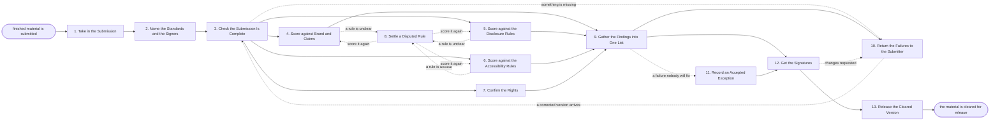

# Reference process: Approve Marketing Material

`ref/mkt/approve-marketing-material v1`

**value stream:** [Idea-to-Asset](../../streams/marketing/idea-to-asset.md)
An agent takes in finished marketing material, works out which standards
apply to it and which people have to sign it, runs the scoring passes,
puts one list of exceptions in front of the signers, and hands back the
version that was cleared. Other processes call this one instead of
describing their own sign-off, so a social post, a guide, an
announcement and an ad all go through the same checks and leave the same
record. A calling process names the material at a version, says where it
will run and by when it is needed, and gets back either a cleared
version with its clearance record or a list of failures with the rule
behind each one. The run ends when every named signer has signed one
version, or when the failures go back to the process that submitted the
material and that process sends a corrected version.

## The activities

| # | Activity | What happens | Agents |
|---|---|---|---|
| 1 | Take in the Submission | record what was submitted and at which version | [decision-coordinator](../../agents/decision-coordinator.md) |
| 2 | Name the Standards and the Signers | which standards apply, at which versions, and who signs | decision-coordinator · [standards-keeper](../../agents/standards-keeper.md) |
| 3 | Check the Submission Is Complete | the material, its claims and its sources are all here | decision-coordinator |
| 4 | Score against Brand and Claims | claims against the register, assets against the guidelines | [brand-check](../../agents/brand-check.md) |
| 5 | Score against the Disclosure Rules | the disclosures and disclaimers the piece must carry | [disclosure-check](../../agents/disclosure-check.md) |
| 6 | Score against the Accessibility Rules | alt text, contrast, captions, links and load time | [accessibility-check](../../agents/accessibility-check.md) |
| 7 | Confirm the Rights | the images, footage, fonts and music are ours to use | [rights-register](../../agents/rights-register.md) · rights approver (person) |
| 8 | Settle a Disputed Rule | what a rule means, written down against the rule | standards-keeper · brand owner (person) · legal reviewer (person) |
| 9 | Gather the Findings into One List | one list of exceptions, each citing the rule it broke | decision-coordinator |
| 10 | Return the Failures to the Submitter | the failures go back to the process that submitted | decision-coordinator |
| 11 | Record an Accepted Exception | a known failure is accepted in writing, with reasons | decision-coordinator · leadership (person) |
| 12 | Get the Signatures | named people sign against one version | decision-coordinator · brand owner (person) · legal reviewer (person) |
| 13 | Release the Cleared Version | the signed version goes back to who asked for it | decision-coordinator |

## The graph



## The document, with the blanks marked

```
PROCESS: approve marketing material   id: <team>/approve-material   v1
from: ref/mkt/approve-marketing-material v1
owner: <who>                          effective: <date>
trigger: another process submits finished material at a version, or
         <who> submits it directly
         watch: record=<submission> system=<your review record>
                change=<finished material is submitted at a version>
concurrency: runs overlap - <how many> reviews open at once
goal: one version of the material cleared against the standards that
      were in force when it was submitted, with the signers, the
      standard versions and the date recorded, or a list of failures
      back to whoever submitted it
phases:
  take-in          - human: record what arrived, from which process or
                     person, at which version, where it will run, and
                     the date it is needed by
                     owner: decision-coordinator  after: trigger
                     automation: <level>
  name-standards   - human: which standards apply to this kind of
                     material and in each market it will run in, at
                     which versions, and which people have to sign
                     owner: standards-keeper      after: take-in
                     automation: <level>
  check-complete   - runs assessment: the material, the claims it
                     makes, the sources under those claims and the
                     list of places it will run are all present
                     owner: decision-coordinator  after: name-standards
                     automation: <level>
  score-brand      - runs assessment: every claim against the claims
                     register, every asset against the brand guidelines
                     owner: brand-check           after: check-complete
                     by: <days>                   automation: <level>
  score-disclosure - runs assessment: the disclosures and disclaimers
                     the material has to carry in each market
                     owner: disclosure-check      after: check-complete
                     by: <days>                   automation: <level>
  score-access     - runs assessment: alt text, captions, contrast,
                     heading order, keyboard use, links and load time
                     owner: accessibility-check   after: check-complete
                     by: <days>                   automation: <level>
  confirm-rights   - human: every image, clip, track, font and
                     appearance in the material, read against the
                     license it rests on and that license's expiry
                     owner: rights-register       after: check-complete
                     by: <days>                   automation: <level>
  settle-rule      - convenes decide-and-announce: what a rule means,
                     written against that rule at its version
                     owner: standards-keeper
                     after: whichever scoring pass raised the question
                     automation: never
  gather-findings  - runs collect-and-report: one list of exceptions,
                     each citing the standard, its version and the rule
                     owner: decision-coordinator
                     after: score-brand + score-disclosure +
                            score-access + confirm-rights
                     automation: <level>
  return-failures  - human: the exception list goes back to the process
                     or the person that submitted the material, with
                     the version it applies to
                     owner: decision-coordinator  after: gather-findings
                     automation: <level>
  accept-exception - convenes approval: <who> accepts a known failure
                     in writing, saying why and what the acceptance
                     covers
                     owner: decision-coordinator  after: gather-findings
                     automation: never
  get-signatures   - convenes approval: the named signers sign against
                     one version, with the exception list in front of
                     them and every accepted failure attached
                     owner: decision-coordinator  after: gather-findings
                     by: <days>                   automation: never
  release          - human: the cleared version, its clearance record
                     and any condition on a signature go back to the
                     submitter
                     owner: decision-coordinator  after: get-signatures
                     automation: <level>
run-scoped:
  status - runs roll-call                      owner: decision-coordinator
           every: <cadence>
           from: take-in   until: run close
handoffs:
  take-in -> name-standards [submission]: what arrived, at which
    version, what it is for, where it will run, and the date it is
    needed by
  name-standards -> check-complete [standards-and-signers]: the
    standards that apply, each at the version it is read at, and the
    people who have to sign
  check-complete -> score-brand + score-disclosure + score-access +
    confirm-rights [scorable-material]: the material at one version,
    its claims, the sources under them, and the list of places it will
    run
  score-brand -> gather-findings [brand-verdicts]: a verdict per item,
    each citing the standard, its version and the rule applied
  score-disclosure -> gather-findings [disclosure-verdicts]: a verdict
    per item and per market, each citing the rule behind it
  score-access -> gather-findings [access-verdicts]: a verdict per
    item, and what the agent could not test
  confirm-rights -> gather-findings [rights-and-expiries]: the license
    behind every image, clip, track and font, and the date each one
    expires
  settle-rule -> the pass that raised it [rule-reading]: what the rule
    means, written against the rule at its version, so the next
    reading of it comes out the same way
  gather-findings -> return-failures [exception-list]: one exception
    list, ordered by what has to change first
  gather-findings -> get-signatures [findings-and-version]: the same
    list with nothing taken out of it, beside the version it was
    scored against
  accept-exception -> get-signatures [written-acceptance]: the
    accepted failure, who accepted it, the reason, and what the
    acceptance covers
  get-signatures -> release [signatures]: the signed version, the
    signers, the date, and any condition a signer attached
  release -> the submitting process [clearance]: the cleared version,
    the clearance record, and the date the clearance stops being good
deviations:
  check-complete -> return-failures [submission-incomplete]: something
    the submission needs is missing, so the failures go straight back
    to the submitter and none of the scoring passes runs on this
    version
  settle-rule -> score-brand [brand-rule-settled]: the reading of the
    rule is written down, so the brand and claims pass scores again
    against it
  settle-rule -> score-disclosure [disclosure-rule-settled]: the
    reading of the rule is written down, so the disclosure pass scores
    again against it
  settle-rule -> score-access [access-rule-settled]: the reading of
    the rule is written down, so the accessibility pass scores again
    against it
  return-failures -> check-complete [corrected-version]: the submitter
    sends a corrected version, so it comes in again and is checked for
    completeness before anything is scored
  get-signatures -> return-failures [signer-changes]: a signer asks
    for changes, so only what that signer named goes back to the
    submitter
bindings:
  roster:  <who holds each role - agents claiming the abstract agents
           above, and named people for brand, legal, rights and
           whoever may accept a known failure>
  systems: the review record (write), the approval record (write),
           the standards store (read), the claims register (read),
           the asset store (read), the rights and license record
           (read), the notification channel (write)
  data:    brand guidelines <version>, <your claims register>,
           <your accessibility standard> <version>,
           <your disclosure rules> <version>, the submitted material
policy:
  nothing is released until every named signer has signed
  sign-off is a human gate and is never delegated to an agent
  every failure reaches the signers, and an agent never waives its own
    finding
  a failure the signers are asked to live with reaches them only with
    a written acceptance attached, naming who accepted it and why
  material changed after a signature goes back through the scoring
    passes its change touches
  the standards are read at the versions in force on the day the
    material was submitted, and those versions are recorded
  a clearance covers one version and the places it was scored for
measures:
  cycle time: <target> from submission to a cleared version
  first-pass rate: <target> share of submissions clearing without
                   going back to the submitter
  volume: <reviews per period>
  quality gate: nothing is released unsigned, and every exception on a
                released version carries a written acceptance
```

## The failure edges

- **A signer asks for changes.** The run returns to return-failures and
  the exception list goes back to the process that submitted the
  material. Only what the signer named reopens, and the corrected
  version comes in again at check-complete.
- **A rule does not settle the question.** The scoring agent says what
  the text does and does not say, and the standards-keeper agent puts
  the question to whoever owns the rule. The answer is written against
  the rule at its version, and the pass that raised it scores again.
- **The submitter never sends a corrected version.** The review stays
  open with its findings recorded, and <who> decides whether the
  material is dropped or the release date moves. A review that has sat
  longer than <how long> is closed as unfinished, and a later submission
  of the same material starts a new run.
- **A license expires between the rights check and the release date.**
  The rights-register agent reports the expiry with the finding, and the
  material is cleared only for the window the license covers. Running it
  past that window needs a new run.
- **A standard is reissued while the review is open.** The review
  finishes against the version it started with, and the standards-keeper
  agent says whether the change is large enough to score again. Scoring
  again is a person's call and is recorded either way.
- **Material changes after it was signed.** The signature is void. The
  changed version goes back through the passes its change touches, and
  the signers see the changed version before it goes anywhere.
- **The trigger fires while runs are in flight.** Reviews overlap
  normally, and the concurrency line says how many. Each review holds
  one submission at one version, so every run in flight needs its own
  holder of the decision-coordinator agent, and the runs read their
  standards read-only at the versions each run named.
- **A run is abandoned.** The findings stay where they are at their
  versions, so a later submission of the same material starts from what
  was already scored. Nothing is released, and the submitting process is
  told the review closed without a clearance.
