# Reference process: Maintain Attribution Model

`ref/mkt/attribution-model v1`

**value stream:** [Activity-to-Insight](../../streams/marketing/activity-to-insight.md)
The attribution model decides how credit for one conversion is divided
across the touches that came before it. This process runs when the
model stops predicting what actually happens, or when a new channel
starts sending traffic the model has no rule for. The department
confirms that something really changed, works out which channels,
conversions and closed periods the review covers, and pulls the record
of touches the model runs on. A forecaster drafts two or three revised
models and tests each one against outcomes the organization already
knows, and the closed periods are recomputed under every candidate so
everyone can see what each channel gains or loses. Leadership chooses
the model. Leadership and finance then make a separate decision about
the reports already published under the old model. The chosen model is
issued at a numbered version carrying the date it applies from, the
approved periods are reissued as new versions of their reports, and
every process that reports numbers is told which version produced which
figure.

## The activities

| # | Activity | What happens | Agents |
|---|---|---|---|
| 1 | Take in the Trigger | what drifted, or which channel is now sending traffic | [standards-keeper](../../agents/standards-keeper.md) · [analytics](../../agents/analytics.md) |
| 2 | Confirm the Drift | test the gap against a holdout before rebuilding | [statistician](../../agents/statistician.md) · analytics |
| 3 | Set What the Review Covers | the channels, the conversions and the periods in scope | standards-keeper · [reporting-manager](../../agents/reporting-manager.md) |
| 4 | Pull the Touchpoint Record | every touch on a path to a conversion, with its date | analytics |
| 5 | Check the Tracking | where touches went uncounted, and for how long | [conversion-tracker](../../agents/conversion-tracker.md) |
| 6 | Clear the Data for Use | whether these touches may be joined to one person | [consent-manager](../../agents/consent-manager.md) · legal reviewer (person) |
| 7 | Draft the Candidate Models | two or three revised models, each written down | [forecaster](../../agents/forecaster.md) |
| 8 | Test the Candidates against the Record | would each model have picked what actually happened | forecaster · statistician |
| 9 | Recompute the Closed Periods | what each channel gains or loses in past periods | analytics · forecaster |
| 10 | Choose the Model | one model chosen, with the reasons written down | [decision-coordinator](../../agents/decision-coordinator.md) · standards-keeper · leadership (person) |
| 11 | Decide What Happens to Published Reports | which past reports get restated and which stand | decision-coordinator · reporting-manager · leadership (person) · finance (person) |
| 12 | Issue the Model at a Version | the model at a number, with the date it applies from | standards-keeper |
| 13 | Reissue the Affected Reports | each period restated, at a new version of its report | reporting-manager · analytics |
| 14 | Tell the Processes that Read the Model | every process that reports numbers hears the change | standards-keeper |
| 15 | Set the Review Conditions | when the model is tested again, and what reopens it | standards-keeper · decision-coordinator |
| 16 | Record What Was Learned | what to repeat, what to avoid | standards-keeper |

## The graph

```mermaid
flowchart LR
  T([the model drifts, or a new channel starts sending traffic]) --> A1[1. Take in the Trigger]
  A1 --> A2[2. Confirm the Drift]
  A2 -. the gap is inside the noise .-> A16[16. Record What Was Learned]
  A2 --> A3[3. Set What the Review Covers]
  A3 --> A4[4. Pull the Touchpoint Record]
  A3 --> A5[5. Check the Tracking]
  A4 --> A6[6. Clear the Data for Use]
  A6 -. the joining is declined .-> A4
  A5 --> A7[7. Draft the Candidate Models]
  A6 --> A7
  A7 --> A8[8. Test the Candidates against the Record]
  A8 -. the record is too thin to test on .-> A4
  A8 --> A9[9. Recompute the Closed Periods]
  A9 -. a candidate falls apart on real periods .-> A7
  A9 --> A10[10. Choose the Model]
  A10 -. no candidate beats the model in use .-> A7
  A10 --> A11[11. Decide What Happens to Published Reports]
  A10 --> A12[12. Issue the Model at a Version]
  A11 --> A13[13. Reissue the Affected Reports]
  A12 --> A13
  A13 -. a restated figure does not reconcile .-> A9
  A12 --> A14[14. Tell the Processes that Read the Model]
  A13 --> A14
  A14 --> A15[15. Set the Review Conditions]
  A15 --> A16
  A16 --> DONE([the model is issued and the history is restated])
```



## The document, with the blanks marked

```
PROCESS: attribution model            id: <team>/attribution-model  v1
from: ref/mkt/attribution-model v1
owner: <who>                          effective: <date>
trigger: the model misses by more than <how far>, or a new channel
         starts sending traffic, raised in <your measurement review>
         watch: record=<attribution model>
                system=<your measurement review>
                change=<the model misses by more than the agreed
                distance>
         or watch: record=<channel>
                system=<your measurement review>
                change=<a channel the model has no rule for starts
                sending traffic>
concurrency: one run at a time - the department has one current model
goal: an attribution model issued at a numbered version with the date
      it applies from, and every closed period either reissued at a new
      version of its report or left standing under the model it was
      computed under
phases:
  take-in-trigger  - human: write down what drifted or which channel
                     arrived, and what the current model predicted
                     owner: standards-keeper     after: trigger
                     automation: <level>
  confirm-drift    - system: the gap between what the model predicted
                     and what happened, measured against data held back
                     from the fit
                     owner: statistician         after: take-in-trigger
                     by: <days>                  automation: <level>
  set-scope        - human: the channels, the conversions and the
                     closed periods the review covers
                     owner: standards-keeper     after: confirm-drift
                     automation: <level>
  pull-touchpoints - system: every touch on a path to a conversion in
                     the periods in scope, each with its date, its
                     channel and the conversion it led to
                     owner: analytics            after: set-scope
                     by: <days>                  automation: <level>
  check-tracking   - human: where measurement was broken, on which
                     channel, and over which dates
                     owner: conversion-tracker   after: set-scope
                     by: <days>                  automation: <level>
  clear-data       - convenes approval: legal signs that these touches
                     may be joined to one person for measurement
                     owner: <your legal role>    after: pull-touchpoints
                     by: <days>                  automation: never
  draft-candidates - runs build-by-talent: two or three revised models,
                     each written out with the rule it changes and the
                     data it was fit on
                     owner: forecaster
                     after: check-tracking + clear-data
                     by: <days>                  automation: <level>
  back-test        - system: each candidate run over outcomes the
                     organization already knows, to see what it would
                     have picked
                     owner: forecaster           after: draft-candidates
                     by: <days>                  automation: <level>
  recompute        - system: every closed period in scope recomputed
                     under each candidate, channel by channel, beside
                     the figures that were published
                     owner: analytics            after: back-test
                     by: <days>                  automation: <level>
  choose-model     - convenes bake-off: two or three candidates, one
                     chosen, with the reasons said out loud
                     owner: decision-coordinator after: recompute
                     by: <days>                  automation: never
  decide-restate   - convenes decide-and-announce: which closed periods
                     are reissued and which keep the figures they
                     published, decided by <who> with <who> from
                     finance in the room
                     owner: decision-coordinator after: choose-model
                     by: <days>                  automation: never
  issue-version    - human: the chosen model issued as a numbered
                     version carrying the date it applies from, with
                     every earlier version left runnable over past data
                     owner: standards-keeper     after: choose-model
                     automation: <level>
  reissue-reports  - human: each approved period recomputed and sent
                     out as a new version of its report, naming the
                     model version under each figure and what moved
                     owner: reporting-manager
                     after: decide-restate + issue-version
                     by: <days>                  automation: <level>
  tell-the-readers - runs decide-and-announce: every process that
                     reports numbers hears the version, the date it
                     applies from, and which periods were reissued
                     owner: standards-keeper
                     after: issue-version + reissue-reports
                     automation: <level>
  set-review       - human: the date the model is tested again, and the
                     conditions that bring it back sooner
                     owner: standards-keeper     after: tell-the-readers
                     automation: <level>
  record-learnings - convenes debrief: what to repeat, what to avoid
                     owner: standards-keeper     after: set-review
                     automation: <level>
run-scoped:
  outstanding - runs roll-call                 owner: standards-keeper
                every: <cadence>
                from: set-scope   until: tell-the-readers
handoffs:
  take-in-trigger -> confirm-drift [drift-report]: what drifted or
    which channel arrived, and what the current model predicted for it
  confirm-drift -> set-scope [drift-verdict]: the size of the gap, the
    data it was measured on, and the verdict on whether it is larger
    than the noise
  set-scope -> pull-touchpoints [review-scope]: the channels, the
    conversions and the closed periods the review covers
  set-scope -> check-tracking [channels-and-periods]: the same scope.
    Both branches read one record
  pull-touchpoints -> clear-data [touchpoint-record]: the touchpoint
    record, the data sets under it, and the terms each set came with
  check-tracking -> draft-candidates [tracking-gaps]: where
    measurement was broken, on which channel, and over which dates, so
    that no candidate is fit on a period the tracking was down in
  clear-data -> draft-candidates [joinable-touches]: the touches that
    may be joined to one person, and the count of the touches that may
    not
  draft-candidates -> back-test [candidate-models]: the candidates in
    the form they will be tested in
  back-test -> recompute [back-test-results]: what each candidate
    would have picked, what actually happened, and whether the
    difference is larger than the noise in the measurement
  recompute -> choose-model [recomputed-periods]: every closed period
    in scope under every candidate, channel by channel, beside the
    figures that were published for that period
  choose-model -> decide-restate [chosen-model]: the chosen model, why
    it won, and what it moves in each closed period
  choose-model -> issue-version [model-wording]: the model in the
    wording it was agreed in, and the date it applies from
  decide-restate -> reissue-reports [restatement-decision]: the
    periods approved for reissue, the periods left standing, and the
    reason recorded for each
  issue-version -> reissue-reports [numbered-model]: the model at its
    number, runnable over the periods being recomputed
  issue-version -> tell-the-readers [version-notice]: the version, the
    date it applies from, and what changed from the version it
    replaces
  reissue-reports -> tell-the-readers [reissued-reports]: each
    reissued period at its new report version, saying what moved and
    by how much
  tell-the-readers -> set-review [reader-responses]: what each
    receiving agent says it changes because of the new model
  set-review -> record-learnings [review-conditions]: the review date
    and the conditions that bring the model back sooner
deviations:
  confirm-drift -> record-learnings [drift-inside-noise]: the gap is
    inside the noise of the measurement, so no model is rebuilt, the
    phases between here and the debrief never run, and the record says
    the model was tested and left as it was
  clear-data -> pull-touchpoints [joining-declined]: legal will not
    clear the joining, so the record is pulled again limited to the
    touches that may be joined to one person
  back-test -> pull-touchpoints [record-too-thin]: the record is too
    thin to test a candidate on, so it is pulled again with the
    missing period or the missing channel named
  recompute -> draft-candidates [candidate-fails-on-periods]: a
    candidate falls apart once real closed periods are run through it,
    so the candidates are drafted again
  choose-model -> draft-candidates [no-candidate-wins]: no candidate
    beats the model already in use, so the room asks for another round
    of candidates before the current version is left as it is
  reissue-reports -> recompute [restated-figure-disagrees]: a restated
    figure does not reconcile with the figures finance already signed,
    so the period is recomputed with the line that moved named
bindings:
  roster:  <who holds each role - agents claiming the abstract agents
           above, and named people for leadership, finance and legal>
  systems: analytics platforms (read), ad platforms (read),
           the CRM (read), the consent record (read),
           the model store (write), the standards store (write),
           the report store (write), the decision record (write),
           the calculation record (write),
           the notification channel (write),
           the review schedule (write)
  data:    the touchpoint record over <what period>, the current model
           <version>, <your conversion definitions> <version>, the
           closed periods in scope and the reports already published
           for them, the terms attached to every data set the model
           rests on
policy:
  a published report is never edited in place. A reissue goes out as a
    new version of the same report, and the version it corrects stays
    where it was
  every figure carries the model version that produced it
  an earlier model version stays runnable over past data, so any closed
    period can be recomputed under any version the department issued
  the model is chosen by named people, and the choice is never
    delegated to an agent
  which closed periods are reissued is decided by named people, and
    <who> from finance is one of them
  a period that closes after the version date is computed under the new
    model, and no reissue is involved
  no candidate reaches the room without a back-test against outcomes
    already known and without every closed period in scope recomputed
    under it
  a touch that may not be joined to one person is left out of the
    model, and the count left out is recorded with the model
  a period the tracking was broken in is marked as such wherever it is
    reported, whether or not the period is reissued
  a disagreement is recorded with the decision, naming who disagreed
    and what they disagreed with
measures:
  cycle time: <target> from the confirmed drift to the issued version
  volume: <runs per period>
  quality gate: no figure is published without the model version that
                produced it, and no published report is corrected in
                place
```

## The failure edges

- **The drift does not confirm.** The gap between what the model
  predicted and what happened turns out to be inside the noise of the
  measurement. The run closes with a record saying the model was tested
  and left as it was, and <who> decides whether the trigger threshold
  has to move so that the same noise does not reopen the model next
  month.
- **Legal will not clear the joining.** The run returns to
  pull-touchpoints and the record comes back limited to the touches
  that may be joined to one person. The candidates are built on the
  narrower record, and the count of touches left out is recorded with
  the model, so a later reader knows what the model could not see.
- **The touchpoint record is too thin to test on.** The back-test
  reports the gap instead of a result, and the run returns to
  pull-touchpoints with the missing period or the missing channel
  named. If the record cannot be repaired, the scope narrows to the
  periods it does cover, and the narrowing is recorded with the model.
- **No candidate beats the model already in use.** The room says so and
  the current version stays current. The run goes on to set-review with
  what was tried and what it scored written down, so the next run does
  not put up the same candidates again.
- **Leadership chooses the model and reissues nothing.** This is a
  normal outcome. No report is recomputed, the version date becomes the
  only mark in the record, and every report either side of that date
  carries the model version it was computed under, so a reader
  comparing two periods can see that the periods came from different
  models.
- **A recomputed period does not reconcile with the figures finance
  already signed.** The reissue stops and the run returns to recompute
  with the line that moved named. The period goes out only when the
  reporting manager and finance agree on what the new figure is.
- **A new channel arrives while a run is in flight.** Either the scope
  widens and the candidates are drafted again to cover the channel, or
  the run finishes on the scope it set and the channel triggers the
  next run. The owner of the run decides which, and the reason is
  recorded.
- **A run is abandoned.** The current model version stays current and
  no report is reissued, because a half-finished restatement leaves two
  sets of figures for the same period in circulation. The candidate
  models and the recomputed periods stay at their versions, so a later
  run can pick them up.
