# Reference process: Submit Award Entry

`ref/mkt/award-entry v1`

**value stream:** [Story-to-Coverage](../../streams/marketing/story-to-coverage.md)
A submissions manager runs one entry into one outside award. The agent
reads what the award recognizes, what it costs and when it closes, and a
person decides whether the organization enters at all. The agent then
reads the entry rules before anything is written, picks the category and
the work with the expert who did that work, has the evidence gathered
and the answers written to the judging criteria, gets the customer named
in the entry to agree to appear, puts the whole entry through sign-off,
files it and pays the fee before the deadline, answers whatever the
judges come back with, and records the result. The run stays open long
past the filing, because the decision arrives weeks or months later and
somebody still owes the debrief.

## The activities

| # | Activity | What happens | Agents |
|---|---|---|---|
| 1 | Take in the Award | what it recognizes, its deadline and its fee | [submissions-manager](../../agents/submissions-manager.md) |
| 2 | Decide Whether to Enter | weigh the fee and the effort against the value | submissions-manager · leadership (person) |
| 3 | Read the Entry Rules | eligibility, categories, word limits and format | submissions-manager · legal reviewer (person) |
| 4 | Pick the Entry | the category and the work entered in it | submissions-manager · subject matter expert (person) |
| 5 | Brief the Entry | everyone hears the same request and the deadline | submissions-manager · [copywriter](../../agents/copywriter.md) · [researcher](../../agents/researcher.md) · [editor](../../agents/editor.md) · [creative-producer](../../agents/creative-producer.md) |
| 6 | Gather the Evidence | results, dates and the proof behind each claim | researcher · [analytics](../../agents/analytics.md) · subject matter expert (person) |
| 7 | Get the Customer's Agreement | the named customer agrees to appear in the entry | [advocacy-manager](../../agents/advocacy-manager.md) · [account-monitor](../../agents/account-monitor.md) · account owner (person) |
| 8 | Write the Entry | the answers written to the judging criteria | copywriter · submissions-manager |
| 9 | Edit the Entry | the answers tightened against the criteria | editor |
| 10 | Assemble the Supporting Material | images, video and references the entry asks for | creative-producer · [designer](../../agents/designer.md) · [video-editor](../../agents/video-editor.md) |
| 11 | Get Sign-Offs | brand, legal, rights and the customer approve it | [brand-check](../../agents/brand-check.md) · brand owner (person) · legal reviewer (person) · rights approver (person) · advocacy-manager |
| 12 | Submit the Entry | the fee is paid and the entry is filed on time | submissions-manager · finance (person) |
| 13 | Answer the Judges | clarifications and interviews the judges ask for | submissions-manager · subject matter expert (person) |
| 14 | Track the Result | shortlist, win or nothing, recorded against the entry | submissions-manager · [coverage-monitor](../../agents/coverage-monitor.md) |
| 15 | Hand the Result On | a shortlist or a win goes to the announcement | submissions-manager · [comms-manager](../../agents/comms-manager.md) · [press-relations](../../agents/press-relations.md) |
| 16 | Record What Was Learned | what to repeat, what to avoid | submissions-manager |

## The graph

```mermaid
flowchart LR
  T([an award opens for entries]) --> A1[1. Take in the Award]
  A1 --> A2[2. Decide Whether to Enter]
  A2 --> A3[3. Read the Entry Rules]
  A3 --> A4[4. Pick the Entry]
  A4 --> A5[5. Brief the Entry]
  A5 --> A6[6. Gather the Evidence]
  A5 --> A7[7. Get the Customer's Agreement]
  A5 --> A10[10. Assemble the Supporting Material]
  A6 -. the work does not qualify .-> A4
  A7 -. the customer declines .-> A4
  A6 --> A8[8. Write the Entry]
  A8 --> A9[9. Edit the Entry]
  A9 -. rewrite what the edit named .-> A8
  A9 --> A11[11. Get Sign-Offs]
  A7 --> A11
  A10 --> A11
  A11 -. changes requested .-> A8
  A11 -. changes requested .-> A10
  A11 --> A12[12. Submit the Entry]
  A12 --> A13[13. Answer the Judges]
  A13 -. the evidence does not answer it .-> A6
  A13 --> A14[14. Track the Result]
  A14 --> A15[15. Hand the Result On]
  A15 --> A16[16. Record What Was Learned]
  A16 --> DONE([the entry is filed and its result is recorded])
```



## The document, with the blanks marked

```
PROCESS: award entry                  id: <team>/award-entry   v1
from: ref/mkt/award-entry v1
owner: <who>                          effective: <date>
trigger: an award opens for entries, or <your awards calendar> says the
         date is close
         watch: record=<award> system=<your awards calendar>
                change=<the award opens for entries>
         or watch: record=<award> system=<your awards calendar>
                change=<the closing date comes within the notice the
                calendar sets>
concurrency: runs overlap - <how many> entries open at once
goal: an entry that meets the award's rules, carries the customer's
      agreement, is signed off, is paid for and filed before the
      deadline, and has its result recorded
phases:
  take-in-award    - human: read what the award recognizes, what it
                     costs to enter, and the date it closes
                     owner: submissions-manager after: trigger
                     automation: <level>
  decide-to-enter  - convenes decide-and-announce: whether this award is
                     worth the fee and the time it takes
                     owner: <who decides>       after: take-in-award
                     automation: never
  read-the-rules   - human: the eligibility, the categories, the word
                     limits, the format, and the terms of entry
                     owner: submissions-manager after: decide-to-enter
                     by: <days>                 automation: <level>
  pick-the-entry   - human: the category, and the work entered in it
                     owner: submissions-manager after: read-the-rules
                     by: <days>                 automation: <level>
  brief-the-entry  - convenes briefing: the judging criteria, what each
                     agent owes, and the filing date
                     owner: submissions-manager after: pick-the-entry
                     automation: <level>
  gather-evidence  - runs collect-and-report: the results the entry
                     claims, each with the source it came from
                     owner: researcher          after: brief-the-entry
                     by: <days>                 automation: <level>
  customer-consent - human: the named customer agrees to appear, and the
                     terms of that agreement are written down
                     owner: advocacy-manager    after: brief-the-entry
                     by: <days>                 automation: never
  write-the-entry  - human: the answers written to the judging criteria,
                     inside the word limits the rules set
                     owner: copywriter          after: gather-evidence
                     by: <days>                 automation: <level>
  edit-the-entry   - runs layered-passes: the structure and argument
                     pass, read against what the judges score
                     owner: editor              after: write-the-entry
                     by: <days>                 automation: <level>
  support-material - runs build-by-talent: the images, the video and the
                     references the rules ask for
                     owner: creative-producer   after: brief-the-entry
                     by: <days>                 automation: <level>
  get-sign-offs    - convenes approval: brand, legal, rights and the
                     customer sign, as named signers, against a version
                     owner: <your legal role>
                     after: edit-the-entry + customer-consent +
                            support-material
                     by: <days>                 automation: never
  submit-the-entry - human: <who> pays the fee and the manager files the
                     entry at the version that was signed
                     owner: submissions-manager after: get-sign-offs
                     by: the award's deadline   automation: <level>
  answer-judges    - human: the clarifications, the questions and the
                     interviews the judges ask for
                     owner: submissions-manager after: submit-the-entry
                     automation: <level>
  track-result     - human: the shortlist, the win or the silence,
                     recorded against the entry
                     owner: submissions-manager after: answer-judges
                     by: <how long the run waits>
                     automation: <level>
  hand-on-result   - human: a shortlist or a win goes to <your
                     announcement process> with the evidence behind it.
                     An entry that did not place is recorded and goes no
                     further
                     owner: comms-manager       after: track-result
                     automation: <level>
  record-learnings - convenes debrief: what to repeat, what to avoid
                     owner: submissions-manager after: hand-on-result
                     automation: <level>
run-scoped:
  status   - runs roll-call                  owner: submissions-manager
             every: <cadence>
             from: brief-the-entry   until: submit-the-entry
  coverage - runs collect-and-report         owner: coverage-monitor
             every: <cadence>
             from: submit-the-entry   until: run close
handoffs:
  take-in-award -> decide-to-enter [award-terms]: what the award
    recognizes, the fee, the work it will take, and the date it closes
  decide-to-enter -> read-the-rules [entry-decision]: the decision to
    enter, and who agreed to pay for it
  read-the-rules -> pick-the-entry [entry-rules]: the eligibility
    rules, the categories and the format, with the date they were read
  pick-the-entry -> brief-the-entry [category-and-work]: the category,
    the work entered in it, and the customer the entry will name
  brief-the-entry -> gather-evidence [judging-criteria]: the criteria
    the judges score, and the date the entry has to be filed
  brief-the-entry -> customer-consent [customer-wording]: what the
    entry will say about the customer, in the words it will say it
  gather-evidence -> write-the-entry [sourced-evidence]: the evidence,
    with a source line for every number the entry uses
  customer-consent -> get-sign-offs [customer-agreement]: the
    customer's agreement in their own words, saying what may be said
    about them and until when
  edit-the-entry -> get-sign-offs [edited-entry]: the entry at a
    version, inside the word limits the rules set
  support-material -> get-sign-offs [supporting-material]: the images,
    the video and the references at their versions
  get-sign-offs -> submit-the-entry [signed-entry]: the approved entry
    at the signed version. A later change voids the approval, and it
    voids the customer's agreement with it
  submit-the-entry -> answer-judges [filed-entry]: the filed entry at
    the version that went in, the date it was filed, and what the body
    sent back
  track-result -> hand-on-result [award-result]: the decision, the
    date the body published it, and what the body said about the entry
  hand-on-result -> record-learnings [announcement-record]: what went
    out and who it went to
deviations:
  read-the-rules -> decide-to-enter [terms-too-costly]: the terms of
    entry ask for more than the organization will give, so the choice
    to enter is taken again against what those terms cost
  gather-evidence -> pick-the-entry [work-does-not-qualify]: the
    evidence shows the work falls outside what the award covers, so
    different work is picked or the award is dropped for this cycle
  customer-consent -> pick-the-entry [customer-declines]: the named
    customer will not agree to appear, so the entry is rebuilt around
    work that names nobody outside the organization, or it is dropped
  edit-the-entry -> write-the-entry [edit-asks-rewrite]: the edit
    names answers that do not read against what the judges score, so
    those answers are written again
  get-sign-offs -> write-the-entry [sign-off-changes-entry]: a signer
    asks for changes to what the entry says, so only what they named
    is written again
  get-sign-offs -> support-material [sign-off-changes-material]: a
    signer asks for changes to the images, the video or the
    references, so only what they named is made again
  answer-judges -> gather-evidence [judge-question-unanswered]: a
    judge asks something the evidence does not answer, so the evidence
    is gathered again and the answer goes back with a source under it
bindings:
  roster:  <who holds each role - agents claiming the abstract agents
           above, and named people for leadership, legal, brand, rights,
           finance, the expert and the account owner>
  systems: the submissions record (write), the asset store (write),
           the advocacy record (write), the account standing record
           (read), the coverage record (write), the outside body's
           submission system (write)
  data:    brand guidelines <version>, <your claims register>,
           the award's entry rules at the date they were read,
           the customer and revenue record
policy:
  the entry rules are read and recorded before anything is written
  no claim in the entry ships without a citation in <your claims
    register>
  a customer is named only where that customer's agreement is on record
  sign-off is a human gate and is never delegated to an agent
  an entry changed after sign-off goes back through sign-offs, and the
    customer sees the change before it is filed
  the fee is committed by <who>, and no agent commits the organization
    to a cost
measures:
  cycle time: <target> from the award opening to the filed entry
  volume: <entries per period>
  quality gate: nothing is filed unsigned, and nothing is filed late
```

## The failure edges

- **The work turns out not to qualify.** The evidence shows the results
  fall outside the window the award covers, or the work sits in a
  category it cannot be entered in. The run goes back to pick-the-entry,
  and the manager either enters different work or takes the award off
  the list for this cycle.
- **The customer will not agree to be named.** The run goes back to
  pick-the-entry, and the entry is rebuilt around work that names nobody
  outside the organization, or the entry is dropped. The refusal is
  recorded with the reason the customer gave and the date they may be
  asked again, so the next cycle does not put the same question to the
  same customer.
- **A sign-off comes back with changes.** The run returns to the entry
  or to the supporting material, and only what the signers named
  reopens. The customer's agreement covers the words they saw, so a
  change to anything the entry says about them goes back to the customer
  before it is filed.
- **The terms of entry ask for more than the organization will give.**
  Some bodies take a licence to reproduce whatever is submitted, and
  some ask for material the organization treats as confidential. The
  legal reviewer reads those terms at read-the-rules, and the run goes
  back to decide-to-enter, where <who> decides whether the entry is
  worth what the terms cost.
- **A judge asks something the evidence does not answer.** The run goes
  back to gather-evidence with the question attached, and the answer
  reaches the judges only once it has a source under it. The question
  and the answer are both recorded against the entry.
- **The deadline cannot be made.** The manager says so on the day the
  arithmetic stops working, while there is still time for <who> to
  decide whether the entry is dropped, whether the body will grant an
  extension, or whether the entry goes in thinner than it was planned.
- **The result never arrives.** Some bodies announce late and some never
  announce at all. The run waits for <how long the run waits> and then
  closes with the result recorded as never published, so the entry does
  not sit open forever.
- **The entry does not place.** The run still goes through
  record-learnings, and whatever the judges said about the entry is
  recorded against the award, because that is the material the next
  cycle starts from.
- **The trigger fires while runs are in flight.** Awards overlap
  normally, and the concurrency line says how many. Several awards close
  in the same few weeks, so the agents that write the entries and gather
  the evidence run short first, and the manager takes one entry at a
  time.
- **A run is abandoned.** The evidence, the draft and the supporting
  material stay where they are at their versions, so a later entry can
  use them. A fee already paid is usually not refundable and it is
  recorded as spent. The customer who agreed to be named is told that
  the entry was dropped.
