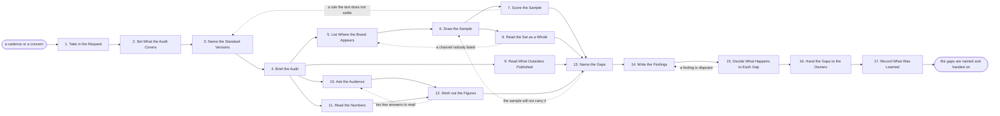

# Reference process: Conduct Brand Audit

`ref/mkt/brand-audit v1`

**value stream:** [Promise-to-Perception](../../streams/marketing/promise-to-perception.md)
A study manager runs one audit of how the brand actually shows up. The
manager settles which channels, which period and which markets the audit
covers, and the standards keeper names the version of each standard
everything will be judged against. The run works out every place
somebody outside the organization meets the brand, and it pulls a sample
of that material in the form it is really served. Brand check scores
each item against the rule it has to meet, and a designer and an editor
read the whole sample together, because items that each pass their own
rules can still look like they came from more than one company. The
coverage monitor reads what outsiders published, the study manager asks
customers and prospects what they think the organization stands for,
and analytics reports how often people come looking for the
organization by name. The run sets all of that against the standard,
names every gap with the rule and the evidence under it, and puts the
list in front of the brand owner and leadership, who decide gap by gap
whether it is fixed now, fixed later, or accepted in writing. The run
ends when each gap has been handed to whoever can close it. Brand check
scores a single piece before it is published. This process reads a
sample of everything already published and reports where it has moved
away from the standard.

## The activities

| # | Activity | What happens | Agents |
|---|---|---|---|
| 1 | Take in the Request | read the cadence or the concern that called it | [study-manager](../../agents/study-manager.md) · requester (person) |
| 2 | Set What the Audit Covers | the channels, the period and the markets covered | study-manager · brand owner (person) |
| 3 | Name the Standard Versions | which version of each standard applies | [standards-keeper](../../agents/standards-keeper.md) |
| 4 | Brief the Audit | every agent hears the scope and the standard at once | study-manager · standards-keeper · [brand-check](../../agents/brand-check.md) · [coverage-monitor](../../agents/coverage-monitor.md) · [analytics](../../agents/analytics.md) · [statistician](../../agents/statistician.md) |
| 5 | List Where the Brand Appears | every place an outsider meets the brand, by channel | study-manager · [content-librarian](../../agents/content-librarian.md) · [audience-manager](../../agents/audience-manager.md) |
| 6 | Draw the Sample | what gets read, pulled as it is actually served | study-manager · content-librarian |
| 7 | Score the Sample | every item scored against the rule it must meet | brand-check · standards-keeper |
| 8 | Read the Set as a Whole | whether it all looks and sounds like one company | study-manager · [designer](../../agents/designer.md) · [editor](../../agents/editor.md) |
| 9 | Read What Outsiders Published | what press, analysts and reviewers said, and when | coverage-monitor |
| 10 | Ask the Audience | what customers say the organization stands for | study-manager · [consent-manager](../../agents/consent-manager.md) · audience-manager |
| 11 | Read the Numbers | how often people come looking for the name itself | analytics |
| 12 | Work out the Figures | which figures hold and what moved since last time | statistician |
| 13 | Name the Gaps | where the material and the standard do not agree | study-manager · standards-keeper |
| 14 | Write the Findings | each gap with the rule and the evidence under it | study-manager |
| 15 | Decide What Happens to Each Gap | fixed now, fixed later, or accepted in writing | brand owner (person) · leadership (person) · study-manager |
| 16 | Hand the Gaps to the Owners | each gap goes to the agent that can close it | study-manager · content-librarian · standards-keeper |
| 17 | Record What Was Learned | what to repeat, what to avoid | study-manager |

## The graph



## The document, with the blanks marked

```
PROCESS: brand audit                  id: <team>/brand-audit   v1
from: ref/mkt/brand-audit v1
owner: <who>                          effective: <date>
trigger: the audit falls due on <your cadence>, or <who> raises a
         concern about how the organization is coming across
         watch: every=<your cadence>
         or watch: record=<concern> system=<your brand concern record>
                change=<a concern about how the organization is coming
                across is raised>
concurrency: one run at a time over the same channels and the same
             period. Audits of different markets may overlap -
             <how many> at once
goal: a named gap for every place the published material and the
      standard disagree, each carrying the rule it fails and the
      evidence under it, and each handed to whoever can close it
phases:
  take-in-request  - human: read the cadence or the concern, and write
                     down what the audit has to settle and by when
                     owner: study-manager      after: trigger
                     automation: <level>
  set-the-scope    - human: which channels, which period and which
                     markets. <who> confirms the scope before any
                     material is pulled
                     owner: study-manager      after: take-in-request
                     automation: never
  name-versions    - human: the version of each standard the material
                     will be judged against, named before scoring
                     owner: standards-keeper   after: set-the-scope
                     automation: <level>
  brief-the-audit  - convenes briefing: the scope, the standard and the
                     due date, heard by every agent at once
                     owner: study-manager      after: name-versions
                     automation: <level>
  list-the-places  - runs collect-and-report: every place somebody
                     outside the organization meets the brand, channel
                     by channel, including material the department did
                     not make
                     owner: study-manager      after: brief-the-audit
                     by: <days>                automation: <level>
  draw-the-sample  - human: which items get read, how many from each
                     channel, and how they are drawn. Each item is
                     pulled in the form it is actually served
                     owner: study-manager      after: list-the-places
                     by: <days>                automation: <level>
  score-the-sample - runs assessment: every item scored against the
                     rule it has to meet, at the named version
                     owner: brand-check        after: draw-the-sample
                     by: <days>                automation: <level>
  read-the-set     - runs layered-passes: the visual pass and the
                     language pass over the whole sample, looking for
                     what no single rule catches
                     owner: study-manager      after: draw-the-sample
                     by: <days>                automation: <level>
  read-coverage    - runs collect-and-report: what outsiders published
                     about the organization in the period, quoted
                     owner: coverage-monitor   after: brief-the-audit
                     by: <days>                automation: <level>
  ask-the-audience - human: what customers and prospects say the
                     organization stands for, asked the same way it was
                     asked last time
                     owner: study-manager      after: brief-the-audit
                     by: <weeks>               automation: <level>
  read-the-numbers - human: how often people come looking for the name
                     itself, and what they ask when they arrive
                     owner: analytics          after: brief-the-audit
                     by: <days>                automation: <level>
  work-out-figures - human: which answers can be relied on, each figure
                     with its range, and what moved since the last
                     audit
                     owner: statistician
                     after: ask-the-audience + read-the-numbers
                     by: <days>                automation: <level>
  name-the-gaps    - human: every place the material and the standard
                     do not agree, each one against the rule it fails
                     owner: study-manager
                     after: score-the-sample + read-the-set +
                            read-coverage + work-out-figures
                     by: <days>                automation: <level>
  write-findings   - runs collect-and-report: the findings on their
                     date, each gap carrying the rule and the evidence
                     owner: study-manager      after: name-the-gaps
                     by: <days>                automation: <level>
  decide-each-gap  - convenes decide-and-announce: fixed now, fixed
                     later, or accepted in writing, gap by gap
                     owner: study-manager      after: write-findings
                     by: <date>                automation: never
  hand-off-gaps    - human: each gap goes to the agent that can close
                     it, with the decision and the date attached
                     owner: study-manager      after: decide-each-gap
                     by: <days>                automation: <level>
  record-learnings - convenes debrief: what to repeat, what to avoid
                     owner: study-manager      after: hand-off-gaps
                     automation: <level>
run-scoped:
  status - runs roll-call                     owner: study-manager
           every: <cadence>
           from: brief-the-audit   until: hand-off-gaps
  spend  - runs allocate-and-reconcile        owner: study-manager
           from: ask-the-audience   until: run close
handoffs:
  take-in-request -> set-the-scope [audit-question]: what the audit
    has to settle, and the date the findings are owed
  set-the-scope -> name-versions [audit-scope]: the channels, the
    period and the markets the audit covers, and what it leaves out
  name-versions -> brief-the-audit [standard-versions]: each standard
    at the version the material will be judged against, and what
    changed in it since the last audit
  brief-the-audit -> list-the-places / read-coverage / ask-the-audience
    / read-the-numbers [audit-brief]: the scope and the standard as
    every agent heard them, and the date each part is due
  list-the-places -> draw-the-sample [appearance-list]: every place the
    brand appears, by channel, with the agent that answers for each one
  draw-the-sample -> score-the-sample [sampled-items]: the sampled
    items at the version each was served at, with the date each was
    pulled
  draw-the-sample -> read-the-set [whole-sample]: the same items, read
    together
  score-the-sample -> name-the-gaps [item-verdicts]: a verdict per
    item, each citing the standard, its version and the rule applied
  read-the-set -> name-the-gaps [set-reading]: what the sample looks
    and sounds like taken together, with the items that show it named
  read-coverage -> name-the-gaps [outside-coverage]: what outsiders
    said, attributed and dated, quoted where a summary would lose the
    point
  ask-the-audience -> work-out-figures [audience-answers]: the answers
    as they were given, each marked with the version of the question
    it answered
  read-the-numbers -> work-out-figures [own-figures]: the
    organization's own figures, each naming where it came from and
    when it was pulled
  work-out-figures -> name-the-gaps [perception-figures]: what people
    say the organization stands for, with the range around every
    figure and what moved since the last audit
  name-the-gaps -> write-findings [named-gaps]: each gap with the rule
    it fails, the version of that rule, and the items that show it
  write-findings -> decide-each-gap [audit-findings]: the findings at
    a version, with everything the audit could not read marked as
    unread
  decide-each-gap -> hand-off-gaps [gap-decisions]: a decision per
    gap, the person who made it, and the date an accepted gap is read
    again
  hand-off-gaps -> record-learnings [gap-owners]: who took each gap
    and what they said they would do about it
deviations:
  score-the-sample -> name-versions [rule-does-not-settle]: a rule
    does not settle the case in front of it, so the item is held
    unscored and what the rule means is written down at its version
  read-the-set -> list-the-places [unlisted-channel]: material turns
    up from a channel nobody listed, so the places are listed again
    and a sample is drawn from the new one
  work-out-figures -> ask-the-audience [too-few-answers]: too few
    answers came back to read, so the audience is asked again or a
    different sample is drawn
  name-the-gaps -> draw-the-sample [sample-too-thin]: the sample will
    not carry a finding, so more is pulled from that channel before
    the gap is named
  decide-each-gap -> write-findings [finding-disputed]: a finding is
    disputed, so it is restated, narrowed or withdrawn with the reason
    recorded beside it
bindings:
  roster:  <who holds each role - agents claiming the abstract agents
           above, and named people for the requester, the brand owner
           and leadership>
  systems: the audit record (write), the study record (write),
           the response record (write), the survey and interview
           system (trigger), the CMS (read), the asset store (read),
           the content inventory (read), the standards store (read),
           the claims register (read), the coverage record (read),
           analytics platforms (read), the consent record (read),
           the contact database (read), the notification channel
           (write), the meeting calendar (write)
  data:    brand guidelines <version>, <your claims register>,
           <your consent rules> <version>, the last audit at the
           version it ran under
policy:
  nothing is scored until the version of every standard is named
  material is judged against the version of the standard in force when
    it was made, until <who> says otherwise
  every gap carries the rule it fails, the version of that rule, and
    the items that show it
  a gap is accepted only in writing, by a named person, with the date
    it is read again
  a finding is never dropped because somebody asked. <who> decides,
    and the decision is recorded with the findings
  this run names gaps and hands them on, and no agent in it changes the
    material or the standard
  the questions put to the audience are reworded only when <who>
    agrees, because the readings before and after stop being comparable
measures:
  cycle time: <target> from the trigger to the delivered findings
  coverage: <share> of the channels in scope with a sample drawn
  closure: <share> of gaps with a decision recorded within <days>
  quality gate: no gap is reported without the rule and the evidence
                under it
```

## The failure edges

- **A rule does not settle the case in front of it.** Brand check
  reports the item as unscored rather than passing it, the run returns
  to name-versions, and the standards keeper writes down what the rule
  means against that rule and that version. Scoring runs again on the
  items that were held, and every later audit reads the same answer.
- **A channel nobody listed turns up in the sample.** The designer or
  the editor recognizes material from somewhere the run never listed,
  such as a partner listing, a product screen or a printed piece. The
  run returns to list-the-places, the channel is added with the agent
  that answers for it, and a sample is drawn from it before the gaps are
  named.
- **The sample will not carry a finding.** The study manager cannot tell
  from the items in hand whether one item is wrong or the whole channel
  is, so the run returns to draw-the-sample and pulls more from that
  channel. The statistician says whether the larger sample changes the
  reading.
- **The consent record removes most of the drawn audience.** The run
  asks whoever is left and the findings say how many were asked, or the
  study manager draws a different sample. An audit that could not ask
  anybody says so in the findings and reports only what the material and
  the coverage show.
- **A finding is disputed.** The brand owner or leadership does not
  accept a gap. The run returns to write-findings, the study manager
  attaches the items the finding rests on, and the gap is restated,
  narrowed, or withdrawn with the reason recorded beside it.
- **The gap turns out to be in the standard itself.** The material is
  consistent and the rule it fails is the wrong rule. This run does not
  change the standard. The standards keeper carries the gap to the
  positioning process, and the audit records it as open against that
  process rather than against the material.
- **The standard changes while the run is open.** The standards keeper
  reports what the new version changed and from when, and <who> says
  whether the audit finishes against the version it named at the start
  or reopens against the new one. Scoring one run under two versions
  makes the findings unreadable.
- **The trigger fires while a run is in flight.** A concern raised
  during an open audit goes into that run as another thing to sample, or
  waits for the findings, and <who> decides which. Two audits never read
  the same channels for the same period at once.
- **A run is abandoned.** The sample stays at its version with the date
  each item was pulled, so a later audit can see what was served and
  when. Anybody already asked is told the study has stopped, the gaps
  already named are handed on anyway, and the spend line reconciles.
