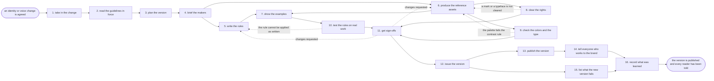

# Reference process: publish brand guidelines

`ref/mkt/brand-guidelines v1`

A change to the identity or the voice has already been agreed somewhere
else, and this process turns that agreement into the document and the
asset kit everyone else works from. A standards keeper works out which
rules the change touches, has those rules written so a scoring seat can
apply them, has the marks, the colors, the type and the templates
produced, clears the rights on anything the organization hands out,
checks the palette and the type against the accessibility standard, and
tries the drafted rules on work that was published recently. The brand
owner, leadership and legal sign the set, the keeper issues it as one
numbered version, the guidelines page and the downloads go live at that
version, and every reader is told what changed and from when. This is
the document the brand-check seat reads whenever it scores anything, so
the version this run issues is what every other process is held to. The
run ends once the version is published and each reader has confirmed
they have it. What the identity or the voice should say is settled
elsewhere, and correcting the published material the new version fails
belongs to the refresh process.

## The activities

| # | Activity | What happens | Seats |
|---|---|---|---|
| 1 | take in the change | what changed, and which rules it touches | [standards-keeper](../../agents/standards-keeper.md) · brand owner (person) |
| 2 | read the guidelines in force | every rule the change contradicts, at its version | standards-keeper · [brand-check](../../agents/brand-check.md) |
| 3 | plan the version | which sections change, who writes each, and by when | standards-keeper · [creative-producer](../../agents/creative-producer.md) |
| 4 | brief the makers | everyone who writes or draws hears the change | standards-keeper · creative-producer · [copywriter](../../agents/copywriter.md) · [editor](../../agents/editor.md) · [designer](../../agents/designer.md) |
| 5 | write the rules | each rule written so a scoring seat can apply it | copywriter · editor · standards-keeper |
| 6 | produce the reference assets | the marks, colors, type and templates, at every size | creative-producer · designer |
| 7 | show the examples | a passing and a failing example under each rule | designer · copywriter · brand-check |
| 8 | clear the rights | the marks and the type cleared for everyone who gets them | designer · rights approver (person) · legal reviewer (person) |
| 9 | check the colors and the type | the palette and the type against the accessibility rules | [accessibility-check](../../agents/accessibility-check.md) · designer |
| 10 | test the rules on real work | recent work scored against the rules as drafted | brand-check · copywriter · designer |
| 11 | get sign-offs | the brand owner, leadership and legal sign the set | brand owner (person) · leadership (person) · legal reviewer (person) |
| 12 | issue the version | the rules and the kit become one numbered version | standards-keeper |
| 13 | publish the version | the page and the downloads go live at that version | [web-producer](../../agents/web-producer.md) · standards-keeper |
| 14 | tell everyone who works to the brand | each reader gets the version and confirms they have it | standards-keeper |
| 15 | list what the new version fails | live material the new rules now fail, handed on | [content-librarian](../../agents/content-librarian.md) · brand-check |
| 16 | record what was learned | what to repeat, what to avoid | standards-keeper |

## The graph



## The document, with the blanks marked

```
PROCESS: publish brand guidelines     id: <team>/brand-guidelines   v1
from: ref/mkt/brand-guidelines v1
owner: <who>                          effective: <date>
trigger: a change to the identity or the voice is agreed in <your
         positioning process>, or <your brand owner> asks for one
concurrency: one run at a time - a second change either joins the open
             run or waits for the version to issue
goal: one numbered version of the brand guidelines and the asset kit,
      signed, published where everyone can get at it, with every reader
      told what changed and from when
phases:
  take-in-change   - human: what was agreed, and which parts of the
                     guidelines in force it touches
                     owner: standards-keeper    after: trigger
                     automation: <level>
  read-in-force    - human: every rule the change contradicts, read at
                     the version currently in force
                     owner: standards-keeper    after: take-in-change
                     by: <days>                 automation: <level>
  plan-version     - human: which sections change, who owes each one,
                     and the date each is due
                     owner: standards-keeper    after: read-in-force
                     by: <days>                 automation: <level>
  brief-makers     - convenes briefing: everyone who writes or draws
                     hears the change at once
                     owner: creative-producer   after: plan-version
                     automation: <level>
  write-rules      - runs build-by-talent: each rule written so a
                     scoring seat can apply it without asking what it
                     means
                     owner: standards-keeper    after: brief-makers
                     by: <days>                 automation: <level>
  produce-assets   - runs build-by-talent: the marks, the colors, the
                     type and the templates, at every size the
                     organization actually uses
                     owner: creative-producer   after: brief-makers
                     by: <days>                 automation: <level>
  show-examples    - human: a passing and a failing example under each
                     rule, taken from work the organization has made
                     owner: standards-keeper
                     after: write-rules + produce-assets
                     by: <days>                 automation: <level>
  clear-rights     - human: the marks, the type and anything licensed
                     cleared for every party who will be handed them
                     owner: <your rights approver>
                     after: produce-assets      by: <days>
                     automation: never
  check-contrast   - runs assessment: the palette and the type scored
                     against <your accessibility standard>
                     owner: accessibility-check after: produce-assets
                     by: <days>                 automation: <level>
  test-the-rules   - runs assessment: recent work scored against the
                     rules as drafted, to find the rules a scoring seat
                     cannot apply
                     owner: brand-check         after: show-examples
                     by: <days>                 automation: <level>
  get-sign-offs    - convenes approval: the brand owner, leadership and
                     legal sign, as named signers, against a version
                     owner: <your legal seat>
                     after: test-the-rules + check-contrast +
                            clear-rights
                     by: <days>                 automation: never
  issue-version    - human: the rules, the examples and the asset kit
                     become one numbered version carrying the date it
                     takes effect
                     owner: standards-keeper    after: get-sign-offs
                     automation: <level>
  publish-version  - human: the guidelines page and the downloads go
                     live at that version, and the version it replaces
                     stays readable at its own number
                     owner: web-producer        after: issue-version
                     by: <days>                 automation: <level>
  tell-the-readers - runs decide-and-announce: every reader gets the
                     version, what changed in it, and the date it
                     applies from, and confirms they have it
                     owner: standards-keeper    after: publish-version
                     by: <days>                 automation: <level>
  list-failures    - runs collect-and-report: the live material the new
                     version now fails, handed to <your refresh
                     process>
                     owner: content-librarian   after: issue-version
                     by: <weeks>                automation: <level>
  record-learnings - convenes debrief: what to repeat, what to avoid
                     owner: standards-keeper
                     after: tell-the-readers + list-failures
                     automation: <level>
run-scoped:
  status    - runs roll-call                  owner: standards-keeper
              every: <cadence>
              from: plan-version   until: publish-version
  questions - runs decide-and-announce        owner: standards-keeper
              from: publish-version   until: run close
handoffs:
  take-in-change -> read-in-force: what was agreed, where it was agreed,
    and the parts of the guidelines it touches
  read-in-force -> plan-version: every rule the change contradicts, each
    named at the version in force
  plan-version -> brief-makers: which sections change, who owes each
    one, and the date each is due
  brief-makers -> write-rules: the change as every seat heard it, and
    what a rule has to say for a scoring seat to apply it
  brief-makers -> produce-assets: the formats, the sizes and the
    templates the kit has to carry
  write-rules -> show-examples: the rules at a version
  produce-assets -> show-examples: the asset kit at a version
  produce-assets -> clear-rights: every mark, typeface and licensed
    element in the kit, with the source of each one
  produce-assets -> check-contrast: the palette and the type as they
    will be handed out
  show-examples -> test-the-rules: the rules and their examples at a
    version, and the recent work to score them on
  test-the-rules -> get-sign-offs: a verdict on each rule, so the
    signers read the rules that did not work
  check-contrast -> get-sign-offs: the scores, each citing the rule it
    was scored against
  clear-rights -> get-sign-offs: the rights settled on every element in
    the kit, with who cleared each one
  get-sign-offs -> issue-version: the approved set at the signed
    version. A later change voids the approval and sign-offs run again
  issue-version -> publish-version: the numbered version, the date it
    takes effect, and the version it replaces
  issue-version -> list-failures: the rules that changed, so the library
    can be read against them
  publish-version -> tell-the-readers: the address the version lives at,
    and the list of people and processes that read the guidelines
  tell-the-readers -> record-learnings: who was told, who confirmed, and
    who did not
  list-failures -> record-learnings: the list of failing material, as
    handed over
bindings:
  roster:  <who holds each seat - agents claiming the abstract agents
           above, and named people for the brand owner, leadership,
           legal and rights>
  systems: the standards store (write), the asset store (write),
           the review record (write), the website (write),
           the notification channel (write), the CMS (read),
           licensed type and image sources (read)
  data:    the guidelines in force <version>, the agreed change,
           <your accessibility standard> <version>,
           <your claims register>, the licenses the organization holds,
           the list of who reads the guidelines
policy:
  sign-off is a human gate and is never delegated to an agent
  an issued version is never edited. A change goes out as a new
    version, and the version it replaces stays readable
  nothing in the kit is handed to anyone until a person has confirmed
    the organization holds the rights to it
  a rule a scoring seat could not apply in the test is rewritten before
    the version issues
  work already in production is judged against the version it started
    under, until <who> says otherwise
  a color or a type size that fails <your accessibility standard>
    issues only when <who> accepts the failure in writing, and the
    acceptance is recorded against the rule
measures:
  cycle time: <target> from the agreed change to the published version
  reach: every reader confirms they hold the version within <days> of
         it being published
  quality gate: no version issues unsigned, and no rule issues that the
                scoring seats could not apply in the test
```

## The failure edges

- **A rule cannot be applied to real work.** The brand-check seat
  scores the recent work and reports the rules it could not decide from
  the text. The run returns to write-rules, the rule is rewritten in
  terms that settle the cases it failed on, and the test runs again on
  the version that comes back.
- **The palette fails the contrast rule.** The accessibility-check seat
  reports the failing color or type size with the rule attached, and
  the run returns to produce-assets. The designer changes the value, or
  <who> accepts the failure in writing and the acceptance is recorded
  against the rule. Issuing the version with the failure unrecorded is
  not one of the choices.
- **A mark or a typeface is not cleared.** The rights approver refuses
  the element, or limits who may be handed it. The run returns to
  produce-assets, and the kit is remade from something the organization
  holds or the limit is written into the rule that governs the element.
  The refusal is recorded against the asset.
- **A sign-off comes back with changes.** The run returns to the rules
  or to the assets, and only the part the signers named reopens. The
  signers see the changed version before it is issued.
- **The identity changes again while the run is open.** The standards
  keeper takes the new change back to take-in-change and <who> says
  whether the run still answers the right question. If it does not, the
  version in progress is abandoned and the guidelines in force stay in
  force until a later run replaces them.
- **A reader never confirms.** The version is published and some of the
  people who work to the brand never say they have it. The keeper
  records who did not confirm, and <who> decides whether the run stays
  open for them or the confirmation is chased outside this run. Work
  those readers make afterwards is judged against the published version
  either way.
- **Work is already in production when the version issues.** The piece
  is judged against the version it started under until a named person
  says otherwise. The argument about which pieces those are surfaces at
  list-failures, and that activity records the decision beside each
  piece.
- **A question about a rule arrives after the run closes.** Questions
  keep coming for as long as the version is current, and the
  standards-keeper seat answers them against the rule outside any run.
  An answer that changes what passes is a change to the standard, and
  it goes through this process again as a new version.
- **The trigger fires while a run is in flight.** Only one run is open
  at a time, because two versions issuing at once leaves the scoring
  seats with no single answer. A second change joins the open run or
  waits for the version to issue, and <who> decides which.
- **A run is abandoned.** The guidelines in force stay in force and
  nothing about them changes. The drafted rules and the produced assets
  stay at their versions so a later run can pick them up, and any
  rights already cleared are recorded so the clearance is not asked for
  twice.
