# Reference process: Measure Brand Health

`ref/mkt/brand-health v1`

**value stream:** [Promise-to-Perception](../../streams/marketing/promise-to-perception.md)
A study manager runs one wave of the brand tracker. The wave asks people
in the market what they have heard of, what they believe the brand
stands for, and which brand they would choose, and it asks the same
questions about the competitors the tracker names. A statistician says
how many answers the wave needs before anybody is asked, and afterwards
says which movements since the last wave are larger than the noise in
the measurement. The findings are set beside the promise the brand makes
at the version in force, so the run says where what people believe
misses what the organization claims. Every figure in this run comes from
people outside the organization. The department's own traffic, pipeline
and campaign numbers are a different source. They belong to the
analytics agent, and this run never reports one of them as a perception
figure.

## The activities

| # | Activity | What happens | Agents |
|---|---|---|---|
| 1 | Open the Cycle | the wave's dates and the waves it compares to | [study-manager](../../agents/study-manager.md) |
| 2 | Read the Promise the Brand Makes | the brand standard at the version now in force | [standards-keeper](../../agents/standards-keeper.md) · study-manager |
| 3 | Settle What the Wave Measures | awareness, perception, preference and the attributes | [decision-coordinator](../../agents/decision-coordinator.md) · study-manager · brand owner (person) |
| 4 | Set the Competitor Set | which rivals get asked about beside the brand | study-manager · [researcher](../../agents/researcher.md) |
| 5 | Brief the Wave | every agent hears the question and the dates at once | study-manager · [statistician](../../agents/statistician.md) · [consent-manager](../../agents/consent-manager.md) · [audience-manager](../../agents/audience-manager.md) · [coverage-monitor](../../agents/coverage-monitor.md) |
| 6 | Say How Much Data It Needs | how many responses, per market and per segment | statistician |
| 7 | Define the Sample | who gets asked, and how the market is represented | study-manager · audience-manager |
| 8 | Check Who May Be Contacted | the consent record applied to the drawn sample | consent-manager |
| 9 | Arrange the Outside Sample | the people the contact base cannot supply are bought | [supplier-manager](../../agents/supplier-manager.md) · [supplier-check](../../agents/supplier-check.md) |
| 10 | Cover the Cost | the panel and the incentives, against what is left | [budget-keeper](../../agents/budget-keeper.md) · finance (person) |
| 11 | Carry the Questions Forward | last wave's wording kept, and any change written down | study-manager · statistician |
| 12 | Get Sign-Offs | legal and the brand owner approve before fielding | legal reviewer (person) · brand owner (person) |
| 13 | Field the Wave | invitations go out and the responses come in | study-manager · [audience-operator](../../agents/audience-operator.md) |
| 14 | Watch the Sample Fill | how many answered against how many are needed | study-manager · statistician |
| 15 | Close the Wave | asking stops and the responses are fixed | study-manager |
| 16 | Work out the Figures | the weighting, and each figure with its range | statistician |
| 17 | Compare with the Earlier Waves | which movements are larger than the noise | statistician · study-manager |
| 18 | Read What Was Published Outside | what outlets, analysts and reviewers said this cycle | coverage-monitor |
| 19 | Set Perception against the Promise | what people believe beside what the brand claims | study-manager · standards-keeper |
| 20 | Write the Findings | each finding with the responses recorded under it | study-manager |
| 21 | Check the Findings Hold | every figure read against its data and its method | statistician |
| 22 | Report Awareness, Perception and Preference | the readout, with the evidence under every line | study-manager · [reporting-manager](../../agents/reporting-manager.md) · decision-coordinator · leadership (person) · brand owner (person) |
| 23 | Record What Was Learned | what to repeat, what to avoid | study-manager |

## The graph

```mermaid
flowchart LR
  T([a tracking cycle comes round]) --> A1[1. Open the Cycle]
  A1 --> A2[2. Read the Promise the Brand Makes]
  A2 --> A3[3. Settle What the Wave Measures]
  A3 --> A4[4. Set the Competitor Set]
  A4 --> A5[5. Brief the Wave]
  A5 --> A6[6. Say How Much Data It Needs]
  A5 --> A11[11. Carry the Questions Forward]
  A5 --> A18[18. Read What Was Published Outside]
  A6 --> A7[7. Define the Sample]
  A7 --> A8[8. Check Who May Be Contacted]
  A7 --> A9[9. Arrange the Outside Sample]
  A8 -. too few may be contacted .-> A7
  A9 --> A10[10. Cover the Cost]
  A11 -. the wording has to change .-> A3
  A8 --> A12[12. Get Sign-Offs]
  A10 --> A12
  A11 --> A12
  A12 -. changes requested .-> A11
  A12 --> A13[13. Field the Wave]
  A13 --> A14[14. Watch the Sample Fill]
  A14 -. too few answers so far .-> A13
  A14 --> A15[15. Close the Wave]
  A15 --> A16[16. Work out the Figures]
  A16 -. the sample fell short .-> A13
  A16 --> A17[17. Compare with the Earlier Waves]
  A17 --> A19[19. Set Perception against the Promise]
  A18 --> A19
  A19 --> A20[20. Write the Findings]
  A20 --> A21[21. Check the Findings Hold]
  A21 -. a figure does not follow .-> A20
  A21 --> A22[22. Report Awareness, Perception and Preference]
  A22 --> A23[23. Record What Was Learned]
  A23 --> DONE([awareness, perception and preference are reported])
```



## The document, with the blanks marked

```
PROCESS: measure brand health         id: <team>/brand-health   v1
from: ref/mkt/brand-health v1
owner: <who>                          effective: <date>
trigger: a tracking cycle comes round on <your tracker's schedule>
         watch: record=<tracking cycle>
                system=<your tracker's schedule>
                change=<a cycle comes round>
concurrency: one wave at a time in the same market. Waves in different
             markets overlap - <how many> in the field at once
goal: awareness, perception and preference read among people outside
      the organization, set beside the promise the brand makes and
      beside the earlier waves, and reported on the date they are due
phases:
  open-the-cycle   - human: the dates of the wave, the markets it
                     covers, and the waves it has to stay comparable to
                     owner: study-manager      after: trigger
                     automation: <level>
  read-the-promise - human: the brand standard at the version in force,
                     and the claims the promise makes
                     owner: standards-keeper   after: open-the-cycle
                     automation: <level>
  settle-measures  - convenes decide-and-announce: what this wave
                     measures - awareness, perception, preference, and
                     the attributes the promise claims
                     owner: decision-coordinator
                     after: read-the-promise   automation: <level>
  competitor-set   - human: the rivals asked about beside the brand,
                     and the reason each one is in the set
                     owner: study-manager      after: settle-measures
                     automation: <level>
  brief-the-wave   - convenes briefing: what the wave measures, the
                     competitor set and the dates, heard by every agent
                     at once
                     owner: study-manager      after: competitor-set
                     automation: <level>
  size-the-sample  - human: how many responses the wave needs in each
                     market and each segment it reports on, and what
                     that number was computed from
                     owner: statistician       after: brief-the-wave
                     by: <days>                automation: <level>
  define-sample    - human: who gets asked, how many of them, and how
                     the drawn sample matches <your market> on the
                     traits the findings are broken down by
                     owner: study-manager      after: size-the-sample
                     by: <days>                automation: <level>
  check-consent    - runs assessment: the drawn sample scored against
                     the consent rules in force, contact by contact
                     owner: consent-manager    after: define-sample
                     automation: <level>
  outside-sample   - runs collect-and-report: the same requirements put
                     to every provider that can supply the people the
                     contact base does not reach, which for a reading
                     of the whole market is most of them
                     owner: supplier-manager   after: define-sample
                     by: <days>                automation: <level>
  cover-the-cost   - runs allocate-and-reconcile: the panel and the
                     incentives, drawn against <which allocation>
                     owner: budget-keeper      after: outside-sample
                     automation: <level>
  carry-questions  - human: last wave's questions at the version they
                     ran under, kept word for word, with every change
                     written down and its reason beside it
                     owner: study-manager      after: brief-the-wave
                     by: <days>                automation: <level>
  get-sign-offs    - convenes approval: legal and the brand owner sign,
                     as named signers, against a version of the sample
                     and a version of the questions
                     owner: <your legal role>
                     after: check-consent + cover-the-cost +
                            carry-questions
                     by: <days>                automation: never
  field-the-wave   - human: the invitations go out and the responses
                     land as they were given
                     owner: study-manager      after: get-sign-offs
                     by: <days>                automation: <level>
  watch-sample     - runs roll-call: how many have answered in each
                     market and each segment, and where the sample is
                     filling more slowly than the wave allowed for
                     owner: study-manager      after: field-the-wave
                     every: <cadence>          automation: <level>
  close-the-wave   - human: asking stops on the date or on the count,
                     and the responses are fixed at a version
                     owner: study-manager      after: watch-sample
                     automation: <level>
  work-out-figures - human: the weighting that brings the sample back
                     to <your market>, and each figure with its method,
                     its exclusions and the range around it
                     owner: statistician       after: close-the-wave
                     by: <days>                automation: <level>
  compare-waves    - human: this wave beside the earlier ones, with a
                     verdict on every movement saying whether it is
                     larger than the noise in the measurement
                     owner: statistician       after: work-out-figures
                     by: <days>                automation: <level>
  read-published   - runs collect-and-report: what outlets, analysts,
                     research firms and review sites published about
                     the brand and the category during the cycle
                     owner: coverage-monitor   after: brief-the-wave
                     every: <cadence>          automation: <level>
  perception-gap   - human: each attribute the wave measured set beside
                     the claim the promise makes about it, naming where
                     what people believe misses what the brand claims
                     owner: study-manager
                     after: compare-waves + read-published
                     by: <days>                automation: <level>
  write-findings   - human: what the wave found, each finding with the
                     responses recorded under it
                     owner: study-manager      after: perception-gap
                     by: <days>                automation: <level>
  check-findings   - runs layered-passes: the numbers pass, every
                     figure against the data and the method beside it
                     owner: statistician       after: write-findings
                     by: <days>                automation: <level>
  report-the-wave  - runs collect-and-report: awareness, perception and
                     preference on their date, complete or not, with
                     the evidence under every line and the version of
                     the promise the figures were read against
                     owner: study-manager      after: check-findings
                     automation: <level>
  record-learnings - convenes debrief: what to repeat, what to avoid
                     owner: study-manager      after: report-the-wave
                     automation: <level>
run-scoped:
  spend  - runs allocate-and-reconcile        owner: budget-keeper
           from: cover-the-cost   until: run close
  status - runs roll-call                     owner: study-manager
           every: <cadence>
           from: brief-the-wave   until: report-the-wave
handoffs:
  open-the-cycle -> read-the-promise [wave-dates]: the dates of the
    wave and the earlier waves this one has to stay comparable to
  read-the-promise -> settle-measures [brand-promise]: the brand
    standard at the version in force, and the claims the promise makes
  settle-measures -> competitor-set [wave-measures]: what the wave
    measures, and the attributes it puts to people
  competitor-set -> brief-the-wave [rivals]: the rivals asked about
    beside the brand, and the reason each one is in the set
  brief-the-wave -> size-the-sample [movement-threshold]: the
    measures, the size of the movement that would matter to a
    decision, and the confidence the wave is being run to
  brief-the-wave -> carry-questions [earlier-questions]: the measures
    as every agent heard them, and the earlier questions at the
    versions they ran under
  brief-the-wave -> read-published [watch-list]: what to watch for
    during the cycle
  size-the-sample -> define-sample [response-counts]: how many
    responses the wave needs in each market and each segment, and what
    that was computed from
  define-sample -> check-consent [drawn-sample]: the drawn sample,
    contact by contact, with the source each contact came from
  define-sample -> outside-sample [sample-shortfall]: the people the
    contact base cannot supply, and what the wave needs them to be
  check-consent -> get-sign-offs [contactable-sample]: the sample that
    may be contacted, the count removed, and the rule behind each
    removal
  outside-sample -> cover-the-cost [provider-quotes]: what each
    provider would charge for the sample, and what it would deliver
  cover-the-cost -> get-sign-offs [wave-cost]: what the wave will
    draw, and the allocation it draws against
  carry-questions -> get-sign-offs [wave-questions]: the questions at
    a version, every change from the last wave marked, and the reason
    for each change
  get-sign-offs -> field-the-wave [signed-wave]: the approved sample
    and the approved questions at their signed versions. A later
    change voids the approval and sign-offs run again
  field-the-wave -> watch-sample [responses]: the responses as they
    arrive, each marked with the version of the questions it answered
  watch-sample -> close-the-wave [fill-counts]: the count answered set
    against the count the wave planned for, market by market
  close-the-wave -> work-out-figures [fixed-responses]: the responses
    fixed at a version, with every response that was removed and the
    rule that removed it
  work-out-figures -> compare-waves [wave-figures]: every figure with
    its method, its weighting, its exclusions and the range around it
  compare-waves -> perception-gap [movement-verdicts]: each measure
    beside its earlier readings, with a verdict on every movement
  read-published -> perception-gap [published-mentions]: what was
    published during the cycle, each mention with its outlet, its date
    and what it said
  perception-gap -> write-findings [promise-gaps]: each attribute set
    beside the claim the promise makes about it, and the version of
    the promise it was read against
  write-findings -> check-findings [draft-findings]: the findings at a
    version, each with the responses recorded under it
  check-findings -> report-the-wave [checked-findings]: the findings
    with every figure checked against the data and the method beside
    it, and every figure that could not be computed marked as such
  report-the-wave -> record-learnings [wave-report]: the report, as
    delivered
deviations:
  check-consent -> define-sample [too-few-contactable]: the consent
    check removes most of the drawn sample, so the sample is drawn
    again or the wave buys the people it cannot reach
  carry-questions -> settle-measures [wording-must-change]: a tracked
    question has to be reworded, so what the wave measures is settled
    again and <who> agrees the change before it is made
  get-sign-offs -> carry-questions [sign-off-changes-questions]: a
    signer asks for changes to the questions, so only what they named
    is carried forward again
  watch-sample -> field-the-wave [sample-filling-slowly]: fewer have
    answered than the wave allowed for, so fielding continues in the
    markets that are short
  work-out-figures -> field-the-wave [sample-fell-short]: the wave
    closed short of what it needed, so it fields again, reports with
    the shortfall named against every finding, or is dropped
  check-findings -> write-findings [figure-does-not-follow]: a figure
    does not follow from the data and the method beside it, so the
    finding is written again
bindings:
  roster:  <who holds each role - agents claiming the abstract agents
           above, and named people for legal, finance, the brand owner
           and leadership>
  systems: the study record (write), the questions and material
           (write), the response record (write), the calculation record
           (write), the survey and interview system (trigger),
           the contact database (read), the consent record (read),
           the sending system (write), the standards store (read),
           the coverage record (write), the supplier record (write),
           the budget record (write), the report store (write),
           the meeting calendar (write)
  data:    brand guidelines <version> - the promise and the attributes
           it claims, <your consent rules> <version>, the earlier waves
           at the versions they ran under, the terms attached to every
           sample bought from outside
policy:
  every figure reported here comes from people outside the
    organization. A number from the department's own systems is never
    reported as a perception figure
  nobody is asked anything until the sample and the questions have been
    signed
  sign-off is a human gate and is never delegated to an agent
  a tracked question is reworded only when <who> agrees, and the wave
    that reworded it reports the old wording and the new one
  the competitor set changes only when <who> agrees, and a wave that
    changed it says so against every share it reports
  a movement inside the noise is reported as no movement
  every finding carries the responses it rests on, and a finding
    resting on fewer responses than the wave needed says so
  every figure carries its method, its weighting, its exclusions and
    the range around it
  responses are kept as they were given, and a response left out of a
    count is left out under a named rule
  a finding is never removed from the report because somebody asked.
    <who> decides, and the decision is recorded with the findings
measures:
  cycle time: <target> from the cycle opening to the reported findings
  comparability: <share> of tracked questions carried forward with
                 their wording unchanged
  completion: <share> of the drawn sample that fills to the count the
              wave planned for
  volume: <waves per period>
  quality gate: no movement is reported as a result without the
                statistician's verdict that it is larger than the noise
```

## The failure edges

- **A tracked question has to be reworded.** The run returns to
  settle-measures, where <who> agrees the change before it is made. The
  wave that carries the new wording reports the old reading and the new
  one for that question, and the statistician says what the change does
  to the comparison with the earlier waves.
- **The consent check removes most of the sample.** The run goes back to
  define-sample. The study manager either draws more contacts or the
  wave buys the sample it cannot reach, and the consent check runs again
  on the sample that comes back. A tracker that reads the whole market
  usually buys most of its sample, because the contact base holds the
  people who already know the brand.
- **The drawn sample does not look like the market.** The statistician
  says which traits it is short on and what that does to each figure,
  and the run goes back to define-sample before anybody is asked.
  Weighting a sample that was drawn wrong moves the figure without
  making it true.
- **A wave closes short of what it needed.** The statistician says so
  before any number from it is read as a result, and <who> decides
  whether the wave keeps fielding, reports with the shortfall named
  against every finding, or is dropped.
- **A movement is inside the noise.** The wave reports it as no
  movement, with the size of the difference and the range around it
  written beside the verdict, and it stays that way whatever anybody
  wanted the number to say.
- **The promise changed between two waves.** The standards keeper names
  the version each wave was read against, and the findings say which
  claims are new. An attribute that entered the promise after the last
  wave has no earlier reading, and the report says so instead of showing
  a movement.
- **A competitor enters or leaves the set.** The change goes to <who>,
  and every share the wave reports says which set it was computed
  against. Shares from a wave that used a different set are compared
  with this one only when the statistician says how.
- **What was published outside contradicts what the wave found.** Both
  readings go into the report as two readings, with the source under
  each. The run records the contradiction and the decision coordinator
  takes it to the people who decide.
- **The trigger fires while runs are in flight.** Waves in different
  markets overlap normally, and the concurrency line says how many. The
  rule that keeps the same people from being asked twice inside one
  period is checked at define-sample, and a contact another wave is
  already asking is left out.
- **A run is abandoned.** The questions and the responses stay where
  they are at their versions, so the next wave can read what was asked
  and what came back. Anybody already invited is told the wave has
  stopped, an incentive already promised is still paid, and the spend
  line reconciles anyway.
