# Reference process: Develop Brand Identity

`ref/mkt/brand-identity v1`

**value stream:** [Promise-to-Perception](../../streams/marketing/promise-to-perception.md)
A creative producer takes the signed brand positioning and has the
visual identity built from it. The producer reads what the positioning
and the promise say, the content librarian and the designer take stock
of the marks, colors, type and files the company uses today, and the
producer sets out what the new system has to cover and briefs the agents
that make it. The designer and the copywriter draw two or three
directions. Each direction is weighed against what the positioning
claims and put in front of buyers, and the marks in each one are
searched against the trademark registers before anybody backs it.
Leadership picks a direction and says why. The designer then builds out
the logo, the color, the type, the imagery and the layout, a rights
approver clears the fonts and the pictures against the licenses the
company holds, and the system is built onto a real page and a real deck
so that its failures show up before it is signed. The usage rules are
written, the brand owner, legal and leadership sign the system, and the
standards keeper issues the rules as a numbered version and tells every
process that reads them. The file set is released at that same version,
so an agent that needs a logo the next day gets the one that was signed.
This process quotes the positioning and never reopens it. When the
identity cannot carry what the positioning claims, the producer sends
that finding to the positioning process instead of settling it here.

## The activities

| # | Activity | What happens | Agents |
|---|---|---|---|
| 1 | Take in the Positioning | what the identity has to carry, read off the standard | [creative-producer](../../agents/creative-producer.md) · [standards-keeper](../../agents/standards-keeper.md) |
| 2 | Take Stock of the Marks in Use | the marks, colors, type and files in use today | [content-librarian](../../agents/content-librarian.md) · [designer](../../agents/designer.md) · [brand-check](../../agents/brand-check.md) |
| 3 | Set the Identity Brief | the surfaces to cover and what the system must do | creative-producer · designer · brand owner (person) |
| 4 | Brief the Makers | everyone hears the same request and the same dates | creative-producer · designer · [copywriter](../../agents/copywriter.md) · [researcher](../../agents/researcher.md) |
| 5 | Draft the Candidate Directions | two or three directions, each with the case for it | designer · copywriter · creative-producer |
| 6 | Test the Directions against the Positioning | whether each direction carries what the promise says | brand-check · standards-keeper · creative-producer |
| 7 | Try the Directions on Outsiders | buyers and staff react to each direction | researcher · creative-producer |
| 8 | Clear the Candidate Marks | search the registers for marks already in use | researcher · legal reviewer (person) |
| 9 | Choose the Identity | one direction is picked and the reasons said out loud | [decision-coordinator](../../agents/decision-coordinator.md) · leadership (person) · brand owner (person) |
| 10 | Build out the System | logo, color, type, imagery and layout, drawn out | designer · copywriter · creative-producer |
| 11 | Clear the Fonts and the Imagery | confirm the type, images and footage are licensed | rights approver (person) · creative-producer · designer |
| 12 | Test the System in Use | a page and a deck built from the system, then scored | designer · [accessibility-check](../../agents/accessibility-check.md) · creative-producer |
| 13 | Write the Usage Rules | clear space, sizes, color values, and what is misuse | designer · copywriter · standards-keeper |
| 14 | Get Sign-Offs | brand, legal and leadership approve the system | brand owner (person) · legal reviewer (person) · leadership (person) |
| 15 | Issue the Rules and Release the Files | the rules land at a version and the files go out | standards-keeper · designer · creative-producer |
| 16 | Record What Was Learned | what to repeat, what to avoid | creative-producer · decision-coordinator |

## The graph

```mermaid
flowchart LR
  T([a brand positioning is signed and issued]) --> A1[1. Take in the Positioning]
  A1 --> A2[2. Take Stock of the Marks in Use]
  A1 --> A3[3. Set the Identity Brief]
  A2 --> A3
  A3 --> A4[4. Brief the Makers]
  A4 --> A5[5. Draft the Candidate Directions]
  A5 --> A6[6. Test the Directions against the Positioning]
  A6 -. the direction misses the promise .-> A5
  A6 --> A7[7. Try the Directions on Outsiders]
  A6 --> A8[8. Clear the Candidate Marks]
  A7 -. no direction lands .-> A5
  A8 -. the mark is already in use .-> A5
  A7 --> A9[9. Choose the Identity]
  A8 --> A9
  A9 -. none is worth backing .-> A5
  A9 --> A10[10. Build out the System]
  A10 --> A11[11. Clear the Fonts and the Imagery]
  A10 --> A12[12. Test the System in Use]
  A11 -. a license is refused .-> A10
  A12 -. the system fails on a real surface .-> A10
  A11 --> A13[13. Write the Usage Rules]
  A12 --> A13
  A13 --> A14[14. Get Sign-Offs]
  A14 -. changes requested .-> A10
  A14 -. changes requested .-> A13
  A14 --> A15[15. Issue the Rules and Release the Files]
  A15 --> A16[16. Record What Was Learned]
  A16 --> DONE([the identity is issued and the file set is released])
```



## The document, with the blanks marked

```
PROCESS: brand identity               id: <team>/brand-identity   v1
from: ref/mkt/brand-identity v1
owner: <who>                          effective: <date>
trigger: a brand positioning is signed and issued in <your positioning
         process>
concurrency: one run at a time - two runs would put two identities
             against one positioning
goal: a visual system, a logo and usage rules, signed and issued as a
      numbered version, with the file set released at that version
phases:
  take-in-position - human: read the signed positioning and the
                     promise, and write down what the identity has to
                     carry on every surface the company uses
                     owner: creative-producer
                     after: trigger
                     automation: <level>
  take-stock       - runs collect-and-report: the marks, colors, type
                     and files in use today, with where each one is
                     used and how far it has drifted
                     owner: content-librarian
                     after: take-in-position
                     by: <weeks>          automation: <level>
  set-the-brief    - human: the surfaces the system has to cover and
                     what it has to do on each one. <who> confirms the
                     scope before any direction is drawn
                     owner: creative-producer
                     after: take-in-position + take-stock
                     by: <days>           automation: <level>
  brief-the-makers - convenes briefing: the request, the positioning
                     and the dates, heard by every agent at once
                     owner: creative-producer
                     after: set-the-brief
                     automation: <level>
  draft-directions - runs build-by-talent: two or three directions,
                     each drawn far enough to be judged, each with the
                     case for it written out
                     owner: creative-producer
                     after: brief-the-makers
                     by: <weeks>          automation: <level>
  test-on-standard - runs assessment: each direction read against the
                     positioning and the promise, claim by claim
                     owner: brand-check
                     after: draft-directions
                     by: <days>           automation: <level>
  try-on-outsiders - human: the directions put in front of buyers and
                     staff, with what each person said recorded
                     owner: researcher
                     after: test-on-standard
                     by: <weeks>          automation: <level>
  clear-the-marks  - human: every candidate mark searched against the
                     registers, and a person reads what the search
                     found before the direction goes forward
                     owner: <your legal role>
                     after: test-on-standard
                     by: <weeks>          automation: never
  choose-identity  - convenes decide-and-announce: one direction
                     chosen, with the reasons and any dissent recorded
                     owner: decision-coordinator
                     after: try-on-outsiders + clear-the-marks
                     by: <date>           automation: never
  build-the-system - runs build-by-talent: the logo at every size, the
                     color values, the typefaces, the imagery and the
                     layout the company will use
                     owner: designer
                     after: choose-identity
                     by: <weeks>          automation: <level>
  clear-the-rights - human: the typefaces, the images and the footage
                     checked against the licenses the organization
                     actually holds
                     owner: <your rights role>
                     after: build-the-system
                     by: <days>           automation: never
  test-in-use      - runs assessment: a real page and a real deck built
                     from nothing but the system, then scored for
                     contrast, legibility and behavior at every size
                     owner: accessibility-check
                     after: build-the-system
                     by: <days>           automation: <level>
  write-the-rules  - human: clear space, minimum sizes, color values,
                     what to do on a dark background, and what counts
                     as misuse, written as rules an agent can score
                     owner: standards-keeper
                     after: clear-the-rights + test-in-use
                     by: <days>           automation: <level>
  get-sign-offs    - convenes approval: the brand owner, legal and
                     leadership sign, as named signers, at a version
                     owner: <your legal role>
                     after: write-the-rules
                     by: <days>           automation: never
  issue-the-system - human: the usage rules become a numbered version
                     of the standard, the file set is released at that
                     same version, and every reader is told
                     owner: standards-keeper
                     after: get-sign-offs
                     by: <days>           automation: <level>
  record-learnings - convenes debrief: what to repeat, what to avoid
                     owner: creative-producer
                     after: issue-the-system
                     automation: <level>
run-scoped:
  status - runs roll-call                 owner: creative-producer
           every: <cadence>
           from: brief-the-makers   until: issue-the-system
  spend  - runs allocate-and-reconcile    owner: creative-producer
           from: draft-directions   until: run close
handoffs:
  take-in-position -> take-stock: the positioning and the promise at
    the version they were issued at
  take-in-position -> set-the-brief: what the identity has to carry,
    written so a later direction can be tested against it
  take-stock -> set-the-brief: the marks, colors, type and files in use
    today, each with where it is used and how far it has drifted
  set-the-brief -> brief-the-makers: the surfaces the system has to
    cover, what it has to do on each, and the date it is promised
  brief-the-makers -> draft-directions: the request as every agent heard
    it, with the positioning attached at its version
  draft-directions -> test-on-standard: the directions at a version,
    each with the case for it written out
  draft-directions -> clear-the-marks: every mark a direction rests on,
    drawn, named, and with the goods and services it would cover
  test-on-standard -> try-on-outsiders: the directions the positioning
    carries, and the claims it will not support in the others
  try-on-outsiders -> choose-identity: what each person said,
    attributed, beside the direction it was said about
  clear-the-marks -> choose-identity: the search result for every mark,
    and the reviewer's reading of anything close to it
  choose-identity -> build-the-system: the chosen direction, the
    reasons for it, and anyone who disagreed and what they said
  build-the-system -> clear-the-rights: every typeface, image and piece
    of footage the system uses, named, with the license claimed for it
  build-the-system -> test-in-use: the system at a version, and a page
    and a deck built from nothing but it
  clear-the-rights -> write-the-rules: the sources cleared, and the
    terms each one was cleared under
  test-in-use -> write-the-rules: the scores, with the rule behind
    every failure
  write-the-rules -> get-sign-offs: the system and the usage rules at
    one version, with the scores and the rights attached
  get-sign-offs -> issue-the-system: the signed system at the version
    the signers read. A later change voids the approval and sign-offs
    run again
  get-sign-offs -> <your trademark filing process>: the signed artwork
    and the goods and services it will be registered for
  issue-the-system -> record-learnings: who was told, when, and what
    each of them said they now have to change
bindings:
  roster:  <who holds each role - agents claiming the abstract agents
           above, and named people for leadership, the brand owner,
           legal and rights>
  systems: the standards store (write), the asset store (write),
           the decision record (write), the review record (write),
           the source record (write), the notification channel (write),
           public and licensed sources (read), the CMS (read),
           licensed type, image and footage sources (read)
  data:    the signed positioning and promise <version>,
           brand guidelines <version>, <your accessibility standard>
           <version>, the licenses the organization holds,
           the marks the organization has already registered
policy:
  the identity is chosen by the named people and never by an agent
  no mark goes forward until a person has read the register search
  no typeface, image or piece of footage ships until a person has
    confirmed the organization holds the license for it
  sign-off is a human gate and is never delegated to an agent
  anything changed after sign-off goes back through sign-offs
  an issued version is never edited. A change goes out as a new
    version, and the version it replaces stays readable
  the file set is released at the version the signers read, so an agent
    that asks for a logo gets the one that was signed
  this process quotes the positioning and never amends it. A change to
    the positioning goes back to <your positioning process>
measures:
  cycle time: <target> from the signed positioning to the issued
              version
  reach: every process that reads the standard told within <days> of
         the version being issued
  rework: <how many> directions come back from the register search
  quality gate: nothing issues unsigned, and no file releases at a
                version the signers did not read
```

## The failure edges

- **A direction does not carry the positioning.** Brand-check names the
  parts of the promise the direction does not carry, and the run
  returns to draft-directions. The direction is redrawn or dropped, and
  the same scoring runs again on the version that comes back. When no
  direction can carry what the positioning claims, the producer takes
  that finding to <your positioning process> and this run waits for the
  answer.
- **A candidate mark is already in use.** The legal reviewer reads the
  search result and says the mark cannot go forward. The run returns to
  draft-directions, the direction that rested on that mark is dropped
  or redrawn, and the search runs again on what comes back. Backing the
  mark anyway is not one of the choices.
- **Outsiders cannot tell two directions apart.** The people the
  directions were shown do not see the company in any of them, or read
  two of them the same way. The run returns to draft-directions with
  what each person actually said, and the round that follows shows the
  redrawn directions to people who have not seen the earlier ones.
- **None of the directions is worth backing.** Leadership can decline
  every direction in front of it, and that answer is recorded like any
  other. The run returns to draft-directions, and the coordinator
  records what leadership turned down and why, so the next set of
  directions leaves out what was already refused.
- **A license is refused.** The rights approver refuses a typeface, an
  image or a piece of footage, and the run returns to build-the-system.
  The designer rebuilds that part of the system from something the
  organization holds, and the refusal is recorded against the system.
- **The system fails on a real surface.** Accessibility-check reports a
  contrast failure, a logo that disappears at small sizes, or a layout
  that falls apart on a phone, each with the rule attached. The run
  returns to build-the-system, the designer changes what the report
  named, and the same scoring runs again. Only a person can accept a
  failure, and that decision is recorded with the failure attached to
  it.
- **A sign-off comes back with changes.** The run returns to the system
  or to the usage rules, and only the part the signers named reopens.
  The signers see the changed version before anything is issued.
- **The positioning changes while the run is open.** The producer takes
  the new version back to take-in-position and <who> says whether the
  work in flight still answers it. When it does not, the run closes and
  the directions stay at their versions for the run that replaces them.
- **The new identity fails material already published.** The standards
  keeper reports what the new version now fails, and <who> decides
  whether each piece is replaced, corrected, or left alone under the
  version it was made under. Putting the new identity onto live
  material belongs to <your content refresh process>.
- **The trigger fires while a run is in flight.** Only one run is open
  at a time. A second change either goes into the open run as more
  evidence, or waits for the version to issue, and <who> decides which.
- **A run is abandoned.** The identity in force stays in force and
  nothing about it changes. The directions, the search results and what
  the outsiders said stay at their versions so a later run can pick
  them up, and the spend line reconciles anyway.
