# Reference process: Define Brand Positioning

`ref/mkt/brand-positioning v1`

**value stream:** [Promise-to-Perception](../../streams/marketing/promise-to-perception.md)
The company's strategy changes or the market moves, and what the company
says it stands for has to be settled again. A decision coordinator writes
down what the decision has to answer and commissions the evidence: what
buyers weigh when they choose, what rivals already claim, the words
people use when they search the category, how the current message is
performing, and what the company's own live material says today. From
that evidence the coordinator builds two or three positions the company
could credibly hold, each with the case for it, and has each one tested
against the evidence and then in front of real buyers. Leadership picks
one and says why. The statement, the promise, the proof under each claim
in the promise, and the voice rules are written and signed, and the
standards keeper issues them as a numbered version of the brand
guidelines. Every process that scores material against the brand reads
that version, so this process is where that standard comes from. The run
settles the company-level position and stops there. Positioning an
individual product is a separate process that quotes the version this run
issued.

## The activities

| # | Activity | What happens | Agents |
|---|---|---|---|
| 1 | Take in the Change | say what changed and what the decision has to settle | [decision-coordinator](../../agents/decision-coordinator.md) · leadership (person) |
| 2 | Gather the Evidence | what buyers weigh, what rivals claim, what people search | [researcher](../../agents/researcher.md) · [search-optimizer](../../agents/search-optimizer.md) · subject matter expert (person) |
| 3 | Read the Current Numbers | how today's message performs and what people ask | [analytics](../../agents/analytics.md) · [community-manager](../../agents/community-manager.md) |
| 4 | Audit What the Company Says Now | the live material scored against today's standard | [brand-check](../../agents/brand-check.md) · decision-coordinator |
| 5 | Agree Who the Company Is For | the buyers to win and the ground to compete on | leadership (person) · decision-coordinator |
| 6 | Draft the Candidate Positions | two or three positions, each with the case for it | decision-coordinator · [copywriter](../../agents/copywriter.md) |
| 7 | Test the Positions against the Evidence | whether the evidence carries what each one claims | [editor](../../agents/editor.md) · researcher |
| 8 | Try the Positions on Outsiders | buyers and sellers react to each one | researcher · sales leader (person) |
| 9 | Choose the Position | one position is picked and the reasons said out loud | leadership (person) · decision-coordinator |
| 10 | Write the Positioning and the Promise | the statement, the promise and the points behind it | copywriter · editor · decision-coordinator |
| 11 | Record the Proof Behind the Promise | a source under every claim the promise makes | researcher |
| 12 | Set the Voice Rules | how the company sounds when it says any of this | copywriter · editor · [standards-keeper](../../agents/standards-keeper.md) |
| 13 | Get Sign-Offs | leadership, legal and the brand owner sign it | leadership (person) · legal reviewer (person) · brand owner (person) |
| 14 | Issue the Standard at a Version | the brand guidelines become a numbered version | standards-keeper |
| 15 | Tell the Processes that Read It | every reader gets the version and what changed | standards-keeper · decision-coordinator |
| 16 | Record What Was Learned | what to repeat, what to avoid | decision-coordinator |

## The graph

```mermaid
flowchart LR
  T([a strategy change or a market shift]) --> A1[1. Take in the Change]
  A1 --> A2[2. Gather the Evidence]
  A1 --> A3[3. Read the Current Numbers]
  A1 --> A4[4. Audit What the Company Says Now]
  A2 --> A5[5. Agree Who the Company Is For]
  A3 --> A5
  A4 --> A5
  A5 --> A6[6. Draft the Candidate Positions]
  A6 --> A7[7. Test the Positions against the Evidence]
  A7 -. the evidence will not carry it .-> A6
  A7 --> A8[8. Try the Positions on Outsiders]
  A8 -. buyers do not recognize it .-> A6
  A8 --> A9[9. Choose the Position]
  A9 -. none is worth backing .-> A6
  A9 --> A10[10. Write the Positioning and the Promise]
  A10 --> A11[11. Record the Proof Behind the Promise]
  A10 --> A12[12. Set the Voice Rules]
  A11 -. a claim with no source .-> A10
  A11 --> A13[13. Get Sign-Offs]
  A12 --> A13
  A13 -. changes requested .-> A10
  A13 -. changes requested .-> A12
  A13 --> A14[14. Issue the Standard at a Version]
  A14 --> A15[15. Tell the Processes that Read It]
  A15 --> A16[16. Record What Was Learned]
  A16 --> DONE([the position is agreed and issued at a version])
```



## The document, with the blanks marked

```
PROCESS: brand positioning            id: <team>/brand-positioning   v1
from: ref/mkt/brand-positioning v1
owner: <who>                          effective: <date>
trigger: a strategy change or a market shift that <who> decides is big
         enough to reopen the positioning
         watch: record=<strategy change>
                system=<your strategy of record>
                change=<a change is recorded and judged big enough to
                reopen the positioning>
         or watch: record=<market shift>
                system=<your evidence store>
                change=<a shift is recorded and judged big enough to
                reopen the positioning>
concurrency: one run at a time - two runs would put two answers to the
             same question in front of the same people
goal: an agreed company-level positioning and promise, sourced, signed,
      and issued as a numbered version of the brand guidelines
phases:
  take-in-change   - human: what changed, and what the decision has to
                     settle. <who> confirms both before evidence starts
                     owner: decision-coordinator
                     after: trigger
                     automation: <level>
  gather-evidence  - runs collect-and-report: what buyers weigh, what
                     rivals already claim, and the words people use
                     owner: researcher
                     after: take-in-change
                     by: <weeks>          automation: <level>
  read-the-numbers - human: how the current message performs, and the
                     questions the audience keeps asking
                     owner: analytics
                     after: take-in-change
                     by: <weeks>          automation: <level>
  audit-current    - runs assessment: the live material scored against
                     the standard in force today
                     owner: brand-check
                     after: take-in-change
                     by: <weeks>          automation: <level>
  agree-the-buyer  - convenes decide-and-announce: which buyers the
                     company means to win, and on what ground
                     owner: decision-coordinator
                     after: gather-evidence + read-the-numbers +
                            audit-current
                     automation: never
  draft-candidates - runs build-by-talent: two or three positions the
                     company could hold, each with the case for it
                     owner: decision-coordinator
                     after: agree-the-buyer
                     by: <weeks>          automation: <level>
  test-on-evidence - runs assessment: each position read against the
                     evidence, claim by claim
                     owner: editor
                     after: draft-candidates
                     by: <days>           automation: <level>
  test-on-buyers   - human: the positions put in front of real buyers
                     and sellers, with what each person said recorded
                     owner: researcher
                     after: test-on-evidence
                     by: <weeks>          automation: <level>
  choose-position  - convenes decide-and-announce: one position
                     chosen, with the reasons and any dissent recorded
                     owner: decision-coordinator
                     after: test-on-buyers
                     by: <date>           automation: never
  write-position   - runs build-by-talent: the positioning statement,
                     the promise, and the points that carry it
                     owner: decision-coordinator
                     after: choose-position
                     by: <days>           automation: <level>
  record-proof     - runs layered-passes: the fact pass over the
                     promise, every claim against the source under it
                     owner: researcher
                     after: write-position
                     by: <days>           automation: <level>
  set-voice-rules  - human: how the company sounds when it says any of
                     this, written as rules a scoring agent can apply
                     owner: standards-keeper
                     after: write-position
                     by: <days>           automation: <level>
  get-sign-offs    - convenes approval: leadership, legal and the
                     brand owner sign, as named signers, at a version
                     owner: <your legal role>
                     after: record-proof + set-voice-rules
                     by: <days>           automation: never
  issue-version    - human: the signed positioning, promise and voice
                     rules become a numbered version of the standard
                     owner: standards-keeper
                     after: get-sign-offs
                     automation: <level>
  tell-the-readers - runs decide-and-announce: every process that reads
                     the standard hears what changed and from when
                     owner: standards-keeper
                     after: issue-version
                     by: <days>           automation: <level>
  record-learnings - convenes debrief: what to repeat, what to avoid
                     owner: decision-coordinator
                     after: tell-the-readers
                     automation: <level>
run-scoped:
  status - runs roll-call                 owner: decision-coordinator
           every: <cadence>
           from: take-in-change   until: tell-the-readers
  spend  - runs allocate-and-reconcile    owner: researcher
           from: gather-evidence   until: test-on-buyers
handoffs:
  take-in-change -> gather-evidence / read-the-numbers / audit-current
    [decision-question]: what changed, what the decision has to
    settle, and the date it is due. Three sources read one record
  gather-evidence -> agree-the-buyer [market-evidence]: what buyers
    weigh, what rivals claim, and the category's search demand, each
    line with its source and the date it was pulled
  read-the-numbers -> agree-the-buyer [message-performance]: how the
    current message performs, each line naming where the number came
    from
  audit-current -> agree-the-buyer [current-material-scores]: the live
    material scored against the standard in force, with the rule
    behind every failure
  agree-the-buyer -> draft-candidates [target-buyers]: the buyers the
    company means to win and the ground it means to compete on
  draft-candidates -> test-on-evidence [candidate-positions]: the
    candidate positions at a version, each with the case for it
    written out and what it would rule out
  test-on-evidence -> test-on-buyers [supported-positions]: the
    positions the evidence carries, and the claims it will not support
    in the others
  test-on-buyers -> choose-position [buyer-reactions]: what each buyer
    and seller said, attributed, beside the position it was said about
  choose-position -> write-position [chosen-position]: the chosen
    position, the reasons for it, and anyone who disagreed and what
    they said
  write-position -> record-proof [promise-claims]: the promise at a
    version, claim by claim
  write-position -> set-voice-rules [statement-and-promise]: the
    statement and the promise the voice rules have to fit
  record-proof -> get-sign-offs [sourced-promise]: the promise with a
    source under every claim, and any claim still unsourced marked as
    unsourced
  set-voice-rules -> get-sign-offs [voice-rules]: the voice rules at a
    version
  get-sign-offs -> issue-version [signed-standard]: the signed
    positioning, promise, proof and voice rules, at the version the
    signers read
  issue-version -> tell-the-readers [numbered-standard]: the numbered
    version, what changed in it, and the date it applies from
  tell-the-readers -> record-learnings [reader-responses]: who was
    told, when, and what each of them said they now have to change
deviations:
  test-on-evidence -> draft-candidates [evidence-will-not-carry]: the
    evidence does not support what a position claims, so the position
    is narrowed to what the evidence carries or drafted again
  test-on-buyers -> draft-candidates [buyers-do-not-recognize]: buyers
    do not see the company in any position, or cannot tell two of them
    apart, so the positions are drafted again
  choose-position -> draft-candidates [none-worth-backing]: none of
    the candidates is worth backing, so another set is drafted leaving
    out what was already turned down
  record-proof -> write-position [claim-without-source]: a claim in
    the promise has no source, so the promise is written again without
    it or the source is found first
  get-sign-offs -> write-position [sign-off-changes-position]: a
    signer asks for changes to the positioning, so only the part they
    named is written again
  get-sign-offs -> set-voice-rules [sign-off-changes-voice]: a signer
    asks for changes to the voice rules, so only the rules they named
    are set again
  any -> take-in-change [strategy-moves]: the strategy moves while the
    run is open, so the change is taken in and <who> says whether the
    run is still answering the right question
bindings:
  roster:  <who holds each role - agents claiming the abstract agents
           above, and named people for leadership, legal, the brand
           owner, the sales leader and the expert>
  systems: the standards store (write), the decision record (write),
           the evidence store (write), the source record (write),
           search demand data (read), analytics platforms (read),
           the CMS (read), the asset store (read),
           the notification channel (write)
  data:    brand guidelines <version>, <your claims register>,
           <your strategy of record>, the evidence gathered for this
           decision
policy:
  the position is chosen by the named people and never by an agent
  every claim the promise makes carries a source recorded against it
  sign-off is a human gate and is never delegated to an agent
  anything changed after sign-off goes back through sign-offs
  an issued version is never edited. A change goes out as a new
    version, and the version it replaces stays readable
  work already in production is judged against the version it started
    under, until <who> says otherwise
measures:
  cycle time: <target> from the trigger to the issued version
  reach: every process that reads the standard told within <days> of
         the version being issued
  quality gate: no version issues unsigned, and no claim in the
                promise issues without its source
```

## The failure edges

- **The evidence will not carry a position.** The editor names the
  claims the evidence does not support and the run returns to
  draft-candidates. The position is narrowed to what the evidence
  carries, or the coordinator commissions the evidence that would
  carry it, and the test runs again on the version that comes back.
- **Buyers do not recognize the position.** The people the positions
  were tried on do not see the company in any of them, or cannot tell
  two of the positions apart. The run returns to draft-candidates with
  what each person actually said, and the round that follows tests the
  rewritten positions on people who have not seen the earlier ones.
- **None of the candidates is worth backing.** Leadership can decline
  every position in front of it, and that answer is recorded like any
  other. The run returns to draft-candidates, and the coordinator
  records what leadership rejected and why, so the next set of
  candidates leaves out what was already turned down.
- **A claim in the promise has no source.** The researcher reports it
  as unsourced and the run goes back to write-position. The promise
  drops the claim or the researcher finds the source. A claim that
  survives goes to the claims register through that register's own
  process as an amendment, and the promise is only scorable once the
  amendment is issued.
- **A sign-off comes back with changes.** The run returns to the
  positioning or to the voice rules, and only the part the signers
  named reopens. The signers see the changed version before it is
  issued.
- **The strategy moves while the run is open.** The coordinator takes
  the change back to take-in-change and <who> says whether the run is
  still answering the right question. If it is not, the run closes and
  the evidence it gathered stays at its version for the run that
  replaces it.
- **The new version fails work that is already published.** The
  standards keeper reports the material the new version now fails, and
  <who> decides whether each piece is withdrawn, corrected, or left
  alone under the version it was made under. This process does not
  correct the material itself.
- **The trigger fires while a run is in flight.** Only one run is open
  at a time. A second change either goes into the open run as more
  evidence, or waits for the version to issue, and <who> decides
  which.
- **A run is abandoned.** The standard in force stays in force and
  nothing about it changes. The evidence, the candidate positions and
  anything the buyers said stay at their versions so a later run can
  pick them up, and the spend line reconciles anyway.
