# Reference process: Roll Out Brand Refresh

`ref/mkt/brand-refresh v1`

**value stream:** [Promise-to-Perception](../../streams/marketing/promise-to-perception.md)
An identity has been approved, and everything the organization has
already published still carries the old one. A standards keeper issues
the new identity as a numbered version and tells every process that
reads a standard which version now applies. A content librarian builds
the list of what is out there, covering the pages, the templates, the
assets and the sending system, and a supplier manager adds what is
registered with outside parties: the domains, the handles, the listings
and the marks. Every surface on that list gets one of four answers: it
is remade, something else replaces it, it is retired, or it stays as it
is under the version it was made under. The templates are rebuilt before
anything else, because most of the remaining work is made from them. A
study manager reads what people recognize before the switch, so the
reading taken afterwards has something to be set against. The properties
change over on one date and the announcement goes out, and the run then
sweeps for what the inventory missed. The old logo files and templates
are taken out of the asset store at the end, so nobody puts the old logo
on something new six months later.

## The activities

| # | Activity | What happens | Seats |
|---|---|---|---|
| 1 | Take in the Approved Identity | what the new identity changes and what it covers | [standards-keeper](../../agents/standards-keeper.md) · brand owner (person) |
| 2 | Issue the Identity at a Version | the guidelines become a numbered version | standards-keeper |
| 3 | Tell the Processes that Read It | every reader gets the version and what changed | standards-keeper |
| 4 | Read What People Recognize Today | the reading taken before anything moves | [study-manager](../../agents/study-manager.md) · [statistician](../../agents/statistician.md) · [analytics](../../agents/analytics.md) |
| 5 | Find Everything on the Old Identity | pages, templates, assets and sends, from what is live | [content-librarian](../../agents/content-librarian.md) · [creative-producer](../../agents/creative-producer.md) |
| 6 | Find What Is Registered Outside | domains, handles, listings and marks held elsewhere | [supplier-manager](../../agents/supplier-manager.md) |
| 7 | Score What Is Live against the New Version | every surface read against the version now in force | [brand-check](../../agents/brand-check.md) |
| 8 | Decide What Happens to Each Surface | remake, replace, retire, or leave under the old one | content-librarian · [decision-coordinator](../../agents/decision-coordinator.md) · brand owner (person) |
| 9 | Check What the Department Can Carry | what the transition needs and what it displaces | [capacity-manager](../../agents/capacity-manager.md) · [budget-keeper](../../agents/budget-keeper.md) |
| 10 | Set the Switch Date and the Order | the day it goes public, and what changes before it | decision-coordinator · leadership (person) · capacity-manager |
| 11 | Brief the Seats that Remake the Material | every seat hears the same account of what changes | content-librarian · creative-producer · [copywriter](../../agents/copywriter.md) · [designer](../../agents/designer.md) · [video-editor](../../agents/video-editor.md) · [web-producer](../../agents/web-producer.md) · [email-producer](../../agents/email-producer.md) |
| 12 | Rebuild the Templates | page, email and document templates, remade first | creative-producer · designer · web-producer · email-producer |
| 13 | Remake the Assets | logos, images and video at every size in use | creative-producer · designer · video-editor |
| 14 | Rewrite What the Words Say | names, boilerplate and descriptions that changed | copywriter · [editor](../../agents/editor.md) |
| 15 | Register the Names and the Marks | domains, handles and marks secured before the day | supplier-manager · legal reviewer (person) · rights approver (person) |
| 16 | Get Sign-Offs | brand, legal and rights approve the remade material | brand-check · brand owner (person) · legal reviewer (person) · rights approver (person) |
| 17 | Check the Remade Material | contrast, alt text, headings, links and addresses | [accessibility-check](../../agents/accessibility-check.md) · [search-optimizer](../../agents/search-optimizer.md) |
| 18 | Stage the Changes | the changes built and previewed, still not serving | web-producer · email-producer |
| 19 | Switch the Properties | the site and the sending system change over | web-producer · email-producer · content-librarian |
| 20 | Change the Profiles Held Elsewhere | the profiles, listings and pages other people serve | supplier-manager · [community-manager](../../agents/community-manager.md) |
| 21 | Say It in Public | the announcement goes out on the switch date | [comms-manager](../../agents/comms-manager.md) · [press-relations](../../agents/press-relations.md) |
| 22 | Sweep for What Was Missed | what still carries the old identity, inside and out | brand-check · content-librarian · [coverage-monitor](../../agents/coverage-monitor.md) |
| 23 | Retire the Old Identity | the old files leave the store and the version closes | standards-keeper · creative-producer · content-librarian |
| 24 | Read What People Recognize Now | the same study run again, beside the baseline | study-manager · statistician |
| 25 | Report the Transition | what changed, what it cost, and what it moved | content-librarian · analytics · budget-keeper |
| 26 | Record What Was Learned | what to repeat, what to avoid | standards-keeper · content-librarian |

## The graph

```mermaid
flowchart LR
  T([a new identity is approved]) --> A1[1. Take in the Approved Identity]
  A1 --> A2[2. Issue the Identity at a Version]
  A1 --> A4[4. Read What People Recognize Today]
  A2 --> A3[3. Tell the Processes that Read It]
  A2 --> A5[5. Find Everything on the Old Identity]
  A2 --> A6[6. Find What Is Registered Outside]
  A5 --> A7[7. Score What Is Live against the New Version]
  A7 --> A8[8. Decide What Happens to Each Surface]
  A6 --> A8
  A8 --> A9[9. Check What the Department Can Carry]
  A9 -. the plan does not fit the period .-> A8
  A9 --> A10[10. Set the Switch Date and the Order]
  A10 --> A11[11. Brief the Seats that Remake the Material]
  A10 --> A15[15. Register the Names and the Marks]
  A15 -. the mark is already held .-> A1
  A11 --> A12[12. Rebuild the Templates]
  A12 --> A13[13. Remake the Assets]
  A12 --> A14[14. Rewrite What the Words Say]
  A12 --> A16[16. Get Sign-Offs]
  A13 --> A16
  A14 --> A16
  A16 -. changes requested .-> A13
  A16 -. changes requested .-> A14
  A16 --> A17[17. Check the Remade Material]
  A17 -. the colors fail the contrast rule .-> A2
  A17 -. failures to fix .-> A13
  A17 --> A18[18. Stage the Changes]
  A18 --> A19[19. Switch the Properties]
  A15 --> A19
  A19 --> A20[20. Change the Profiles Held Elsewhere]
  A19 --> A21[21. Say It in Public]
  A20 --> A22[22. Sweep for What Was Missed]
  A21 --> A22
  A22 -. the inventory missed a surface .-> A5
  A22 -. still on the old identity .-> A13
  A22 --> A23[23. Retire the Old Identity]
  A23 --> A24[24. Read What People Recognize Now]
  A4 --> A24
  A23 --> A25[25. Report the Transition]
  A24 --> A25
  A25 --> A26[26. Record What Was Learned]
  A26 --> DONE([every surface is transitioned or recorded as left])
```



## The document, with the blanks marked

```
PROCESS: brand refresh                id: <team>/brand-refresh   v1
from: ref/mkt/brand-refresh v1
owner: <who>                          effective: <date>
trigger: a new identity is approved by <who>, at the version they
         approved
concurrency: one run at a time - two transitions at once leave nobody
             able to say which identity is current
goal: every surface, asset, template and registration carrying the new
      identity at its issued version, or recorded as staying on the
      old identity with the reason it was left
phases:
  take-in-identity   - human: what the new identity changes, what it
                       covers, and what it leaves alone
                       owner: standards-keeper
                       after: trigger
                       automation: <level>
  issue-version      - human: the approved identity becomes a numbered
                       version of the brand guidelines
                       owner: standards-keeper
                       after: take-in-identity
                       automation: <level>
  tell-the-readers   - runs decide-and-announce: every process that
                       reads the standard hears what changed and from
                       when
                       owner: standards-keeper
                       after: issue-version
                       by: <days>        automation: <level>
  read-baseline      - human: what people recognize and what they say
                       the organization stands for, read before the
                       switch so the later reading has a comparison
                       owner: study-manager
                       after: take-in-identity
                       by: <weeks>       automation: <level>
  build-inventory    - runs collect-and-report: every page, template,
                       asset and standing send, built from what is
                       actually live rather than from a list
                       owner: content-librarian
                       after: issue-version
                       by: <days>        automation: <level>
  find-registrations - runs collect-and-report: the domains, handles,
                       listings, memberships and marks the
                       organization holds with outside parties
                       owner: supplier-manager
                       after: issue-version
                       by: <days>        automation: <level>
  score-surfaces     - runs assessment: every surface on the inventory
                       scored against the version now in force
                       owner: brand-check
                       after: build-inventory
                       by: <days>        automation: <level>
  decide-surfaces    - convenes decide-and-announce: each surface gets
                       one of remake, replace, retire, or leave under
                       the version it was made under
                       owner: content-librarian
                       after: score-surfaces + find-registrations
                       automation: <level>
  check-capacity     - human: the seats the transition needs, the
                       weeks it takes, the money it draws, and the
                       committed work it would displace
                       owner: capacity-manager
                       after: decide-surfaces
                       by: <days>        automation: <level>
  set-switch-date    - convenes decide-and-announce: the day the
                       identity goes public, which surfaces change
                       before it, and which change after
                       owner: decision-coordinator
                       after: check-capacity
                       by: <date>        automation: never
  brief-the-work     - convenes briefing: what each surface needs and
                       when it is due, heard by every seat at once
                       owner: content-librarian
                       after: set-switch-date
                       automation: <level>
  rebuild-templates  - runs build-by-talent: the page templates, the
                       email templates and the document templates,
                       rebuilt before anything made from them
                       owner: creative-producer
                       after: brief-the-work
                       by: <days>        automation: <level>
  remake-assets      - runs build-by-talent: the logos, the images and
                       the video, at every size already in use
                       owner: creative-producer
                       after: rebuild-templates
                       by: <weeks>       automation: <level>
  rewrite-words      - human: the names, the boilerplate and the
                       descriptions the new identity changed
                       owner: copywriter
                       after: rebuild-templates
                       by: <weeks>       automation: <level>
  register-marks     - human: the domains, handles and marks the new
                       identity needs, searched and registered before
                       anything goes out on them
                       owner: supplier-manager
                       after: set-switch-date
                       by: <weeks>       automation: never
  get-sign-offs      - convenes approval: brand, legal and rights
                       sign, as named signers, against a version of
                       the templates and the remade material
                       owner: <your legal seat>
                       after: rebuild-templates + remake-assets +
                              rewrite-words
                       by: <days>        automation: never
  check-material     - runs assessment: contrast, alt text, heading
                       order, links and addresses, against the
                       accessibility standard at its version
                       owner: accessibility-check
                       after: get-sign-offs
                       by: <days>        automation: <level>
  stage-changes      - human: the approved templates and material
                       built into the properties as drafts, with
                       previews, still not serving
                       owner: web-producer
                       after: check-material
                       by: <days>        automation: <level>
  switch-properties  - human: the named owner says go and the site,
                       the templates and the sending system change
                       over in the order that was set
                       owner: web-producer
                       after: stage-changes + register-marks
                       automation: <level>
  change-profiles    - human: the profiles, listings and partner pages
                       the organization does not serve itself
                       owner: supplier-manager
                       after: switch-properties
                       by: <days>        automation: <level>
  announce           - human: the announcement goes out once the
                       properties already show the new identity
                       owner: comms-manager
                       after: switch-properties
                       automation: <level>
  sweep              - runs assessment: what still carries the old
                       identity, on the organization's own surfaces
                       and on other people's
                       owner: brand-check
                       after: change-profiles + announce
                       by: <weeks>       automation: <level>
  retire-old         - human: the old files come out of the asset
                       store, and the version they belong to is marked
                       as no longer current and left readable
                       owner: standards-keeper
                       after: sweep
                       by: <days>        automation: <level>
  read-again         - runs collect-and-report: the same study, worded
                       the same way, set beside the baseline
                       owner: study-manager
                       after: retire-old + read-baseline
                       by: <weeks>       automation: <level>
  report-transition  - runs collect-and-report: what changed, what was
                       left on the old identity, what it cost, and
                       what the numbers did
                       owner: content-librarian
                       after: retire-old + read-again
                       by: <weeks>       automation: <level>
  record-learnings   - convenes debrief: what to repeat, what to avoid
                       owner: standards-keeper
                       after: report-transition
                       automation: <level>
run-scoped:
  status   - runs roll-call                  owner: capacity-manager
             every: <cadence>
             from: brief-the-work   until: sweep
  spend    - runs allocate-and-reconcile     owner: budget-keeper
             from: check-capacity   until: run close
  coverage - runs collect-and-report         owner: coverage-monitor
             every: <cadence>
             from: announce   until: run close
handoffs:
  take-in-identity -> issue-version: the identity as it was approved,
    and what it changes in the standard now in force
  take-in-identity -> read-baseline: what the study has to be able to
    say afterwards, so the questions are written before the switch
  issue-version -> tell-the-readers: the numbered version, what
    changed in it, and the date it applies from
  issue-version -> build-inventory / find-registrations: the version
    every surface is about to be read against
  build-inventory -> score-surfaces: the inventory at a version, with
    every surface carrying where it lives, who owns it, and the date
    it last changed
  find-registrations -> decide-surfaces: every domain, handle, listing
    and mark, with its owner, its renewal date, and the notice a
    change needs
  score-surfaces -> decide-surfaces: a verdict per surface against the
    new version, with the rule behind every failure
  decide-surfaces -> check-capacity: the surfaces to remake, replace
    and retire, each with what it will take
  check-capacity -> set-switch-date: what the transition needs, what
    room is left in the period, and what a date would displace
  set-switch-date -> brief-the-work: the switch date, the surfaces
    that have to change before it, and the order they change in
  set-switch-date -> register-marks: the names, domains and handles
    the new identity needs, and the date they have to be held by
  brief-the-work -> rebuild-templates: what each template has to
    become, as every seat heard it
  rebuild-templates -> remake-assets / rewrite-words: the templates at
    a version, with the sizes, the safe areas and the character counts
    the material has to fit
  remake-assets -> get-sign-offs: the remade set at a version, naming
    the old asset each piece replaces
  rewrite-words -> get-sign-offs: the changed wording at a version,
    with the old wording beside it
  get-sign-offs -> check-material: the approved material at the signed
    version. A later change voids the approval and sign-offs run again
  check-material -> stage-changes: the scored list, with the rule
    behind every failure and what it could not test
  stage-changes -> switch-properties: every property built and
    previewed, with the order the switch fires in
  register-marks -> switch-properties: the names, domains and marks
    the organization now holds, with the date each was secured
  switch-properties -> change-profiles / announce: what went live, at
    which version, at what time, and who said go
  change-profiles -> sweep: every profile and listing that changed,
    and every one that could not be changed with the reason
  sweep -> retire-old: what still carries the old identity, where it
    is, and whether the organization can change it
  retire-old -> read-again: the date the old version stopped being
    current, so the reading afterwards knows what it is measuring
  read-baseline -> read-again: the questions at the version they were
    asked at, and the responses behind the baseline
  read-again -> report-transition: the second reading beside the
    baseline, with the statistician saying whether the difference is
    larger than the noise in the measurement
  report-transition -> record-learnings: the account of the
    transition, as delivered
bindings:
  roster:  <who holds each seat - agents claiming the abstract agents
           above, and named people for the brand owner, leadership,
           legal and rights>
  systems: the standards store (write), the content inventory (write),
           the asset store (write), the CMS (write),
           redirects and address settings (write),
           the sending system (write),
           the supplier and registration record (write),
           the book of work (write), the budget record (write),
           the study record (write), the response record (write),
           the coverage record (write), the review record (write),
           analytics platforms (read),
           the notification channel (write)
  data:    brand guidelines <version>, <your claims register>
           <version>, <your accessibility standard> <version>,
           the identity as it was approved,
           the inventory at the version the transition was decided
           from
policy:
  every surface on the inventory gets a recorded answer, and a surface
    left on the old identity carries the reason it was left
  an issued version is never edited. A change goes out as a new
    version, and the version it replaces stays readable
  work signed under the old version is judged against that version
    until <who> says otherwise
  nothing publishes on a name, a domain or a mark the organization
    does not hold
  sign-off is a human gate and is never delegated to an agent
  anything changed after sign-off goes back through sign-offs
  every address a renamed page held keeps pointing at a page, and the
    redirect is set before the old address stops serving
  the old identity's files leave the asset store only after the
    switch, and the versions that came down stay readable
  a surface with a known accessibility failure goes live only when
    <who> accepts the failure in writing, and the acceptance is
    recorded
measures:
  cycle time: <target> from the approved identity to the switch date
  coverage: <share> of the surfaces on the inventory carrying the new
            version <weeks> after the switch
  remainder: the count of surfaces still on the old identity,
             restated every <cadence> until <who> accepts the number
  quality gate: nothing goes live unsigned, no address is left broken,
                and nothing goes out on a name the organization does
                not hold
```

## The failure edges

- **A name or a mark is already held by somebody else.** The supplier
  manager finds that another party holds the domain, the handle or the
  mark the new identity needs, or holds one close enough to be
  contested. The run returns to take-in-identity and the people who
  approved the identity decide whether the identity changes, whether
  the organization does without that name, or whether it goes after
  the name. Nothing publishes on a name the organization does not
  hold, so the switch date moves if the answer takes longer than the
  date allows.
- **The department cannot carry the transition in the time it has.**
  The capacity manager says so on the day the math stops working and
  names the committed work that would have to move, and the budget
  keeper says what is left to draw against. The run returns to the
  surface decisions, and a person either cuts the list, moves the
  date, or accepts what gets displaced.
- **The new colors fail the contrast rule.** The accessibility check
  reports a failure that comes from the identity itself rather than
  from any one page, so no producing seat can fix it. The finding goes
  to the standards keeper as a question about the standard, a person
  decides whether the identity changes or that use of the color is
  written out of it, and the answer is recorded against the rule so
  every later surface gets the same answer.
- **A sign-off comes back with changes.** The run returns to the
  assets or to the words, and only the piece the signers named
  reopens. A change to a template reopens everything already made from
  that template, which is why the templates are signed before the
  material built on them.
- **The switch is part done when something breaks.** Half the
  properties show the new identity and half show the old. The order
  set at the switch date says which surfaces have to change together,
  and a surface that cannot change takes its whole group back with it.
  A person decides whether the date holds with the organization
  showing two identities for a period, or whether the surfaces that
  already changed go back to the old one until the group is ready.
- **The sweep finds material nobody knew about.** The inventory was
  incomplete, and on a transition this size it usually is. The run
  returns to build-inventory, the found surface is added at a new
  version of the inventory, and it gets one of the same four answers
  as everything else.
- **Something on the old identity cannot be changed.** Printed
  material is already in people's hands, a partner controls the page,
  a video sits on somebody else's platform, or a license does not
  allow the change. The surface is recorded as staying on the old
  identity with the reason, and the record says what happens the next
  time it is reprinted or renewed.
- **A page's address changes with the name.** Every old address keeps
  pointing at a page, the redirect is set before the old address stops
  serving, and the check on the remade material tests that it works.
  Where the search optimizer says the change will cost rankings, that
  cost goes to the people setting the switch date before the date is
  set.
- **Work is in production when the version issues.** A piece briefed,
  written or signed under the old version is judged against the
  version it started under until <who> says otherwise. The hard case
  is a piece signed under the old version that would publish after the
  switch, and <who> decides whether it holds, goes back through
  sign-offs against the new version, or publishes as it was signed.
- **The recognition reading gets worse after the switch.** The
  statistician says whether the difference is larger than the noise in
  the measurement, and a difference smaller than the noise says
  nothing at all. A real drop goes to leadership with both readings
  and the responses under them. This process does not reverse the
  identity, and what happens next is decided where the identity was
  decided.
- **The trigger fires while a run is in flight.** One run is open at a
  time. A second approved identity either goes into the open run
  before the templates are rebuilt, or waits for the run to close, and
  <who> decides which. Two transitions at once leave every scoring
  seat unable to say which version a surface should have been made
  under.
- **A run is abandoned.** Every surface already switched stays on the
  new identity, every surface still on the old one stays where it is,
  and both states are recorded so a later run knows what it inherits.
  The domains and marks already registered stay registered and keep
  costing money until somebody decides to let them lapse, so they go
  back to the supplier manager with their renewal dates on them. The
  old version stays current, the new version stays issued and unused,
  and the spend line reconciles anyway.
