# Reference process: define brand voice and messaging

`ref/mkt/brand-voice v1`

An approved positioning says what the company stands for and what it
promises. This process turns that into the way the company sounds and
the set of messages that carry the promise. A decision coordinator opens
the run and has two readings gathered first: how the live material reads
today, and the words buyers themselves use for the problem and the
category. The writing seats draft the voice as a short set of traits
with a definition under each one, set the tone each situation calls for,
and build the messaging architecture, which is one core message, the
pillars that carry it, the proof recorded under each pillar, and the
version each audience hears. The standards keeper writes the voice out
as numbered rules, and each rule is worded so that a scoring seat can
return a pass or a fail against it and carries an example that passes
and an example that fails. Those rules are scored over material that
already exists before anyone signs them, because a rule that two readers
apply differently will fail material at random once it is in force.
Leadership, legal and the brand owner sign, and the standards keeper
issues the voice, the tone settings, the architecture and the word list
together as a numbered version of the brand guidelines. That version is
what the brand-check seat scores material against, and this process is
where it comes from. The run does not reopen the position itself.

## The activities

| # | Activity | What happens | Seats |
|---|---|---|---|
| 1 | take in the approved positioning | say what the standard has to cover and by when | [decision-coordinator](../../agents/decision-coordinator.md) · [standards-keeper](../../agents/standards-keeper.md) |
| 2 | read how the company sounds now | a sample of live material, read for how it reads | [content-librarian](../../agents/content-librarian.md) · [editor](../../agents/editor.md) |
| 3 | gather how the audience talks | the words buyers use for the problem and the category | [researcher](../../agents/researcher.md) · [audience-manager](../../agents/audience-manager.md) · [search-optimizer](../../agents/search-optimizer.md) |
| 4 | brief the makers | everyone hears the same request at once | decision-coordinator · [copywriter](../../agents/copywriter.md) · editor · standards-keeper · researcher |
| 5 | draft the voice | the traits the company writes with, each one defined | copywriter · editor |
| 6 | set the tone for each situation | how the voice changes by channel and by situation | copywriter · editor |
| 7 | build the messaging architecture | the core message, the pillars under it, and the order | copywriter · editor · decision-coordinator |
| 8 | put a source under every message | every pillar read against the source under it | researcher |
| 9 | write the version each audience gets | the same pillar said in the words each audience uses | copywriter · audience-manager |
| 10 | write the word list | words to use, words to avoid, names and spellings | copywriter · editor · standards-keeper |
| 11 | turn the voice into scorable rules | each rule numbered, with a passing and a failing example | standards-keeper · editor · [brand-check](../../agents/brand-check.md) |
| 12 | score old material against the draft rules | the rules tried on real material before they issue | brand-check · editor |
| 13 | try the messages on buyers | whether people outside the company recognize it | [study-manager](../../agents/study-manager.md) · researcher |
| 14 | get sign-offs | leadership, legal and the brand owner sign it | leadership (person) · legal reviewer (person) · brand owner (person) |
| 15 | issue the standard at a version | voice, tone, architecture and words at one number | standards-keeper |
| 16 | tell the processes that read it | every reader gets the version and what changed | standards-keeper · decision-coordinator |
| 17 | brief the seats that write to it | the writing seats work through it on a real piece | standards-keeper · copywriter · editor · [content-manager](../../agents/content-manager.md) |
| 18 | watch how the rules score | which rules keep failing and which nobody applies | brand-check · [analytics](../../agents/analytics.md) · standards-keeper |
| 19 | record what was learned | what to repeat, what to avoid | decision-coordinator |

## The graph

```mermaid
flowchart LR
  T([a positioning is approved and issued]) --> A1[1. take in the approved positioning]
  A1 --> A2[2. read how the company sounds now]
  A1 --> A3[3. gather how the audience talks]
  A2 --> A4[4. brief the makers]
  A3 --> A4
  A4 --> A5[5. draft the voice]
  A4 --> A7[7. build the messaging architecture]
  A5 --> A6[6. set the tone for each situation]
  A6 --> A10[10. write the word list]
  A6 --> A11[11. turn the voice into scorable rules]
  A10 --> A11
  A7 --> A8[8. put a source under every message]
  A7 --> A9[9. write the version each audience gets]
  A8 -. a claim with no source .-> A7
  A11 --> A12[12. score old material against the draft rules]
  A12 -. two readers scored it differently .-> A11
  A8 --> A13[13. try the messages on buyers]
  A9 --> A13
  A13 -. buyers do not recognize it .-> A7
  A12 --> A14[14. get sign-offs]
  A13 --> A14
  A14 -. changes requested .-> A11
  A14 -. changes requested .-> A7
  A14 --> A15[15. issue the standard at a version]
  A15 --> A16[16. tell the processes that read it]
  A16 --> A17[17. brief the seats that write to it]
  A17 --> A18[18. watch how the rules score]
  A18 -. a rule nobody can apply .-> A11
  A18 --> A19[19. record what was learned]
  A19 --> DONE([the voice and the messaging are issued at a version])
```



## The document, with the blanks marked

```
PROCESS: brand voice and messaging    id: <team>/brand-voice   v1
from: ref/mkt/brand-voice v1
owner: <who>                          effective: <date>
trigger: a brand positioning is approved and issued at a version in
         <your positioning process>
concurrency: one run at a time - two runs would put two standards in
             front of the same signers
goal: a voice, a tone setting for each situation, and a messaging
      architecture, sourced, signed, and issued as a numbered version
      of the brand guidelines that a scoring seat can apply rule by
      rule
phases:
  take-in-position   - human: read the approved positioning and say
                       what the standard has to cover and by when
                       owner: decision-coordinator
                       after: trigger
                       automation: <level>
  sound-now          - runs collect-and-report: a sample of the live
                       material, read for how it reads today
                       owner: content-librarian
                       after: take-in-position
                       by: <weeks>          automation: <level>
  audience-words     - runs collect-and-report: the words buyers use
                       for the problem and for the category
                       owner: researcher
                       after: take-in-position
                       by: <weeks>          automation: <level>
  brief-makers       - convenes briefing: the positioning, the promise
                       and both readings, heard by every seat at once
                       owner: decision-coordinator
                       after: sound-now + audience-words
                       automation: <level>
  draft-voice        - runs build-by-talent: the traits the company
                       writes with, each one defined in a sentence
                       owner: copywriter
                       after: brief-makers
                       by: <days>           automation: <level>
  set-tone           - human: how the voice changes by channel and by
                       situation, written out situation by situation
                       owner: editor
                       after: draft-voice
                       by: <days>           automation: <level>
  build-architecture - runs build-by-talent: the core message, the
                       pillars under it, and the order they are said in
                       owner: copywriter
                       after: brief-makers
                       by: <days>           automation: <level>
  source-messages    - runs layered-passes: the fact pass over the
                       pillars, every claim against the source under it
                       owner: researcher
                       after: build-architecture
                       by: <days>           automation: <level>
  audience-versions  - runs build-by-talent: the same pillar written in
                       the words each audience uses
                       owner: copywriter
                       after: build-architecture
                       by: <days>           automation: <level>
  word-list          - human: the words to use, the words to avoid, and
                       the names and spellings that are settled
                       owner: standards-keeper
                       after: set-tone
                       by: <days>           automation: <level>
  scorable-rules     - human: the voice written as numbered rules, each
                       with an example that passes and one that fails
                       owner: standards-keeper
                       after: set-tone + word-list
                       by: <days>           automation: <level>
  try-the-rules      - runs assessment: the draft rules scored over
                       material that already exists, by two readers
                       owner: brand-check
                       after: scorable-rules
                       by: <days>           automation: <level>
  test-on-buyers     - human: the messages put in front of real buyers,
                       with what each person said recorded
                       owner: study-manager
                       after: source-messages + audience-versions
                       by: <weeks>          automation: <level>
  get-sign-offs      - convenes approval: leadership, legal and the
                       brand owner sign, as named signers, at a version
                       owner: <your legal seat>
                       after: try-the-rules + test-on-buyers
                       by: <days>           automation: never
  issue-version      - human: the signed voice, tone, architecture and
                       word list become a numbered version
                       owner: standards-keeper
                       after: get-sign-offs
                       automation: <level>
  tell-the-readers   - runs decide-and-announce: every process that
                       reads the standard hears what changed and from
                       when
                       owner: standards-keeper
                       after: issue-version
                       by: <days>           automation: <level>
  brief-the-writers  - convenes briefing: the writing seats work
                       through the new version on a real piece
                       owner: standards-keeper
                       after: tell-the-readers
                       by: <days>           automation: <level>
  watch-the-scores   - runs collect-and-report: which rules material
                       keeps failing, and which rules nobody applies
                       owner: brand-check
                       after: brief-the-writers
                       every: <cadence>     automation: <level>
  record-learnings   - convenes debrief: what to repeat, what to avoid
                       owner: decision-coordinator
                       after: watch-the-scores
                       automation: <level>
run-scoped:
  status - runs roll-call                  owner: decision-coordinator
           every: <cadence>
           from: take-in-position   until: tell-the-readers
  spend  - runs allocate-and-reconcile     owner: study-manager
           from: test-on-buyers   until: get-sign-offs
  scores - runs collect-and-report         owner: brand-check
           every: <cadence>
           from: tell-the-readers   until: run close
handoffs:
  take-in-position -> sound-now / audience-words: the approved
    positioning at its version, what the standard has to cover, and
    the date it is due. Both readings work from one record
  sound-now -> brief-makers: the sample of live material, each piece
    with what it was made to do and how it reads today
  audience-words -> brief-makers: the words buyers use for the problem
    and the category, each with its source and the date it was pulled
  brief-makers -> draft-voice: the positioning and the promise the
    voice has to fit, and what the standard will have to score
  brief-makers -> build-architecture: the promise and the proof
    already recorded under it
  draft-voice -> set-tone: the traits at a version, each with the
    sentence that defines it
  set-tone -> word-list: the voice and the tone settings at a version
  set-tone -> scorable-rules: the same version, as the text the rules
    are written from
  build-architecture -> source-messages: the pillars at a version,
    claim by claim
  build-architecture -> audience-versions: the pillars and the order
    they are meant to be said in
  word-list -> scorable-rules: the words to use and the words to
    avoid, each with the reason it is on the list
  scorable-rules -> try-the-rules: the numbered rules at a version,
    each with an example that passes and an example that fails
  source-messages -> test-on-buyers: the pillars with a source under
    every claim, and any claim still unsourced marked as unsourced
  audience-versions -> test-on-buyers: the version each audience gets
  try-the-rules -> get-sign-offs: the sample scored rule by rule, and
    the rules the two readers scored differently
  test-on-buyers -> get-sign-offs: what each buyer said, attributed,
    beside the message it was said about
  get-sign-offs -> issue-version: the signed voice, tone settings,
    architecture and word list, at the version the signers read
  issue-version -> tell-the-readers: the numbered version, what
    changed in it, and the date it applies from
  tell-the-readers -> brief-the-writers: the version and the rules the
    writing seats have to work to
  brief-the-writers -> watch-the-scores: the first pieces written
    under the new version, and the date each one was scored
  watch-the-scores -> record-learnings: the scores by rule, naming the
    rules material keeps failing and the rules nobody could apply
bindings:
  roster:  <who holds each seat - agents claiming the abstract agents
           above, and named people for leadership, legal and the
           brand owner>
  systems: the standards store (write), the interpretation record
           (write), the decision record (write), the source record
           (write), the evidence store (write), the CMS (read),
           the asset store (read), analytics platforms (read),
           search demand data (read),
           the notification channel (write)
  data:    brand guidelines <version>, the approved positioning at its
           version, <your claims register>, <your style guide>
           <version>
policy:
  every rule is written so a scoring seat can return a verdict on it,
    and a rule that cannot be scored does not go into the standard
  every message in the architecture carries a source recorded against
    it
  sign-off is a human gate and is never delegated to an agent
  anything changed after sign-off goes back through sign-offs
  an issued version is never edited. A correction goes out as a new
    version, and the version it replaces stays readable
  work already in production is judged against the version it started
    under, until <who> says otherwise
measures:
  cycle time: <target> from the approved positioning to the issued
              version
  reach: every process that reads the standard told within <days> of
         the version being issued
  agreement: <target> share of the sample scored the same way by both
             readers before the standard issues
  quality gate: no version issues unsigned, and no message issues
                without its source
```

## The failure edges

- **Two readers score the same piece differently.** The run returns to
  scorable-rules and the rule they disagreed on is rewritten until both
  readers reach the same verdict on the same material, or it comes out
  of the standard. A rule that two people apply differently fails
  material at random once it is in force, so this is settled before the
  version issues rather than after.
- **A claim in a pillar has no source.** The researcher reports it as
  unsourced and the run goes back to build-architecture. The pillar
  drops the claim or the researcher finds the source. A claim that
  survives goes to the claims register through that register's own
  process as an amendment, and the pillar is only scorable once the
  amendment is issued.
- **Buyers do not recognize the message.** The people the messages were
  tried on cannot say what the company does, or cannot tell two pillars
  apart. The run returns to build-architecture with what each person
  actually said, and the round that follows tests the rewritten
  messages on people who have not seen the earlier ones.
- **A sign-off comes back with changes.** The run returns to the rules
  or to the architecture, and only the part the signers named reopens.
  The signers see the changed version before it is issued.
- **The positioning changes while the run is open.** The coordinator
  takes the change back to take-in-position and <who> says whether the
  run is still answering the right question. If it is not, the run
  closes and everything it produced stays at its version for the run
  that replaces it.
- **A rule nobody can apply turns up after the version is issued.** The
  standing scores report it, the run returns to scorable-rules, and the
  rewritten rule goes out as a new version. The issued version stays
  readable, and work already underway is judged against the version it
  started under.
- **The new version fails work that is already published.** The
  standards keeper reports the material the new version now fails, and
  <who> decides whether each piece is withdrawn, corrected, or left
  alone under the version it was made under. This process does not
  correct the material itself.
- **The trigger fires while a run is in flight.** Only one run is open
  at a time. A second approved positioning either goes into the open
  run before the rules are written, or waits for the version to issue,
  and <who> decides which.
- **A run is abandoned.** The standard in force stays in force and
  nothing about it changes. The draft voice, the architecture and
  anything the buyers said stay at their versions so a later run can
  pick them up, and the spend line reconciles anyway.
