# Reference process: Brief Executive Leadership

`ref/mkt/brief-executive-leadership v1`

**value stream:** [Objective-to-Commitment](../../streams/marketing/objective-to-commitment.md)
A board meeting or an executive review is coming, and marketing has to
arrive with something the people in the room can decide from. The
decision coordinator works out what marketing is asking them to settle,
commissions the results, the money, the book of work and the outside
picture from the seats that hold each one, has the position written into
a paper for each decision, gets the pack signed and sent ahead, and runs
the meeting where the decisions are put. The run stays open after the
meeting ends, because every decision still has to be written down with
its reasons, every question the room left open still has to be answered
in writing, and every seat that acts on a decision still has to hear it.
This process is a different job from the department's quarterly review.
In that review marketing examines its own quarter and resets what each
area is held to. This process goes outside the department, to a board or
an executive team, and it asks those people to take the decisions
marketing cannot take on its own.

## The activities

| # | Activity | What happens | Seats |
|---|---|---|---|
| 1 | Take in the Cycle | what the board asked for, and when it meets | [decision-coordinator](../../agents/decision-coordinator.md) |
| 2 | Read the Last Meeting's Record | the standing questions and the commitments made | decision-coordinator · [reporting-manager](../../agents/reporting-manager.md) |
| 3 | Work out What Has to Be Decided | the decisions marketing is asking the board for | decision-coordinator · leadership (person) |
| 4 | Pull the Results for the Period | what the department did, with a source on every line | reporting-manager · [analytics](../../agents/analytics.md) |
| 5 | Say What the Numbers Carry | which figures hold and how far they can be read | [statistician](../../agents/statistician.md) |
| 6 | Account for the Money | what was allocated, what was drawn, what is left | [budget-keeper](../../agents/budget-keeper.md) · finance (person) |
| 7 | Account for the Book of Work | what is committed and what room is left | [capacity-manager](../../agents/capacity-manager.md) |
| 8 | Gather the Outside Picture | the market, the competitors, and what buyers say | [researcher](../../agents/researcher.md) |
| 9 | Put Numbers on the Choices | cost and return for each option, and what they rest on | [forecaster](../../agents/forecaster.md) |
| 10 | Settle Marketing's Position | what marketing will say and what it will ask for | decision-coordinator · leadership (person) |
| 11 | Write the Decision Papers | one paper per decision, with its options | [copywriter](../../agents/copywriter.md) · [editor](../../agents/editor.md) |
| 12 | Build the Pack | the pages the board reads, in one document | [designer](../../agents/designer.md) · editor |
| 13 | Get Sign-Offs | brand, legal and leadership approve the pack | [brand-check](../../agents/brand-check.md) · legal reviewer (person) · leadership (person) |
| 14 | Send the Pack Ahead | the board gets time to read it before the room | decision-coordinator |
| 15 | Rehearse the Briefing | the hard questions get asked before the board asks | editor · leadership (person) |
| 16 | Deliver the Briefing | marketing presents and the board decides | leadership (person) · board member (person) · decision-coordinator |
| 17 | Record the Decisions | each decision, its reasons, and who disagreed | decision-coordinator |
| 18 | Answer What Was Left Open | the questions the room could not settle | decision-coordinator · researcher · analytics |
| 19 | Hand the Decisions On | every seat that has to act hears what was decided | decision-coordinator · [standards-keeper](../../agents/standards-keeper.md) · capacity-manager · budget-keeper |
| 20 | Record What Was Learned | what to repeat, what to avoid | decision-coordinator |

## The graph

```mermaid
flowchart LR
  T([a board or executive cycle opens]) --> A1[1. Take in the Cycle]
  A1 --> A2[2. Read the Last Meeting's Record]
  A2 --> A3[3. Work out What Has to Be Decided]
  A3 --> A4[4. Pull the Results for the Period]
  A3 --> A6[6. Account for the Money]
  A3 --> A7[7. Account for the Book of Work]
  A3 --> A8[8. Gather the Outside Picture]
  A4 --> A5[5. Say What the Numbers Carry]
  A5 -. the data will not carry the figure .-> A4
  A5 --> A9[9. Put Numbers on the Choices]
  A6 --> A9
  A7 --> A9
  A8 --> A9
  A9 -. a rate nobody can source .-> A8
  A9 --> A10[10. Settle Marketing's Position]
  A10 -. the evidence will not support the ask .-> A9
  A10 --> A11[11. Write the Decision Papers]
  A11 --> A12[12. Build the Pack]
  A12 --> A13[13. Get Sign-Offs]
  A13 -. changes requested .-> A11
  A13 -. changes requested .-> A12
  A13 --> A14[14. Send the Pack Ahead]
  A14 -. a member asks before the room .-> A11
  A14 --> A15[15. Rehearse the Briefing]
  A15 -. the answer is not in the pack .-> A11
  A15 --> A16[16. Deliver the Briefing]
  A16 --> A17[17. Record the Decisions]
  A16 --> A18[18. Answer What Was Left Open]
  A18 -. the answer changes what was decided .-> A17
  A17 --> A19[19. Hand the Decisions On]
  A18 --> A19
  A19 --> A20[20. Record What Was Learned]
  A20 --> DONE([the position is understood and every decision is recorded])
```



## The document, with the blanks marked

```
PROCESS: brief executive leadership   id: <team>/brief-executive-leadership   v1
from: ref/mkt/brief-executive-leadership v1
owner: <who>                          effective: <date>
trigger: a board or executive cycle opens on <your board calendar>
concurrency: one run per meeting - a board cycle and an executive
             review are separate runs and may overlap
goal: a board or an executive team that understands where marketing
      stands, and every decision marketing asked for either taken and
      recorded or declined with a reason
phases:
  take-in-cycle    - human: read what the board asked marketing to
                     bring, and write down the date it meets and the
                     date the pack is due
                     owner: decision-coordinator   after: trigger
                     automation: <level>
  read-last-record - human: the questions the board left open last
                     time, and the commitments marketing made in front
                     of it
                     owner: decision-coordinator
                     after: take-in-cycle          automation: <level>
  set-decisions    - convenes briefing: what marketing is asking the
                     board to settle, heard at once by every seat that
                     owes evidence toward it
                     owner: decision-coordinator
                     after: read-last-record       automation: never
  pull-results     - runs collect-and-report: what the department did
                     in the period, each line carrying its source and
                     the date it was pulled
                     owner: reporting-manager      after: set-decisions
                     by: <days>                    automation: <level>
  qualify-numbers  - runs assessment: which figures hold, the range
                     around each one, and which cannot be computed
                     from the data there is
                     owner: statistician           after: pull-results
                     by: <days>                    automation: <level>
  account-money    - human: what each function was allocated, what has
                     been drawn against it, and what is left
                     owner: budget-keeper          after: set-decisions
                     by: <days>                    automation: <level>
  account-work     - human: what the department has already committed
                     for the period ahead, and what room is left in it
                     owner: capacity-manager       after: set-decisions
                     by: <days>                    automation: <level>
  outside-picture  - runs build-by-talent: the market, the competitors
                     and what buyers have been saying, every fact
                     carrying the source under it
                     owner: researcher             after: set-decisions
                     by: <weeks>                   automation: <level>
  size-choices     - runs build-by-talent: what each option would cost
                     and return at each level of spend, with the
                     assumptions written beside every number
                     owner: forecaster
                     after: qualify-numbers + account-money +
                            account-work + outside-picture
                     by: <days>                    automation: <level>
  settle-position  - convenes decide-and-announce: what marketing will
                     say to the board, and what it will ask for
                     owner: decision-coordinator   after: size-choices
                     automation: never
  write-papers     - human: one paper for each decision, saying what
                     is being asked, the options, and what each option
                     would rule out
                     owner: copywriter
                     after: settle-position
                     by: <days>                    automation: <level>
  build-pack       - runs build-by-talent: the papers, the figures and
                     the charts assembled into the one document the
                     board reads
                     owner: designer               after: write-papers
                     by: <days>                    automation: <level>
  get-sign-offs    - convenes approval: brand, legal and <who> sign, as
                     named signers, against a version of the pack
                     owner: <your legal seat>      after: build-pack
                     by: <days>                    automation: never
  send-ahead       - human: the signed pack reaches every member with
                     enough days in front of the meeting to be read
                     owner: decision-coordinator   after: get-sign-offs
                     by: <days>                    automation: <level>
  rehearse         - runs layered-passes: the hard questions asked
                     against the pack, and the answer to each one
                     written down
                     owner: editor                 after: send-ahead
                     by: <days>                    automation: <level>
  deliver-briefing - convenes decide-and-announce: the position is
                     presented, each decision is put to the room, and
                     the answer is said out loud there
                     owner: decision-coordinator   after: rehearse
                     automation: never
  record-decisions - human: each decision at a version, naming who
                     decided it, on what reasons, and anyone who
                     disagreed and what they said
                     owner: decision-coordinator
                     after: deliver-briefing
                     by: <days>                    automation: <level>
  answer-open      - runs collect-and-report: the questions the room
                     could not settle, each answered in writing with
                     the source under the answer
                     owner: decision-coordinator
                     after: deliver-briefing
                     by: <days>                    automation: <level>
  hand-on          - convenes decide-and-announce: every seat that has
                     to act hears the decision and the date it applies
                     from
                     owner: decision-coordinator
                     after: record-decisions + answer-open
                     automation: <level>
  record-learnings - convenes debrief: what to repeat, what to avoid
                     owner: decision-coordinator   after: hand-on
                     automation: <level>
run-scoped:
  status - runs roll-call                    owner: decision-coordinator
           every: <cadence>
           from: set-decisions   until: get-sign-offs
handoffs:
  take-in-cycle -> read-last-record: the date the board meets, the
    date the pack is due, and what the board asked marketing to bring
  read-last-record -> set-decisions: the questions the board left open
    last time, and the commitments marketing made in front of it
  set-decisions -> pull-results / account-money / account-work /
    outside-picture: the decisions being asked for and the date the
    evidence is due. Four branches read one record
  pull-results -> qualify-numbers: the results, each line naming its
    source and the date it was pulled
  qualify-numbers -> size-choices: the figures that hold, the range
    around each one, every exclusion and the rule behind it, and every
    figure marked uncomputed
  account-money -> size-choices: what each function was allocated,
    what has been drawn against it, and what is left
  account-work -> size-choices: what the department has committed for
    the period ahead, and what a new commitment would displace
  outside-picture -> size-choices: the market and the competitors,
    each fact carrying its source and the date it was read
  size-choices -> settle-position: what each option would cost and
    return, with the assumptions beside the numbers and every rate
    that could not be sourced marked unsourced
  settle-position -> write-papers: what marketing will say, and the
    decision it wants against each option
  write-papers -> build-pack: the papers at a version, one for each
    decision
  build-pack -> get-sign-offs: the pack at a version, as the board
    will read it
  get-sign-offs -> send-ahead: the pack at the signed version. A later
    change voids the approval and the signers see it again
  send-ahead -> rehearse: the pack as the board received it, and the
    date each member received it
  rehearse -> deliver-briefing: the questions the rehearsal asked, and
    the answer given to each one
  deliver-briefing -> record-decisions: what the room decided, on what
    reasons, and what it declined to decide
  deliver-briefing -> answer-open: the questions the room could not
    settle, each with the date its answer is due
  record-decisions -> hand-on: each decision at a version, naming the
    seats that have to act on it
  answer-open -> hand-on: the written answer to each open question,
    with the source under it
  hand-on -> record-learnings: what each seat took away, and anything
    a seat said it could not do
bindings:
  roster:  <who holds each seat - agents claiming the abstract agents
           above, and named people for the board, leadership, legal
           and finance>
  systems: the decision record (write), the report store (read),
           the budget record (read), the book of work (read),
           the model store (write), the calculation record (write),
           the source record (write), the asset store (write),
           analytics platforms (read), the notification channel
           (write), the meeting calendar (write)
  data:    the record of the last meeting, the closed periods'
           reports, what the department committed to for the period,
           the marketing standards at their versions, <your measure
           definitions> at a version, the board calendar
policy:
  every figure in the pack names the source or the model version it
    came from
  a figure that cannot be computed from the data there is appears in
    the pack as uncomputed, and nobody fills it in
  a rate the model cannot source appears in the pack as unsourced
  a difference inside the noise of the measurement is never presented
    as a result
  the decisions belong to the people in the room and are never
    delegated to an agent
  every decision is recorded with its reasons and with anyone who
    disagreed, and a recorded decision changes only as a new version
  the pack goes to the board only at the version the signers signed
  a question the room could not settle gets a written answer by
    <when>, rather than waiting for the next cycle
measures:
  cycle time: <weeks> from the cycle opening to the briefing
  coverage: <share> of the decisions asked for that came back decided
  quality gate: every figure in the pack carries its source, and every
                decision leaves a record
```

## The failure edges

- **A figure will not carry what the pack wants to claim.** The
  statistician says the data cannot support the figure, or supports it
  only inside a range wide enough to change the answer. The run goes
  back to the results, and the pack either narrows the claim or carries
  the range beside the number. Presenting the figure without its range
  is not one of the choices.
- **A choice rests on a rate nobody can source.** The rate is reported
  as unsourced and stays unsourced in the pack. The board decides
  whether to back the option on a stated assumption, and that
  assumption goes into the record of what the decision rests on.
- **A sign-off comes back with changes.** The run returns to the papers
  or to the pack, and only the part the signers named reopens. The
  signers see the changed version before it goes to any board member.
- **A board member asks a question before the meeting.** The question
  goes back to the papers as a written answer, the answer reaches every
  member rather than only the one who asked, and the pack is reissued
  as a new version if the answer changes what it says.
- **The rehearsal finds a question the pack cannot answer.** The run
  returns to the papers. Marketing either answers the question or says
  in the room that it cannot answer it yet and gives the date it will,
  and which of the two happened is recorded.
- **The board declines to decide.** A decision the room sends back is
  recorded as declined, with what the room said it needs before it will
  decide and the date it comes up again. The seats waiting on that
  decision are told it did not come.
- **A decision the room took contradicts a standard.** The change goes
  to the process that owns the standard, the standards-keeper issues it
  as a version, and nothing acts on the decision until that version
  exists.
- **An answer given after the meeting changes what was decided.** The
  original decision stays where it was, the change goes in as a new
  version naming the answer that caused it, and every seat that already
  heard the first decision hears the new one.
- **The trigger fires while a run is in flight.** An executive review
  can land while the board pack is still being written, and each run
  keeps its own decisions, its own pack and its own date. The runs read
  the same results and the same money record, and neither changes it.
- **A run is abandoned.** The evidence, the papers and the pack stay
  where they are at their versions. The board still gets a record
  saying marketing did not bring the decisions it said it would, and
  what it is running on in the meantime.
