# Reference process: Brief Industry Analyst

`ref/mkt/brief-industry-analyst v1`

**value stream:** [Story-to-Coverage](../../streams/marketing/story-to-coverage.md)
A press and analyst relations seat takes in what a research firm asked
for, works out what the organization wants that analyst to understand,
has the evidence gathered and the material built and signed, puts the
right people in front of the analyst, answers what the call left open,
and reports what the analyst says afterwards.

Two things start a run. A research firm opens an evaluation cycle on its
own calendar, or an analyst sends in a question of their own. A cycle
usually arrives with a questionnaire and a filing deadline, and the
submissions-manager seat answers that questionnaire in the firm's own
format and files it once the signers who approved the briefing material
have signed. An inquiry that arrives on its own skips the filing and
goes straight to the call.

The run stays open after the call. A research firm publishes on its own
schedule, and the briefing has only landed once the firm has said
something in public and somebody has read it against what the briefing
set out to do. Activities 14 through 16 often run weeks after the call,
and the seats that hold them keep the run open until they have something
to report.

The briefing itself is held by people. A research firm wants to hear
from the executive who owns the strategy and the product person who
answers the detail questions, so the seats in this process prepare that
conversation, sit in it, record what was said, and answer for everything
around it.

## The activities

| # | Activity | What happens | Seats |
|---|---|---|---|
| 1 | Take in the Request | what the analyst asked for, and by when | [press-relations](../../agents/press-relations.md) · [submissions-manager](../../agents/submissions-manager.md) |
| 2 | Read Where the Analyst Stands | what the firm has already published about us | [coverage-monitor](../../agents/coverage-monitor.md) · [researcher](../../agents/researcher.md) · press-relations |
| 3 | Set What the Briefing Must Do | the result worth having, and who will speak | press-relations · leadership (person) |
| 4 | Brief the Makers | every seat hears the same request at once | press-relations · [copywriter](../../agents/copywriter.md) · [designer](../../agents/designer.md) · researcher |
| 5 | Gather the Proof | customers, numbers and product facts, each sourced | researcher · subject matter expert (person) |
| 6 | Settle What the Briefing Will Say | what the analyst has to come away believing | press-relations · copywriter · leadership (person) |
| 7 | Build the Briefing Material | the deck, the written answers and the demo | copywriter · designer |
| 8 | Get Sign-Offs | the claims are scored, then legal and product sign | [brand-check](../../agents/brand-check.md) · legal reviewer (person) · subject matter expert (person) |
| 9 | File What the Cycle Requires | the firm's questionnaire, in the firm's own format | submissions-manager · researcher |
| 10 | Line up the Customer References | the customers who agreed to speak, and when | [advocacy-manager](../../agents/advocacy-manager.md) · press-relations |
| 11 | Rehearse the Briefing | the speakers run it once, hard questions included | press-relations · leadership (person) · subject matter expert (person) |
| 12 | Hold the Briefing | the call happens and the analyst asks questions | leadership (person) · subject matter expert (person) · press-relations |
| 13 | Answer What Was Left Open | the follow-ups the analyst asked for, sent | press-relations · researcher · subject matter expert (person) |
| 14 | Watch What Gets Published | the note, the quote and the ranking, each logged | coverage-monitor · press-relations |
| 15 | Check the Published Note | the errors are named and a correction is asked for | press-relations · subject matter expert (person) |
| 16 | Report Whether the Positioning Landed | what the analyst now says, set against the goal | press-relations · [analytics](../../agents/analytics.md) · coverage-monitor |
| 17 | Record What Was Learned | what to repeat, what to avoid | press-relations · submissions-manager |

## The graph

```mermaid
flowchart LR
  T([an analyst cycle opens or an inquiry arrives]) --> A1[1. Take in the Request]
  A1 --> A2[2. Read Where the Analyst Stands]
  A2 --> A3[3. Set What the Briefing Must Do]
  A3 --> A4[4. Brief the Makers]
  A3 --> A10[10. Line up the Customer References]
  A4 --> A5[5. Gather the Proof]
  A5 --> A6[6. Settle What the Briefing Will Say]
  A6 --> A7[7. Build the Briefing Material]
  A7 --> A8[8. Get Sign-Offs]
  A8 -. changes requested .-> A7
  A8 --> A9[9. File What the Cycle Requires]
  A8 --> A11[11. Rehearse the Briefing]
  A10 --> A11
  A11 -. a question nobody can answer .-> A5
  A9 --> A12[12. Hold the Briefing]
  A11 --> A12
  A12 --> A13[13. Answer What Was Left Open]
  A13 -. the answer needs new material .-> A7
  A12 --> A14[14. Watch What Gets Published]
  A13 --> A14
  A14 --> A15[15. Check the Published Note]
  A15 -. a correction is published .-> A14
  A14 --> A16[16. Report Whether the Positioning Landed]
  A15 --> A16
  A16 --> A17[17. Record What Was Learned]
  A17 --> DONE([the briefing is delivered and the positioning has landed])
```



## The document, with the blanks marked

```
PROCESS: brief industry analyst       id: <team>/brief-industry-analyst   v1
from: ref/mkt/brief-industry-analyst v1
owner: <who>                          effective: <date>
trigger: a research firm opens an evaluation cycle, or an analyst sends
         an inquiry
concurrency: runs may overlap - <how many> live at once, and <how many>
             against one firm at a time
goal: the analyst hears the organization from the people who run it,
      and what the firm publishes afterwards is read against what the
      briefing set out to do
phases:
  take-in-request  - human: read what the analyst asked for, the form
                     the answer has to take, and the date it is due
                     owner: press-relations    after: trigger
                     automation: <level>
  read-position    - runs collect-and-report: what this firm has
                     already published about us and about the category
                     owner: coverage-monitor   after: take-in-request
                     by: <days>                automation: <level>
  set-the-goal     - human: name the result worth having from this
                     analyst, and name who will speak
                     owner: press-relations    after: read-position
                     automation: <level>
  brief-makers     - convenes briefing: the writing, design and
                     evidence seats hear the same request at once
                     owner: press-relations    after: set-the-goal
                     automation: <level>
  gather-proof     - runs build-by-talent: customers, numbers and
                     product facts, each one carrying its source
                     owner: researcher         after: brief-makers
                     by: <days>                automation: <level>
  settle-message   - human: agree what this analyst has to come away
                     believing, inside the approved positioning
                     owner: press-relations    after: gather-proof
                     by: <days>                automation: <level>
  build-material   - runs build-by-talent: the deck, the written
                     answers and the demo script
                     owner: press-relations    after: settle-message
                     by: <days>                automation: <level>
  get-sign-offs    - convenes approval: the claims and the assets are
                     scored, then named signers sign legal and product
                     accuracy against a version
                     owner: <your legal seat>  after: build-material
                     by: <days>                automation: never
  file-submission  - human: the firm's questionnaire answered in the
                     firm's own format and filed before its deadline
                     owner: submissions-manager
                     after: get-sign-offs
                     by: <the firm's deadline> automation: <level>
  line-up-refs     - human: the customers who agreed to speak to this
                     firm, booked, on the terms they agreed
                     owner: advocacy-manager   after: set-the-goal
                     by: <days>                automation: <level>
  rehearse         - human: the speakers run the briefing once, with
                     the hard questions asked out loud
                     owner: press-relations
                     after: get-sign-offs + line-up-refs
                     by: <days>                automation: never
  hold-briefing    - human: the call happens, the analyst asks
                     questions, and what was said is written down
                     owner: press-relations
                     after: rehearse + file-submission
                     automation: never
  send-follow-ups  - human: every question the call left open, answered
                     with its source, inside the window the analyst
                     gave
                     owner: press-relations    after: hold-briefing
                     by: <days>                automation: <level>
  watch-coverage   - runs collect-and-report: everything the firm
                     publishes after the briefing, each mention logged
                     with its date, its author and what it said
                     owner: coverage-monitor   after: hold-briefing
                     by: <how long>            automation: <level>
  check-the-note   - human: the published note read against the record,
                     with any error quoted and the correct source set
                     beside it
                     owner: press-relations    after: watch-coverage
                     automation: <level>
  report-landing   - runs collect-and-report: what the analyst now says
                     in public, set against what the briefing set out
                     to do
                     owner: press-relations    after: check-the-note
                     by: <days>                automation: <level>
  record-learnings - convenes debrief: what to repeat, what to avoid
                     owner: press-relations    after: report-landing
                     automation: <level>
run-scoped:
  contacts - human: every exchange with the firm logged on the day it
             happened                          owner: press-relations
             from: take-in-request   until: run close
  standing - runs collect-and-report           owner: coverage-monitor
             every: <cadence>
             from: take-in-request   until: run close
handoffs:
  take-in-request -> read-position: what the analyst asked for, the
    format it has to take, and the date it is due
  read-position -> set-the-goal: what this firm has already published
    about the organization and about the category, quoted
  set-the-goal -> brief-makers: the result worth having from this
    analyst, in one line that every later decision can be tested
    against
  set-the-goal -> line-up-refs: the same goal, and how many customers
    the cycle asks for. Both branches read one record
  brief-makers -> gather-proof: the request as every seat heard it,
    and which seat owes which piece
  gather-proof -> settle-message: every fact with its source under it,
    and every fact nobody could source, named as unsourced
  settle-message -> build-material: what the analyst has to come away
    believing, and the approved positioning it sits inside
  build-material -> get-sign-offs: the deck, the written answers and
    the demo script at a version
  get-sign-offs -> file-submission: the approved material at the signed
    version. A later change voids the approval and sign-offs run again
  get-sign-offs -> rehearse: the same signed version, and the call
    stays inside it
  line-up-refs -> rehearse: the customers who agreed to speak, what
    each of them agreed to, and until when
  rehearse -> hold-briefing: the questions the rehearsal could not
    answer, each one with the seat that owes the answer
  hold-briefing -> send-follow-ups: what the analyst asked that nobody
    answered on the call, each with the date it was promised
  hold-briefing -> watch-coverage: what the analyst said they would do
    with the briefing, and when
  watch-coverage -> check-the-note: what the firm published, quoted,
    with its date and its author
  check-the-note -> report-landing: the errors found, the corrections
    asked for, and what the firm said about them
  report-landing -> record-learnings: the report, as delivered
bindings:
  roster:  <who holds each seat - agents claiming the abstract agents
           above, and named people for legal, for product accuracy,
           and for whoever speaks on the call>
  systems: the press and analyst contact record (write),
           the contact log (write), the briefing calendar (write),
           the submissions record (write), the coverage record (read),
           the asset store (write), the advocacy record (read),
           the source record (write)
  data:    the approved positioning <version>, brand guidelines
           <version>, <your claims register>,
           the firm's published evaluation criteria at <version>,
           what the firm has published about us to date
policy:
  no claim reaches an analyst without a citation in <your claims
    register>
  sign-off is a human gate and is never delegated to an agent
  material changed after sign-off goes back through sign-offs
  the briefing call is held by a person, and everything said on it
    comes out of the signed material
  a question the seats cannot answer from approved material goes to
    <who>, and it is never answered from memory
  a customer is asked to speak only through the advocacy record, and
    only for a use that customer already agreed to
  a question about something the organization has not announced goes
    to <who> before anybody replies
measures:
  cycle time: <target> from the request to the briefing
  volume: <briefings per period>, <cycles filed per period>
  quality gate: nothing reaches an analyst unsigned, and every filing
                goes in before its deadline
  landing: <how many> of the things the briefing set out to establish
           appear in what the firm publishes
```

## The failure edges

- **A sign-off comes back with changes.** The run returns to
  build-material, and only the piece the signers named reopens. The
  claim scoring runs again on the version that comes back, and the
  filing waits for the signed version.
- **The rehearsal turns up a question nobody can answer.** The run goes
  back to gather-proof and the answer comes back with a source under it.
  A question still open on the day of the call is said out loud to the
  analyst as an open question and becomes a follow-up with a date on it.
- **The filing deadline cannot be met.** The submissions-manager seat
  says so on the day the arithmetic stops working, while there is still
  time to decide, and <who> decides whether the organization asks the
  firm for more time or withdraws from the cycle. Withdrawing carries
  consequences a seat does not accept on its own.
- **The analyst asks about something the organization has not
  announced.** The press-relations seat answers nothing and takes the
  question to <who>, who decides what may be said and when. The question
  and the decision both go in the contact log.
- **A customer who agreed to speak drops out.** The advocacy record
  names who else agreed to that kind of ask, and the advocacy-manager
  seat proposes a substitute for the same date. A cycle that requires a
  named number of references and cannot reach it goes to <who> while
  there is still time to do something about it.
- **The published note carries an error.** The press-relations seat asks
  for a correction with the wrong sentence quoted and the correct source
  set beside it. The firm may refuse, and <who> then decides what the
  organization does about it. The refusal is recorded against the firm
  so the next cycle starts from it.
- **The firm never publishes.** The watch line runs for <how long> after
  the call and then stops. The run reports what the analyst said on the
  call and in the follow-ups, and says plainly that nothing was
  published, because a briefing that produced no public position is
  worth knowing about before the next cycle opens.
- **The trigger fires while runs are in flight.** Several firms run
  cycles in the same quarter and the runs overlap normally, and the
  concurrency line says how many. The press-relations seat answers for
  the relationship with every firm at once, so a department briefing
  several firms needs enough holders of that seat, and the runs share
  their reference data read-only.
- **A run is abandoned.** The material stays at its versions so a later
  cycle can pick it up, the contact log keeps every exchange already
  made, and the analyst is told the briefing is off. An entry already
  filed stays filed, and the submissions record says the run behind it
  was abandoned.
