# Reference process: Develop Buyer Persona

`ref/mkt/buyer-persona v1`

**value stream:** [Market-to-Audience](../../streams/marketing/market-to-audience.md)
An audience manager takes a segment the organization has already decided
to sell to and works out who inside those accounts actually buys. The
persona sits inside an agreed customer profile and cites that profile at
its version, so the account traits are read from the profile instead of
being written down a second time. A study manager plans the study that
has to answer the question, a statistician says how much data that study
needs before any of it is gathered, and a consent manager says which of
the intended sample may be contacted at all. Once the interviews and the
survey are in, the study manager and the audience manager write down the
jobs this person is trying to get done, what gets in the way of those
jobs and what it costs, the events that start this person looking for an
answer, and the other people who have to agree before anything is
bought. A forecaster checks the persona against the buyers the
organization has already won, and the people who talk to buyers every
day say whether they recognize it. The run ends with the persona
recorded at a version, handed to every agent that writes to this buyer
or targets them, and carrying the date it comes back up.

## The activities

| # | Activity | What happens | Agents |
|---|---|---|---|
| 1 | Take in the Segment | what the persona has to settle, and by when | [audience-manager](../../agents/audience-manager.md) · leadership (person) |
| 2 | Quote the Account Profile | the profile the persona sits inside, at its version | audience-manager |
| 3 | Gather What Is Already Known | prior research, published work on this role | [researcher](../../agents/researcher.md) · [content-librarian](../../agents/content-librarian.md) |
| 4 | Read the Behavioral Record | what people in this role already do and read | [analytics](../../agents/analytics.md) |
| 5 | Plan the Study | the method, who is sampled, what gets asked | [study-manager](../../agents/study-manager.md) · [statistician](../../agents/statistician.md) |
| 6 | Clear the Sample and the Questions | who may be reached, and what may be asked | [consent-manager](../../agents/consent-manager.md) · legal reviewer (person) |
| 7 | Field the Study | interviews and a survey put to the sample | study-manager · [audience-operator](../../agents/audience-operator.md) |
| 8 | Say What the Responses Support | which figures hold, and how far they hold | statistician |
| 9 | Name the Jobs | what this person is trying to get done | study-manager · audience-manager |
| 10 | Name the Pains and What They Cost | what gets in the way, and what it costs them | study-manager · audience-manager |
| 11 | Name the Buying Triggers | the events that start this person looking | audience-manager · study-manager |
| 12 | Name the Others in the Decision | who else has to agree, and what each one wants | audience-manager · researcher |
| 13 | Record the Words This Person Uses | their own words for the problem and the answer | study-manager · [copywriter](../../agents/copywriter.md) |
| 14 | Test the Persona against the Record | did the buyers who bought look like this person | [forecaster](../../agents/forecaster.md) · analytics |
| 15 | Review with the People Who Sell | do the sellers recognize the buyer described | audience-manager · subject matter expert (person) |
| 16 | Write the Persona | jobs, pains, triggers, and the evidence under each | audience-manager |
| 17 | Issue the Persona as a Version | numbered, with the agents that read it told | [standards-keeper](../../agents/standards-keeper.md) |
| 18 | Hand over the Persona | each receiving agent says what it changes | audience-manager · copywriter · [content-manager](../../agents/content-manager.md) · [campaign-manager](../../agents/campaign-manager.md) · [lead-scorer](../../agents/lead-scorer.md) · [email-producer](../../agents/email-producer.md) |
| 19 | Set the Review Conditions | the review date, and what would change the answer | audience-manager · leadership (person) |
| 20 | Record What Was Learned | what to repeat, what to avoid | audience-manager |

## The graph

```mermaid
flowchart LR
  T([a priority segment is named]) --> A1[1. Take in the Segment]
  A1 --> A2[2. Quote the Account Profile]
  A1 --> A3[3. Gather What Is Already Known]
  A1 --> A4[4. Read the Behavioral Record]
  A2 -. no agreed profile covers this segment .-> A1
  A2 --> A5[5. Plan the Study]
  A3 --> A5
  A4 --> A5
  A5 --> A6[6. Clear the Sample and the Questions]
  A6 -. a question or a contact is ruled out .-> A5
  A6 --> A7[7. Field the Study]
  A7 --> A8[8. Say What the Responses Support]
  A8 -. fewer responses than the study needed .-> A7
  A8 --> A9[9. Name the Jobs]
  A9 --> A10[10. Name the Pains and What They Cost]
  A10 --> A11[11. Name the Buying Triggers]
  A8 --> A12[12. Name the Others in the Decision]
  A8 --> A13[13. Record the Words This Person Uses]
  A11 --> A14[14. Test the Persona against the Record]
  A14 -. the record does not match this persona .-> A9
  A11 --> A15[15. Review with the People Who Sell]
  A12 --> A15
  A13 --> A15
  A15 -. the sellers do not recognize this buyer .-> A9
  A12 -. the decision sits with a different role .-> A1
  A14 --> A16[16. Write the Persona]
  A15 --> A16
  A16 --> A17[17. Issue the Persona as a Version]
  A17 --> A18[18. Hand over the Persona]
  A18 --> A19[19. Set the Review Conditions]
  A19 --> A20[20. Record What Was Learned]
  A20 --> DONE([the persona is recorded and in use])
```



## The document, with the blanks marked

```
PROCESS: buyer persona                id: <team>/buyer-persona   v1
from: ref/mkt/buyer-persona v1
owner: <who>                          effective: <date>
trigger: a priority segment is named in <your planning process>, or the
         review date on a recorded persona arrives
concurrency: one run at a time for the same role inside the same
             segment. Runs for different roles overlap
goal: one persona for one role inside one segment, carrying the jobs
      that person is trying to get done, the pains in the way of them,
      the events that start the buying, and the other people who have
      to agree, each with the responses recorded under it, and cited
      against the customer profile the segment already has
phases:
  take-in-segment  - convenes briefing: which segment, which role
                     inside it, what the persona has to settle, and the
                     date the answer is due
                     owner: audience-manager     after: trigger
                     automation: <level>
  quote-profile    - human: name the agreed customer profile the
                     persona sits inside and the version of it, and
                     read the account traits from there
                     owner: audience-manager     after: take-in-segment
                     automation: <level>
  gather-known     - human: the research the organization already has
                     on this role, and the published work on it
                     owner: researcher           after: take-in-segment
                     by: <days>                  automation: <level>
  read-behavior    - human: what people in this role already do on the
                     site, in the product and with what gets sent them
                     owner: analytics            after: take-in-segment
                     by: <days>                  automation: <level>
  plan-study       - human: the method, who is sampled and how the
                     sample is drawn, every question in the order it is
                     asked, and how many responses it needs
                     owner: study-manager
                     after: quote-profile + gather-known + read-behavior
                     by: <days>                  automation: <level>
  clear-study      - convenes approval: the consent-manager scores the
                     sample and the questions against the rules in
                     force, and <your legal role> signs
                     owner: <your legal role>    after: plan-study
                     by: <days>                  automation: never
  field-study      - runs collect-and-report: the interviews are held
                     and the survey is put to the cleared sample
                     owner: study-manager        after: clear-study
                     by: <days>                  automation: <level>
  read-responses   - system: which responses count, which were left out
                     and under which rule, what each figure is and the
                     range around it
                     owner: statistician         after: field-study
                     automation: <level>
  name-jobs        - human: what this person is trying to get done, in
                     the order the responses say each one matters
                     owner: study-manager        after: read-responses
                     by: <days>                  automation: <level>
  name-pains       - human: what gets in the way of each job, how often
                     it happens, and what it costs the person and the
                     organization
                     owner: study-manager        after: name-jobs
                     by: <days>                  automation: <level>
  name-triggers    - human: the events that start this person looking
                     for an answer, and how long the looking runs
                     owner: audience-manager     after: name-pains
                     by: <days>                  automation: <level>
  name-committee   - human: who else has to agree before anything is
                     bought, what each of them wants, and who can stop
                     the purchase on their own
                     owner: audience-manager     after: read-responses
                     by: <days>                  automation: <level>
  record-language  - human: the words this person uses for the problem
                     and for the answer, each attributed to the kind of
                     participant who said it
                     owner: study-manager        after: read-responses
                     by: <days>                  automation: <level>
  back-test        - system: the persona run backwards over the record,
                     to see whether the buyers who actually bought look
                     like the person described
                     owner: forecaster           after: name-triggers
                     by: <days>                  automation: <level>
  seller-review    - convenes approval: the people who talk to buyers
                     read the persona and say whether they recognize
                     this buyer, naming what is wrong where they do not
                     owner: audience-manager
                     after: name-triggers + name-committee +
                            record-language
                     by: <days>                  automation: never
  write-persona    - human: the jobs, the pains, the triggers, the
                     other people in the decision, the language, and
                     the responses recorded under each of them
                     owner: audience-manager
                     after: back-test + seller-review
                     automation: <level>
  issue-version    - human: the persona issued as a numbered version,
                     with the version it replaces left readable
                     owner: standards-keeper     after: write-persona
                     automation: <level>
  hand-over        - runs decide-and-announce: every agent that writes
                     to this buyer or targets them hears the persona at
                     once and says what it changes because of it
                     owner: audience-manager     after: issue-version
                     by: <days>                  automation: <level>
  set-review       - human: the date the persona comes back up, and the
                     conditions that would bring it back sooner
                     owner: audience-manager     after: hand-over
                     automation: <level>
  record-learnings - convenes debrief: what to repeat, what to avoid
                     owner: audience-manager     after: set-review
                     automation: <level>
run-scoped:
  outstanding - runs roll-call             owner: audience-manager
                every: <cadence>
                from: take-in-segment   until: hand-over
  sample      - runs roll-call             owner: study-manager
                every: <cadence>
                from: field-study       until: read-responses
handoffs:
  take-in-segment -> quote-profile / gather-known / read-behavior: the
    segment, the role inside it, what each agent owes, and the date it
    is owed. Three agents read one record
  quote-profile -> plan-study: the profile id and its version, and the
    account traits as that profile states them
  gather-known -> plan-study: what is already known about this role,
    with a source line under every fact and the date it was read
  read-behavior -> plan-study: what people in this role already do,
    with the systems the numbers came from
  plan-study -> clear-study: the sample, every question at its version,
    and every piece of material anybody will be shown
  clear-study -> field-study: the sample the consent record covers and
    the questions that were signed, at the version they were signed at
  field-study -> read-responses: every response as it was given, with
    its date and the question version it answered
  read-responses -> name-jobs: which figures the data supports, the
    range around each one, and every response left out with the rule
    that removed it
  read-responses -> name-committee: the same reading. Three branches
    read one record
  read-responses -> record-language: the responses in the words they
    were given in
  name-jobs -> name-pains: the jobs, ordered by how much the responses
    say each one matters
  name-pains -> name-triggers: each pain, how often it happens, and
    what it costs
  name-triggers -> back-test: the persona in the form it will be
    tested in
  name-triggers -> seller-review: the jobs, the pains and the triggers
  name-committee -> seller-review: the other people in the decision,
    what each of them wants, and who can stop the purchase alone
  record-language -> seller-review: the buyer's own words, attributed
    to the kind of participant who said them
  back-test -> write-persona: which buyers the persona would have
    matched, and what actually happened to those deals
  seller-review -> write-persona: what the sellers recognized, and
    everything they said was wrong
  write-persona -> issue-version: the persona in the wording it was
    reviewed in, with its profile citation
  issue-version -> hand-over: the persona at its number, and what
    changed from the version it replaces
  hand-over -> set-review: what each receiving agent said it would
    change, and the date it said it by
  set-review -> record-learnings: the review date and the conditions
    that bring the persona back sooner
bindings:
  roster:  <who holds each role - agents claiming the abstract agents
           above, and named people for leadership, the sellers and
           legal>
  systems: the agreed customer profile (read), the study record
           (write), the questions and the material shown (write),
           the survey and interview system (trigger),
           the response record (write), the calculation record (write),
           the contact database (read), the consent record (read),
           the customer and revenue record (read),
           analytics platforms (read), the content library (read),
           licensed market data (read, cap: <what may be bought
           without asking>), the meeting calendar (write, cap: <how
           many sessions may be set without asking>),
           the evidence store (write), the standards store (write),
           the review schedule (write), the notification channel
           (write)
  data:    the named segment, the agreed customer profile at its
           version, <your account and revenue history> over <what
           period>, the terms attached to every data set the study
           rests on
policy:
  the persona cites the agreed customer profile at its version and does
    not repeat the account traits that profile already carries. A
    persona that contradicts the profile it cites is not recorded
  a persona describes one role. A persona that turns out to describe
    two roles is split into two personas
  every job, pain and trigger carries the responses recorded under it,
    and one that carries none is marked as unevidenced
  nobody is reached for the study beyond what the consent record
    covers, and the consent-manager's finding is kept with the study
  a finding resting on fewer responses than the statistician said the
    study needed is marked as such, and <who> decides whether it stays
  a quotation is attributed to the kind of participant who said it, and
    no quotation is composed from more than one participant
  the people who talk to buyers read the persona before it is recorded,
    and what they said was wrong is recorded with it
  the run does not close until every agent that writes to this buyer or
    targets them has said what it changes, and an agent that changes
    nothing says why
  a recorded persona is never edited in place. A change goes in as a
    new version, and the version it replaces stays readable
measures:
  cycle time: <target> from the segment to the recorded persona
  evidence coverage: <share> of the jobs, pains and triggers that carry
                     responses recorded under them
  recognition: <share> of the sellers who read the persona and said
               they recognize this buyer
  fit: <share> of the opportunities opened since the persona was agreed
       that began with a trigger the persona names, read on the review
       date
  quality gate: no persona is recorded without its profile citation,
                its evidence, and an answer from every agent that reads
                it
```

## The failure edges

- **The segment has no agreed customer profile behind it.** The run
  returns to take-in-segment and waits there. A persona written without
  a profile describes somebody inside accounts nobody has agreed to sell
  to, so the profile gets settled first and this run picks up after it.
- **Legal or the consent record rules out part of the sample or one of
  the questions.** The run goes back to plan-study, and the study
  manager either finds a sample that may be reached or changes the
  question. Better evidence does not overturn this check, because the
  question it answers is whether anybody may be asked at all.
- **The study closes with fewer responses than the statistician asked
  for.** The run returns to field-study while there is still time to
  gather more. When there is not, the statistician says which figures
  the smaller sample still supports, and <who> decides whether the
  persona is written on what came back.
- **The record does not match the persona.** The back-test sends the run
  to name-jobs, carrying the buyers it found that the persona would have
  missed. Either the persona widens to cover them, or it stays as it is
  and records which buyers it leaves out on purpose.
- **The sellers do not recognize the buyer.** The review sends the run
  back to name-jobs with what each seller said was wrong. The people who
  work the deals every day see buyers the study never sampled, and a
  persona they do not recognize will not get used.
- **The real decision sits with somebody the persona does not
  describe.** This shows up while the other people in the decision are
  being named, and it means the run has been describing the wrong role.
  The audience manager takes it back to take-in-segment, because a
  different role needs its own persona.
- **The profile changes while the run is in flight.** The audience
  manager reads what changed in it. A change to the account traits the
  study was sampled against sends the run back to plan-study, and a
  change that leaves the sample intact is recorded against the run,
  which then continues.
- **The trigger fires while a run is in flight.** Two runs for the same
  role inside the same segment do not overlap, because they would
  produce two personas and leave the agents that read them with neither.
  A different role starts its own run.
- **A run is abandoned.** The responses stay where they are with the
  dates they were gathered on, and a later run reads them at those
  dates. No persona is recorded, the agents that write to this buyer
  keep working to whatever they had before, and the audience manager
  records that the segment went undescribed and why.
